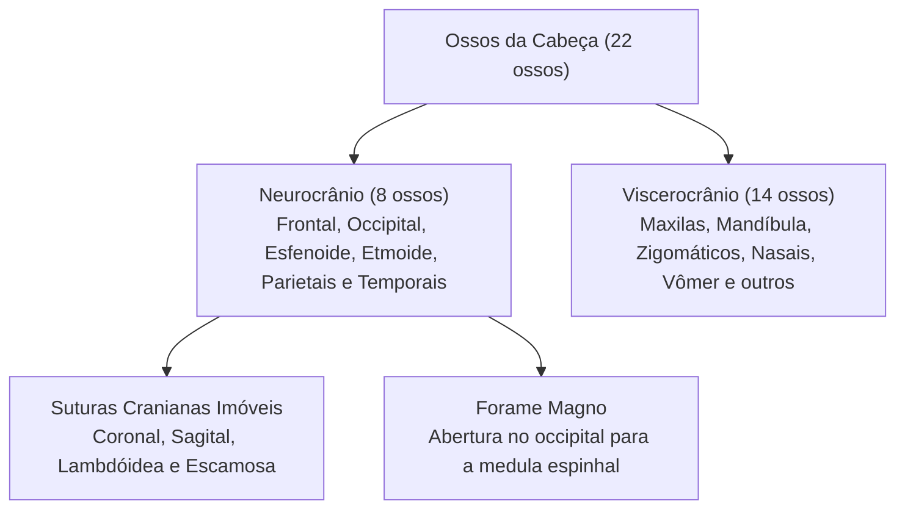
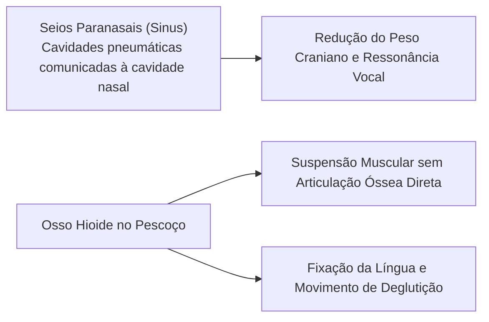
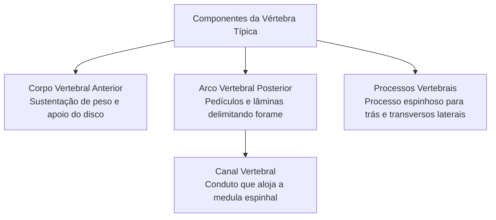
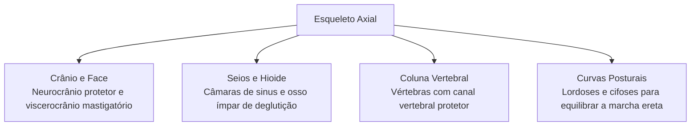

O esqueleto axial forma o eixo longitudinal central do corpo humano. Ele reúne estruturas ósseas fundamentais para a proteção de órgãos vitais do sistema nervoso central e das vísceras viscerais. Compreender a anatomia craniana e a arquitetura das vértebras é indispensável para avaliar riscos de traumas encefálicos e lesões raquimedulares em operações de socorro e emergências pré-hospitalares.

> [!objetivos]
> - Identificar os ossos constituintes do neurocrânio e do viscerocrânio.
> - Compreender a importância funcional do forame magno, seios paranasais e osso hioide.
> - Analisar a estrutura anatômica padrão de uma vértebra e dos discos intervertebrais.
> - Diferenciar as curvaturas fisiológicas normais da coluna das alterações posturais clínicas.

## O Esqueleto Axial e os Ossos da Cabeça

O esqueleto axial reúne oitenta ossos organizados na linha média corporal. Ele compreende o crânio, os ossículos auditivos, o osso hioide, a coluna vertebral e a caixa torácica. Essa porção esquelética sustenta a cabeça, o pescoço e o tronco. Ela protege o encéfalo, a medula espinhal e os órgãos torácicos. Atente para as posições relativas e nomes anatômicos de cada peça esquelética.

A cabeça óssea é constituída por vinte e dois ossos. A anatomia divide a cabeça em dois compartimentos:
- **Neurocrânio (Caixa Craniana):** reúne oito ossos que delimitam a cavidade craniana. Aloja e resguarda o encéfalo e as meninges. É formado por ossos ímpares (frontal, occipital, esfenoide e etmoide) e ossos pares (dois parietais e dois temporais).
- **Viscerocrânio (Ossos da Face):** reúne catorze ossos. Eles sustentam a cavidade nasal, as órbitas oculares e a boca. Abrange dois nasais, duas maxilas, dois zigomáticos, dois lacrimais, dois palatinos, duas conchas nasais inferiores, o vômer e a mandíbula. A **mandíbula** é o único osso móvel do crânio. Ela articula-se com o osso temporal por articulação sinovial.

Os ossos do neurocrânio unem-se por articulações fibrosas imóveis chamadas **suturas**:
- **Sutura Coronal:** une o osso frontal aos dois parietais.
- **Sutura Sagital:** une os dois parietais na linha média dorsal superior.
- **Sutura Lambdóidea:** une o occipital aos dois parietais.
- **Sutura Escamosa:** une o osso temporal ao osso parietal lateralmente.

Na base do osso occipital abre-se o **forame magno**. Esse amplo orifício dá passagem à transição entre o bulbo encefálico e a medula espinhal. Pequenos furos e forames adicionais na base do crânio conduzem vasos e nervos cranianos. Em cada orelha média alojam-se três minúsculos ossículos auditivos (martelo, bigorna e estribo), que amplificam as ondas sonoras.

## Seios Paranasais e o Osso Hioide

Quatro ossos do crânio contêm cavidades pneumáticas internas revestidas por mucosa que drenam na cavidade nasal. Essas cavidades são denominadas **seios paranasais** ou **sinus paranasais**, presentes no frontal, esfenoide, etmoide e maxilas. Esses seios reduzem o peso total da cabeça. Também aquecem o ar inspirado e atuam como câmaras de ressonância na voz. Inflamações dessa mucosa caracterizam a sinusite.

No pescoço localiza-se o **osso hioide**, com formato em U ou ferradura. Esse osso ímpar não possui articulação óssea direta com nenhuma outra peça do esqueleto. Ele permanece suspenso por ligamentos e músculos fixados à base do crânio e à cartilagem tireóidea da laringe. O hioide serve como base para os músculos da língua e assoalho bucal, atuando na deglutição e fala.

> [!bizu] Relevância Médico-Legal do Osso Hioide
> O osso hioide tem grande relevância pericial em medicina legal. Em casos de morte por asfixia mecânica violenta com constrição do pescoço, como estrangulamento ou esganadura manual, a fratura dos cornos do hioide é um achado característico. Esse sinal confirma a ocorrência de pressão física externa sobre as vias aéreas cervicais.

| Estrutura Anatômica | Posição e Relações | Função Biológica Principal |
|---|---|---|
| **Forame Magno** | Base do osso occipital | Passagem do tronco encefálico e vasos vertebrais |
| **Seios Paranasais** | Frontal, maxilas, etmoide e esfenoide | Alívio da massa óssea e ressonância vocal |
| **Osso Hioide** | Região cervical anterior | Fixação muscular para deglutição e fonação |
| **Suturas Cranianas** | Junções dos ossos da calota | Articulações fibrosas imóveis protetoras |

## A Coluna Vertebral e a Arquitetura das Vértebras

A coluna vertebral é uma haste óssea flexível que se estende do crânio à pelve. Ela reúne vinte e seis peças funcionais no adulto. A coluna sustenta a cabeça e o tronco ereto contra a gravidade. Ela amortece impactos e protege a medula espinhal em toda a extensão do tronco.

O corpo humano visto de perfil exibe curvas naturais na coluna. Essas curvas fisiológicas ajudam a equilibrar o tronco e dissipar choques mecânicos na postura ereta bípede.

A vértebra típica apresenta três componentes anatômicos essenciais:
- **Corpo Vertebral:** bloco cilíndrico anterior de osso esponjoso que suporta a carga axial.
- **Arco Vertebral:** estrutura posterior formada por dois pedículos e duas lâminas. O arco contorna o forame vertebral. A sobreposição dos forames ao longo da coluna forma o **canal vertebral**, conduto que abriga a medula espinhal e raízes nervosas.
- **Processos Vertebrais:** projeções ósseas de fixação muscular. Incluem o **processo espinhoso**, projetando-se dorsalmente para trás na linha média; dois **processos transversos** laterais; e quatro **processos articulares** que se articulam com vértebras vizinhas.

Entre os corpos vertebrais adjacentes situam-se os **discos intervertebrais**. Cada disco possui um **anel fibroso** periférico resistente e um **núcleo pulposo** gelatinoso central. O disco absorve pressões e permite movimentos entre as vértebras. A ruptura do anel com deslocamento do núcleo origina a hérnia de disco.

> [!atencao] Curvaturas Fisiológicas da Coluna e Alterações Posturais
> A coluna vertebral apresenta quatro curvas normais no plano sagital. Visto de lado, observam-se duas lordoses voltadas para trás (cervical e lombar) e duas cifoses convexas posteriormente (torácica e sacral). Essas curvaturas são vitais para equilibrar o corpo em marcha ereta. Desvios acentuados configuram patologias:
> - **Hiperlordose:** curvatura lombar anteriorizada em excesso.
> - **Hipercifose:** aumento da curvatura torácica posterior.
> - **Escoliose:** desvio lateral anormal da coluna visto por trás em linha reta.

## Mapa do capítulo

### Para fixar

- O esqueleto axial é formado por oitenta ossos distribuídos entre crânio, osso hioide, coluna e tórax.
- O neurocrânio possui oito ossos que encerram o encéfalo, unidos por suturas imóveis.
- O viscerocrânio abriga catorze ossos faciais, sendo a mandíbula o único osso com articulação móvel.
- O forame magno situa-se na base do occipital, permitindo a continuidade com a medula espinhal.
- Os seios paranasais ou sinus aliviam o peso craniano e fornecem ressonância durante a fala.
- O osso hioide não se articula diretamente com outro osso, atuando na sustentação da língua.
- A vértebra típica possui corpo anterior, arco delimitando o forame e processo espinhoso para trás.
- O canal vertebral resulta da sobreposição dos forames e aloja com segurança a medula espinhal.
- As quatro curvas fisiológicas da coluna equilibram o corpo na postura ereta bípede.
