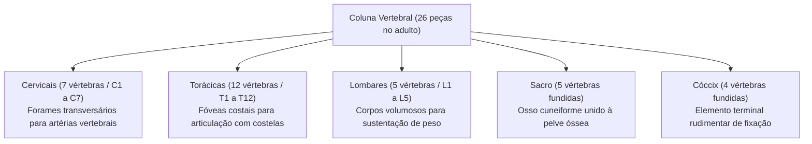
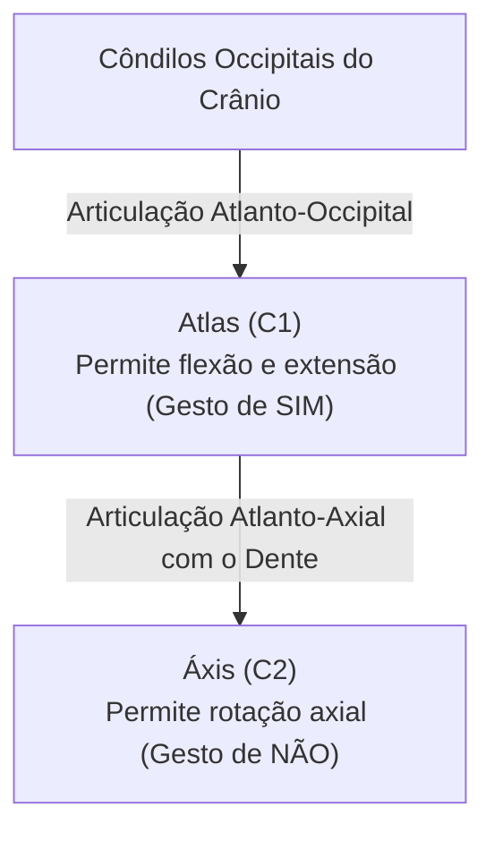
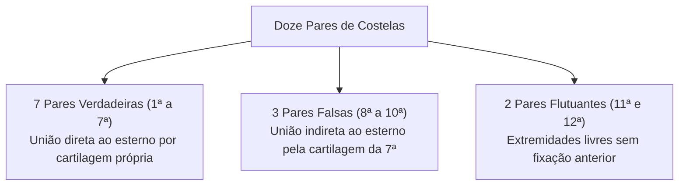
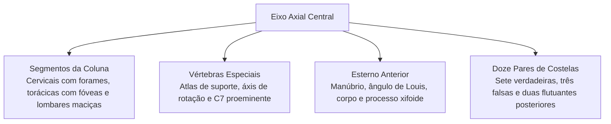

A coluna vertebral e a caixa torácica formam a estrutura central de sustentação e proteção do esqueleto axial humano. Juntas, essas estruturas abrigam a medula espinhal e resguardam os órgãos vitais do mediastino contra lesões perfurantes e contusões mecânicas em ocorrências de resgate, salvamento e colisões veiculares. Dominar essas divisões anatômicas e seus pontos de referência ósseos é decisivo para a atuação precisa em primeiros socorros e avaliação de lesões traumáticas.

> [!objetivos]
> - Reconhecer as características morfológicas e funcionais das cinco regiões da coluna.
> - Compreender as particularidades do atlas, áxis e da vértebra proeminente.
> - Identificar as partes anatômicas do esterno e sua importância clínica no tórax.
> - Diferenciar a classificação das costelas em verdadeiras, falsas e flutuantes.

## As Regiões da Coluna Vertebral

A coluna vertebral do ser humano adulto é organizada em cinco segmentos craniocaudais distintos. Cada segmento reúne vértebras com características adaptadas às exigências mecânicas daquela altura do tronco:

- **Vértebras Cervicais (C1 a C7):** compõem o esqueleto do pescoço. São vértebras menores e leves que conferem grande amplitude de movimento à cabeça. Apresentam um traço diagnóstico exclusivo: os **forames transversários** em seus processos transversos. Por essas aberturas transitam as artérias e veias vertebrais que sobem em direção à cavidade craniana para vascularizar o encéfalo. Seus processos espinhosos costumam ser bífidos de C2 a C6.
- **Vértebras Torácicas (T1 a T12):** articulam-se com os doze pares de costelas. Apresentam corpos em formato de coração e pequenas facetas lisas denominadas **fóveas costais** no corpo vertebral e nos processos transversos. Seus processos espinhosos são afilados e muito inclinados para baixo, sobrepondo-se à vértebra subjacente para limitar a hiperextensão do tórax.
- **Vértebras Lombares (L1 a L5):** sustentam o peso da maior parte do corpo superior. Seus corpos são grandes, pesados e reniformes. Não possuem forames transversários nem fóveas costais. Os processos espinhosos são curtos, espessos e horizontais em formato de lâmina, adaptados para ancoragem de fortes músculos dorsais eretores da espinha.
- **Sacro:** osso triangular formado pela fusão biológica de cinco vértebras sacrais durante a juventude. Situa-se entre os ossos do quadril, transmitindo as forças axiais do tronco para a cintura pélvica e membros inferiores através das articulações sacroilíacas. Apresenta o promontório sacral na margem anterior superior e forames sacrais para ramos nervosos.
- **Cóccix:** pequeno osso terminal triangular formado pela fusão de cerca de quatro vértebras rudimentares. Embora não suporte carga direta em pé, fornece fixação a ligamentos pélvicos e ao músculo levantador do ânus.

## Vértebras Especiais: Atlas, Áxis e Proeminente

Na região cervical superior destacam-se três vértebras com especializações anatômicas singulares que desempenham papéis críticos na mobilidade da cabeça:

- **Atlas (C1):** a primeira vértebra cervical sustenta diretamente o crânio. É desprovida de corpo vertebral verdadeiro e não possui processo espinhoso. É formada por dois arcos ósseos (anterior e posterior) unidos por duas massas laterais volumosas. Suas fóveas articulares superiores côncavas articulam-se com os côndilos do osso occipital. Essa articulação atlanto-occipital permite os movimentos de flexão e extensão da cabeça, gesto gestual afirmativo de "sim".
- **Áxis (C2):** a segunda vértebra cervical caracteriza-se pela presença de uma projeção cilíndrica vertical que sobe a partir de seu corpo, o **dente do áxis** (ou processo odontoide). O dente encaixa-se na face posterior do arco anterior do atlas, mantido firme pelo ligamento transverso do atlas. Essa articulação pivô permite a rotação lateral da cabeça sobre o pescoço, gesto negativo de "não".
- **Vértebra Proeminente (C7):** a sétima vértebra cervical possui um processo espinhoso especialmente longo, horizontal e não bífido. Ele forma uma elevação bem visível e palpável na transição entre o pescoço e o dorso superior, sendo o principal marco de contagem óssea no exame clínico.

> [!atencao] Trauma Raquimedular e Fratura do Dente do Áxis
> Em acidentes automobilísticos de alta velocidade ou mergulhos em águas rasas, a hiperextensão ou desaceleração súbita da cabeça (efeito chicote cervical) pode fraturar o dente do áxis ou romper o ligamento transverso do atlas. Esse deslocamento projeta a estrutura óssea contra o bulbo e a porção superior da medula espinhal, provocando parada respiratória instantânea ou tetraplegia traumática. No atendimento pré-hospitalar a vítimas de politrauma, a estabilização cervical imediata com colar rígido é obrigatória.

| Vértebra | Posição | Peculiaridade Anatômica | Movimento ou Função Principal |
|---|---|---|---|
| **Atlas (C1)** | Cervical superior | Ausência de corpo e processo espinhoso | Suporte do crânio e flexão da cabeça ("sim") |
| **Áxis (C2)** | Cervical superior | Presença do dente (processo odontoide) | Eixo de rotação horizontal da cabeça ("não") |
| **C7** | Cervical inferior | Processo espinhoso longo e não bífido | Marco anatômico palpável na base do pescoço |
| **Lombares (L1-L5)**| Região lombar | Corpos reniformes maciços e volumosos | Suporte de carga corporal e absorção de força |

## A Caixa Torácica, Esterno e Costelas

A caixa torácica é um compartimento ósseo elástico formado anteriormente pelo osso esterno, posterolateralmente por doze pares de costelas articuladas com doze vértebras torácicas, e inferiormente pelo músculo diafragma. Ela resguarda o coração, os grandes vasos da base e os pulmões, além de participar dos movimentos de fole durante a respiração pulmonar.

O **esterno** é um osso plano vertical localizado na parede anterior do peito. Ele é dividido em três porções sobrepostas:
- **Manúbrio:** porção superior larga e triangular que apresenta a incisura jugular no bordo superior e incisuras claviculares laterais para articulação com as clavículas.
- **Corpo do Esterno:** lâmina média longa e plana que se articula com as cartilagens das costelas de número dois a sete. A junção entre o manúbrio e o corpo forma o **ângulo esternal** (ângulo de Louis), crista transversa palpável que indica com precisão o nível da segunda costela.
- **Processo Xifoide:** extremidade inferior pequena e afilada, cartilaginosa na infância e ossificada no adulto, ponto de fixação muscular do abdome.

Os doze pares de **costelas** conectam-se posteriormente aos corpos e processos transversos das vértebras torácicas. De acordo com o modo como se conectam ao esterno pela sua extremidade anterior, são agrupadas em três categorias:
- **Costelas Verdadeiras (1ª a 7ª costela):** unem-se diretamente ao esterno através de suas próprias barras de cartilagem hialina (cartilagens costais).
- **Costelas Falsas Propriamente Ditas (8ª a 10ª costela):** suas cartilagens costais fundem-se à cartilagem da sétima costela, alcançando o esterno de forma indireta para constituir a margem costal inferior.
- **Costelas Flutuantes (11ª e 12ª costela):** não possuem cartilagem anterior ligada ao esterno. Suas pontas afiladas terminam livres na parede muscular do abdome. Elas conferem proteção mecânica direta aos rins na região lombar posterior.

> [!bizu] Reanimação Cardiopulmonar e o Processo Xifoide
> Na realização de manobras de reanimação cardiopulmonar (RCP), a correta localização das mãos sobre o terço inferior do corpo do esterno é vital. Deve-se evitar a compressão direta sobre a ponta do processo xifoide, pois a força vigorosa pode fraturar essa estrutura óssea cartilaginosa, causando laceração traumática do lobo esquerdo do fígado, hemorragia peritoneal grave ou perfuração do diafragma.

> [!esquema] Dinâmica Respiratória da Caixa Torácica
> Durante a inspiração, os músculos intercostais externos contraem-se e elevam as costelas como a alça de um balde, aumentando o diâmetro transversal e anteroposterior da caixa torácica. A queda de pressão intratorácica expande os pulmões e promove a entrada de ar atmosférico.

## Mapa do capítulo

### Para fixar

- A coluna vertebral divide-se em sete cervicais, doze torácicas, cinco lombares, sacro e cóccix.
- As vértebras cervicais apresentam forames transversários exclusivos por onde ascendem as artérias vertebrais.
- As vértebras torácicas possuem fóveas costais que se articulam com a cabeça e o tubérculo das costelas.
- As vértebras lombares possuem corpos volumosos reniformes para absorção de fortes cargas axiais corporais.
- O atlas (C1) suporta o occipital e permite o movimento de "sim", enquanto o áxis (C2) com seu dente permite o "não".
- A vértebra C7 possui processo espinhoso longo e horizontal, servindo como marco anatômico na palpação dorsal.
- O esterno compreende o manúbrio superior, o ângulo esternal palpável, o corpo esternal e o processo xifoide inferior.
- As costelas classificam-se em sete pares verdadeiras, três pares falsas unidas indiretamente e dois pares flutuantes livres.
