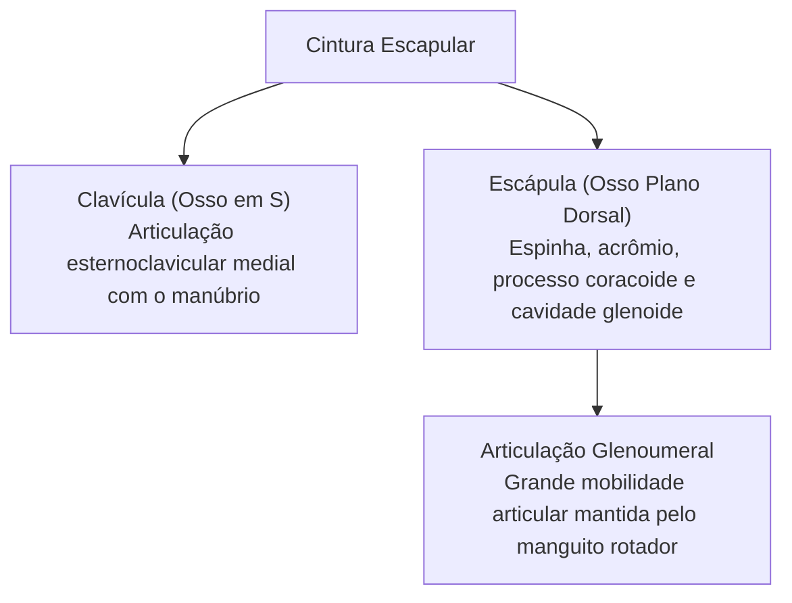
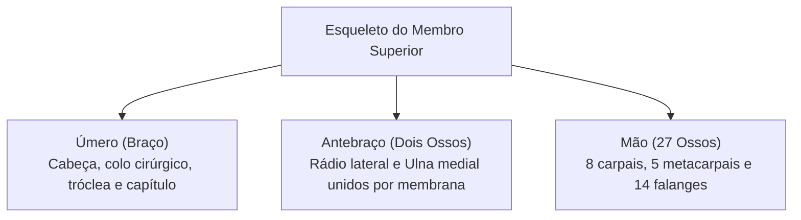
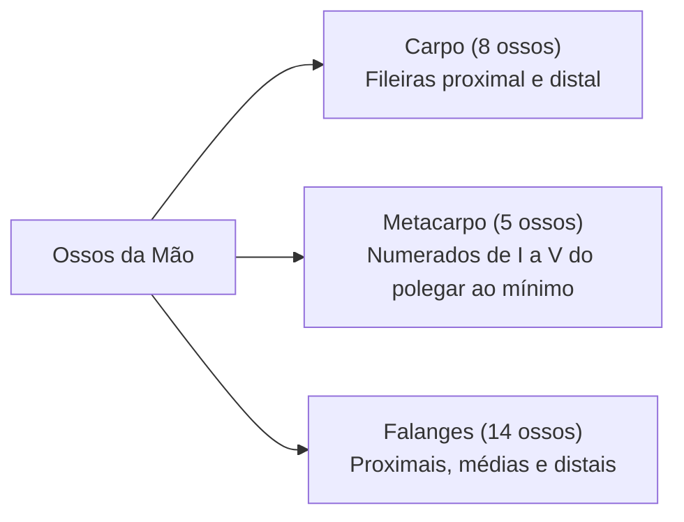
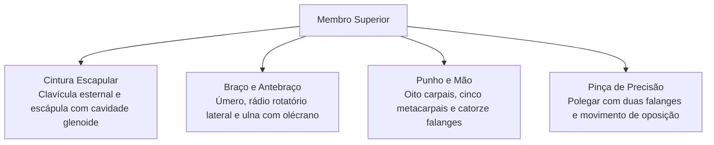

O esqueleto apendicular compreende os ossos dos membros superiores e inferiores, juntamente com as cinturas esqueléticas que os ancoram ao eixo axial central. Nos membros superiores, a disposição óssea privilegia a amplitude de movimento e a destreza manual, fatores essenciais para a manipulação de ferramentas e equipamentos em atividades operacionais de salvamento.

> [!objetivos]
> - Compreender a organização da cintura escapular e sua fixação esternal.
> - Identificar os acidentes anatômicos do úmero, rádio e ulna.
> - Caracterizar os movimentos de pronação e supinação do antebraço.
> - Reconhecer os grupos ósseos do carpo, metacarpo e falanges digitais.

## A Cintura Escapular e a Mobilidade do Ombro

A cintura escapular une o membro superior ao tórax. É formada por dois pares de ossos: duas **clavículas** e duas **escápulas**.

A **clavícula** é um osso em forma de "S" situado horizontalmente na base cervical. Atua como escora rígida que projeta o ombro para fora do tórax. Sua extremidade medial articula-se com o manúbrio na **articulação esternoclavicular**, único ponto sinovial direto entre a cintura escapular e o esqueleto axial. Sua ponta lateral une-se ao acrômio da escápula.

A **escápula** é um osso plano triangular dorsal. Na face posterior destaca-se a **espinha da escápula**, que se expande lateralmente no **acrômio**, ponto superior palpável do ombro. No ângulo superolateral situa-se a **cavidade glenoide**, rasa depressão que recebe a cabeça esférica do úmero. Próximo a ela projeta-se o **processo coracoide** para fixação ligamentar e muscular.

> [!bizu] Compromisso Biomecânico: Mobilidade versus Estabilidade
> A articulação glenoumeral do ombro é a mais móvel do corpo humano. Contudo, essa extrema amplitude reduz sua estabilidade mecânica, pois a cavidade glenoide acomoda apenas um terço da cabeça do úmero. Por isso, luxações do ombro são frequentes em traumas, sendo contidas pela ação dinâmica dos músculos do manguito rotador.

## Braço e Antebraço: Úmero, Rádio e Ulna

O esqueleto do braço é formado pelo **úmero**, osso longo que se articula com a escápula e com os ossos do cotovelo. Proximalmente possui a cabeça hemisférica, o colo anatômico e o **colo cirúrgico**, estreitamento propício a fraturas traumáticas. Apresenta o tubérculo maior e o tubérculo menor, separados pelo sulco intertubercular. Na diáfise encontra-se a tuberosidade deltóidea. Distalmente alarga-se nos epicôndilos medial e lateral, no capítulo lateral (articulado com a cabeça do rádio) e na tróclea medial (articulada com a ulna).

O antebraço abriga dois ossos paralelos unidos pela **membrana interóssea**:
- **Ulna:** osso medial do antebraço (lado do dedo mínimo). Proximalmente destaca-se o **olécrano**, proeminência posterior que forma a ponta do cotovelo ao encaixar na fossa umeral. Possui a incisura troclear e o processo coronoide, terminando distalmente na cabeça da ulna com processo estiloide.
- **Rádio:** osso lateral do antebraço (lado do polegar). Possui cabeça proximal cilíndrica em disco que gira contra o capítulo umeral e a ulna. Na **supinação**, rádio e ulna repousam paralelos com a palma para a frente. Na **pronação**, o rádio cruza sobre a ulna, girando a palma para trás.

## Esqueleto da Mão: Carpo, Metacarpo e Falanges

A mão humana contém vinte e sete ossos agrupados em três divisões:

- **Carpo (Punho):** oito ossos curtos em duas fileiras transversais:
  - Fileira Proximal: **Escafoide**, **Semilunar**, **Piramidal** e **Pisiforme** (sesamoide anterior sobre o piramidal). O escafoide e o semilunar articulam-se com o rádio no punho.
  - Fileira Distal: **Trapézio**, **Trapezoide**, **Capitato** (o maior carpal) e **Hamato** (com hâmulo saliente).
- **Metacarpo (Palma):** cinco ossos metacarpais numerados de I a V do polegar ao mínimo. Suas cabeças distais formam os nós dos dedos ao fechar o punho.
- **Falanges (Dedos):** catorze falanges no total. Os dedos de II a V contêm três falanges cada (proximal, média e distal). O **polegar (dedo I)** possui apenas duas falanges (proximal e distal), viabilizando o movimento de oponência para preensão de pinça.

> [!atencao] Fratura do Escafoide e Risco de Necrose
> O osso escafoide é o carpal mais comumente fraturado em quedas com apoio da mão estendida. Como seu suprimento sanguíneo arterial penetra pelo polo distal em fluxo retrógrado, fraturas na porção média podem interromper a nutrição do polo proximal, originando necrose avascular e sequelas funcionais graves.

| Segmento | Ossos Constituintes | Detalhes Funcionais |
|---|---|---|
| **Cintura Escapular** | Clavícula e Escápula | Ancoragem do membro superior ao manúbrio |
| **Braço** | Úmero | Articulações do ombro e cotovelo |
| **Antebraço** | Rádio e Ulna | Pronação e supinação com membrana interóssea |
| **Carpo** | 8 ossos em duas fileiras | Mobilidade multidirecional do punho |
| **Metacarpo e Falanges**| 5 metacarpais e 14 falanges | Preensão palmar e pinça de precisão digital |

## Mapa do capítulo

### Para fixar

- A clavícula forma no manúbrio o único contato sinovial direto entre cintura escapular e esqueleto axial.
- A escápula apresenta a cavidade glenoide rasa que recebe a cabeça do úmero na articulação do ombro.
- O colo cirúrgico do úmero situa-se abaixo dos tubérculos e representa frequente ponto de fraturas.
- O olécrano da ulna forma a proeminência dorsal do cotovelo e bloqueia a hiperextensão articular.
- O rádio localiza-se lateralmente no antebraço e cruza diagonalmente a ulna no movimento de pronação.
- O carpo compreende oito ossos em duas fileiras, articulando escafoide e semilunar com a base radial.
- A fratura do escafoide por queda espalmada apresenta alto risco de necrose avascular retrógrada.
- O polegar possui apenas duas falanges, enquanto os outros quatro dígitos possuem três falanges cada.
