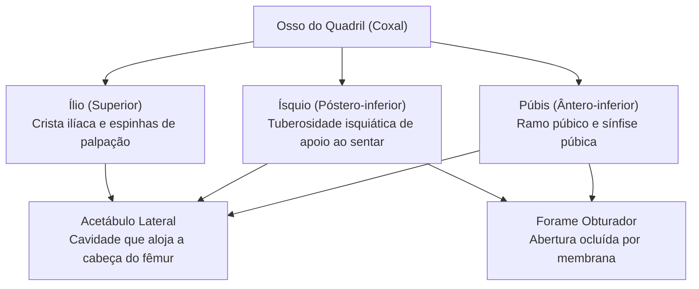
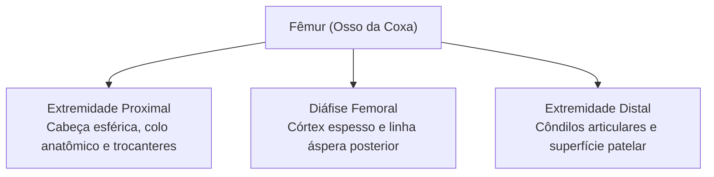
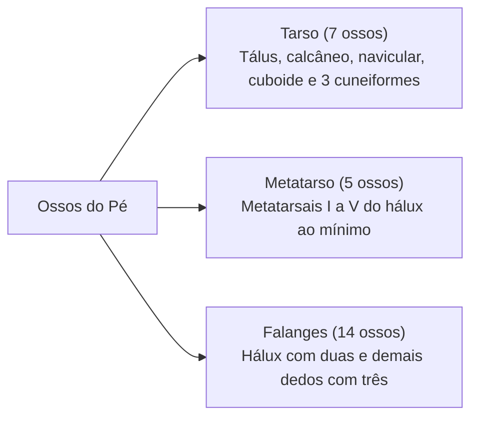
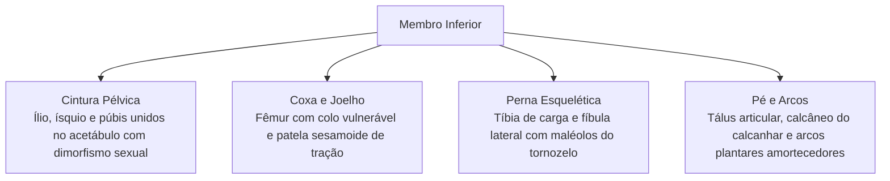

O esqueleto apendicular inferior compreende a cintura pélvica e os membros inferiores. Diferente do membro superior, voltado à mobilidade, o membro inferior prioriza a sustentação do peso corporal. Sua estrutura assegura estabilidade estática e propulsão mecânica na marcha e corrida durante atividades operacionais. O conhecimento minucioso desses ossos e articulações é essencial para reconhecer lesões traumáticas, entorses e fraturas em vítimas de acidentes e ocorrências de salvamento.

> [!objetivos]
> - Analisar a anatomia dos ossos do quadril e as diferenças sexuais na pelve.
> - Compreender a biomecânica da articulação coxofemoral e do fêmur.
> - Diferenciar as funções mecânicas da tíbia e da fíbula na perna.
> - Caracterizar a distribuição óssea do tarso, metatarso e arcos plantares.

## A Cintura Pélvica e o Dimorfismo Sexual

A cintura pélvica fixa os membros inferiores ao esqueleto axial. Ela transfere o peso do tronco para o solo. Também protege a bexiga urinária, órgãos reprodutores e o reto. A bacia é formada por dois **ossos do quadril** unidos anteriormente pela **sínfise púbica**. Posteriormente, unem-se ao sacro pelas articulações sacroilíacas.

Cada osso do quadril resulta da fusão de três ossos embrionários:
- **Ílio:** componente superior em forma de leque. Sua borda forma a **crista ilíaca**. Termina anteriormente na espinha ilíaca ântero-superior.
- **Ísquio:** porção póstero-inferior espessa. Apresenta a **tuberosidade isquiática**, estrutura de apoio ao sentar.
- **Púbis:** porção ântero-inferior que se articula na linha média na sínfise púbica.

Esses três ossos convergem lateralmente no **acetábulo**. Essa cavidade profunda recebe a cabeça esférica do fêmur. Entre o ísquio e o púbis abre-se o **forame obturador**, coberto quase totalmente por membrana fibrosa.

A pelve divide-se em pelve maior (falsa) e pelve menor (verdadeira). A pelve maior situa-se acima da linha terminal entre as fossas ilíacas. Ela acomoda alças do intestino delgado e cólon sigmoide. A pelve menor fica abaixo dessa linha terminal. Ela abriga a cavidade pélvica com a bexiga urinária e o reto. O estreito superior da pelve delimita a passagem fetal durante o parto.

> [!esquema] Dimorfismo Sexual da Pelve Óssea
> A pelve feminina é adaptada para a gestação e o parto:
> - **Pelve Feminina:** ossos delgados e leves. Bacia menor rasa e ampla, com abertura superior oval. O arco púbico exibe ângulo superior a noventa graus.
> - **Pelve Masculina:** ossos mais pesados com cristas salientes. Bacia afunilada com abertura em formato de coração. O arco púbico exibe ângulo inferior a noventa graus.

## O Fêmur e a Articulação do Joelho

O esqueleto da coxa é formado pelo **fêmur**. Ele é o osso mais longo, pesado e resistente do corpo humano. Proximalmente destaca-se a **cabeça do fêmur**, esfera lisa que se encaixa no acetábulo. A cabeça conecta-se à diáfise pelo **colo anatômico**, eixo oblíquo que afasta o membro do quadril.

O ângulo entre o colo e o corpo femoral gira em torno de cento e vinte e seis graus. Esse alinhamento garante suporte bípede eficaz. Entre o colo e o corpo projetam-se duas elevações musculares: o **trocanter maior** lateral e o **trocanter menor** medial. A diáfise femoral é cilíndrica e convexa para a frente. Apresenta a linha áspera posterior para fixação muscular adutora. Distalmente o osso expande-se nos côndilos medial e lateral. Eles articulam-se com a tíbia e são separados pela tróclea patelar anterior e fossa intercondilar.

> [!atencao] Fraturas do Colo do Fêmur em Idosos
> O colo femoral suporta grandes forças de compressão axial. Em idosos com osteoporose, pequenas quedas provocam fraturas no colo anatômico. Essa lesão lesiona artérias retinaculares locais. Sem fluxo sanguíneo adequado, a cabeça femoral sofre necrose avascular, exigindo intervenção cirúrgica com prótese.

> [!bizu] A Patela e a Alavanca do Quadríceps
> A **patela** é o maior osso sesamoide do corpo humano. Ela localiza-se no tendão do músculo quadríceps femoral no joelho. Sua presença afasta o tendão do centro da articulação. Isso amplia o braço de alavanca mecânica durante a extensão da perna, poupando esforço muscular e reduzindo o atrito nos côndilos.

## Perna e Pé: Tíbia, Fíbula, Tarso e Dedos

O esqueleto da perna compreende dois ossos paralelos interligados por membrana interóssea:
- **Tíbia:** osso medial robusto da perna. Suporta todo o peso transmitido pelo fêmur. Seus côndilos superiores articulam-se com os meniscos do joelho. Na diáfise exibe a tuberosidade anterior e a crista tibial subcutânea. Distalmente projeta o **maléolo medial**, saliência interna do tornozelo.
- **Fíbula:** osso lateral delgado. Não suporta carga axial direta do corpo. Serve para fixação de tendões musculares e forma o **maléolo lateral**, estabilizando o tornozelo externamente.

No tornozelo, o maléolo medial da tíbia e o maléolo lateral da fíbula formam a pinça maleolar. Esse encaixe abraça a tróclea do tálus. Essa articulação viabiliza a flexão dorsal e plantar do pé. Entorses com torção forçada geram fraturas bimaleolares frequentes.

O pé reúne vinte e seis ossos organizados para a marcha:
- **Tarso (Retropé e Médio-pé):** compreende sete ossos:
  - **Tálus:** osso superior que recebe o peso da tíbia e distribui forças para o calcanhar e dedos.
  - **Calcâneo:** maior osso do tarso, forma o calcanhar e ancora o tendão de Aquiles.
  - **Navicular, Cuboide e três Cuneiformes** (medial, intermediário e lateral).
- **Metatarso:** cinco ossos metatarsais numerados de I a V a partir do hálux.
- **Falanges:** catorze falanges. O **hálux** possui apenas duas falanges (proximal e distal). Os outros quatro dígitos contêm três falanges cada.
- **Arcos Plantares:** os ossos do pé formam arcos longitudinais e transversos sustentados por ligamentos. Esses arcos flexionam a cada passo, amortecendo choques mecânicos e devolvendo energia elástica na passada.

| Segmento | Componentes Ósseos | Características Biomecânicas |
|---|---|---|
| **Cintura Pélvica**| Ílio, ísquio e púbis fundidos | Formação do acetábulo e transmissão de carga |
| **Coxa** | Fêmur | Maior osso do corpo com cabeça esférica e trocanteres |
| **Joelho** | Patela sesamoide | Ampliação do braço de alavanca do quadríceps |
| **Perna** | Tíbia medial e fíbula lateral | Tíbia suporta peso corporal; fíbula ancora músculos |
| **Pé** | Tarso (7), metatarso (5) e falanges (14) | Amortecimento elástico em arcos plantares e propulsão |

## Mapa do capítulo

### Para fixar

- O osso do quadril resulta da união anatômica de ílio, ísquio e púbis no acetábulo articular.
- A pelve feminina apresenta abertura ampla e arco subpúbico superior a noventa graus para o parto.
- O fêmur é o osso mais longo do corpo, articulando sua cabeça esférica com o acetábulo pélvico.
- O colo do fêmur é vulnerável a fraturas em idosos com risco de necrose avascular.
- A patela atua como osso sesamoide que amplifica o braço de alavanca do músculo quadríceps no joelho.
- A tíbia suporta diretamente o peso corporal, enquanto a fíbula estabiliza o tornozelo lateralmente.
- Os maléolos medial tibial e lateral fibular formam as proeminências articulares do tornozelo.
- O tálus transmite a carga gravitacional ao calcâneo e aos arcos plantares elásticos do pé.
