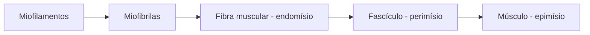

O músculo transforma energia química em trabalho mecânico. Esta frase resume o capítulo: veremos quais são os três tipos de tecido muscular, como o músculo esquelético é organizado em camadas, qual é a unidade de contração, o sarcômero, e como um estímulo nervoso vira movimento. Também veremos de onde vem a energia para contrair, por que o músculo cansa e como as fibras se dividem em lentas e rápidas. Na prova, é um assunto de alta cobrança em fisiologia: as questões pedem proteínas, íons e etapas da contração com os nomes exatos.

> [!objetivos]
> - Diferenciar os músculos estriado esquelético, estriado cardíaco e liso.
> - Descrever a organização do músculo e o sarcômero.
> - Explicar a sequência da contração e o papel do cálcio, do ATP e da acetilcolina.
> - Relacionar fontes de energia, fadiga e tipos de fibra.

## Funções e tipos de músculo

O sistema muscular representa de 40% a 50% da massa corporal, o que o torna o maior tecido do corpo. Suas funções são movimentar o corpo e as substâncias dentro dele, **produzir calor** e proteger aberturas do corpo, como as do sistema digestório e urinário. Os músculos também funcionam como reserva de proteínas: na falta de alimento, o organismo degrada proteínas musculares, e o fígado usa os aminoácidos para produzir glicose.

| Característica | Estriado esquelético | Estriado cardíaco | Liso |
| --- | --- | --- | --- |
| Células | Longas, cilíndricas e multinucleadas | Menores, com um ou dois núcleos e aspecto ramificado | Fusiformes, com um núcleo |
| Estrias | Sim | Sim | Não |
| Controle | Voluntário, por nervos somáticos | Involuntário | Involuntário, pelo sistema autônomo |
| Localização | Ligado aos ossos | Coração | Órgãos internos e vasos |
| Contração | Rápida e forte | Resistente à fadiga | Lenta e sustentada |

O **músculo cardíaco** tem discos intercalares, onde junções comunicantes e desmossomos ligam as células, e por isso o coração responde como uma única unidade, o **sincício funcional**. Células marcapasso determinam o ritmo e dão ao coração certa independência do controle neural. O **músculo liso** não tem miofibrilas nem sarcômeros: os filamentos de actina se prendem a corpos densos, e a miosina fica dispersa no citoplasma. Ele regula o fluxo sanguíneo, o calibre das vias aéreas, a movimentação do alimento e da urina e o parto.

A função do músculo liso muda conforme o sistema onde ele está.

| Sistema | O que o músculo liso faz |
| --- | --- |
| Reprodutivo | Expulsa o feto no parto e conduz o ovócito e os espermatozoides |
| Urinário | Leva a urina até a bexiga e para fora e ajusta a filtração nos rins |
| Tegumentar | Regula o fluxo de sangue na derme e eriça os pelos |
| Cardiovascular | Controla a pressão e o fluxo do sangue nos vasos |
| Respiratório | Altera o diâmetro das passagens de ar |
| Digestório | Move o bolo alimentar e esvazia a bile |

O músculo liso também responde a hormônios, assim como o cardíaco, e sua contração é lenta e pode ser mantida por muito tempo com pouco gasto de energia.

> [!pegadinha]
> Dizer que todo músculo estriado é voluntário. O músculo cardíaco é estriado e **involuntário**. O diafragma é um caso especial, porque é esquelético mas pode ser acionado de modo voluntário e involuntário.

## Organização do músculo esquelético

A fibra muscular, que é a célula, é envolvida por tecido conjuntivo frouxo chamado **endomísio**. Entre as fibras há células-satélite, ou miosatélites, com características de células-tronco e capacidade de regenerar a fibra. Grupos de fibras formam **fascículos**, envolvidos pelo **perimísio**. O músculo inteiro, reunião de fascículos, é revestido pelo **epimísio**. Os três envoltórios se juntam nas extremidades e formam os **tendões**. A sequência de organização vai do menor ao maior:



As células musculares têm muita **actina** (filamentos finos) e **miosina** (filamentos grossos), que interagem na presença de cálcio e consomem ATP. Os filamentos formam as miofibrilas, que existem aos milhares em cada fibra.

### Como os músculos são nomeados

Os nomes costumam indicar uma característica do músculo, o que ajuda a memorizá-lo.

| Critério | Exemplos |
| --- | --- |
| Forma | Deltoide (triangular), romboide, trapézio |
| Tamanho | Longo, maior, menor, grande dorsal (latissimus) |
| Número de cabeças | Bíceps, tríceps, quadríceps, digástrico |
| Profundidade | Superficial, profundo |
| Ligação | Esternocleidomastóideo, coracobraquial |
| Posição | Anterior, posterior, medial, lateral |
| Ação | Flexor, extensor, abdutor, adutor, pronador, supinador |

## Sarcômero: a unidade de contração

O citoplasma da fibra, o **sarcoplasma**, é repleto de proteínas contráteis, e a membrana plasmática é o **sarcolema**. O sarcolema forma invaginações para o interior da fibra, os **túbulos T** (transversos), que levam o sinal elétrico para dentro da célula.

O padrão de organização repetido ao longo da miofibrila é o **sarcômero**, a menor unidade funcional da contração. Ele fica entre duas **linhas Z**. A **banda I** é a região mais clara e contém só actina. A **banda A** é mais escura e contém miosina, além de parte da actina. A repetição regular dessas bandas dá a aparência estriada. A miosina responde por cerca de 60% das proteínas da fibra, e a actina, por cerca de 20%.

```svg Sarcômero relaxado e contraído
<svg viewBox="0 0 640 220" xmlns="http://www.w3.org/2000/svg">
  <text x="10" y="20" font-family="Public Sans, Arial, sans-serif" font-size="14" fill="#0e1b2e">Relaxado</text>
  <line x1="60" y1="30" x2="60" y2="90" stroke="#0e1b2e" stroke-width="3"/>
  <line x1="580" y1="30" x2="580" y2="90" stroke="#0e1b2e" stroke-width="3"/>
  <line x1="60" y1="45" x2="300" y2="45" stroke="#2563eb" stroke-width="4"/>
  <line x1="580" y1="45" x2="340" y2="45" stroke="#2563eb" stroke-width="4"/>
  <line x1="180" y1="75" x2="460" y2="75" stroke="#d4301f" stroke-width="8"/>
  <text x="250" y="105" font-family="Public Sans, Arial, sans-serif" font-size="13" fill="#0e1b2e">banda A (miosina)</text>
  <text x="62" y="105" font-family="Public Sans, Arial, sans-serif" font-size="13" fill="#2563eb">banda I</text>
  <text x="10" y="140" font-family="Public Sans, Arial, sans-serif" font-size="14" fill="#0e1b2e">Contraído</text>
  <line x1="160" y1="150" x2="160" y2="210" stroke="#0e1b2e" stroke-width="3"/>
  <line x1="480" y1="150" x2="480" y2="210" stroke="#0e1b2e" stroke-width="3"/>
  <line x1="160" y1="165" x2="320" y2="165" stroke="#2563eb" stroke-width="4"/>
  <line x1="480" y1="165" x2="320" y2="165" stroke="#2563eb" stroke-width="4"/>
  <line x1="190" y1="195" x2="450" y2="195" stroke="#d4301f" stroke-width="8"/>
</svg>
```

Os nervos e os vasos chegam ao músculo pela superfície e se ramificam por dentro. O nervo penetra num ponto central, o **ponto motor**.

## Contração muscular

A contração segue a **teoria dos filamentos deslizantes**. A sequência dos eventos é:

1. O impulso chega à **placa motora**, onde o nervo encontra a fibra, e libera **acetilcolina** na fenda sináptica.
2. A acetilcolina se liga a receptores do sarcolema e causa **despolarização**, pela entrada de sódio. A enzima **acetilcolinesterase** remove a acetilcolina restante, para que o estímulo seja pontual.
3. O sinal percorre o sarcolema e desce pelos **túbulos T**.
4. O **retículo sarcoplasmático**, um retículo endoplasmático liso, libera **cálcio** no sarcoplasma.
5. O cálcio se liga à **troponina**, que faz parte do complexo troponina-tropomiosina e "tranca" o sítio ativo da actina. O sítio é liberado.
6. As cabeças de **miosina** se prendem à actina e a tracionam, e o sarcômero encurta. O ATP é gasto nesse ciclo.
7. Quando o estímulo cessa, bombas de **cálcio-ATPase** devolvem o cálcio ao retículo, e a fibra **relaxa**.

> [!bizu]
> Guarde a frase: o músculo **puxa, mas não empurra**. Ele só gera tensão ao encurtar, e por isso os músculos trabalham em pares opostos. Outra pista: o ATP é necessário para a contração e para o **relaxamento**, porque desfaz a ligação entre miosina e actina e alimenta as bombas de cálcio.

Quanto mais frequentes os impulsos, maior a força. Uma das extremidades do músculo se prende a um osso que serve de ponto fixo, a **origem**, e a outra, a **inserção**, prende-se ao osso que se move. Se nenhum osso se move, há tensão sem encurtamento, e a contração é **isométrica**.

> [!atencao] Músculo liso
> No músculo liso, o cálcio também dispara a contração, mas ele se liga à **calmodulina**, e não à troponina. A calmodulina ativa a quinase da cadeia leve da miosina, que permite a ligação entre miosina e actina.

### Tipos de contração

Quando o músculo se encurta enquanto vence uma carga, a contração é **concêntrica**, como a do bíceps ao subir um copo até a boca. Quando ele se alonga enquanto freia o movimento, a contração é **excêntrica**, como a do mesmo bíceps ao descer o copo devagar. Na contração **isométrica**, o músculo gera tensão sem mudar de comprimento, como ao empurrar uma parede. Em todas elas, os sarcômeros gastam ATP.

> [!exemplo] Do estímulo ao movimento
> Ao decidir flexionar o cotovelo, o córtex motor envia impulsos que descem pela medula e chegam ao nervo que inerva o bíceps. Na placa motora, a acetilcolina é liberada, o sarcolema se despolariza, o cálcio sai do retículo sarcoplasmático e os sarcômeros do bíceps encurtam. Como o bíceps se insere no rádio, o antebraço sobe. Ao mesmo tempo, o tríceps se alonga um pouco e controla a velocidade.

## Energia, fadiga e tipos de fibra

O ATP não é armazenado em grande quantidade. A **creatina fosfato** o regenera em poucos segundos: doa um fosfato ao ADP e se transforma em creatina e depois em creatinina, excretada pela urina. Em seguida, o músculo degrada o **glicogênio** em glicose. A glicólise ocorre no citoplasma sem oxigênio e produz piruvato. Com oxigênio, o piruvato vira acetil-CoA, entra no ciclo de Krebs e na fosforilação oxidativa e gera muito ATP. Sem oxigênio suficiente, o piruvato vira **ácido lático**, que acidifica a célula e causa **fadiga**. O lactato vai ao fígado, vira glicose e volta ao músculo no **ciclo de Cori**. O músculo cardíaco depende quase só do metabolismo aeróbio, com muitas mitocôndrias, glicogênio e mioglobina.

| Fibra | Contração | Metabolismo | Aparência |
| --- | --- | --- | --- |
| Tipo I | Lenta e duradoura, como na postura | Aeróbio, com muita mioglobina | Vermelha |
| Tipo IIA | Rápida, resistente | Misto | Intermediária |
| Tipo IIB | Rápida e potente, que cansa depressa | Anaeróbio | Branca |

A **mioglobina** é uma proteína parecida com a hemoglobina e guarda oxigênio na fibra. O estímulo contínuo e intenso faz o músculo ganhar mitocôndrias, enzimas e proteínas das miofibrilas, o que aumenta seu tamanho sem aumentar o número de células, a **hipertrofia**. Sem estímulo, ocorre **atrofia**.

> [!pegadinha]
> Afirmar que a hipertrofia se deve à multiplicação das células musculares. Ela decorre do aumento das proteínas e das miofibrilas dentro das fibras já existentes. Outra confusão é achar que o ácido lático "queima" músculo no dia seguinte: ele se acumula durante o esforço e é reaproveitado depois.

### Estruturas que transmitem a força

A força do músculo chega ao osso por **tendões**, feitos de tecido conjuntivo denso, com muito colágeno, **aponeuroses**, lâminas de tecido conjuntivo que ligam músculos a ossos e separam órgãos vizinhos, e **fáscias**.

## Como a banca cobra este assunto

Os enunciados costumam descrever uma etapa da contração e pedir o nome da estrutura ou da substância envolvida, ou então comparar os três tipos de músculo em uma tabela. A resposta quase sempre depende de saber onde ficam o cálcio (no retículo sarcoplasmático), o ATP (cabeça da miosina e bombas) e a troponina (no filamento fino). As questões costumam explorar a sequência da contração, as proteínas envolvidas (actina, miosina, troponina, tropomiosina), o papel do cálcio e do ATP, a diferença entre os três tipos de músculo e a origem da fadiga. Outra cobrança comum é a troca entre fibras lentas (tipo I, aeróbias) e rápidas (tipo II, anaeróbias).

## Mapa do capítulo

| Tema | Ideia central | Cuidado |
| --- | --- | --- |
| Tipos | Esquelético, cardíaco e liso | Cardíaco é estriado e involuntário |
| Organização | Endomísio, perimísio e epimísio | Formam os tendões |
| Sarcômero | Entre linhas Z; bandas I e A | Banda I é só actina |
| Contração | Acetilcolina, cálcio, troponina e miosina | ATP no relaxamento também |
| Energia | Creatina fosfato, glicogênio e ácido lático | Fadiga vem da acidez |
| Fibras | Tipo I lenta; tipo II rápida | Mioglobina dá cor vermelha |

### Para fixar

- Os músculos representam de 40% a 50% da massa do corpo e produzem movimento e calor.
- O músculo cardíaco é estriado, involuntário e funciona como sincício, graças aos discos intercalares.
- O músculo é envolvido por epimísio; os fascículos, por perimísio; e as fibras, por endomísio.
- O sarcômero fica entre duas linhas Z e contém bandas I (actina) e A (miosina).
- A acetilcolina despolariza o sarcolema, e o cálcio do retículo sarcoplasmático se liga à troponina.
- A miosina traciona a actina com gasto de ATP, e o relaxamento também consome ATP.
- A creatina fosfato regenera o ATP e o glicogênio é a reserva principal de energia.
- Sem oxigênio, forma-se ácido lático, que causa fadiga; o lactato volta ao fígado no ciclo de Cori.
- Fibras tipo I são lentas e aeróbias; fibras tipo II são rápidas e anaeróbias.
