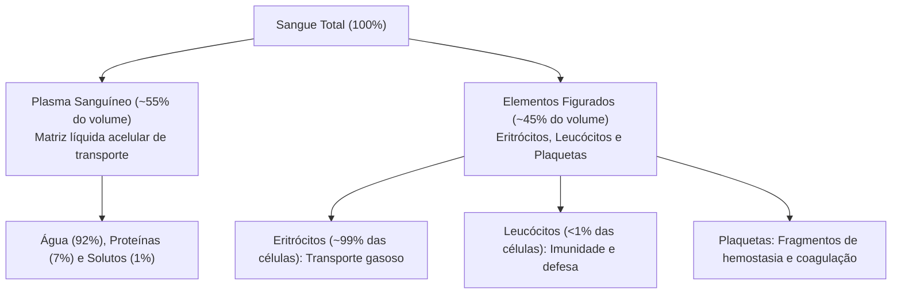
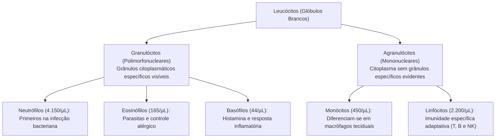
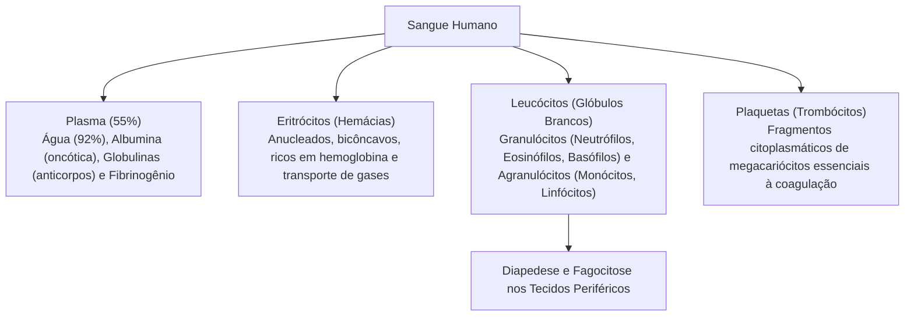

O sangue é um tecido conjuntivo líquido especializado que circula continuamente impulsionado pelo coração através de uma complexa rede de vasos sanguíneos. Representando cerca de oito por cento do peso corporal total de um adulto saudável (aproximadamente cinco litros), ele atua como o principal meio de transporte do organismo humano. Por meio de sua circulação ininterrupta, o sangue distribui oxigênio e nutrientes indispensáveis ao metabolismo tecidual, recolhe subprodutos e excretas celulares para eliminação, conduz sinais hormonais reguladores, atua na dissipação térmica e abriga componentes celulares e humorais vitais para a imunidade e a homeostase.

> [!objetivos]
> - Reconhecer as propriedades físico-químicas e as funções homeostáticas fundamentais do sangue.
> - Caracterizar os componentes da matriz líquida do plasma sanguíneo e suas proteínas funcionais.
> - Compreender a organização morfológica dos elementos figurados em eritrócitos, leucócitos e plaquetas.
> - Diferenciar as linhagens leucocitárias e dominar o mecanismo de diapedese e defesa imunológica.

## Introdução ao Sistema Cardiovascular e ao Sangue

O sistema cardiovascular atua como o circuito fechado integrador de toda a fisiologia humana. O sangue que flui por esse circuito exibe propriedades físico-químicas bem delineadas:
- **Temperatura:** Mantém-se ligeiramente superior à temperatura corporal média periférica, situando-se próximo a 38 °C;
- **pH:** Apresenta caráter levemente alcalino, rigorosamente tamponado entre 7,35 e 7,45 (com média fisiológica fixada em torno de 7,4);
- **Viscosidade:** É aproximadamente cinco vezes maior do que a da água, decorrente da concentração de proteínas plasmáticas e da abundância de células em suspensão;
- **Volume:** Varia entre 5 a 6 litros em homens adultos e entre 4 a 5 litros em mulheres adultas.

As funções biológicas do sangue subdividem-se em três eixos principais:
1. **Transporte:** Carreamento de gases respiratórios (oxigênio dos pulmões aos tecidos e dióxido de carbono dos tecidos aos pulmões), distribuição de nutrientes digeridos (glicose, aminoácidos, ácidos graxos e vitaminas), transporte de hormônios das glândulas endócrinas até seus receptores-alvo e carreamento de resíduos nitrogenados metabólicos (ureia, ácido úrico e creatinina) até os rins para excreção urinária.
2. **Regulação:** Manutenção da temperatura corporal pela absorção e redistribuição periférica de calor; controle do equilíbrio ácido-base por meio de sistemas tampão (especialmente o sistema bicarbonato-ácido carbônico); e regulação da pressão coloidosmótica intersticial pelas proteínas plasmáticas.
3. **Proteção:** Prevenção da perda excessiva de fluido por meio da hemostasia e cascata de coagulação; e defesa ativa contra patógenos invasores mediante fagocitose celular e secreção de anticorpos específicos.

## Composição do Plasma Sanguíneo

O plasma representa a fração líquida extracelular do sangue, equivalendo a cerca de 55% do volume sanguíneo total. Trata-se de uma solução aquosa amarelada e translúcida composta por três classes de elementos:
- **Água (aproximadamente 92%):** Atua como solvente biológico universal e dispersante de solutos orgânicos e inorgânicos;
- **Proteínas Plasmáticas (cerca de 7%):** Moléculas de grande massa molecular, quase inteiramente sintetizadas pelo fígado;
- **Outros Solutos (cerca de 1%):** Eletrólitos inorgânicos (sódio, potássio, cálcio, magnésio, cloreto e bicarbonato), nutrientes orgânicos absorvidos, gases dissolvidos e produtos terminais do catabolismo celular (ureia, ácido úrico, creatinina e bilirrubina).

| Proteína Plasmática | Proporção Relativa | Funções Principais |
|---|---|---|
| **Albumina** | Cerca de **60%** do total | Manutenção da pressão coloidosmótica intravascular e transporte de ácidos graxos, bilirrubina e hormônios |
| **Globulinas** | Cerca de **35%** do total | Imunoglobulinas (anticorpos sintetizados por plasmócitos) e proteínas transportadoras (como a transferrina) |
| **Fibrinogênio** | Cerca de **4%** do total | Precursor solúvel da rede insolúvel de fibrina essencial para a coagulação sanguínea |

> [!atencao] Pressão Coloidosmótica e o Papel da Albumina
> A albumina exerce papel preponderante na manutenção da pressão oncótica (coloidosmótica) do plasma. Por ser uma proteína abundante que não atravessa com facilidade as fenestras dos capilares contínuos, ela retém água no interior dos vasos por atração osmótica. Quedas acentuadas na concentração sérica de albumina (em casos de desnutrição proteica grave ou cirrose hepática) provocam escape de líquido para o espaço intersticial, gerando quadros clínicos de edema generalizado (ascite e anasarca).

## Elementos Figurados do Sangue: Eritrócitos, Leucócitos e Plaquetas

A porção celular e subcelular do sangue corresponde aos elementos figurados, ocupando cerca de 45% do volume sanguíneo total (porcentagem denominada **hematócrito**). Essa fração divide-se em três linhagens morfofuncionais distintas:

### Eritrócitos (Hemácias ou Glóbulos Vermelhos)

Os eritrócitos representam aproximadamente 99% de todas as células presentes no sangue. Nos mamíferos, são células anucleadas, desprovidas de organelas membranosas (incluindo mitocôndrias) e moldadas no formato de discos bicôncavos flexíveis com diâmetro médio de 7 a 8 micrômetros. Essa morfologia maximiza a relação superfície/volume para rápida difusão de gases e confere maleabilidade para atravessar capilares estreitos. O citoplasma eritrocitário é repleto da proteína conjugada hemoglobina, responsável pelo transporte especializado de oxigênio dos alvéolos até as células periféricas.

### Leucócitos (Glóbulos Brancos)

Os leucócitos constituem a linhagem celular de defesa do organismo. Diferente dos eritrócitos, são células completas (possuem núcleo e organelas) e não contêm hemoglobina. A contagem normal de leucócitos no sangue de um adulto varia habitualmente entre **5.000 e 10.000 células por microlitro (µL)**. Valores abaixo de 5.000/µL indicam **leucopenia**, enquanto contagens que ultrapassam 10.000/µL configuram **leucocitose**, frequentemente associada a infecções agudas ou processos inflamatórios.

A maior parte dos leucócitos não executa suas funções prioritárias dentro dos vasos, utilizando a circulação sanguínea apenas como meio de transporte até os tecidos inflamados ou invadidos. A passagem ativa do leucócito através da parede dos capilares e vênulas pós-capilares denomina-se **diapedese**, ocorrendo com emissão de pseudópodes e locomoção ameboide no líquido intersticial.

| Tipo Leucocitário | Contagem Média (/µL) | Características Morfológicas e Funcionais |
|---|---|---|
| **Neutrófilos** | ~4.150 (50% a 70%) | Núcleo multilobulado (3 a 5 lobos). Primeiros a chegar aos focos de infecção bacteriana; fagocitam bactérias ativamente e liberam enzimas líticas e peróxidos; a morte em massa de neutrófilos e bactérias forma o pus |
| **Eosinófilos** | ~165 (1% a 4%) | Núcleo tipicamente bilobado e grânulos citoplasmáticos alaranjados/vermelhos. Atuam contra parasitas multicelulares (helmintos) e modulam reações alérgicas |
| **Basófilos** | ~44 (<1%) | Grânulos volumosos azul-escuros cobrindo o núcleo. Liberam histamina (vasodilatador e mediador inflamatório) e heparina (anticoagulante local), assemelhando-se aos mastócitos |
| **Monócitos** | ~450 (2% a 8%) | Grandes células com núcleo reniforme (formato de feijão). Ao migrarem para os tecidos, diferenciam-se em **macrófagos**, executando fagocitose vigorosa e apresentando antígenos |
| **Linfócitos** | ~2.200 (20% a 40%) | Células esféricas de núcleo volumoso e citoplasma escasso. Dividem-se em Linfócitos T (imunidade celular maturada no timo), Linfócitos B (diferenciam-se em plasmócitos produtores de anticorpos na resposta humoral) e células NK (Natural Killer, que destroem células infectadas por vírus ou tumorais) |

> [!bizu] O Processo de Diapedese e o Mecanismo Fagocitário
> Lembre-se para a prova: neutrófilos, eosinófilos e monócitos/macrófagos são células com capacidade de realizar **fagocitose**. A saída dessas células do leito vascular em direção ao foco inflamatório tecidual denomina-se **diapedese**, mediada por moléculas de adesão endotelial (selectinas e integrinas) e orientada por gradientes químicos de atração (quimiotaxia).

## Mapa do capítulo

### Para fixar

- O sangue é um tecido conjuntivo líquido com pH médio de 7,4 e temperatura aproximada de 38 °C.
- O plasma compõe cerca de cinquenta e cinco por cento do volume sanguíneo, sendo formado por noventa e dois por cento de água.
- A albumina é a proteína plasmática mais abundante, responsável direta pela pressão coloidosmótica do sangue.
- Os eritrócitos são células anucleadas nos mamíferos, especializadas no transporte gasoso pela hemoglobina.
- Os elementos figurados compreendem glóbulos vermelhos, glóbulos brancos e fragmentos plaquetários.
- A contagem leucocitária normal oscila entre cinco mil e dez mil células por microlitro de sangue.
- A diapedese é a migração ativa dos glóbulos brancos através do endotélio dos vasos em direção aos tecidos.
- Neutrófilos são os leucócitos mais numerosos e os primeiros a combater infecções bacterianas agudas.
- Os monócitos sanguíneos migram para os tecidos e diferenciam-se em macrófagos fagocitários de alta capacidade.
- Linfócitos B originam plasmócitos produtores de anticorpos, enquanto linfócitos T coordenam a imunidade celular.
