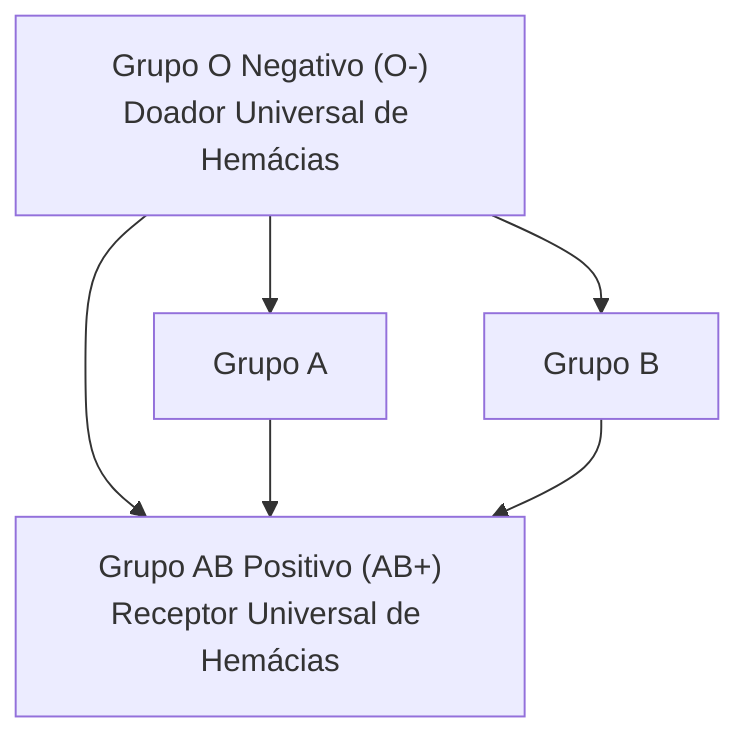
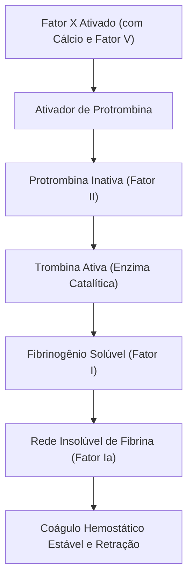
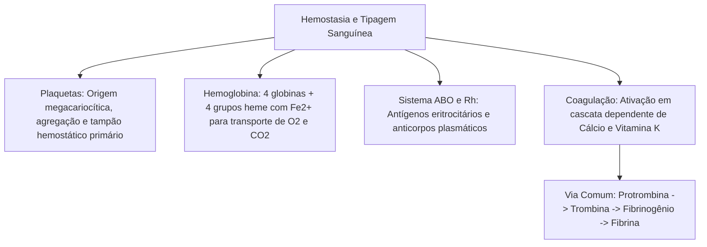

No estudo da anatomia e fisiologia humana integrando os sistemas cardiovascular, sangue e linfático, a preservação da integridade vascular e o fornecimento contínuo de oxigênio aos tecidos dependem da ação coordenada de estruturas especializadas. As plaquetas atuam como sentinelas na hemostasia primária, a hemoglobina viabiliza o transporte eficiente de gases respiratórios, e a cascata de coagulação consolida o estancamento de hemorragias por meio da formação de fibrina. Paralelamente, o reconhecimento imunológico de antígenos de membrana nos sistemas ABO e Rh rege as regras fundamentais de compatibilidade transfusional na medicina de emergência e no suporte pré-hospitalar.

> [!objetivos]
> - Compreender a gênese, a morfologia e a função das plaquetas na hemostasia primária.
> - Analisar a estrutura da molécula de hemoglobina e suas ligações com oxigênio, dióxido de carbono e monóxido de carbono.
> - Dominar a genética e a fisiologia da tipagem sanguínea nos sistemas ABO e Fator Rh.
> - Descrever a sequência enzimática da cascata de coagulação sanguínea até a formação da rede de fibrina.

## Fisiologia das Plaquetas e Hemostasia Primária

As plaquetas, ou trombócitos, não são células completas, mas fragmentos citoplasmáticos anucleados circundados por membrana plasmática. Elas se originam na medula óssea vermelha a partir da fragmentação de células precursoras gigantes denominadas **megacariócitos**.

A concentração plasmática habitual oscila entre 150.000 e 400.000 plaquetas por microlitro de sangue (com média de cerca de 350.000/µL). Cerca de um terço da população plaquetária permanece retida fisiologicamente no baço como reserva móvel. Apresentam vida média curta na circulação sistêmica, durando entre 8 e 10 dias, após o que são fagocitadas por macrófagos no baço e no fígado.

Quando ocorre ruptura ou lesão do endotélio vascular, as plaquetas entram em contato com fibras de colágeno subendoteliais expostas, deflagrando a **hemostasia primária**:
1. **Adesão Plaquetária:** As plaquetas aderem ao colágeno com o auxílio do fator de von Willebrand;
2. **Ativação e Secreção:** As plaquetas alteram drasticamente sua forma esférica, emitindo pseudópodes, e liberam o conteúdo de seus grânulos (ADP, tromboxano A2 e serotonina), que provocam vasoconstrição local e atraem novas plaquetas;
3. **Agregação Plaquetária:** O acúmulo de plaquetas adjacentes forma o **tampão plaquetário primário**, capaz de ocluir rapidamente pequenas brechas vasculares.

| Fase da Hemostasia Primária | Mecanismo Fisiológico | Resultado Funcional |
|---|---|---|
| **Espasmo Vascular** | Contração reflexa da musculatura lisa da túnica média | Redução imediata do fluxo sanguíneo no vaso lesado |
| **Adesão das Plaquetas** | Ligação das plaquetas ao colágeno subendotelial exposto | Fixação das plaquetas na margem da lesão endotelial |
| **Desgranulação Plaquetária** | Liberação de ADP, serotonina e tromboxano A2 | Vasoconstrição reforçada e quimiotaxia de novos trombócitos |
| **Agregação Plaquetária** | União de plaquetas vizinhas mediada por receptores de membrana | Formação do tampão hemostático primário |

## A Estrutura da Hemoglobina e o Transporte de Gases

A hemoglobina (Hb) é uma proteína globular conjugada de estrutura quaternária que preenche quase a totalidade do citoplasma dos eritrócitos. Cada molécula é constituída por quatro cadeias polipeptídicas (duas cadeias alfa e duas beta no adulto normal) associadas a quatro **grupos heme**. No centro de cada grupo heme situa-se um átomo de ferro no estado ferroso (Fe2+), capaz de ligar-se reversivelmente a uma molécula de oxigênio (O2). Consequentemente, cada hemoglobina transporta até quatro moléculas de O2.

A associação entre a hemoglobina e os gases respiratórios gera compostos específicos:
- **Oxiemoglobina (HbO2):** Formada nos capilares alveolares pulmonares, onde a pressão parcial de oxigênio é alta. Trata-se de uma ligação reversível e frouxa;
- **Desoxiemoglobina:** Hemoglobina que liberou suas moléculas de oxigênio nos tecidos periféricos;
- **Carbaminoemoglobina (HbCO2):** Formada quando o dióxido de carbono se liga diretamente aos grupos amino das cadeias proteicas de globina (responsável pelo transporte de cerca de 23% do CO2 sanguíneo);
- **Carboxiemoglobina (HbCO):** Composto formado pela ligação da hemoglobina com o **monóxido de carbono (CO)**.

> [!atencao] Intoxicação por Monóxido de Carbono em Incêndios
> O monóxido de carbono liga-se ao mesmo sítio do ferro do grupo heme com uma afinidade química cerca de duzentas vezes superior à do oxigênio. Essa ligação é extremamente estável e bloqueia o transporte de O2, provocando asfixia química celular em nível tecidual. Em ocorrências de combate a incêndio com queima incompleta de materiais, o uso do equipamento de proteção respiratória autônoma (EPR) é mandatório para evitar a formação letal de carboxiemoglobina.

Ao completarem seu ciclo de vida médio de cento e vinte dias, as hemácias senescentes tornam-se frágeis e são destruídas no baço por hemocaterese. O organismo reaproveita os aminoácidos das globinas e recicla o ferro transportado pela transferrina para a medula óssea. A fração porfirínica do grupo heme é degradada em biliverdina e posteriormente em **bilirrubina**, que é captada pelos hepatócitos e excretada na bile.

## O Sistema ABO e o Fator Rh: Tipagem Sanguínea

A superfície dos eritrócitos humanos exibe glicoproteínas e glicolipídios geneticamente determinados que atuam como **antígenos (ou aglutinogênios)**. O plasma sanguíneo, por sua vez, pode conter anticorpos naturais denominados **aglutininas**.

O sistema ABO é governado por três alelos principais (IA, IB e i). A presença ou ausência dos aglutinogênios A e B define os quatro grupos sanguíneos clássicos:

| Fenótipo (Grupo) | Aglutinogênio na Hemácia | Aglutinina no Plasma | Pode Doar Para | Pode Receber De |
|---|---|---|---|---|
| **Grupo A** | Antígeno **A** | Anti-**B** | A e AB | A e O |
| **Grupo B** | Antígeno **B** | Anti-**A** | B e AB | B e O |
| **Grupo AB** | Antígenos **A e B** | **Nenhum** | Apenas AB | **Todos (A, B, AB, O)** |
| **Grupo O** | **Nenhum** | Anti-**A** e Anti-**B** | **Todos (A, B, AB, O)** | Apenas O |

O **Fator Rh** depende da presença do antígeno D na membrana eritrocitária. Indivíduos que expressam o antígeno são classificados como **Rh positivos (Rh+)**, enquanto aqueles desprovidos do antígeno são **Rh negativos (Rh-)**. Diferente do sistema ABO, os indivíduos Rh negativos não possuem anticorpos anti-Rh pré-formados naturalmente no plasma: a produção de anti-Rh ocorre apenas após sensibilização prévia (transfusão incompatível ou gestação de feto Rh positivo, mecanismo responsável pela **eritroblastose fetal** ou doença hemolítica do recém-nascido).

> [!bizu] Regra de Ouro das Transfusões Sanguíneas
> Em transfusões de concentrado de hemácias, o perigo crítico reside na reação entre os **anticorpos do plasma do receptor** e os **antígenos das hemácias do doador**. Por não possuir antígenos A, B ou D em suas hemácias, o sangue **O negativo** é o doador universal de emergência. Por não possuir anticorpos anti-A, anti-B ou anti-Rh em seu plasma, o indivíduo **AB positivo** é o receptor universal.

## A Coagulação do Sangue e Formação da Fibrina

A hemostasia secundária compreende a coagulação sanguínea propriamente dita, consistindo na conversão de uma proteína plasmática solúvel (fibrinogênio) em filamentos insolúveis de **fibrina**, que consolidam e estabilizam o tampão plaquetário inicial.

A coagulação processa-se por meio de uma cascata enzimática complexa que envolve treze fatores proteicos numerados de I a XIII, íons **Cálcio (Ca2+)** e fosfolipídios de membrana. A síntese hepática de diversos fatores de coagulação (notadamente os fatores II, VII, IX e X) depende diretamente da presença de **Vitamina K**.

A cascata divide-se didaticamente em duas vias iniciais que convergem para a via comum:
- **Via Extrínseca:** Ativada rapidamente quando tecidos traumatizados liberam o fator tecidual (tromboplastina tecidual);
- **Via Intrínseca:** Ativada de forma mais lenta quando o sangue entra em contato direto com superfícies de colágeno desnudadas;
- **Via Comum:** As duas vias ativam o **Fator X**, que se associa ao fator V, cálcio e fosfolipídios para formar o complexo ativador de protrombina.

> [!esquema] Sequência Final da Coagulação Sanguínea
> Memorize para a prova a sequência final indispensável da via comum:
> 1. O **ativador de protrombina** catalisa a conversão da **protrombina** (inativa) em **trombina** (ativa);
> 2. A **trombina** cliva o **fibrinogênio** solúvel do plasma em monômeros de **fibrina** insolúvel;
> 3. Os polímeros de fibrina entrelaçam-se formando uma rede tridimensional estável que aprisiona eritrócitos e plaquetas, estruturando o coágulo definitivo e impedindo o extravasamento hemorrágico.

## Mapa do capítulo

### Para fixar

- As plaquetas são fragmentos celulares de megacariócitos que executam a hemostasia primária.
- A vida média das plaquetas oscila entre oito e dez dias, com contagem normal de 150 a 400 mil por microlitro.
- A hemoglobina contém quatro cadeias de globina e quatro grupos heme com ferro para ligação reversível de oxigênio.
- A carboxiemoglobina decorre da ligação estável e prejudicial da hemoglobina com o monóxido de carbono.
- O sistema ABO define-se pelos antígenos A e B nas hemácias e pelos anticorpos anti-A e anti-B no plasma.
- O sangue do tipo O negativo atua como doador universal de hemácias por não possuir antígenos A, B ou D.
- O sangue AB positivo atua como receptor universal de hemácias por não conter anticorpos anti-A, anti-B ou anti-Rh.
- A síntese hepática de fatores da coagulação (II, VII, IX e X) exige a presença de vitamina K.
- Na via comum da coagulação, a enzima trombina converte o fibrinogênio solúvel em rede insolúvel de fibrina.
- Os íons cálcio atuam como cofatores indispensáveis em múltiplas etapas da cascata de coagulação.
