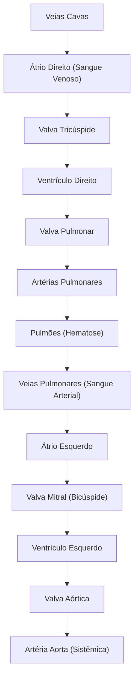
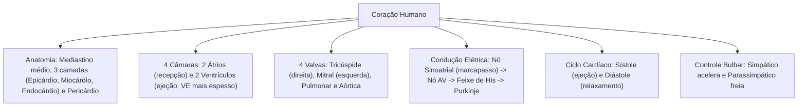

No estudo da anatomia e fisiologia humana dos sistemas cardiovascular, sangue e linfático, o coração funciona como uma bomba muscular propulsora central. Localizado no mediastino médio, esse órgão oco contrai-se ritmicamente para manter a pressão sanguínea contínua. Essa força motriz impulsiona o fluxo de sangue pelas artérias, capilares e veias do organismo. Assim, o sangue nutre as células periféricas e conduz o volume desoxigenado até os pulmões para renovação gasosa.

> [!objetivos]
> - Reconhecer a topografia anatômica do coração, seus envoltórios pericárdicos e camadas parietais.
> - Caracterizar a morfologia e a dinâmica das quatro cavidades cardíacas e do aparelho valvar.
> - Compreender a automaticidade cardíaca mediada pelo nó sinoatrial e pela rede de condução intrínseca.
> - Analisar as fases mecânicas do ciclo cardíaco entre sístole e diástole e sua regulação autonômica.

## Anatomia do Coração, Envoltórios e Camadas Parietais

O coração humano tem o tamanho aproximado de um punho fechado. Sua massa média varia entre 250 e 350 gramas. O órgão fica situado no **mediastino médio**, repousando sobre o músculo diafragma. Ele localiza-se atrás do osso esterno e à frente da coluna vertebral. Sua base é superior e posterior, onde se fixam os grandes vasos. O ápice do coração aponta para baixo, para a frente e para a esquerda.

O coração é envolvido pelo saco fibroseroso do **pericárdio**. Esse envoltório divide-se em:
- **Pericárdio Fibroso:** Camada externa resistente de tecido conjuntivo. Ela fixa o coração no mediastino e evita a dilatação súbita das câmaras;
- **Pericárdio Seroso:** Membrana de dupla lâmina. A lâmina parietal reveste a face interna do saco fibroso. A lâmina visceral adere à superfície externa do miocárdio, formando o epicárdio. Entre as duas lâminas existe a cavidade pericárdica com líquido lubrificante.

A parede cardíaca é formada por três camadas estruturais:

| Camada Parietal | Tecido Predominante | Função Principal |
|---|---|---|
| **Epicárdio** | Lâmina serosa visceral externa e gordura | Proteção mecânica externa e passagem de vasos coronários |
| **Miocárdio** | Músculo estriado cardíaco | Camada média espessa responsável pela contração ativa |
| **Endocárdio** | Endotélio simples e conjuntivo | Revestimento liso interno contínuo com os vasos sanguíneos |

A irrigação do miocárdio depende das **artérias coronárias direita e esquerda**. Elas nascem na base da artéria aorta ascendente. O sangue venoso do coração é recolhido pelo **seio coronário**, que desemboca no átrio direito.

## As Cavidades Cardíacas e o Fluxo Unidirecional

O coração humano possui quatro cavidades internas:
- **Dois Átrios (direito e esquerdo):** Câmaras superiores que recebem o sangue das veias. Apresentam paredes musculares finas;
- **Dois Ventrículos (direito e esquerdo):** Câmaras inferiores que ejetam o sangue nas artérias. Possuem paredes musculares espessas.

O septo interatrial separa os dois átrios. O septo interventricular separa os dois ventrículos. O ventrículo esquerdo possui miocárdio cerca de três vezes mais espesso que o direito. Essa diferença ocorre porque o ventrículo esquerdo precisa vencer a alta pressão da circulação sistêmica (120 mmHg). O ventrículo direito bombeia apenas contra a baixa resistência da circulação pulmonar (cerca de 25 mmHg).

Quatro valvas cardíacas asseguram o fluxo unidirecional do sangue:
1. **Valvas Atrioventriculares (AV):** Ficam situadas entre os átrios e os ventrículos. A **valva tricúspide** localiza-se à direita. A **valva mitral (ou bicúspide)** localiza-se à esquerda. Ambas possuem cordas tendíneas presas aos músculos papilares dos ventrículos. Isso evita que as cúspides se invertam para os átrios durante a contração ventricular;
2. **Valvas Semilunares:** Ficam situadas na saída dos ventrículos. A **valva pulmonar** fica na base do tronco pulmonar. A **valva aórtica** fica na base da artéria aorta. Ambas evitam o retorno do sangue quando os ventrículos relaxam.

> [!bizu] O Trajeto do Fluxo Sanguíneo Intracardíaco
> A **valva tricúspide fica no lado direito**, onde circula sangue venoso desoxigenado. A **valva mitral/bicúspide fica no lado esquerdo**, onde passa sangue arterial oxigenado. O lado direito conduz sangue aos pulmões. O lado esquerdo envia sangue a todo o corpo.

## As Contrações Cardíacas: Sístole, Diástole e Condução Elétrica

A mecânica do coração alterna duas etapas básicas:
- **Sístole:** Fase de contração muscular da câmara. Há aumento de pressão interna e ejeção do sangue;
- **Diástole:** Fase de relaxamento muscular. A pressão interna diminui e a câmara recebe sangue.

O músculo cardíaco possui a propriedade da **automaticidade**. Suas células geram impulsos elétricos espontâneos sem depender de estímulos nervosos externos. A onda elétrica percorre um sistema especializado de condução:
1. **Nó Sinoatrial (ou Sinusal):** Fica localizado na parede do átrio direito, próximo à veia cava superior. Funciona como o **marcapasso natural do coração**, emitindo de 60 a 100 impulsos por minuto;
2. **Vias Internodais:** Conduzem o estímulo pelos átrios, provocando a sístole atrial;
3. **Nó Atrioventricular (AV):** Fica no septo interatrial. Ele gera um **retardo de 0,1 segundo** no impulso. Esse tempo permite que os átrios esvaziem todo o sangue antes da contração dos ventrículos;
4. **Feixe de His:** Desce pelo septo interventricular e divide-se em ramos direito e esquerdo;
5. **Fibras de Purkinje:** Conduzem a despolarização por todo o miocárdio dos ventrículos, provocando a sístole ventricular de baixo para cima.

> [!atencao] O Papel do Nó Sinoatrial como Marcapasso Fisiológico
> O nó sinoatrial comanda os batimentos cardíacos normais (ritmo sinusal). Ele possui a maior taxa de despolarização espontânea do sistema. Se o nó sinusal sofrer lesão, o nó atrioventricular assume o ritmo com 40 a 60 batimentos por minuto.

A ausculta do coração identifica dois sons principais, chamados de bulhas cardíacas:
- **Primeira Bulha (B1 ou "tum"):** Ocorre com o fechamento das valvas atrioventriculares (mitral e tricúspide) no início da sístole ventricular;
- **Segunda Bulha (B2 ou "tá"):** Ocorre com o fechamento das valvas semilunares (aórtica e pulmonar) no início da diástole ventricular.

## O Ciclo Cardíaco e sua Regulação Autônoma

O ciclo cardíaco reúne todos os eventos mecânicos e elétricos de um batimento. Em repouso, cada ciclo dura cerca de 0,8 segundo. Suas etapas dividem-se de forma ordenada:

| Fase do Ciclo | Estado das Câmaras | Valvas AV | Valvas Semilunares | Direção do Fluxo |
|---|---|---|---|---|
| **Sístole Atrial** | Átrios contraídos; ventrículos relaxados | **Abertas** | **Fechadas** | Sangue completa o enchimento dos ventrículos |
| **Contração Isovolumétrica** | Início da contração ventricular | **Fecham-se (B1)** | **Fechadas** | Pressão sobe rápido sem mudança de volume |
| **Ejeção Ventricular** | Ventrículos em contração máxima | **Fechadas** | **Abertas** | Sangue é lançado para aorta e artéria pulmonar |
| **Relaxamento Isovolumétrico**| Início da diástole ventricular | **Fechadas** | **Fecham-se (B2)** | Pressão ventricular despenca sem entrada de sangue |
| **Enchimento Ventricular**| Câmaras relaxadas | **Abertas** | **Fechadas** | Sangue venoso entra passivamente nos ventrículos |

> [!esquema] Dinâmica Pressórica e Valvar no Ciclo Cardíaco
> O sangue sempre se move de onde a pressão está mais alta para onde está mais baixa. As valvas abrem-se e fecham-se por ação passiva desses gradientes de pressão mecânica.

O sistema nervoso autônomo regula a frequência e a força dos batimentos por meio do centro cardiovascular no **bulbo**:
- **Simpático:** Libera **noradrenalina**, acelerando o marcapasso e aumentando a força de contração (**taquicardia**);
- **Parassimpático:** Atua pelo **nervo vago** e libera **acetilcolina**, reduzindo os batimentos cardíacos (**bradicardia**).

## Mapa do capítulo

### Para fixar

- O coração fica no mediastino médio e é envolvido pelo pericárdio.
- As três camadas da parede cardíaca são epicárdio, miocárdio e endocárdio.
- Os átrios recebem o sangue venoso e os ventrículos ejetam o sangue nas artérias.
- O miocárdio do ventrículo esquerdo é muito mais espesso que o do ventrículo direito.
- A valva tricúspide fica à direita e a valva mitral fica à esquerda.
- As valvas semilunares impedem o refluxo das artérias para os ventrículos relaxados.
- O nó sinoatrial funciona como o marcapasso natural dos batimentos cardíacos.
- O nó atrioventricular gera um retardo elétrico para os átrios terminarem a ejeção.
- A primeira bulha cardíaca marca o fechamento das valvas atrioventriculares.
- A segunda bulha cardíaca marca o fechamento das valvas semilunares.
