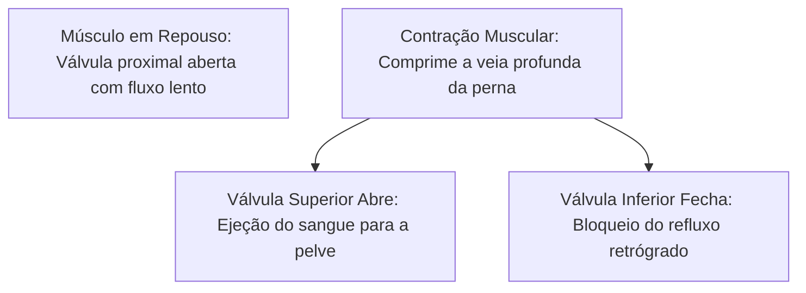
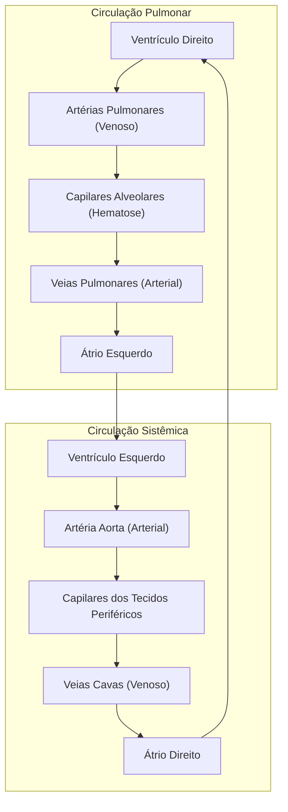
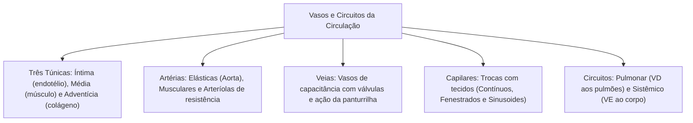

No estudo da anatomia e fisiologia humana dos sistemas cardiovascular, sangue e linfático, os vasos sanguíneos formam condutos fechados. Eles transportam o sangue ejetado pelo coração até os tecidos e promovem o seu retorno às câmaras cardíacas. Sua parede varia conforme a pressão e a função exercida. As artérias resistem a altas pressões sistólicas. Os capilares realizam trocas de nutrientes e gases com o interstício. As veias funcionam como reservatórios de volume com baixa pressão e possuem válvulas antirefluxo.

> [!objetivos]
> - Diferenciar a estrutura das túnicas íntima, média e adventícia em artérias, veias e capilares.
> - Compreender a função das artérias elásticas, musculares e arteríolas.
> - Analisar a dinâmica do retorno venoso, as válvulas e a bomba muscular da panturrilha.
> - Classificar os capilares em contínuos, fenestrados e sinusoides.
> - Mapear os trajetos da circulação pulmonar e da circulação sistêmica.

## Os Vasos Sanguíneos e sua Organização Geral

O sistema cardiovascular humano forma um circuito fechado e contínuo. O sangue sai dos ventrículos cardíacos, atinge a periferia e retorna aos átrios. O fluxo percorre condutos organizados em sequência:
1. **Artérias de grande calibre (elásticas):** recebem sangue sob alta pressão pulsátil direta do miocárdio.
2. **Artérias de médio calibre (musculares):** distribuem o fluxo aos órgãos e tecidos regionais.
3. **Arteríolas:** vasos finos de resistência que controlam o fluxo de entrada nos leitos microvasculares.
4. **Capilares:** vasos microscópicos com calibre de uma hemácia, onde ocorrem as trocas metabólicas.
5. **Vênulas:** pequenos vasos que recolhem o sangue efluente dos capilares.
6. **Veias médias e grandes:** condutos de paredes delgadas que trazem o sangue ao coração em baixa pressão.

A pressão hidrostática cai ao longo do circuito:
- Na aorta, a pressão arterial oscila entre 120 mmHg (sístole) e 80 mmHg (diástole).
- Nas arteríolas terminais, a pressão decai para cerca de 35 mmHg.
- No leito capilar, atinge de 18 a 25 mmHg, resguardando o endotélio de roturas.
- No sistema venoso, varia de 15 mmHg nas vênulas a quase zero na chegada ao átrio direito.

As veias abrigam cerca de 65% a 70% do sangue corporal em repouso. Por isso, são denominadas **vasos de capacitância**. Um terço dessa reserva fica no fígado, baço e plexos cutâneos. Em situações de hemorragia ou esforço físico, descargas simpáticas provocam venoconstrição. Esse mecanismo devolve grande volume ao coração, sustentando o débito cardíaco.

## Anatomia dos Vasos Sanguíneos: As Três Túnicas Parietais

Artérias e veias compartilham uma organização parietal básica em três camadas concêntricas:
1. **Túnica Íntima:** camada interna voltada para a luz vascular. É formada por uma monocamada de células endoteliais apoiada em lâmina basal e tecido conjuntivo frouxo subendotelial. Nas artérias, possui uma lâmina elástica interna fenestrada bem evidente.
2. **Túnica Média:** camada intermediária constituída por células musculares lisas e fibras de elastina. Controla o diâmetro da luz vascular via vasoconstrição ou vasodilatação. Nas artérias de distribuição, uma lâmina elástica externa separa a média da adventícia.
3. **Túnica Adventícia:** camada mais externa de tecido conjuntivo denso com colágeno tipo I. Fixa o vaso às estruturas vizinhas. Em vasos calibrosos, contém vasos nutricionais próprios denominados **vasa vasorum**.

| Túnica Vascular | Estrutura Principal | Artérias | Veias | Capilares |
|---|---|---|---|---|
| **Túnica Íntima** | Endotélio simples e lâmina basal | Presente com lâmina elástica nítida | Presente, projeta válvulas | Camada única constituinte |
| **Túnica Média** | Músculo liso e elastina | **Espessa e muito desenvolvida** | Delgada e pouco desenvolvida | **Ausente** |
| **Túnica Adventícia** | Fibras de colágeno e vasa vasorum | Desenvolvida e resistente | **Camada mais espessa do vaso** | **Ausente** |

> [!atencao] Formato Parietal e Colapso Vascular
> A diferença histológica entre os vasos tem valor prático em anatomia e cirurgia. As artérias mantêm o contorno cilíndrico aberto após secção, graças à densidade de elastina e músculo na túnica média. As veias, por possuírem paredes delgadas e pouca musculatura, colapsam e achatam suas bordas quando esvaziadas.

## As Artérias: Tipos Funcionais e Principais Ramos

As artérias conduzem sangue para fora do coração em direção aos órgãos. Dividem-se em três grupos estruturais:
1. **Artérias Elásticas (Grande Calibre):** representadas pela aorta e pelo tronco pulmonar. Apresentam túnica média com dezenas de lâminas elásticas. Expandem-se na sístole e recuam na diástole. Esse recuo elástico converte pulsos intermitentes em fluxo sanguíneo contínuo para os órgãos.
2. **Artérias Musculares (Médio Calibre):** como a carótida, braquial, radial e femoral. Possuem túnica média rica em células musculares lisas. Respondem ao sistema nervoso autônomo e a mediadores locais para direcionar o débito regional.
3. **Arteríolas:** vasos delgados pré-capilares com uma ou duas camadas de músculo liso. Constituem o sítio primário de **resistência vascular periférica**. A contração do seu tônus eleva a pressão arterial sistêmica.

> [!pegadinha] Definição de Artéria versus Sangue Arterial
> Artéria é conceituada puramente pelo sentido do fluxo: **é todo vaso que parte do coração em direção aos tecidos**. A nomenclatura não depende do teor de oxigênio. A aorta transporta sangue oxigenado. Em contraste, a **artéria pulmonar conduz sangue pobre em oxigênio (venoso)** do ventrículo direito até os pulmões. Afirmar que toda artéria transporta sangue oxigenado é incorreto.

### Principais Ramos da Artéria Aorta

A aorta emerge do ventrículo esquerdo e encurva-se no **arco aórtico**. Do arco partem três troncos arteriais fundamentais:
- **Tronco braquiocefálico:** ramifica-se em artéria subclávia direita (membro superior direito) e artéria carótida comum direita (face e encéfalo).
- **Artéria carótida comum esquerda:** vasculariza o lado esquerdo da cabeça e do encéfalo.
- **Artéria subclávia esquerda:** supre o membro superior esquerdo e a artéria vertebral.

A aorta segue caudalmente pelo tórax e abdômen. Emite o tronco celíaco, artérias mesentéricas para o trato gastrointestinal e artérias renais. Ao nível lombar, bifurca-se nas artérias ilíacas comuns, que dão origem às **artérias femorais** nos membros inferiores.

## As Veias: Retorno Venoso, Válvulas e Bomba Muscular

As veias recolhem o sangue periférico e o reconduzem aos átrios sob baixas pressões. Nos membros inferiores, o fluxo precisa vencer a gravidade. Para viabilizar esse retorno, o corpo utiliza recursos mecânicos especializados:
- **Válvulas Venosas:** são projeções semilunares da túnica íntima voltadas para o sentido cranial. Abrem-se quando o sangue avança em direção ao coração. Fecham-se passivamente diante de refluxos retrógrados. Quando falham, geram estase e dilatações varicosas.
- **Bomba Muscular Esquelética:** a contração dos músculos da perna comprime as veias profundas da panturrilha. O sangue é ordenhado para cima, enquanto as válvulas inferiores barram o retorno. A panturrilha atua como um coração periférico.
- **Bomba Respiratória:** a descida do diafragma na inspiração comprime a cavidade abdominal e expande o tórax. A sucção intratorácica atrai sangue da veia cava inferior para o átrio direito.

Dentre os principais troncos venosos destacam-se:
- **Veia Cava Superior:** reúne o fluxo da cabeça, pescoço e membros superiores via veias jugulares e subclávias.
- **Veia Cava Inferior:** drena membros inferiores, órgãos pélvicos e abdominais para o átrio direito.
- **Veias Pulmonares:** quatro vasos que trazem sangue oxigenado dos pulmões ao átrio esquerdo.
- **Veias Safenas:** trajetos superficiais nos membros inferiores que deságuam na veia femoral.
- **Veia Porta-Hepática:** conduz sangue do tubo digestório ao fígado.

> [!bizu] O Sistema Porta-Hepático
> Em um sistema porta, o sangue atravessa duas redes capilares sucessivas antes de alcançar o coração. A veia porta reúne os capilares do estômago, intestino, pâncreas e baço. Esse fluxo segue para os **sinusoides hepáticos**. Assim, os hepatócitos filtram toxinas e armazenam nutrientes absorvidos antes de liberar o sangue para a veia cava inferior.

## Os Capilares e a Microcirculação

Os capilares estabelecem o ponto funcional culminante da circulação. Possuem calibre médio de 8 micrômetros e parede constituída exclusivamente por **endotélio apoiado em lâmina basal**. Sem musculatura ou adventícia, facilitam a difusão gasosa e de metabólitos entre o plasma e os tecidos.

Classificam-se em três tipos segundo a ultraestrutura endotelial:

| Tipo de Capilar | Estrutura da Parede | Principais Localizações | Permeabilidade |
|---|---|---|---|
| **Contínuo** | Células endoteliais contínuas com junções oclusivas | Músculos, pulmões, pele e encéfalo | Baixa: barreira hematoencefálica seletiva |
| **Fenestrado** | Células com poros e fenestras circulares | Rins, vilosidades intestinais e endócrinas | Intermediária: filtração rápida de água e íons |
| **Sinusoide** | Grandes fendas intercelulares e membrana descontínua | Fígado, baço e medula óssea vermelha | Máxima: passagem livre de proteínas e células |

A perfusão da rede capilar é controlada por **esfíncteres pré-capilares**. Quando as células de um tecido reduzem o metabolismo, esses esfíncteres se fecham. O sangue é desviado diretamente para as vênulas por anastomoses arteriovenosas.

### Dinâmica das Trocas Capilares e Equilíbrio de Starling

As trocas de líquidos e solutos através da parede capilar dependem do balanço entre duas forças opostas descritas pelas **forças de Starling**:
- **Pressão Hidrostática Capilar (PH):** é a força física exercida pelo sangue contra o endotélio. Tende a empurrar a água e os solutos para fora do vaso em direção ao espaço intersticial (filtração). No início do capilar arterial, a PH é de cerca de 32 a 35 mmHg; na extremidade venular, cai para aproximadamente 15 mmHg.
- **Pressão Coloidosmótica (ou Oncótica Plasmática - PO):** é a pressão osmótica exercida pelas proteínas que não conseguem atravessar o endotélio, com destaque para a **albumina**. Essa força atrai a água de volta do interstício para dentro do leito capilar (reabsorção). A PO mantém-se constante em torno de 25 mmHg ao longo de todo o comprimento do capilar.

Na extremidade arterial do leito capilar, a pressão hidrostática supera a pressão coloidosmótica, gerando uma **filtração líquida líquida** para os tecidos periféricos. Na extremidade venosa, a queda da pressão hidrostática permite que a pressão oncótica predomine, promovendo a **reabsorção** da maior parte desse fluido. O pequeno volume excedente de líquido intersticial que não retorna diretamente às veias é absorvido pelos capilares linfáticos. Dessa forma, evita-se a formação de **edema tecidual**.

## A Circulação Sanguínea: Circuitos Pulmonar e Sistêmico

O sistema circulatório humano é **fechado** (sangue restrito a vasos), **duplo** (passa duas vezes pelo coração para cumprir um circuito integral) e **completo** (sem mistura de sangue venoso e arterial). Essa dinâmica envolve dois circuitos em série:

### Circulação Pulmonar (Pequena Circulação)

A pequena circulação tem a finalidade de realizar trocas gasosas nos pulmões:
1. O ventrículo direito ejeta sangue venoso no **tronco pulmonar**.
2. O tronco ramifica-se nas **artérias pulmonares direita e esquerda**.
3. O sangue atinge os capilares que recobrem os alvéolos pulmonares.
4. Ocorre a **hematose**: captação de oxigênio e excreção alveolar de dióxido de carbono.
5. O sangue arterializado converge para as **quatro veias pulmonares**.
6. As veias pulmonares deságuam no **átrio esquerdo**, encerrando o trajeto.

### Circulação Sistêmica (Grande Circulação)

A grande circulação distribui oxigênio e nutrientes aos tecidos periféricos:
1. O sangue oxigenado passa do átrio esquerdo para o **ventrículo esquerdo**.
2. O ventrículo esquerdo contrai e ejeta o fluxo com grande pressão na **artéria aorta**.
3. A aorta e suas artérias filhas distribuem o sangue para a cabeça, vísceras e membros.
4. Nos capilares teciduais, o oxigênio é cedido e o dióxido de carbono é recolhido.
5. O sangue venoso é reunido pelas veias cavas superior e inferior.
6. As cavas desembocam no **átrio direito**, de onde o fluxo seguirá ao ventrículo direito.

> [!esquema] Síntese dos Dois Circuitos
> Lembre-se:
> - **Pequena Circulação:** Ventrículo Direito -> Artérias Pulmonares -> Hematose Alveolar -> Veias Pulmonares -> Átrio Esquerdo.
> - **Grande Circulação:** Ventrículo Esquerdo -> Aorta -> Tecidos Corporais -> Veias Cavas -> Átrio Direito.

## Mapa do capítulo

### Para fixar

- As artérias conduzem sangue para fora do coração em regime de pressão elevada.
- As veias conduzem sangue de volta aos átrios e contam com válvulas que impedem o refluxo.
- A túnica média é espessa nas artérias e rudimentar nas veias.
- As veias colapsam quando vazias, enquanto as artérias mantêm a luz circular.
- A artéria pulmonar conduz sangue pobre em oxigênio do ventrículo direito aos pulmões.
- As veias pulmonares conduzem sangue rico em oxigênio dos pulmões ao átrio esquerdo.
- A contração da panturrilha atua como bomba muscular essencial ao retorno venoso.
- Os capilares contínuos formam a barreira hematoencefálica com junções oclusivas firmes.
- Os capilares sinusoides são amplos e descontínuos no fígado, baço e medula óssea.
- A circulação sistêmica distribui sangue pelo ventrículo esquerdo e drena pelas veias cavas ao átrio direito.
