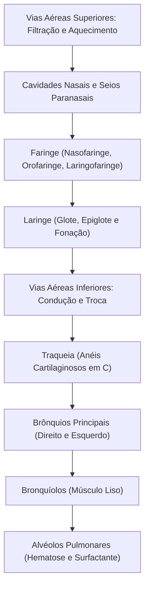
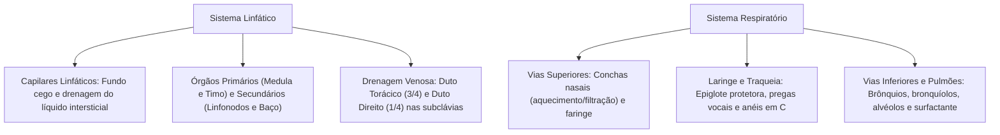

No estudo da anatomia e fisiologia humana dos sistemas cardiovascular, sangue e linfático, bem como do sistema respiratório, ocorrem processos integrados de transporte e regulação. O sistema linfático recolhe o excesso de líquido intersticial que extravasa dos capilares e coordena a vigilância imune. Paralelamente, o sistema respiratório capta oxigênio atmosférico, remove o dióxido de carbono e condiciona o ar inspirado. Ambas as vias atuam em sintonia para manter o equilíbrio hídrico e gasoso celular.

> [!objetivos]
> - Compreender a gênese da linfa e seu trajeto pelos capilares e ductos linfáticos.
> - Diferenciar a estrutura e as funções dos órgãos linfoides primários e secundários.
> - Analisar a anatomia das vias respiratórias superiores e a ação da mucosa ciliada.
> - Mapear as vias respiratórias inferiores, da traqueia até a barreira alvéolo-capilar.
> - Identificar o papel da epiglote, das pregas vocais e do surfactante pulmonar.

## O Sistema Linfático e a Dinâmica da Linfa

O sistema linfático forma uma rede de vasos e órgãos que acompanha o leito cardiovascular. Durante a microcirculação, a filtração capilar excede ligeiramente a reabsorção osmótica. O líquido acumulado no interstício é absorvido pelos vasos linfáticos e passa a ser denominado **linfa**. A linfa é um fluido claro com composição similar ao plasma sanguíneo, porém com teor proteico reduzido.

O fluxo linfático tem origem nos **capilares linfáticos**. Esses microvasos apresentam particularidades fundamentais:
- Iniciam-se em **fundo cego** nos espaços teciduais.
- Possuem endotélio delgado sem membrana basal contínua.
- Suas células endoteliais sobrepõem-se formando microválvulas unidirecionais.

Quando a pressão do fluido tecidual sobe, as bordas endoteliais abrem-se, permitindo a entrada de líquido e macromoléculas. O aumento da pressão intraluminal comprime as bordas, impedindo o refluxo.

Os capilares convergem para vasos coletores dotados de **válvulas semilunares**. A propulsão da linfa depende da compressão muscular e dos movimentos respiratórios. Toda a linfa desemboca no sistema venoso por dois grandes coletores:
- **Duto Torácico:** maior vaso linfático, recolhe a linfa dos membros inferiores, abdômen, hemitórax esquerdo, membro superior esquerdo e hemiface esquerda. Deságua na **veia subclávia esquerda**.
- **Duto Linfático Direito:** drena apenas o quadrante superior direito do corpo, desembocando na **veia subclávia direita**.

> [!pegadinha] Assimetria de Drenagem dos Dutos Linfáticos
> A drenagem linfática humana não é simétrica. O **duto linfático direito drena apenas 1/4 do corpo** (quadrante superior direito). O **duto torácico drena os outros 3/4** corporais. Ambos reconduzem a linfa ao sangue venoso nas veias subclávias.

## Órgãos e Tecidos Linfoides

Os órgãos linfoides agrupam-se em dois compartimentos funcionais:

1. **Órgãos Linfoides Primários (Centrais):** locais onde ocorrem a linfopoiese e a maturação inicial. Abrangem a **medula óssea vermelha** (onde todos os linfócitos se originam e onde os linfócitos B maturam) e o **timo**. No timo, os linfócitos T passam por diferenciação sob ação das **timosinas**. O timo involui na puberdade, sendo substituído por tecido adiposo.
2. **Órgãos Linfoides Secundários (Periféricos):** locais onde os linfócitos maduros encontram antígenos e disparam a resposta imune. Incluem os linfonodos, o baço, as tonsilas e o tecido linfoide associado a mucosas (MALT).

| Órgão ou Tecido | Categoria | Função Primária | Características |
|---|---|---|---|
| **Medula Óssea** | Primário | Hematopoiese e maturação de linfócitos B | Situada no interior dos ossos |
| **Timo** | Primário | Maturação de linfócitos T (timosinas) | Mediastino anterior; sofre involução |
| **Linfonodos** | Secundário | Filtração da linfa e ativação imune | Rins milimétricos com vasos aferentes/eferentes |
| **Baço** | Secundário | Hemocaterese e filtração do sangue | Hipocôndrio esquerdo; polpas branca e vermelha |
| **Tonsilas e MALT** | Secundário | Vigilância em mucosas digestivas e aéreas | Agregados linfoides sem cápsula rígida |

Os **linfonodos** distribuem-se em cadeias no pescoço, axilas e virilhas. A linfa penetra por vários vasos linfáticos aferentes, passa por seios filtradores repletos de macrófagos e emerge por um único vaso eferente.

O **tecido linfoide associado a mucosas (MALT)** engloba agregados não encapsulados situados sob as mucosas dos tratos digestório, respiratório e geniturinário. Destacam-se as **tonsilas** na faringe (faríngea, palatinas e linguais), as **placas de Peyer** na mucosa do íleo terminal e o tecido linfoide do apêndice vermiforme. Essas estruturas realizam o primeiro combate contra bactérias e vírus que adentram o corpo pelas vias naturais de alimentação e ventilação.

> [!bizu] Baço e Hemocaterese
> O baço não filtra linfa; sua função é filtrar o sangue circulante. Na **polpa vermelha**, os macrófagos realizam a **hemocaterese**, fagocitando hemácias senescentes e reciclando o ferro. Na **polpa branca**, ocorre vigilância imunitária por linfócitos T e B contra patógenos da corrente sanguínea.

## O Sistema Respiratório: Visão Geral e Princípios Fisiológicos

As células corporais demandam suprimento contínuo de oxigênio (O₂), que compõe cerca de 21% da atmosfera. No metabolismo aeróbico, o O₂ atua como aceptor final de elétrons na síntese mitocondrial de ATP. Essa via gera gás carbônico (CO₂) como resíduo.

O sistema respiratório desempenha funções essenciais:
- Conduzir o fluxo de ar entre a atmosfera e os pulmões.
- Aquecer, umidificar e filtrar o ar inspirado.
- Realizar a difusão gasosa passiva na membrana alveolar.
- Possibilitar a fala pela vibração das pregas vocais.
- Acomodar quimiorreceptores do olfato.

A troca gasosa depende de difusão simples. Esse transporte é otimizado por uma vasta área alveolar (70 a 140 m²) e por uma barreira biológica delgada. A ventilação pulmonar decorre de variações de pressão torácica promovidas pelo **diafragma** e pelos **músculos intercostais**.

## O Sistema Respiratório Superior

As vias superiores abrangem cavidades nasais, seios paranasais e faringe:
1. **Cavidades Nasais:** separadas pelo septo nasal. Na parede lateral existem três **conchas nasais (superior, média e inferior)**. Elas formam meatos que criam turbulência no ar. Esse turbilhonamento força o ar de encontro à mucosa vascularizada, aquecendo-o a 37 °C e saturando-o de umidade.
2. **Epitélio Respiratório e Olfatório:** o topo abriga o epitélio olfatório sensorial. O restante é coberto por epitélio pseudoestratificado ciliado com células caliciformes. O muco aprisiona impurezas e os cílios o direcionam à faringe, onde é deglutido.
3. **Seios Paranasais:** cavidades nos ossos frontal, maxilar, etmoide e esfenoide. Reduzem o peso ósseo e ampliam a ressonância da voz.
4. **Faringe:** tubo muscular compartilhado pela respiração e digestão. Divide-se em nasofaringe, orofaringe e laringofaringe.

> [!atencao] Conchas Nasais e Condicionamento do Ar
> A respiração nasal é preferível à bucal porque as conchas nasais e o muco realizam o condicionamento térmico e físico do ar. A mucosa altamente vascularizada transfere calor rapidamente. Quem respira pela boca inala ar seco e frio, aumentando a irritação traqueal e a suscetibilidade a infecções.

## O Sistema Respiratório Inferior

As vias inferiores iniciam-se na laringe e terminam nos alvéolos pulmonares.

### A Laringe e a Prevenção do Engasgo

A **laringe** é uma estrutura cartilaginosa que conecta a faringe à traqueia. Sua maior peça é a **cartilagem tireoide**, que projeta o pomo de Adão. 

A abertura laríngea é a **glote**, protegida superiormente pela **epiglote**. Durante a deglutição, a laringe eleva-se e a epiglote fecha a glote. Essa manobra conduz o alimento ao esôfago e isola a via aérea. Falhas nesse fechamento causam o **engasgo**, gerando tosse reflexa.

No lúmen da laringe encontram-se duas dobras mucosas:
- **Pregas Vestibulares (Superiores):** falsas cordas vocais que protegem a rima glótica.
- **Pregas Vocais (Inferiores):** verdadeiras cordas vocais providas de músculo e ligamentos elásticos. Sua vibração com o fluxo expiratório gera os sons da voz.

### Traqueia, Brônquios e Bronquíolos

A **traqueia** é um conduto de cerca de 11 centímetros estendido de C6 ao mediastino. É sustentada por 16 a 20 **anéis cartilaginosos hialinos em formato de C**. A porção posterior é membranácea e contém músculo liso, permitindo a expansão do esôfago vizinho.

Na extremidade caudal, a traqueia bifurca-se na **carina** nos dois brônquios principais:
- **Brônquio Principal Direito:** é mais curto, largo e verticalizado. Por sua orientação retilínea, aspirações acidentais de corpos estranhos alojam-se nele com maior frequência.
- **Brônquio Principal Esquerdo:** é mais longo, estreito e horizontal.

Nos pulmões, os brônquios ramificam-se em **bronquíolos**. Estes são desprovidos de cartilagem e envolvidos por músculo liso. A estimulação simpática desencadeia broncodilatação, enquanto a parassimpática induz broncoconstrição.

### Pulmões e Membrana Alvéolo-Capilar

Os pulmões repousam na cavidade torácica recobertos pela **pleura visceral** (aderida ao parênquima pulmonar) e pela **pleura parietal** (aderida à parede torácica interna). Entre as duas lâminas pleurais existe um espaço virtual preenchido por uma fina película de **líquido interpleural**. Esse fluido lubrifica o deslizamento das membranas e mantém uma **pressão intrapleural subatmosférica (negativa)**, em torno de -4 mmHg em repouso. Essa pressão negativa impede o recolhimento elástico natural do pulmão. Se houver perfuração da parede torácica (por arma branca ou fratura costal), o ar penetra na cavidade pleural, igualando a pressão interna à atmosférica. Esse quadro clínico é o **pneumotórax**, no qual o pulmão colapsa instantaneamente.

O pulmão direito possui três lobos (superior, médio e inferior), ao passo que o pulmão esquerdo possui apenas dois lobos (superior e inferior), apresentando a incisura cardíaca voltada para o ventrículo esquerdo.

Os **alvéolos pulmonares** são pequenas bolsas que realizam as trocas gasosas:
- **Pneumócitos Tipo I:** células delgadas que formam a parede alveolar de troca.
- **Pneumócitos Tipo II:** sintetizam o **surfactante pulmonar**, um complexo lipoproteico que reduz a tensão superficial da água e impede o colapso alveolar na expiração.
- **Macrófagos Alveolares:** fagocitam sujidades e patógenos inalados.

A espessura da barreira de difusão entre o ar alveolar e a hemácia capilar é de apenas 0,5 micrômetro, viabilizando trocas gasosas imediatas.

> [!esquema] Dinâmica Protetora Alveolar e Surfactante
> Síntese clínica para a prova:
> - **Pneumócitos Tipo I:** revestimento estrutural (95% da área) e trocas gasosas.
> - **Pneumócitos Tipo II:** secreção de **surfactante**, substância tensoativa que previne o colapso dos alvéolos ao final da expiração.

## Mapa do capítulo

### Para fixar

- Os capilares linfáticos possuem extremidades em fundo cego e recolhem o excesso de líquido intersticial.
- O duto linfático direito drena o quarto superior direito e o duto torácico drena o restante do organismo.
- A linfa é reconduzida à corrente circulatória venosa na altura das veias subclávias.
- Medula óssea e timo são órgãos primários; linfonodos e baço atuam como órgãos secundários.
- A polpa vermelha do baço promove a destruição de hemácias velhas e reciclagem de ferro.
- As conchas nasais formam turbulência para condicionar e umidificar o ar inspirado.
- A epiglote bloqueia a glote durante a deglutição, evitando o desvio de alimentos para a via aérea.
- As pregas vocais inferiores vibram com o ar e executam a produção do som vocal.
- O brônquio direito é mais curto, largo e vertical, facilitando o alojamento de corpos aspirados.
- Os pneumócitos tipo II produzem surfactante para evitar o colapso alveolar expiratório.
