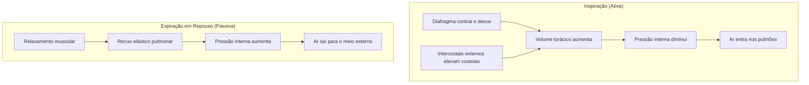
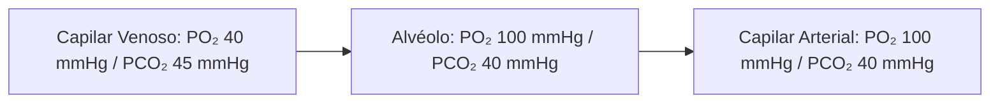
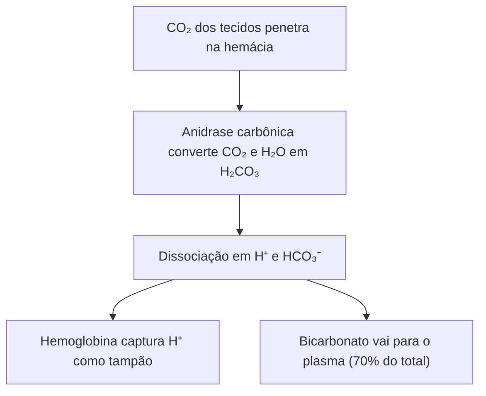
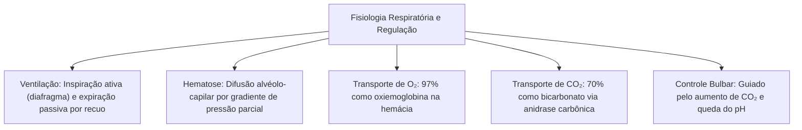

No estudo da anatomia e fisiologia humana do sistema respiratório, a ventilação e as trocas gasosas mantêm o equilíbrio corporal. A ventilação pulmonar consiste no fluxo de ar entre o ambiente e os alvéolos. Esse movimento decorre de variações de pressão na cavidade torácica. Nos alvéolos, a hematose oxigena o sangue venoso e remove o dióxido de carbono. Paralelamente, o tronco encefálico ajusta o ritmo respiratório conforme o pH e os níveis de gases no sangue.

> [!objetivos]
> - Compreender a mecânica ventilatória, diferenciando inspiração e expiração.
> - Analisar os gradientes de pressão parcial que orientam a difusão na hematose.
> - Diferenciar as formas de transporte de oxigênio pela hemoglobina.
> - Mapear o transporte do dióxido de carbono e o papel da anidrase carbônica.
> - Explicar o controle respiratório bulbar baseado no pH e no CO₂.

## O Processo Respiratório e a Biomecânica Ventilatória

A ventilação pulmonar é o movimento físico do ar entre a atmosfera e os pulmões. Ela não se confunde com a respiração celular, que é a quebra intracelular de glicose para formar ATP.

O ar desloca-se de regiões com maior pressão para áreas com menor pressão. Pela lei de Boyle, a pressão de um gás varia de forma inversa ao volume do recipiente. Assim, quando a caixa torácica expande, a pressão interna diminui e o ar entra. Quando o tórax se retrai, a pressão sobe e o ar sai.

O ciclo respiratório apresenta duas etapas fundamentais:

### Inspiração Pulmonar

A inspiração é um processo sempre **ativo**. Ela exige contração muscular coordenada:
- **Diafragma:** é o principal músculo inspiratório. Ao se contrair, ele achata e desce em direção ao abdômen. Essa ação responde por cerca de 75% do aumento do volume torácico.
- **Músculos Intercostais Externos:** elevam as costelas para cima e para fora. Respondem por 25% da expansão da caixa torácica.

A dilatação do tórax reduz a pressão intrapulmonar em cerca de 1 mmHg abaixo da atmosfera. Essa pressão negativa suga o ar externo para os alvéolos.

### Expiração Pulmonar

Em repouso, a expiração é um processo **passivo**:
- O diafragma e os músculos intercostais externos relaxam.
- O parênquima pulmonar retrai pela sua própria elasticidade natural.
- O volume torácico diminui rapidamente.
- A pressão intrapulmonar sobe cerca de 1 mmHg acima da pressão atmosférica.
- O ar é empurrado para o exterior.

Durante exercícios físicos, a expiração passa a ser **ativa (forçada)**. Nela atuam os músculos abdominais e os intercostais internos. A contração do abdômen comprime as vísceras para cima contra o diafragma, expulsando o ar com rapidez.

> [!atencao] Músculos da Mecânica Respiratória
> Guarde bem para a prova:
> - **Inspiração em repouso:** Ativa. Usa diafragma (75%) e intercostais externos (25%).
> - **Expiração em repouso:** Passiva. Ocorre por recuo elástico e relaxamento muscular.
> - **Expiração forçada:** Ativa. Recruta músculos abdominais e intercostais internos.

## Hematose e o Transporte de Gases

O ar atmosférico ao nível do mar tem pressão total de 760 mmHg. O oxigênio compõe cerca de 21% da atmosfera, correspondendo a uma pressão parcial de aproximadamente 160 mmHg ao ar livre. O nitrogênio perfaz 78% e o CO₂ apenas 0,04%.

Nos alvéolos pulmonares, o ar inspirado mistura-se ao ar residual. A pressão parcial de oxigênio (PO₂) no alvéolo fica em cerca de 100 mmHg. A pressão parcial de gás carbônico (PCO₂) alveolar fixa-se em 40 mmHg.

A **hematose** é a transformação de sangue venoso em sangue arterial nos capilares alveolares. Ela decorre de difusão simples passiva a favor dos gradientes de pressão parcial.

| Compartimento | PO₂ (Oxigênio) | PCO₂ (Gás Carbônico) | Condição do Sangue |
|---|---|---|---|
| **Alvéolo Pulmonar** | 100 mmHg | 40 mmHg | Ar renovado de troca |
| **Sangue Venoso Chegando** | 40 mmHg | 45 mmHg | Pobre em O₂ e rico em CO₂ |
| **Sangue Arterial Saindo** | 100 mmHg | 40 mmHg | Oxigenado para a aorta |
| **Tecidos Periféricos** | 40 mmHg | 45 mmHg | Consumo celular de O₂ |

Como a PO₂ alveolar (100 mmHg) é maior que a do sangue venoso (40 mmHg), o O₂ difunde para o capilar. Ao mesmo tempo, a PCO₂ venosa (45 mmHg) supera a alveolar (40 mmHg). O CO₂ difunde do sangue para o alvéolo e é eliminado.

## O Transporte de Oxigênio no Sangue

O oxigênio possui baixa solubilidade na água plasmática. Por isso, apenas cerca de **3% do O₂** viaja dissolvido no plasma.

Os restantes **97% do oxigênio** são transportados no interior das hemácias pela **hemoglobina**. Forma-se a **oxiemoglobina (HbO₂)**. Cada molécula de hemoglobina contém quatro átomos de ferro (Fe²⁺) e pode ligar-se a quatro moléculas de O₂.

A ligação entre hemoglobina e oxigênio é instável e reversível:
- Nos alvéolos com alta PO₂, a hemoglobina atinge saturação de quase 98%.
- Nos tecidos com baixa PO₂, a hemoglobina libera seu oxigênio com facilidade.

A liberação de oxigênio nos tecidos é favorecida pelo **efeito Bohr**. Tecidos ativos produzem ácido láctico e CO₂. Isso reduz o pH e eleva a temperatura local. A acidez tecidual diminui a afinidade da hemoglobina pelo oxigênio, facilitando a entrega de O₂ às células.

A curva de dissociação da oxiemoglobina tem formato sigmoide (em forma de S). Essa geometria reflete a cooperatividade da ligação do oxigênio. Quando a primeira molécula de O₂ se liga ao ferro, as outras três subunidades aumentam sua afinidade. Mesmo se a PO₂ alveolar cair de 100 para 60 mmHg (como em elevadas altitudes), a saturação da hemoglobina mantém-se em cerca de 90%. Esse platô de segurança resguarda o aporte de oxigênio ao encéfalo e miocárdio em ambientes rarefeitos.

> [!pegadinha] Intoxicação por Monóxido de Carbono
> O monóxido de carbono (CO) liga-se aos mesmos sítios de ferro da hemoglobina. Ele forma a **carboxiemoglobina (HbCO)**. A afinidade da hemoglobina pelo CO é cerca de 200 vezes maior que pelo oxigênio. Essa ligação é praticamente irreversível. Ela bloqueia os sítios de O₂ e causa asfixia química grave. Esse risco é frequente em incêndios e queima de combustíveis.

## O Transporte de Gás Carbônico no Sangue

O dióxido de carbono gerado pelas células é transportado até os pulmões por três vias:
1. **Dissolvido no plasma (~7%):** o CO₂ é mais solúvel em água que o oxigênio.
2. **Carbaminoemoglobina (~23%):** liga-se às globinas da hemoglobina sem competir com o ferro.
3. **Íons bicarbonato no plasma (~70%):** é a principal forma de transporte de CO₂.

Ao entrar na hemácia, o CO₂ reage com a água sob ação da enzima **anidrase carbônica**. Essa reação produz ácido carbônico (H₂CO₃), que se dissocia em íons H⁺ e **bicarbonato (HCO₃⁻)**:

CO₂ + H₂O em equilíbrio com H₂CO₃ em equilíbrio com H⁺ + HCO₃⁻

A hemoglobina atua como tampão e aprisiona os íons H⁺ livres. O bicarbonato sai da hemácia para o plasma através de uma proteína carreadora de membrana. Para manter a neutralidade elétrica das cargas da hemácia, um íon cloreto (Cl⁻) entra no citoplasma eritrocitário. Esse mecanismo denomina-se **desvio de cloreto de Hamburger**. Nos capilares alveolares dos pulmões, o gradiente inverte-se por completo. O bicarbonato reentra no eritrócito, o cloreto sai, a anidrase carbônica regenera CO₂ gasoso e o gás difunde para o alvéolo para ser expirado.

## O Controle da Respiração

Embora o córtex permita ações conscientes como prender o ar, o ritmo respiratório basal é automático. Ele é regulado pelo tronco encefálico, nos centros situados no **bulbo** e na **ponte**:
- **Centro Bulbar:** estabelece a frequência respiratória cíclica de base.
- **Centros Pontinos:** coordenam a transição suave entre inspiração e expiração.

### Quimiorreceptores Centrais e Periféricos

Os centros respiratórios recebem estímulos de receptores químicos corporais:
- **Quimiorreceptores Centrais:** situam-se na superfície ventral do bulbo. Eles entram em contato com o líquor. Detectam alterações de íons H⁺ geradas pelo CO₂ que cruza a barreira hematoencefálica. Se o CO₂ sanguíneo aumenta, o líquor acidifica e o bulbo acelera a respiração.
- **Quimiorreceptores Periféricos:** localizam-se no arco aórtico e nos corpos carotídeos. Detectam reduções acentuadas de PO₂ arterial e elevações de PCO₂ e H⁺ no sangue.

> [!bizu] Principal Estímulo Respiratório
> Em condições normais, o principal estímulo para a respiração humana não é a falta de oxigênio. O verdadeiro gatilho é o **aumento de gás carbônico (hipercapnia) e a redução do pH sanguíneo**. Se o CO₂ arterial sobe levemente, o bulbo amplia de pronto a ventilação para expelir o ácido volátil.

## Mapa do capítulo

### Para fixar

- A ventilação pulmonar é o fluxo mecânico de ar determinado por gradientes de pressão torácica.
- A inspiração em repouso é ativa e depende da contração do diafragma e dos intercostais externos.
- A expiração em repouso é passiva e ocorre pelo recuo elástico dos pulmões.
- A hematose nos alvéolos pulmonares ocorre por difusão simples passiva de gases.
- A maior parte do oxigênio sanguíneo é transportada pela hemoglobina como oxiemoglobina.
- O dióxido de carbono é conduzido principalmente na forma de íons bicarbonato no plasma.
- A enzima anidrase carbônica catalisa a conversão de CO₂ e água em ácido carbônico.
- O monóxido de carbono liga-se com alta afinidade à hemoglobina, gerando carboxiemoglobina.
- O controle respiratório involuntário localiza-se no bulbo e na ponte do tronco encefálico.
- O aumento da pressão parcial de CO₂ e a redução do pH são os principais estímulos para acelerar a respiração.
