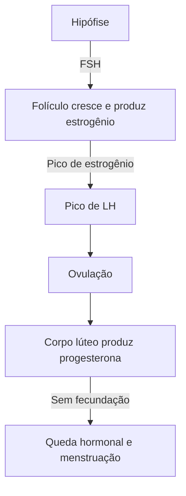

O corpo produz resíduos que precisam sair, e o sistema urinário cuida disso, ao mesmo tempo em que regula a água e os sais do sangue. O sistema reprodutor tem outra missão: garantir a continuidade da espécie, produzindo e transportando os gametas. Este capítulo reúne os dois sistemas, que compartilham estruturas na região da pelve, e descreve os rins e o néfron, as vias urinárias, os órgãos reprodutores masculinos e femininos e o ciclo menstrual, que é o ponto mais cobrado em prova.

> [!objetivos]
> - Descrever os órgãos do sistema urinário e as etapas de formação da urina.
> - Identificar as partes do néfron e as principais excretas.
> - Descrever os órgãos e as glândulas do sistema reprodutor masculino e feminino.
> - Explicar as fases do ciclo menstrual e os hormônios envolvidos.

## Sistema urinário

O sistema é formado por dois **rins**, dois **ureteres**, a **bexiga urinária** e a **uretra**. Suas funções são **excretar** compostos do metabolismo, eliminar a urina e **regular** o volume do sangue e a concentração de solutos.

Os rins ficam atrás do peritônio (são **retroperitoneais**), um de cada lado da coluna. Cada rim tem uma região externa, o **córtex**, e uma interna, a **medula**. A urina se forma e sai pela **pelve renal** (ou pélvis), desce pelo **ureter** até a **bexiga**, um saco muscular que a armazena, e é eliminada pela **uretra**.

As principais excretas que o rim retira do sangue são:

| Excreta | Origem |
| --- | --- |
| Ureia | Degradação de aminoácidos (proteínas) |
| Ácido úrico | Degradação de bases nitrogenadas |
| Creatinina | Uso da creatina fosfato nos músculos |

### O néfron

A unidade funcional do rim é o **néfron**, e cada rim tem cerca de um milhão. Ele tem duas partes:

- O **corpúsculo renal**, esférico, formado pelo **glomérulo** (um novelo de capilares) e pela **cápsula de Bowman**, que o envolve. Ali ocorre a **filtração** do sangue.
- O **túbulo renal**, que se divide em túbulo contorcido proximal, alça de Henle, túbulo contorcido distal e ducto coletor.

A formação da urina tem três processos:

| Processo | Onde | O que ocorre |
| --- | --- | --- |
| Filtração | Corpúsculo renal | Água, íons, glicose, ureia e aminoácidos passam do sangue à cápsula; células e proteínas grandes ficam |
| Reabsorção | Túbulos | Água, glicose, aminoácidos e sais voltam ao sangue; a maior parte no túbulo proximal |
| Secreção | Túbulos | Substâncias como íons de hidrogênio, potássio e drogas passam do sangue ao túbulo |

Cerca de 99% do filtrado é reabsorvido. A concentração da urina é regulada por hormônios: o **hormônio antidiurético (ADH)** aumenta a reabsorção de água nos ductos coletores, e a **aldosterona** aumenta a reabsorção de sódio. Sem a reabsorção de água, a desidratação seria rapidamente fatal.

> [!pegadinha]
> Dizer que a glicose e as proteínas fazem parte da urina normal. A glicose é filtrada, mas **totalmente reabsorvida**, e as proteínas grandes quase não passam pelo glomérulo. A presença de glicose ou de proteínas na urina indica alteração, como o diabetes ou doença renal.

## Sistema reprodutor masculino

A função do sistema reprodutor é produzir os **gametas** (células sexuais), nutri-los e transportá-los, além de produzir hormônios sexuais. O sistema masculino tem:

- **Gônadas:** os dois **testículos**, que ficam no **escroto**, fora do corpo, em temperatura um pouco menor que a corporal, necessária à produção de espermatozoides. Produzem os espermatozoides nos túbulos seminíferos e a testosterona nas células de Leydig.
- **Ductos:** o **epidídimo** (onde os espermatozoides amadurecem), o **ducto deferente** e o **ducto ejaculatório**, que desemboca na **uretra**.
- **Glândulas acessórias:** as **vesículas seminais**, a **próstata** e as **glândulas bulbouretrais**, que produzem o líquido seminal, rico em frutose para nutrir os espermatozoides.
- **Pênis:** órgão erétil, com os **corpos cavernosos** e o **corpo esponjoso**, por onde passa a uretra. A ereção ocorre pelo enchimento de sangue, estimulado pelo parassimpático.

O espermatozoide tem **cabeça** (com o núcleo e o acrossomo, que tem enzimas), **peça intermediária** (com mitocôndrias, que fornecem energia) e **cauda** (flagelo, para o movimento).

## Sistema reprodutor feminino

O sistema feminino tem:

- **Ovários:** as gônadas, que produzem os ovócitos e os hormônios estrogênio e progesterona;
- **Tubas uterinas** (trompas): conduzem o ovócito até o útero e é onde, em geral, ocorre a **fecundação**;
- **Útero:** órgão muscular onde o embrião se desenvolve; sua parede tem o **endométrio** (camada interna que se renova a cada ciclo) e o **miométrio** (camada muscular);
- **Vagina:** canal de ligação com o meio externo;
- **Vulva:** conjunto dos órgãos genitais externos, com os lábios maiores e menores e o clitóris.

### Ciclo menstrual

O ciclo menstrual, de cerca de 28 dias, é o conjunto de modificações do ovário e do útero, controlado pelos hormônios da hipófise (FSH e LH) e dos ovários (estrogênio e progesterona). Considerando o primeiro dia da menstruação como dia 1, as fases são:

| Fase | Dias | O que ocorre | Hormônios |
| --- | --- | --- | --- |
| Menstrual | 1 a 5 | Descamação do endométrio | Queda de estrogênio e progesterona |
| Folicular (proliferativa) | 6 a 13 | O folículo cresce; o endométrio se reconstitui | FSH estimula o folículo; o estrogênio sobe |
| Ovulação | Em torno do 14 | O folículo maduro libera o ovócito | Pico de LH |
| Lútea (secretora) | 15 a 28 | O corpo lúteo produz progesterona e prepara o endométrio | Progesterona alta |

Se o ovócito é fecundado, o embrião se implanta no endométrio, o corpo lúteo continua a produzir progesterona e a menstruação não ocorre. Se não há fecundação, o corpo lúteo degenera, a progesterona cai e a menstruação recomeça.

> [!bizu]
> Para o ciclo, lembre uma regra: **FSH faz o folículo crescer, o pico de LH faz a ovulação, e a progesterona (do corpo lúteo) prepara o útero para a gravidez**. A queda da progesterona provoca a menstruação. E a ovulação, em um ciclo de 28 dias, ocorre por volta do 14º dia, e não no início nem no fim.

## Detalhes que completam o quadro

**Vias urinárias.** A pelve renal se forma pela união dos **cálices** renais, que recolhem a urina dos ductos coletores. O ureter leva a urina à bexiga por peristaltismo, e dois esfíncteres controlam a micção: o interno, involuntário, e o externo, voluntário. A uretra feminina é curta, cerca de 4 cm, o que facilita as infecções urinárias na mulher; a masculina, mais longa, serve também à passagem do sêmen.

**Gametogênese e maturação.** Os gametas se formam por meiose. No homem, a espermatogênese produz continuamente espermatozoides a partir da puberdade. Na mulher, a ovogênese começa antes do nascimento, com a formação dos ovócitos primários, e o número de ovócitos é finito; a cada ciclo, um deles completa a **maturação**. O ovócito maduro é liberado e permanece viável por cerca de 24 horas, enquanto o espermatozoide pode sobreviver até três dias no trato feminino.

**Eixo hormonal.** O hipotálamo libera o hormônio liberador de gonadotrofinas (GnRH), que age na hipófise anterior, ou **adenoipófise**, a hipófise anterior (pituitária), estimulando a produção de duas **gonadotrofinas**: o FSH (hormônio folículo-estimulante) e o LH (hormônio **luteinizante**). No homem, o FSH atua na espermatogênese e o LH estimula a produção de testosterona. Na mulher, como vimos, comandam o ciclo.

**Fases da vida.** Na puberdade, os hormônios sexuais promovem o desenvolvimento dos **caracteres sexuais secundários**, como a voz mais grave e a barba no homem e o desenvolvimento das mamas na mulher. Na **menopausa**, em geral por volta dos 50 anos, a produção de estrogênio e progesterona cai, o ciclo cessa e a mulher deixa de ser fértil. O colo do útero, também chamado de **cérvix**, é a parte inferior do útero que se abre na vagina e é onde se realiza o exame preventivo do câncer de colo.

> [!atencao] Vasectomia e laqueadura
> Os dois métodos de esterilização cirúrgica interrompem o trajeto dos gametas sem alterar os hormônios. Na **vasectomia**, o **ducto deferente** é seccionado, e o homem continua a ejacular, só que sem espermatozoides. Na **laqueadura**, as **tubas uterinas** são ligadas, e o ovócito não chega ao útero nem encontra o espermatozoide. Em nenhum dos dois casos há alteração do desejo sexual, nem do ciclo hormonal.

## Como a banca cobra este assunto

Os padrões mais frequentes são:

- **Néfron:** corpúsculo renal e túbulos, e onde ocorrem filtração e reabsorção.
- **Excretas:** ureia, ácido úrico e creatinina, e sua origem.
- **Hormônios renais:** ADH e aldosterona.
- **Aparelho masculino:** trajeto dos espermatozoides e função das glândulas acessórias.
- **Ciclo menstrual:** associação entre fase, dia e hormônio, e o momento da ovulação.

## Mapa do capítulo

| Tema | Ideia central | Cuidado |
| --- | --- | --- |
| Rim | Retroperitoneal; córtex e medula | Unidade funcional: néfron |
| Néfron | Filtração, reabsorção e secreção | Glicose é reabsorvida |
| Excretas | Ureia, ácido úrico e creatinina | Origem diferente |
| Testículo | Espermatozoides e testosterona | Fora do corpo, por causa da temperatura |
| Glândulas masculinas | Vesículas seminais, próstata e bulbouretrais | Líquido seminal |
| Ciclo | FSH, LH, estrogênio e progesterona | Ovulação em torno do 14º dia |

### Para fixar

- O sistema urinário é formado por rins, ureteres, bexiga e uretra.
- A unidade funcional do rim é o néfron, com corpúsculo renal e túbulo.
- A filtração ocorre no glomérulo, e a maior parte da água e da glicose é reabsorvida.
- As principais excretas são ureia, ácido úrico e creatinina.
- O ADH aumenta a reabsorção de água, e a aldosterona, a de sódio.
- Os testículos produzem espermatozoides e testosterona e ficam no escroto.
- Os ductos masculinos são epidídimo, deferente, ejaculatório e uretra.
- O ciclo menstrual tem fases menstrual, folicular, ovulação e lútea, com ovulação por volta do 14º dia.
