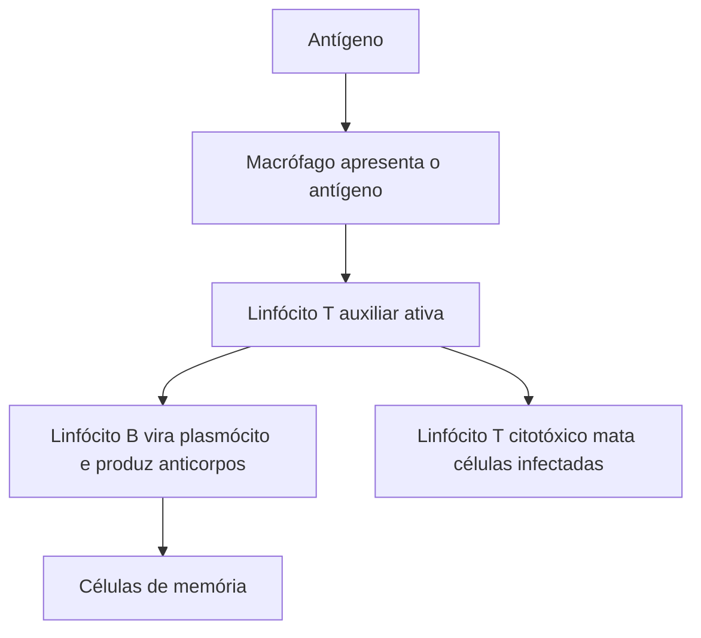

O corpo é alvo constante de vírus, bactérias, fungos e parasitas. O **sistema imunitário** (ou imune) é o conjunto de células, tecidos e moléculas que reconhece e elimina esses invasores, além de células do próprio corpo que se tornaram anormais, como as tumorais. Ele atua em dois níveis: a **imunidade inata**, rápida e inespecífica, e a **imunidade adaptativa**, mais lenta, específica e com memória. Este capítulo descreve os dois níveis, as células envolvidas, os anticorpos e a base das vacinas.

> [!objetivos]
> - Distinguir imunidade inata e adaptativa.
> - Reconhecer as principais células e barreiras de defesa.
> - Explicar a resposta imune, a memória e os anticorpos.
> - Diferenciar imunização ativa e passiva.

## Imunidade inata

É a primeira linha de defesa, presente desde o nascimento, **igual para qualquer invasor** (inespecífica) e sem memória. Seus componentes:

| Componente | Exemplos | Função |
| --- | --- | --- |
| Barreiras físicas e químicas | Pele, mucosas, muco, cílios, lágrimas, saliva (lisozima), suor, suco gástrico ácido | Impedem a entrada ou destroem microrganismos |
| Células fagocitárias | Neutrófilos, macrófagos e células dendríticas | Englobam e destroem invasores (**fagocitose**) |
| Células *natural killer* (NK) | Linfócitos citotóxicos inespecíficos | Eliminam células infectadas por vírus e células tumorais |
| Proteínas | Sistema complemento, interferons | O complemento perfura microrganismos; os interferons protegem células vizinhas contra vírus |
| Inflamação | Vermelhidão, calor, inchaço e dor | Leva células de defesa ao local da lesão |
| Febre | Elevação da temperatura | Dificulta a multiplicação de microrganismos |

Na **inflamação**, células lesadas e mastócitos liberam **histamina**, que dilata os vasos e aumenta a permeabilidade, trazendo plasma e leucócitos. Os **neutrófilos** são os primeiros a chegar. Os **macrófagos**, derivados dos monócitos, fagocitam e **apresentam antígenos** aos linfócitos, o que faz a ponte para a resposta adaptativa.

## Imunidade adaptativa

É **específica**: reconhece um antígeno determinado, e tem **memória**, isto é, responde mais rápido e mais forte a um segundo contato com o mesmo antígeno. É feita pelos **linfócitos**, que nascem na medula óssea. Os linfócitos **B** amadurecem na medula; os **T** migram para o **timo** e lá amadurecem. Os órgãos linfoides incluem a medula óssea e o timo (primários) e os linfonodos, o baço, as amígdalas e as placas de Peyer (secundários).

| Célula | Função |
| --- | --- |
| Linfócito B | Reconhece antígenos e se transforma em **plasmócito**, que produz anticorpos (imunidade humoral) |
| Linfócito T auxiliar (CD4) | Coordena a resposta, ativando B e T citotóxicos; é o alvo do vírus HIV |
| Linfócito T citotóxico (CD8) | Destrói diretamente células infectadas (imunidade celular) |
| Linfócito T regulador | Controla e encerra a resposta |
| Células de memória | Permanecem após a infecção e permitem resposta rápida |

## Resposta imune e anticorpos

Um **antígeno** é qualquer molécula que provoca resposta imune. O **anticorpo** (ou imunoglobulina) é uma proteína em forma de Y, produzida pelo plasmócito, que se liga **especificamente** a um antígeno e o neutraliza ou o marca para destruição. Há cinco classes principais:

| Classe | Onde e para que |
| --- | --- |
| IgG | A mais abundante no sangue; atravessa a placenta e protege o feto; principal na resposta secundária |
| IgM | A primeira a ser produzida na resposta primária; grande, ativa o complemento |
| IgA | Presente em secreções (saliva, lágrima, leite materno), protege as mucosas |
| IgE | Ligada a alergias e a defesa contra parasitas; ativa mastócitos |
| IgD | Receptor dos linfócitos B |

O primeiro contato com um antígeno gera a **resposta primária**, lenta (dias) e de pouco anticorpo, com predomínio da IgM. O segundo contato gera a **resposta secundária**, muito mais rápida e intensa, com predomínio da IgG, graças às células de memória.

> [!pegadinha]
> Dizer que o linfócito T produz anticorpos, ou que os anticorpos são produzidos pelos linfócitos B diretamente. Os anticorpos são produzidos pelos **plasmócitos**, que derivam dos linfócitos B. Os linfócitos T agem na imunidade celular, e não fabricam anticorpos. Outra confusão é achar que a imunidade inata tem memória: ela não tem.

## Imunização: vacinas e soros

| Tipo | Como funciona | Duração | Exemplo |
| --- | --- | --- | --- |
| **Ativa** | O organismo produz seus próprios anticorpos e células de memória | Longa | Vacinas e a própria doença |
| **Passiva** | O organismo recebe anticorpos prontos | Curta | Soro antiofídico, anticorpos da mãe pela placenta e pelo leite |

As **vacinas** apresentam o antígeno enfraquecido, morto ou fragmentado, sem causar a doença, e geram memória. O **soro** contém anticorpos prontos e age de imediato, mas não deixa memória. Por isso o soro é usado em emergências (picada de cobra, tétano) e a vacina, em prevenção.

> [!bizu]
> Resuma a diferença assim: **vacina treina o corpo, soro empresta anticorpos**. Vacina é imunização ativa, demora a agir, mas dura; soro é passiva, age na hora, mas dura pouco. E o leite materno, com IgA, é imunização passiva natural.

## Alergias e imunodeficiências

Na **alergia**, o sistema reage de forma exagerada a antígenos inofensivos, os alérgenos, com produção de IgE e liberação de histamina. A forma grave é o choque anafilático. Nas **doenças autoimunes**, o sistema ataca os tecidos do próprio corpo, como no lúpus e no diabetes tipo 1. Na **imunodeficiência**, as defesas estão reduzidas; um exemplo é a aids, em que o HIV destrói os linfócitos T auxiliares.

## Como a banca cobra este assunto

Os padrões mais frequentes são:

- **Inata e adaptativa:** qual tem memória e qual é específica.
- **Células:** função de neutrófilos, macrófagos, linfócitos B e T e plasmócitos.
- **Anticorpos:** quem os produz e as classes mais importantes.
- **Vacina e soro:** imunização ativa e passiva.
- **Alergia e HIV:** reação exagerada e destruição do linfócito T auxiliar.

## Mapa do capítulo

| Tema | Ideia central | Cuidado |
| --- | --- | --- |
| Inata | Rápida, inespecífica e sem memória | Inclui barreiras, fagócitos, NK e inflamação |
| Adaptativa | Específica e com memória | Linfócitos B e T |
| Anticorpo | Produzido pelo plasmócito | Linfócito T não produz |
| Resposta secundária | Mais rápida e intensa | Predomina a IgG |
| Vacina | Imunização ativa | Dura mais |
| Soro | Imunização passiva | Age na hora, mas não dá memória |

### Para fixar

- A imunidade inata é rápida, inespecífica e não tem memória.
- A imunidade adaptativa é específica e guarda memória.
- Neutrófilos e macrófagos fagocitam; células NK destroem células infectadas e tumorais.
- Os linfócitos B viram plasmócitos, que produzem anticorpos.
- Os linfócitos T auxiliares coordenam a resposta e são atacados pelo HIV.
- A IgG é o anticorpo mais abundante e atravessa a placenta; a IgA protege as mucosas.
- Vacina é imunização ativa e dura; soro é passiva e dura pouco.
- A segunda exposição ao antígeno gera resposta mais rápida e intensa.
