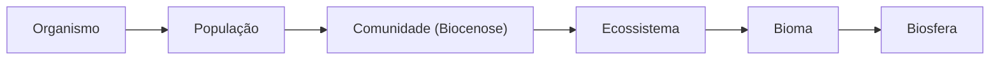
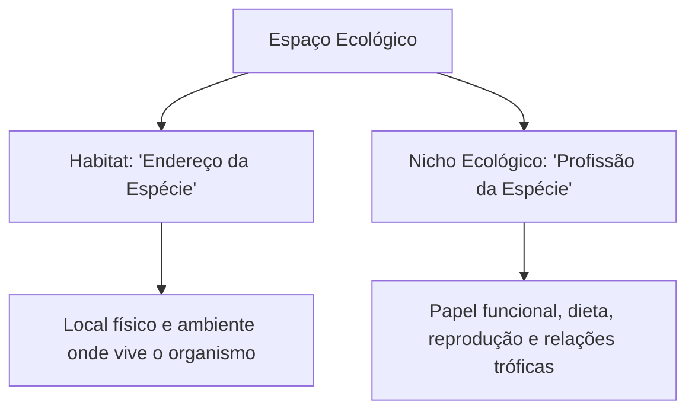
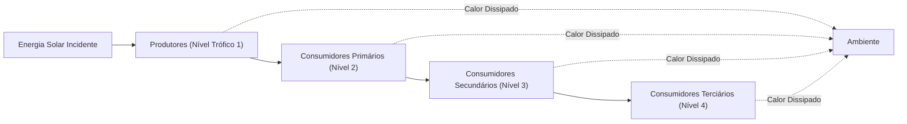
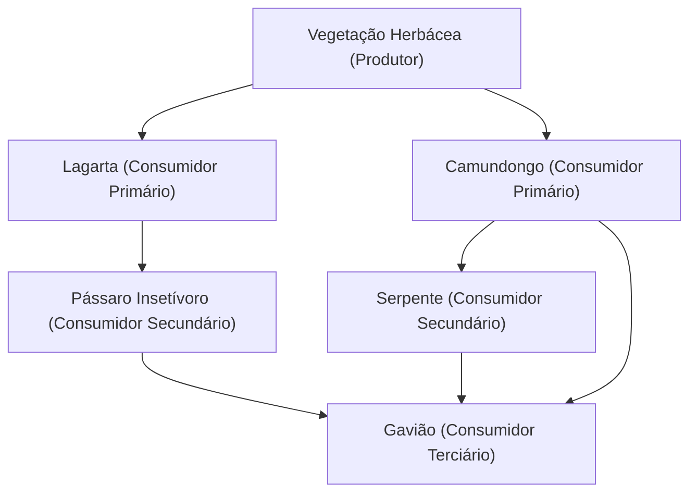
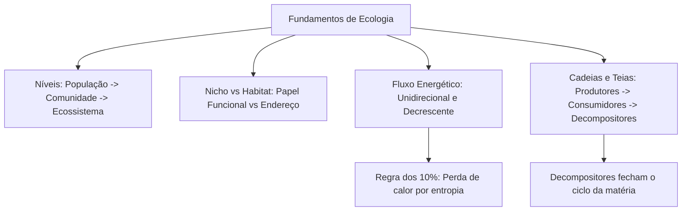

A ecologia investiga as interações mútuas entre os seres vivos e as variáveis físico-químicas do meio ambiente. O termo tem origem grega, combinando oikós (casa) e logos (estudo). Essa ciência analisa onde as espécies ocorrem e quantas são na biosfera. Em concursos públicos da segurança pública, o conhecimento ecológico é essencial para compreender dinâmicas florestais e desastres ambientais. Este capítulo apresenta os níveis de organização biológica, a diferença entre habitat e nicho, o fluxo unidirecional de energia e as teias alimentares.

> [!objetivos]
> - Compreender a hierarquia ecológica: organismo, população, comunidade, ecossistema, bioma e biosfera.
> - Diferenciar os padrões espaciais de dispersão de populações e o conceito de metapopulação.
> - Dominar a distinção conceitual e prática entre habitat e nicho ecológico.
> - Compreender o fluxo de energia unidirecional e decrescente ao longo dos níveis tróficos.
> - Mapear cadeias e teias alimentares, identificando produtores, consumidores, detritívoros e decompositores.

## Níveis de Organização Ecológica e Dinâmica Populacional

A ecologia estrutura seus estudos em níveis integrados de complexidade biológica crescente. Cada patamar exibe propriedades emergentes que não existem no nível imediatamente inferior:

1. Organismo: indivíduo funcional pertencente a uma espécie biológica singular.
2. População: conjunto de indivíduos da mesma espécie que ocupam uma área geográfica comum em determinado período de tempo. Exemplos clássicos são as capivaras que habitam uma represa ou os pulgões em um ramo de planta.
3. Comunidade (biocenose ou biota): agrupamento de todas as populações de espécies diferentes que convivem no mesmo biótopo (espaço físico), interagindo direta ou indiretamente.
4. Ecossistema: unidade funcional resultante da interação entre os fatores bióticos (comunidade viva) e os fatores abióticos (luz, água, gases, solo, minerais e temperatura).
5. Bioma: grande unidade geográfica regional com clima, relevo e fitofisionomia vegetacional característicos. Reúne múltiplos ecossistemas similares.
6. Biosfera: conjunto global de todos os ecossistemas do planeta Terra onde a vida se manifesta.

As populações possuem atributos próprios mensuráveis, como densidade, taxa de crescimento, estrutura etária e variabilidade genética. No plano espacial, os indivíduos de uma população distribuem-se conforme três arranjos fundamentais:

| Padrão de Dispersão | Descrição Estrutural | Fatores Determinantes Comuns | Exemplo Biológico |
| --- | --- | --- | --- |
| Agregado (Agrupado) | Indivíduos formam grupos ou bandos | Distribuição irregular de recursos e proteção social | Cardumes de peixes e manadas de herbívoros |
| Aleatório | Indivíduos espalham-se sem ordem definida | Recursos homogêneos e ausência de atração ou repulsão | Dentes-de-leão dispersos pelo vento |
| Uniforme | Espaçamento regular e distância constante | Competição intensa por recursos e territorialismo | Arbustos no deserto e aves nidificando em praias |

O conceito de metapopulação descreve um mosaico de subpopulações locais da mesma espécie separadas no espaço por fragmentação ambiental, mas interligadas por fluxo migratório de indivíduos. Caso uma subpopulação se extinga localmente por escassez de recursos, a imigração vinda de fragmentos vizinhos viabiliza a recolonização.

## Comunidade, Habitat e Nicho Ecológico

A comunidade biológica congrega populações que partilham o mesmo espaço físico. Ela apresenta atributos como riqueza de espécies, diversidade e dominância ecológica. A diversidade considera não apenas o número total de espécies, mas a equabilidade entre suas abundâncias relativas. O Índice de Diversidade de Shannon (H) sintetiza essas grandezas: comunidades dominadas por uma única espécie abundante têm menor diversidade do que comunidades equilibradas com proporções homogêneas.

Dois conceitos centrais da ecologia frequentemente confundidos em provas são o habitat e o nicho ecológico:

- Habitat: é o endereço físico do organismo, ou seja, o tipo de ambiente ou local geográfico onde a espécie normalmente vive e encontra condições propícias à sua sobrevivência. Exemplo: as florestas tropicais de galeria constituem o habitat da onça-pintada.
- Nicho ecológico: é a profissão do organismo na comunidade. Traduz o papel funcional exercido pela espécie: seus hábitos alimentares, períodos de atividade diurna ou noturna, tolerância térmica, táticas reprodutivas de acasalamento e interações com competidores e presas.

Diversas espécies podem coexistir em perfeita harmonia no mesmo habitat, desde que explorem nichos ecológicos distintos. Por exemplo, em uma savana africana, zebras, gazelas e girafas partilham a mesma paisagem, mas pastam em extratos vegetais diferentes.

Além disso, o nicho ecológico e o habitat de uma espécie podem mudar radicalmente durante a ontogenia (desenvolvimento individual):

- O girino vive em ambiente aquático límnico, atua como herbívoro ou detritívoro e respira por brânquias.
- O sapo adulto habita terra firme úmida, é predador carnívoro de artrópodes e respira por pulmões e pele.

O ecótono define a região de transição espacial entre dois ou mais ecossistemas adjacentes (como a borda de contato entre uma floresta e um campo cerrado). Essa zona de fronteira apresenta elevada diversidade biológica e densidade populacional, fenômeno denominado efeito de borda.

| Parâmetro Comparativo | Habitat | Nicho Ecológico |
| --- | --- | --- |
| Natureza Básica | Espacial e geográfica | Funcional e comportamental |
| Analogia Didática | O endereço do ser vivo | A ocupação funcional ou profissão |
| Coexistência | Várias espécies dividem o mesmo habitat | Ocupação de nichos idênticos gera competição excludente |
| Variação no Ciclo de Vida | Pode permanecer estável ou mudar | Muda frequentemente na metamorfose de anfíbios e insetos |

> [!pegadinha] Sobreposição de Nicho e Competição
> Se duas espécies ocupam nichos ecológicos exatamente idênticos no mesmo habitat, o Princípio de Gause (exclusão competitiva) estabelece que elas não poderão coexistir indefinidamente. Uma delas vencerá a disputa, forçando a outra a migrar, alterar seu nicho ou ser extinta localmente.

## Fluxo de Energia no Ecossistema

O funcionamento dos ecossistemas depende da entrada contínua de energia externa. O Sol representa a fonte primária original de quase toda a energia biológica do planeta Terra. Os organismos autótrofos fotossintetizantes (plantas terrestres, algas e fitoplâncton) captam a radiação luminosa e a transformam em energia potencial química armazenada em moléculas orgânicas.

A transferência energética através dos seres vivos obedece de forma irrestrita às leis da termodinâmica:

1. Primeira Lei da Termodinâmica (Conservação): a energia não pode ser criada nem destruída na biosfera, apenas transformada de uma forma em outra.
2. Segunda Lei da Termodinâmica (Entropia): em qualquer transferência energética, parte da energia útil degrada-se em calor dissipado no ambiente. O calor irradiado não pode ser reaproveitado pelos seres vivos para a síntese orgânica.

Consequentemente, o fluxo de energia nos ecossistemas é estritamente **unidirecional e decrescente** ao longo das cadeias alimentares. A energia entra pelo estrato dos produtores e vai diminuindo progressivamente a cada nível trófico sucessivo.

Em virtude dessa dissipação térmica contínua pela respiração celular, excreção e manutenção metabólica, apenas cerca de 10% da energia útil é transferida de um nível trófico para o patamar seguinte (regra dos 10%). Por esse motivo físico estrutural, as cadeias alimentares raramente ultrapassam quatro ou cinco elos tróficos sucessivos.

> [!atencao] Energia versus Matéria
> Nunca confunda a dinâmica da energia com a dinâmica da matéria. O fluxo de energia é unidirecional e aberto: a energia flui e dissipa-se na forma de calor, demandando aporte solar permanente. O ciclo da matéria é fechado e cíclico: átomos de carbono, oxigênio e nitrogênio são continuamente reciclados pelos decompositores.

## Cadeias e Teias Alimentares

A cadeia alimentar representa uma sequência linear e unidirecional de transferência de matéria e energia por meio da alimentação. Cada elo da cadeia corresponde a um nível trófico distinto:

1. Produtores (1º nível trófico): seres autótrofos que sintetizam sua própria biomassa orgânica a partir de matéria inorgânica simples, utilizando luz solar (fotossíntese) ou energia de reações químicas inorgânicas (quimiossíntese). Exemplos: árvores, gramíneas e diatomáceas fitoplanctônicas.
2. Consumidores primários (2º nível trófico): organismos heterótrofos herbívoros que se alimentam diretamente dos produtores. Exemplos: gafanhotos, veados e zooplâncton herbívoro.
3. Consumidores secundários (3º nível trófico): carnívoros que predam os herbívoros primários. Exemplo: sapos alimentando-se de gafanhotos.
4. Consumidores terciários e quaternários (4º e 5º níveis tróficos): predadores de topo que caçam carnívoros dos níveis precedentes. Exemplo: serpentes e gaviões.
5. Detritívoros: animais que se alimentam de dejetos e fragmentos macroscópicos de matéria orgânica morta, como minhocas, urubus, besouros rola-bosta e siris.
6. Decompositores: fungos e bactérias heterótrofas que atuam sobre resíduos microscópicos, quebrando moléculas orgânicas complexas em sais minerais, água e gás carbônico, disponibilizando nutrientes de volta aos produtores.

| Nível Trófico | Categoria Ecológica | Dieta Primordial | Organismos Típicos |
| --- | --- | --- | --- |
| 1º Nível | Produtores | Autótrofos (fotossíntese) | Gramíneas, algas verdes e fitoplâncton |
| 2º Nível | Consumidores Primários | Herbívoros | Gafanhotos, lagartas, bois e zooplâncton |
| 3º Nível | Consumidores Secundários | Carnívoros de 1ª ordem | Rãs, joaninhas e pequenos peixes |
| 4º Nível | Consumidores Terciários | Carnívoros de 2ª ordem | Cobras, gaviões e tubarões |
| Recicladores | Decompositores | Matéria orgânica morta | Fungos filamentosos e bactérias saprófitas |

Na natureza real, as relações tróficas não ocorrem em linhas isoladas. Diversas cadeias alimentares entrelaçam-se formando uma rede complexa denominada teia alimentar. Em uma teia, o mesmo animal pode ocupar múltiplos níveis tróficos dependendo do recurso consumido naquele instante. Por exemplo, uma ave onívora que ingere sementes atua como consumidora primária; quando captura uma lagarta herbívora, comporta-se como consumidora secundária.

Nas representações esquemáticas de cadeias e teias tróficas, as setas indicam rigorosamente o sentido do fluxo de matéria e energia. A seta aponta do organismo que foi consumido em direção ao organismo que o consome ("serve de alimento para").

> [!bizu] Orientação das Setas Tróficas
> Questões de concurso cobram frequentemente o significado das setas. A flecha nunca indica quem caça quem. A seta A -> B significa que a biomassa de A transfere-se para o corpo de B.

## Mapa do capítulo

### Para fixar

- População é o conjunto de indivíduos da mesma espécie na mesma área geográfica e no mesmo tempo.
- Comunidade ou biocenose reúne todas as espécies biológicas que convivem em um determinado biótopo.
- Ecossistema engloba os fatores bióticos e abióticos e as interações dinâmicas entre eles.
- Habitat representa o endereço ecológico da espécie, enquanto nicho reflete seu modo de vida e função trófica.
- O fluxo de energia é estritamente unidirecional e decrescente entre os níveis tróficos sucessivos.
- Em cada transição alimentar, a maior parte da energia útil dissipa-se na forma de calor metabólico.
- Decompositores transformam compostos orgânicos em substâncias minerais simples, reciclando a matéria.
