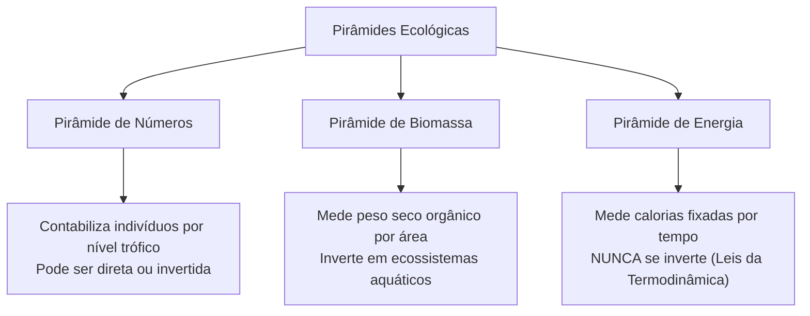
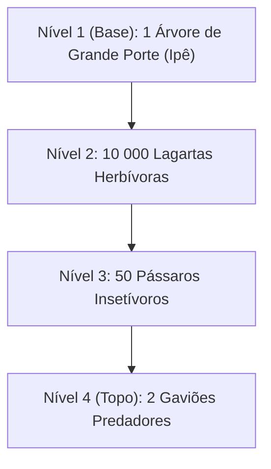
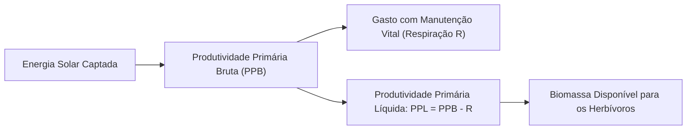
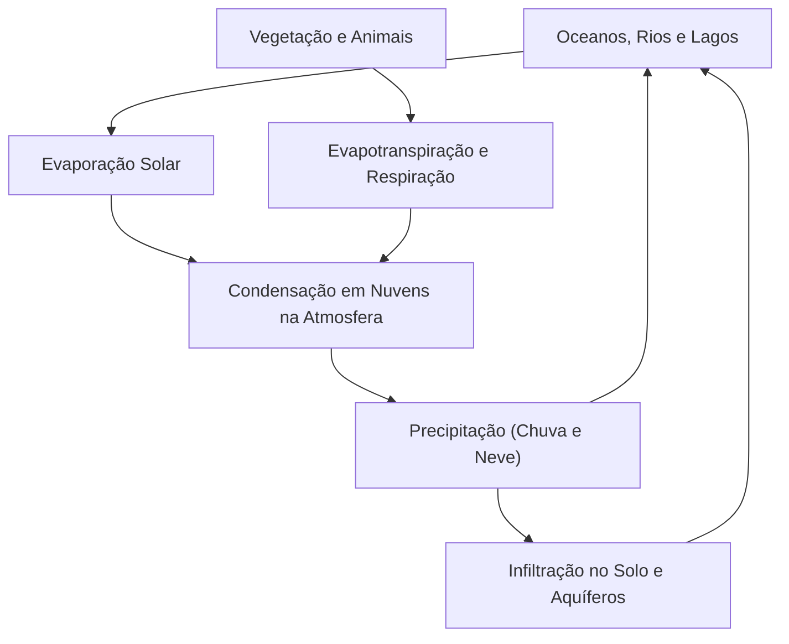
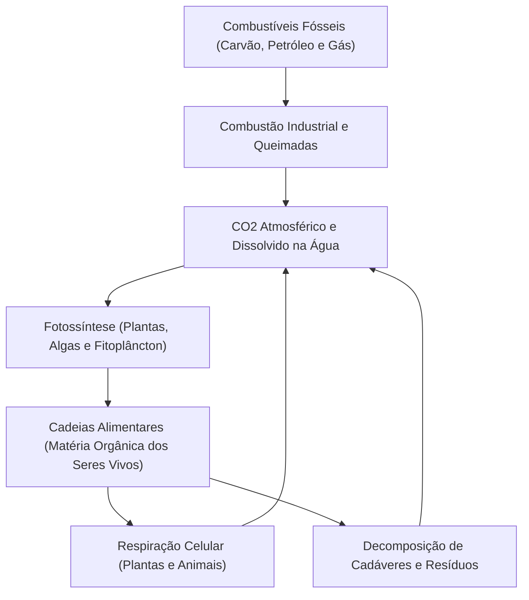
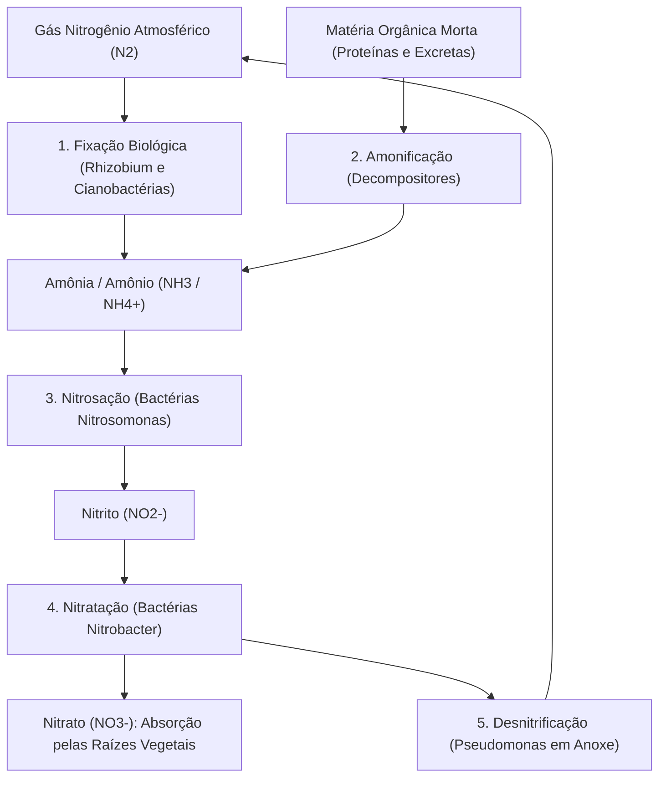
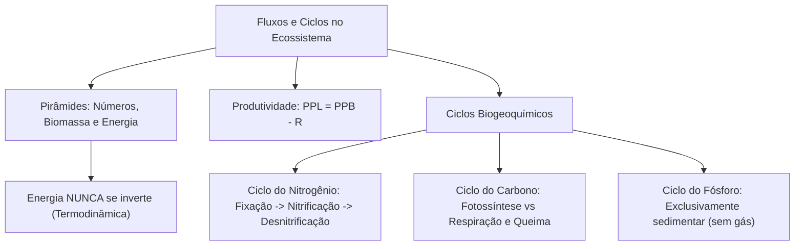

A dinâmica funcional dos ecossistemas fundamenta-se em dois processos paralelos e complementares. O primeiro é a transferência unidirecional e decrescente de energia ao longo dos níveis tróficos. O segundo é a recirculação cíclica contínua dos elementos químicos entre os seres vivos e o meio abiótico. Para avaliar com precisão matemática a estrutura das comunidades, a ecologia utiliza representações gráficas denominadas pirâmides ecológicas e mede as taxas de produção de biomassa. Este capítulo analisa a quantificação de cadeias alimentares, as produtividades primária e secundária, e os ciclos biogeoquímicos do carbono, nitrogênio, oxigênio, fósforo e água.

> [!objetivos]
> - Diferenciar e construir pirâmides ecológicas de números, biomassa e energia.
> - Compreender por que a pirâmide de energia é a única que nunca pode se inverter.
> - Calcular e relacionar a Produtividade Primária Bruta, a Respiração e a Produtividade Primária Líquida.
> - Detalhar as etapas do ciclo do nitrogênio: fixação, amonificação, nitrificação e desnitrificação.
> - Mapear os ciclos biogeoquímicos do carbono, do oxigênio, do fósforo e da água na biosfera.

## Pirâmides Ecológicas e Quantificação Trófica

As pirâmides ecológicas são diagramas gráficos retangulares sobrepostos que expressam a quantidade de matéria viva, o número de indivíduos ou a cota energética presente em cada elo da cadeia alimentar. A base do diagrama representa obrigatoriamente os produtores primários, sobre os quais assentam sucessivamente os consumidores primários, secundários e terciários.

Existem três tipos consagrados de pirâmides ecológicas:

### Pirâmide de Números

Essa pirâmide indica a quantidade absoluta de indivíduos existentes em cada nível trófico em determinada área de amostragem. Ela pode assumir conformação direta ou invertida:

1. Pirâmide de números direta: apresenta base larga e ápice estreito. É típica de pastagens abertas, onde milhões de pés de capim sustentam milhares de gafanhotos, que por sua vez alimentam dezenas de sapos e poucos gaviões.
2. Pirâmide de números invertida: ocorre com frequência quando o produtor primário possui porte arbóreo maciço. Uma única árvore de grande porte (produtor) serve de morada e alimento para dezenas de milhares de pulgões ou lagartas herbívoras (consumidores primários). Da mesma forma, cadeias parasitárias exibem conformações invertidas, onde poucos hospedeiros abrigam milhares de carrapatos e parasitas intestinais.

### Pirâmide de Biomassa

A pirâmide de biomassa quantifica a quantidade de matéria orgânica seca incorporada nos tecidos dos organismos por unidade de área ou de volume (expressa em gramas por metro quadrado, g/m², ou quilogramas por hectare, kg/ha).

Em ecossistemas continentais terrestres (florestas tropicais, cerrados e savanas), a pirâmide de biomassa é invariavelmente direta: a massa dos vegetais supera amplamente a dos herbívoros, e a massa destes excede a dos carnívoros.

Contudo, em ecossistemas aquáticos marinhos e lacustres, a pirâmide de biomassa pode apresentar-se **invertida**. A biomassa instantânea mensurada do fitoplâncton produtor (diatomáceas e cianobactérias) pode ser inferior à biomassa do zooplâncton herbívoro que dele se alimenta. Essa inversão momentânea sustenta-se graças à altíssima taxa de reprodução e rápido tempo de renovação do fitoplâncton: suas células dividem-se em poucas horas, sustentando um contingente consumidor de ciclo de vida mais longo sem esgotar o estoque produtivo.

> [!exemplo] Inversão de Biomassa em Ambientes Marinhos
> Em alto-mar, uma coleta momentânea pode indicar 4 g/m² de fitoplâncton sustentando 21 g/m² de zooplâncton. Isso ocorre porque o fitoplâncton renova toda a sua população em menos de 24 horas. Uma biomassa pequena, multiplicada por uma altíssima velocidade de replicação, produz alimento contínuo suficiente para herbívoros maiores.

| Modalidade de Pirâmide | Unidade de Medida Típica | Possibilidade de Inversão | Condição Típica de Inversão |
| --- | --- | --- | --- |
| Pirâmide de Números | Indivíduos / área (ind/m²) | Sim, frequente | Árvore grande como base ou cadeias com parasitas |
| Pirâmide de Biomassa | Massa seca / área (g/m²) | Sim, em ambientes aquáticos | Fitoplâncton com rápida taxa de renovação e zooplâncton |
| Pirâmide de Energia | Energia / área · tempo (kcal/m² · ano) | **NUNCA se inverte** | Proibida pelas leis físicas da termodinâmica |

### Pirâmide de Energia

A pirâmide de energia representa a taxa de produção de nova biomassa ou energia química acumulada por unidade de área ao longo de um determinado intervalo de tempo (expressa comumente em quilocalorias por metro quadrado ao ano, kcal/m² · ano, ou joules por metro quadrado ao dia).

A pirâmide de energia **NUNCA se inverte**. Em qualquer ecossistema do planeta, a base dos produtores é rigorosamente mais larga do que os estratos superiores. Essa característica decorre das leis universais da termodinâmica:

- A energia solar incidente é convertida pelos produtores.
- Em cada nível trófico, os organismos consomem parte substancial da energia química na respiração celular e em processos de locomoção e termorregulação.
- Essa parcela metabólica degrada-se em calor irradiado, que se dissipa no ambiente e não pode ser reaproveitado por nenhum organismo.
- Apenas uma fração diminuta (em torno de 10%) da energia absorvida por um nível fica disponível para ser consumida e assimilada pelo patamar subsequente.

> [!pegadinha] A Regra Inflexível das Pirâmides
> Bancas de concurso costumam exibir esquemas gráficos de pirâmides invertidas e perguntar qual tipo de grandeza pode ser representada. Lembre-se: números e biomassa admitem desenho invertido. Pirâmides de energia JAMAIS podem ser desenhadas de ponta-cabeça, sob pena de violação da segunda lei da termodinâmica.

## Produtividade dos Ecossistemas

A produtividade de um ecossistema avalia a taxa com que a energia radiante solar é fixada na forma de compostos orgânicos carbonados por fotossíntese. Distinguem-se dois parâmetros ecológicos fundamentais:

### Produtividade Primária Bruta e Líquida

A Produtividade Primária Bruta (PPB) representa a taxa total de matéria orgânica gerada pelos produtores autótrofos por unidade de tempo e área. Trata-se da fotossíntese total executada pela comunidade vegetal. A PPB depende de fatores climáticos essenciais, como disponibilidade hídrica, radiação luminosa, concentração de dióxido de carbono e fertilidade do solo.

Nem toda a biomassa sintetizada na fotossíntese fica acumulada nos tecidos vegetais. As próprias plantas consomem uma fração substancial desse material para sustentar seu metabolismo basal e crescimento por meio da respiração celular (R).

A Produtividade Primária Líquida (PPL) define a matéria orgânica real que sobra após descontar os custos respiratórios dos produtores:

PPL = PPB - R

A PPL expressa a biomassa vegetal efetivamente disponível para o consumo alimentar dos herbívoros da comunidade. Se uma comunidade jovem em crescimento apresenta PPB muito superior a R (PPB > R), a PPL é positiva e o ecossistema acumula biomassa florestal. Em uma floresta clímax madura, como trechos antigos da Amazônia, a respiração total dos organismos empata com a fotossíntese bruta (PPB ≈ R), resultando em PPL próxima de zero: a floresta consome quase tudo o que produz.

A Produtividade Secundária Líquida (PSL) representa a taxa de energia química que os consumidores heterótrofos conseguem converter em biomassa corporal nova, após descontarem a energia perdida nas fezes, urina e calor respiratório.

| Ecossistema Terrestre ou Aquático | Nível de PPL Média | Fatores Ecológicos Determinantes |
| --- | --- | --- |
| Florestas Tropicais Úmidas | Altíssima | Calor constante, radiação intensa e alta pluviosidade |
| Recifes de Corais e Estuários | Altíssima | Águas rasas iluminadas e abundância de nutrientes |
| Savanas e Cerrados | Moderada | Chuvas sazonais com estiagem pronunciada |
| Mares Abertos (Pelágicos) | Baixa por m² (alta global) | Escassez de nutrientes minerais dissolvidos na zona fótica |
| Desertos Quentes e Tundras | Mínima | Extrema escassez hídrica ou temperaturas congelantes |

## Ciclos Biogeoquímicos: A Reciclagem da Matéria

Ao contrário da energia, a matéria na biosfera move-se em circuitos fechados e cíclicos. Os elementos químicos transitam periodicamente entre os reservatórios abióticos (litosfera, hidrosfera e atmosfera) e os reservatórios bióticos (corpos dos seres vivos). Esse trajeto planetário constitui os ciclos biogeoquímicos.

### O Ciclo da Água (Ciclo Hidrológico)

A água (H2O) é o solvente universal da vida e atua como veículo de transporte para todos os nutrientes minerais. O ciclo hidrológico divide-se em dois compartimentos dinâmicos:

- Pequeno ciclo (abiótico): a água líquida de oceanos, rios e lagos evapora por aquecimento solar. O vapor sobe à atmosfera, resfria-se em altitudes elevadas, condensa-se formando gotículas de nuvens e precipita na forma de chuva ou neve, retornando diretamente aos mananciais e ao solo.
- Grande ciclo (biótico): os seres vivos participam ativamente da circulação hídrica. As raízes vegetais absorvem água do lençol subterrâneo. A água percorre o caule e é devolvida à atmosfera na forma de vapor por transpiração foliar (evapotranspiração). Animais ingerem água e a devolvem ao ambiente por urina, fezes, suor e respiração.

No solo, as águas de chuva infiltram-se pelas camadas sedimentares, recarregando aquíferos profundos que alimentam nascentes e perenizam os cursos de água.

### O Ciclo do Carbono

O carbono (C) constitui o elemento químico estrutural de todas as macromoléculas orgânicas (carboidratos, proteínas, lipídios e ácidos nucleicos). O reservatório atmosférico de carbono é o gás dióxido de carbono (CO2), presente na proporção aproximada de 0,04% do ar.

O ciclo do carbono articula dois processos metabólicos opostos e balanceados:

1. Fixação do carbono: os vegetais e algas clorofiladas absorvem o CO2 do ar ou da água por fotossíntese, convertendo-o em glicose e amido. Esse carbono passa aos consumidores através da alimentação.
2. Liberação de carbono: o CO2 é devolvido ao ambiente por três vias principais:
   - Respiração celular realizada por plantas, animais e microrganismos.
   - Decomposição aeróbia da matéria orgânica morta por bactérias e fungos.
   - Combustão de biomassa florestal e queima de combustíveis fósseis (carvão mineral, derivados de petróleo e gás natural).

A atividade industrial humana e o desmatamento massivo romperam o equilíbrio do ciclo natural. O carbono que esteve confinado na litosfera por centenas de milhões de anos é subitamente lançado na atmosfera em poucas décadas. Essa elevação na concentração de gases de efeito estufa intensifica a retenção de calor e desencadeia o aquecimento global contemporâneo.

### O Ciclo do Nitrogênio

O nitrogênio (N) é componente essencial dos aminoácidos, proteínas e ácidos nucleicos (DNA e RNA). Embora o gás nitrogênio (N2) represente cerca de 78% do volume atmosférico da Terra, a imensa maioria dos seres vivos é incapaz de assimilá-lo diretamente, devido à forte ligação tripla covalente (N≡N) entre os átomos.

A circulação do nitrogênio depende de bactérias especializadas do solo e da água, desenvolvendo-se em quatro etapas sequenciais:

- **Fixação do Nitrogênio:** consiste na transformação do gás N2 do ar em compostos utilizáveis (amônia e íon amônio). Ocorre por fixação biológica (executada por bactérias simbióticas *Rhizobium* em raízes de leguminosas, bactérias livres *Azotobacter* e cianobactérias aquáticas), por descargas elétricas e por síntese industrial de fertilizantes.
- **Amonificação:** os decompositores (bactérias e fungos saprófitas) hidrolisam a matéria orgânica nitrogenada presente em fezes, urina e carcaças mortas, liberando amônia (NH3) e amônio (NH4+) no solo.
- **Nitrificação:** processo biológico aeróbio de oxidação da amônia realizado por bactérias quimiossintetizantes do solo em duas fases sucessivas:
  - Nitrosação: bactérias do gênero *Nitrosomonas* oxidam a amônia em nitrito (NO2-), que é tóxico para a maioria das plantas.
  - Nitratação: bactérias do gênero *Nitrobacter* oxidam o nitrito em nitrato (NO3-), forma altamente solúvel e facilmente assimilável pelas raízes vegetais.
- **Desnitrificação:** em solos anaeróbios encharcados e compactados, bactérias desnitrificantes (como *Pseudomonas denitrificans*) utilizam o nitrato em sua respiração celular, convertendo-o de volta em gás N2. Esse processo devolve o nitrogênio à atmosfera, fechando o ciclo biogeoquímico.

> [!esquema] Adubação Verde com Leguminosas
> A rotação de culturas ou consórcio com leguminosas (soja, feijão, ervilha) baseia-se na simbiose mutualística com bactérias *Rhizobium*. As bactérias abrigadas nos nódulos radiculares fixam nitrogênio atmosférico e fornecem compostos nitrogenados à planta. Ao término da colheita, a biomassa vegetal decompõe-se no próprio solo, fertilizando o terreno de forma orgânica e ecológica.

| Processo Microbiano | Reagente Inicial | Produto Final | Principais Bactérias Envolvidas |
| --- | --- | --- | --- |
| Fixação Biológica | Gás N2 atmosférico | Amônia (NH3) / Amônio (NH4+) | *Rhizobium* (em leguminosas) e *Azotobacter* |
| Nitrosação | Amônia (NH3) | Nitrito (NO2-) | Bactérias *Nitrosomonas* |
| Nitratação | Nitrito (NO2-) | Nitrato (NO3-) | Bactérias *Nitrobacter* |
| Desnitrificação | Nitrato (NO3-) | Gás N2 gasoso | Bactérias *Pseudomonas denitrificans* |

### O Ciclo do Oxigênio

O oxigênio (O) é vital para a respiração aeróbia celular da maioria dos seres vivos e atua na combustão de materiais. Ele circula na biosfera principalmente sob a forma de oxigênio molecular gasoso (O2) e ligado a moléculas de água (H2O) e dióxido de carbono (CO2).

O oxigênio livre atmosférico é produzido quase exclusivamente pela **fotossíntese** vegetal e fitoplanctônica. No processo de fotólise da água ocorrido nos cloroplastos, a molécula de H2O é quebrada pela luz solar, liberando O2 gasoso. Em contrapartida, o oxigênio é continuamente consumido na respiração aeróbia de animais e plantas, na oxidação de minerais do solo e na queima de materiais combustíveis.

Nas camadas superiores da atmosfera (estratosfera), moléculas de O2 sofrem irradiação ultravioleta de alta energia e dissociam-se, reagindo com outras moléculas de O2 para formar o gás **ozônio (O3)**. A camada de ozônio atua como um escudo protetor planetário indispensável, filtrando cerca de 95% da radiação ultravioleta prejudicial à vida terrestre.

### O Ciclo do Fósforo

O fósforo (P) é um macronutriente essencial na estruturação de fosfolipídios de membranas celulares, esqueletos ósseos de vertebrados, carapaças e, especialmente, na formação de nucleotídeos de DNA, RNA e moléculas transportadoras de energia (ATP).

Diferente do carbono, nitrogênio e oxigênio, o ciclo do fósforo é um **ciclo sedimentar**: ele não possui fase gasosa atmosférica relevante. O grande reservatório de fósforo na Terra são as rochas fosfatadas da litosfera.

Pela ação lenta do intemperismo químico e físico (chuvas, ventos e variações térmicas), os minerais de fosfato dissolvem-se e são liberados no solo e nas águas na forma de íon fosfato inorgânico (PO4³⁻). As plantas absorvem o fosfato solúvel pelas raízes e o incorporam em compostos orgânicos. Os animais obtêm fósforo alimentando-se dos vegetais. Com a morte dos organismos, decompositores devolvem o fosfato ao solo.

Parte significativa do fósforo é carreada pelas chuvas até os oceanos, onde se deposita no fundo marinho, incorporando-se a sedimentos rochosos que demoram milhões de anos para aflorar por movimentos tectônicos. Por não ter retorno rápido pela atmosfera, o fósforo atua frequentemente como o **fator limitante** primário da fertilidade vegetal tanto em lavouras agrícolas quanto em corpos d'água doce.

> [!bizu] O Fósforo como Ciclo Sedimentar
> Questões de biologia ambiental frequentemente perguntam qual elemento essencial à vida não possui reservatório gasoso na atmosfera. A resposta padrão é sempre o fósforo. Seu trânsito depende exclusivamente da litosfera, da hidrosfera e dos tecidos orgânicos.

## Mapa do capítulo

### Para fixar

- Pirâmides de números e biomassa podem sofrer inversão em cadeias específicas ou ambientes marinhos.
- A pirâmide de energia é estritamente direta em todos os ecossistemas, pois a energia degrada-se em calor.
- A Produtividade Primária Líquida expressa a biomassa disponível: PPL = PPB - R.
- O ciclo da água integra o compartimento abiótico e a evapotranspiração dos seres vivos.
- O ciclo do carbono equilibra a fixação fotossintética com a respiração celular, decomposição e queima de fósseis.
- No ciclo do nitrogênio, a nitrificação compreende a nitrosação (*Nitrosomonas*) e a nitratação (*Nitrobacter*).
- A desnitrificação bacteriana realizada por *Pseudomonas* devolve gás N2 à atmosfera em solos anaeróbios.
- O ciclo do fósforo é sedimentar e não possui fase gasosa atmosférica relevante na biosfera.
