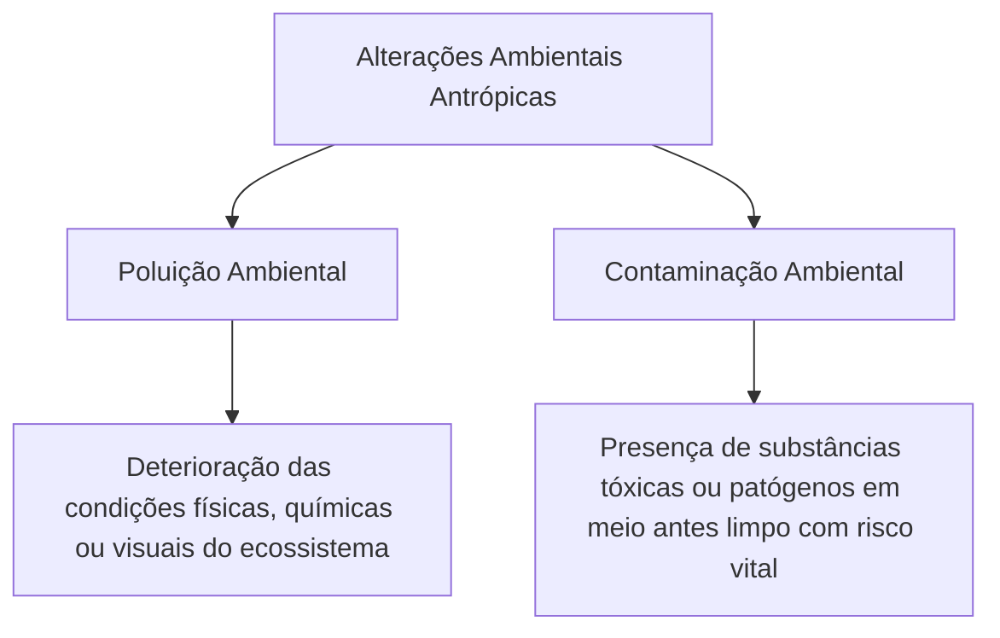
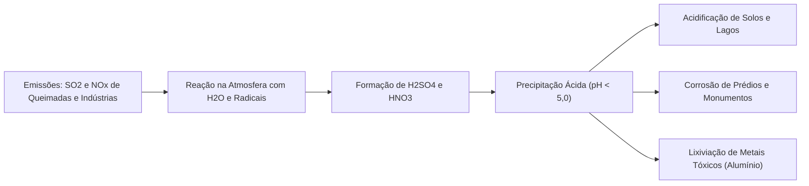
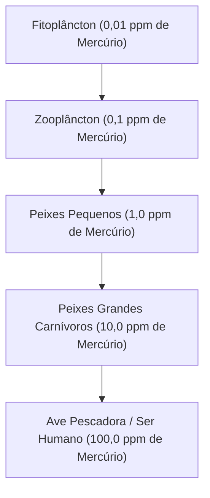
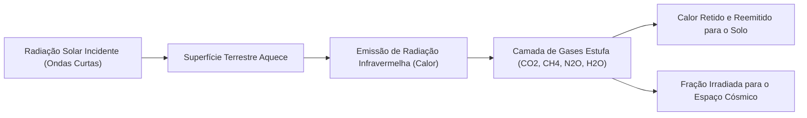
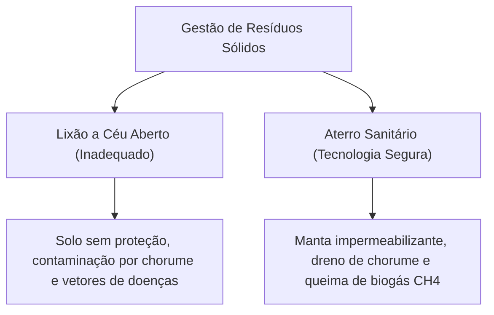
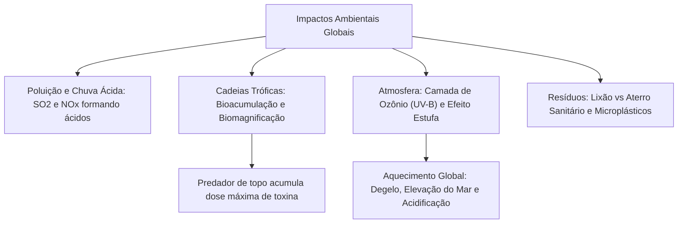

A aceleração das atividades industriais, a expansão urbana desordenada e o avanço da fronteira agropecuária provocaram desequilíbrios profundos na biosfera. A degradação ambiental manifesta-se pela poluição das matrizes de ar, solo e água, pela contaminação de cadeias alimentares e por alterações no clima global. No âmbito da segurança pública e da atuação de bombeiros militares, o entendimento desses impactos é vital para gerenciar ocorrências de produtos perigosos, incêndios florestais e desastres hidrológicos. Este capítulo examina a poluição atmosférica, a chuva ácida, a bioacumulação, a intensificação do efeito estufa e o saneamento básico.

> [!objetivos]
> - Diferenciar conceitualmente e praticamente poluição de contaminação ambiental.
> - Compreender a gênese química e as consequências ecológicas da chuva ácida.
> - Distinguir os mecanismos de bioacumulação individual e biomagnificação trófica.
> - Analisar a camada de ozônio e a intensificação do efeito estufa no aquecimento global.
> - Identificar os impactos antrópicos rurais e urbanos, a poluição por microplásticos e as tecnologias de saneamento.

## Poluição, Contaminação e Degradação Atmosférica

A ecologia estabelece uma distinção técnica rigorosa entre poluição e contaminação. A poluição consiste na introdução ou liberação de matéria ou energia no meio ambiente em concentrações capazes de provocar deterioração nas características físicas, químicas ou biológicas do ecossistema. A contaminação, por sua vez, refere-se especificamente à presença de agentes biológicos patogênicos ou substâncias químicas nocivas em um meio antes limpo, gerando risco direto à saúde humana e à biota. Nem todo ambiente poluído está contaminado, mas qualquer ambiente contaminado a ponto de causar danos é considerado poluído.

Os poluentes atmosféricos dividem-se em duas categorias operacionais:

1. Poluentes primários: emitidos diretamente pelas fontes geradoras para a atmosfera. Exemplos: monóxido de carbono (CO), dióxido de enxofre (SO2), óxidos de nitrogênio (NO e NO2), material particulado e hidrocarbonetos voláteis provenientes da queima de biomassa e combustíveis fósseis em motores e fábricas.
2. Poluentes secundários: substâncias tóxicas originadas na própria atmosfera a partir de reações químicas sofridas pelos poluentes primários em contato com a luz solar e a umidade. Exemplos: ozônio troposférico (O3 em baixa altitude), ácido sulfúrico (H2SO4) e ácido nítrico (HNO3).

O monóxido de carbono (CO) constitui um dos poluentes mais letais. Ele liga-se à hemoglobina sanguínea de forma irreversível com afinidade duzentas vezes superior à do oxigênio, formando carboxiemoglobina. Isso impede o transporte respiratório de O2 aos tecidos, culminando em asfixia química silenciosa.

> [!atencao] Asfixia Química pelo Monóxido de Carbono
> Em incêndios confinados atendidos pelo Corpo de Bombeiros, a inalação de fumaça rica em monóxido de carbono (CO) representa a principal causa imediata de óbito. O gás não possui cor nem odor, mas satura os sítios de ligação da hemoglobina com altíssima afinidade, bloqueando o aporte de oxigênio vital ao cérebro e ao coração.

| Poluente Atmosférico | Categoria Primária ou Secundária | Fonte Geradora Principal | Impacto Humano e Ambiental |
| --- | --- | --- | --- |
| Monóxido de Carbono (CO) | Primário | Combustão incompleta de combustíveis | Asfixia celular por formação de carboxiemoglobina |
| Dióxido de Enxofre (SO2) | Primário | Queima de carvão e óleo diesel com enxofre | Irritação respiratória e precursor da chuva ácida |
| Óxidos de Nitrogênio (NOx) | Primário | Motores a combustão interna e queimadas | Crises de asma e precursor de chuva ácida |
| Material Particulado (MP) | Primário | Fuligem de diesel, poeira e queimadas | Doenças cardiorrespiratórias e silicose |
| Ácido Sulfúrico (H2SO4) | Secundário | Reação do SO3 com vapor de água | Corrosão e acidificação de mananciais |

## Chuva Ácida, Bioacumulação e Biomagnificação

Fenômenos de poluição química transfronteiriça afetam tanto áreas industriais quanto reservas ecológicas distantes.

### Gênese e Efeitos da Chuva Ácida

Toda chuva natural apresenta leve acidez (pH em torno de 5,6) devido à dissolução normal do gás carbônico atmosférico, gerando ácido carbônico fraco (H2CO3). Fala-se em chuva ácida quando a precipitação pluviométrica atinge pH inferior a 5,0, resultante de emissões industriais maciças de óxidos de enxofre e óxidos de nitrogênio:

- O dióxido de enxofre (SO2) oxida-se a trióxido de enxofre (SO3) e reage com gotículas de água na atmosfera, formando ácido sulfúrico forte (H2SO4).
- Os óxidos de nitrogênio (NO2) reagem com radicais hidroxila e vapor d'água, produzindo ácido nítrico (HNO3).

A precipitação ácida provoca danos severos:

1. Acidifica cursos d'água doce e represas, provocando a morte de peixes e anfíbios por colapso osmótico e destruição de brânquias.
2. Degrada solos agrícolas e florestais por meio da lixiviação de nutrientes minerais essenciais (cálcio, magnésio e potássio), liberando íons metálicos de alumínio tóxicos para as raízes das plantas.
3. Causa a queima química de folhas e brotos de árvores, reduzindo a fotossíntese florestal.
4. Corrói estruturas metálicas de pontes e degrada monumentos históricos construídos em calcário e mármore por ataque ao carbonato de cálcio.

### Bioacumulação versus Biomagnificação Trófica

Dois processos descrevem o comportamento de poluentes persistentes não biodegradáveis na cadeia alimentar:

- Bioacumulação: é o acúmulo de uma substância química persistente nos tecidos corporais de um **único organismo** ao longo do seu ciclo de vida. A taxa de absorção do poluente através do alimento, pele ou respiração supera a capacidade metabólica do indivíduo de excretá-lo ou degradá-lo.
- Biomagnificação trófica (ou magnificação trófica): é o aumento progressivo e cumulativo da concentração do poluente ao longo dos **níveis tróficos sucessivos** da teia alimentar. Os predadores de topo acumulam doses exponencialmente maiores do que os produtores basais.

As substâncias químicas sujeitas à biomagnificação caracterizam-se por alta lipossolubilidade (afinidade por gordura) e ausência de mecanismos enzimáticos de metabolização no fígado e rins. Exemplos célebres incluem pesticidas organoclorados como o DDT, metais pesados tóxicos como o metilmercúrio proveniente do garimpo fluvial ilegal de ouro, cádmio, chumbo de baterias e, contemporaneamente, os **microplásticos**.

> [!pegadinha] Predador de Topo versus Base Trófica
> Em questões de biomagnificação, a banca pergunta em qual nível trófico é detectada a maior concentração de poluente por quilograma de biomassa. A resposta correta sempre aponta para o **consumidor do topo** da cadeia alimentar (último nível trófico), que consome centenas de presas previamente contaminadas.

## Camada de Ozônio, Efeito Estufa e Mudanças Climáticas

As alterações na composição gasosa da atmosfera afetam o equilíbrio térmico e a blindagem contra radiações cósmicas da Terra.

### A Camada de Ozônio Estratosférica

A camada de ozônio situa-se na estratosfera, em altitudes compreendidas entre 20 e 35 quilômetros acima da superfície terrestre. O ozônio (O3) é responsável por filtrar quase a totalidade da radiação ultravioleta do tipo B (UV-B), que provoca mutações no DNA celular, câncer de pele em humanos, catarata ocular e morte do fitoplâncton marinho.

A destruição da camada de ozônio decorreu da emissão antrópica de compostos clorofluorcarbonetos (CFCs), antigamente utilizados em gases refrigerantes e aerossóis. Ao atingirem a estratosfera, os átomos de cloro livres catalisam a destruição de milhares de moléculas de ozônio em reações em cadeia:

Cl + O3 -> ClO + O2

Com o Tratado Internacional do Protocolo de Montreal em 1987, os países baniram a fabricação dos CFCs, possibilitando a lenta regeneração desse manto gasoso protetor.

### O Efeito Estufa e o Aquecimento Global

O efeito estufa é um fenômeno biofísico natural indispensável à manutenção da vida no planeta. Sem a retenção natural de calor pelos gases estufa, a temperatura média da Terra seria de cerca de 18 graus Celsius negativos, congelando a água líquida.

A radiação luminosa solar de ondas curtas atravessa a atmosfera e aquece o solo. A superfície reirradia essa energia na forma de radiação infravermelha de ondas longas (calor). Os gases de efeito estufa absorvem essa energia térmica e a reemitem de volta para a crosta:

- Vapor de água (H2O): principal gás estufa natural em volume.
- Dióxido de carbono (CO2): responsável por cerca de 60% do forçamento antrópico, emitido por queima de combustíveis fósseis e queimadas.
- Metano (CH4): possui potencial de aquecimento vinte e oito vezes maior que o CO2, liberado pela fermentação entérica de bovinos, aterros sanitários e plantações de arroz inundado.
- Óxido nitroso (N2O): liberado pelo uso excessivo de adubos agrícolas nitrogenados.

O problema contemporâneo reside na intensificação antrópica desmedida desse efeito. O acúmulo acelerado de gases estufa causa o aquecimento global, deflagrando as mudanças climáticas globais:

1. Derretimento acelerado das calotas polares e geleiras continentais, associado à expansão térmica das águas aquecidas, resultando na elevação contínua do nível dos oceanos e inundação de cidades litorâneas.
2. Acidificação das águas oceânicas por dissolução massiva de CO2 (formando ácido carbônico), o que desestabiliza conchas calcárias e provoca o branqueamento e a mortalidade generalizada de recifes de corais.
3. Intensificação de eventos meteorológicos extremos: secas severas e desertificação em regiões semiáridas, alternadas com tempestades convectivas torrenciais que causam enchentes e desmoronamentos em áreas urbanas de risco.
4. Expansão geográfica de vetores biológicos de doenças tropicais (como mosquitos *Aedes aegypti* transmissores de dengue, zika e febre amarela) para latitudes antes temperadas.

As queimadas florestais provocam um dano ecológico duplo: liberam instantaneamente milhões de toneladas de carbono retido nos troncos e eliminam a cobertura vegetal viva que continuaria retirando CO2 atmosférico nos anos vindouros.

## Impactos Rurais, Urbanos e Tecnologias de Saneamento

As perturbações ecológicas dividem-se entre o meio rural agropecuário e os centros metropolitanos urbanos. A exploração e uso de recursos naturais de forma predatória impõe sérios limites à capacidade de regeneração dos ecossistemas terrestres e aquáticos.

> [!exemplo] Exploração e Uso de Recursos Naturais Renováveis e Não Renováveis
> A exploração e uso de recursos naturais divide os insumos da Terra em renováveis (como água doce, florestas e biomassa) e não renováveis (como minérios e combustíveis fósseis). Quando a taxa de extração madeireira ou a captação de água supera a velocidade de recarga dos mananciais, o recurso renovável sofre exaustão ecológica crônica. Na mineração a céu aberto, a retirada violenta da cobertura vegetal expõe o solo à erosão profunda e contamina bacias com rejeitos pesados.

### Impactos Rurais e Resíduos Sólidos

No campo, a conversão de vegetação nativa em monoculturas extensivas de grãos e pastagens degrada o solo. A remoção da cobertura florestal acelera a erosão hídrica, causando a perda de camadas férteis de húmus e o assoreamento das calhas de rios e reservatórios hidrelétricos. O emprego indiscriminado de agrotóxicos contamina lençóis freáticos e dizima populações de insetos polinizadores vitais.

Nos centros urbanos, o descarte irregular de resíduos sólidos gera contaminações gravíssimas:

- Lixões a céu aberto: representam o modelo mais primitivo e danoso. O lixo exposto atrai vetores de doenças e libera o chorume (líquido escuro, fétido e altamente tóxico resultante da decomposição de matéria orgânica com metais pesados), que percola pelo solo sem tratamento e contamina aquíferos subterrâneos.
- Aterros sanitários: constituem a tecnologia sanitária adequada. O solo é impermeabilizado com mantas de polietileno de alta densidade e argila compactada, o chorume é drenado para estações de tratamento biológico e o gás metano gerado pela decomposição anaeróbia é queimado em chaminés ou aproveitado para a produção de biogás energético.

### O Desafio dos Microplásticos

A poluição por plásticos alcançou escala planetária crítica. Os polímeros sintéticos (polietileno, polipropileno) demoram mais de 450 anos para sofrer decomposição biológica completa. No ambiente marinho, a irradiação solar e o atrito das ondas fragmentam macroplásticos em partículas microscópicas menores que 5 milímetros denominadas **microplásticos**.

Os microplásticos flutuantes adsorvem poluentes hidrofóbicos da água (como bifenilas policloradas e pesticidas). Eles são ingeridos involuntariamente por corais, peixes e crustáceos, adentrando a teia trófica e atingindo o consumo humano, com potenciais efeitos inflamatórios e desreguladores endócrinos.

> [!bizu] Hierarquia dos Resíduos e Reciclagem
> O manejo ecológico de resíduos adota a ordem dos 3R: Reduzir a geração na fonte, Reutilizar materiais de longa vida e Reciclar matérias-primas secundárias. A reciclagem de alumínio economiza 95% da energia exigida na extração da bauxita.

## Mapa do capítulo

### Para fixar

- Poluição deteriora o ambiente; contaminação introduz toxinas ou patógenos em meio antes limpo com risco vital.
- A chuva ácida decorre principalmente da reação de óxidos de enxofre (SO2) e nitrogênio (NOx) com a água atmosférica.
- Bioacumulação ocorre no organismo singular; biomagnificação é o acúmulo crescente nos níveis tróficos da teia.
- O predador de topo da cadeia alimentar concentra a maior taxa de substâncias lipossolúveis não biodegradáveis.
- A camada de ozônio estratosférica situa-se entre 20 e 35 km e filtra a radiação nociva ultravioleta do tipo B.
- O efeito estufa é um fenômeno natural vital cuja intensificação por CO2 e CH4 provoca o aquecimento global.
- Aterros sanitários impermeabilizam o fundo, drenam o chorume tóxico e canalizam o biogás metano para mitigação.
