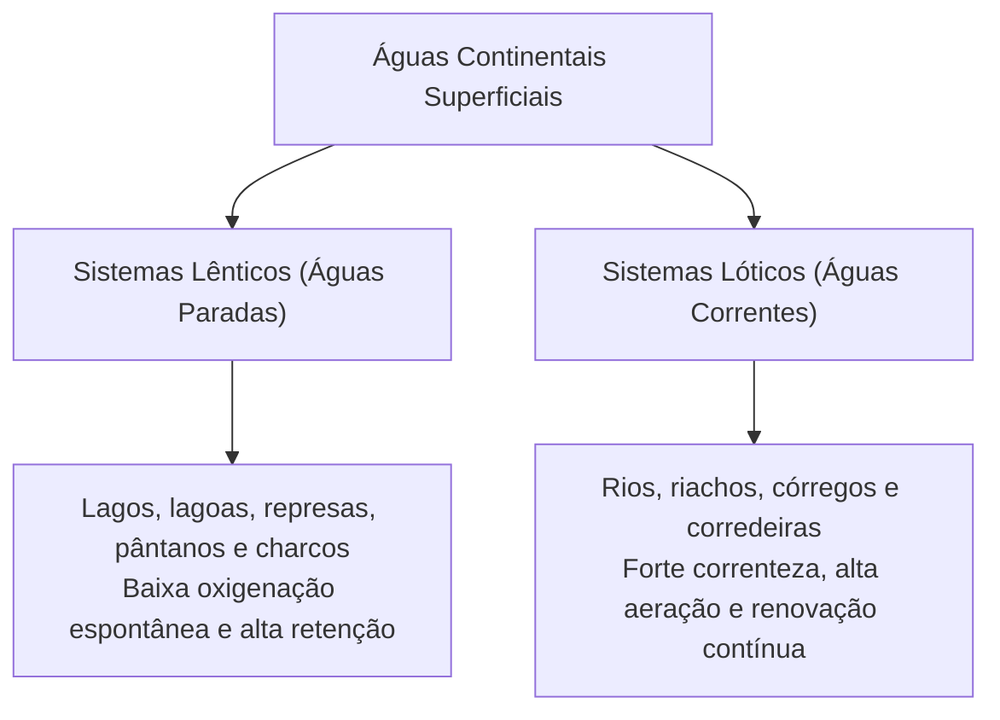
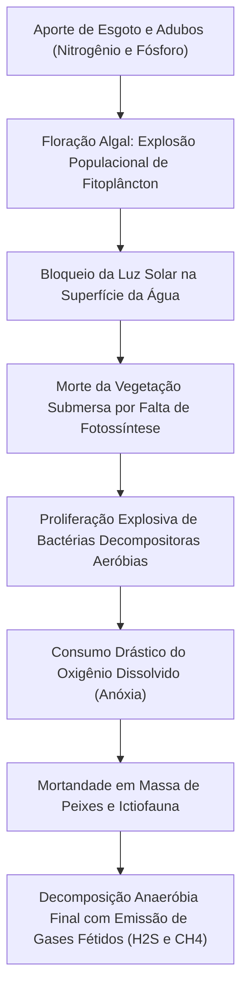
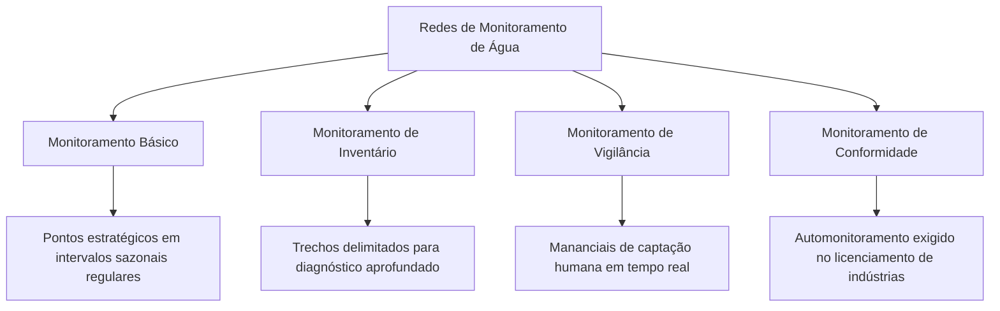
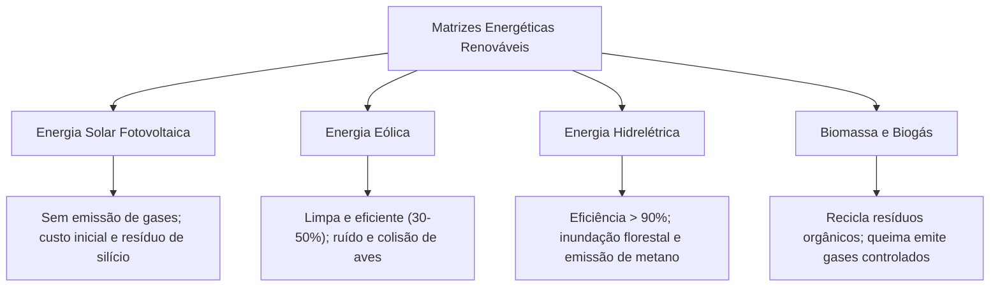
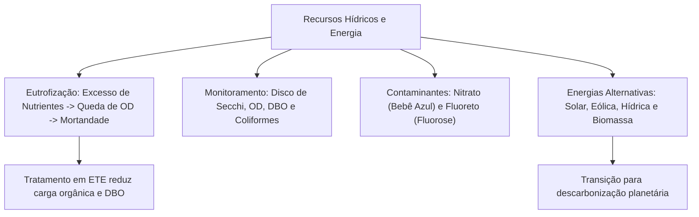

A conservação dos recursos hídricos continentais constitui uma das principais prioridades ambientais contemporâneas. Rios, lagos, represas e aquíferos subterrâneos sofrem pressões crescentes decorrentes do despejo de efluentes domésticos sem tratamento, fertilizantes agrícolas e efluentes industriais. Na rotina operacional do Corpo de Bombeiros e da Defesa Civil, a segurança hídrica conecta-se diretamente ao abastecimento de populações e à contenção de desastres químicos em mananciais. Este capítulo analisa a ecologia das águas doces, a dinâmica da eutrofização, as técnicas de monitoramento da qualidade da água, o saneamento básico e as alternativas energéticas renováveis.

> [!objetivos]
> - Distinguir ecossistemas de águas continentais lênticas e lóticas.
> - Compreender a sequência cronológica da eutrofização artificial e seus efeitos ecológicos.
> - Identificar os contaminantes críticos: nitratos, metais tóxicos, pesticidas e excesso de fluoretos.
> - Dominar as metodologias de monitoramento da água e as variáveis físicas, químicas e biológicas.
> - Comparar as vantagens, limitações e impactos ambientais das principais fontes de energia renovável.

## Águas Continentais e Dinâmica da Eutrofização

As águas continentais congregam os corpos de água doce superficiais do interior dos continentes. Em termos ecológicos e hidrodinâmicos, classificam-se em duas grandes categorias:

1. Ambientes lênticos: corpos de água estagnada ou de fluxo extremamente lento, como lagos naturais, lagoas marginais, represas hidrelétricas e áreas pantanosas. Pela reduzida turbulência, apresentam estratificação térmica e são mais vulneráveis ao acúmulo de poluentes.
2. Ambientes lóticos: ecossistemas de água corrente com fluxo unidirecional constante, como rios, córregos e ribeirões. A correnteza favorece a aeração contínua e a autodepuração, mas transporta contaminantes rapidamente bacia abaixo.

As águas continentais são agredidas por fontes pontuais (despejo de esgoto bruto urbano e efluentes industriais por tubulações) e fontes difusas (escoamento superficial de agrotóxicos e fertilizantes em lavouras e lixiviação de chorume de lixões).

### O Processo de Eutrofização Artificial

A eutrofização artificial ou cultural representa um dos desastres ecológicos mais frequentes em ambientes lênticos. O fenômeno desenvolve-se em etapas encadeadas:

1. Enriquecimento nutricional: lançamento maciço de efluentes ricos em fósforo (detergentes e fezes) e nitrogênio (amônia de esgotos e nitratos de adubos químicos).
2. Floração de algas (bloom): o excesso de nutrientes fertiliza a água, provocando a multiplicação descontrolada de microalgas e cianobactérias na lâmina d'água superficial.
3. Bloqueio luminoso: a camada densa de algas esverdeadas impede a penetração dos raios solares nas camadas profundas.
4. Morte da vegetação bentônica: as plantas submersas deixam de realizar fotossíntese por falta de luz solar, morrem e afundam, acumulando imensa biomassa morta no leito.
5. Explosão de decompositores aeróbios: bactérias saprófitas multiplicam-se para digerir a matéria orgânica em decomposição.
6. Queda do oxigênio dissolvido (anóxia): a respiração bacteriana esgota o oxigênio dissolvido (OD) na água, elevando a Demanda Bioquímica de Oxigênio (DBO).
7. Mortandade da fauna aquática: peixes, moluscos e crustáceos morrem por asfixia coletiva.
8. Decomposição anaeróbia: esgotado o oxigênio, bactérias anaeróbias assumem a degradação da matéria, liberando gases de odor repugnante e tóxicos, como o gás sulfídrico (H2S) e o metano (CH4).

> [!atencao] Oxigênio Dissolvido versus Demanda Bioquímica de Oxigênio
> Em águas limpas e equilibradas, o teor de Oxigênio Dissolvido (OD) é alto e a Demanda Bioquímica de Oxigênio (DBO) é baixa. Em corpos d'água poluídos por esgoto, o inverso acontece: a DBO dispara devido à carga de matéria orgânica a ser decomposta, e o OD despenca para níveis próximos de zero.

## Contaminantes Críticos da Água e Saúde Pública

Além da matéria orgânica doméstica, agentes químicos industriais e agrícolas provocam patologias severas:

### Nitratos e a Síndrome do Bebê Azul

O excesso de nitrato (NO3-) na água potável decorre da lixiviação de fertilizantes agrícolas e contaminação de poços por fossas sépticas. Ao ser ingerido por lactentes humanos, o nitrato é convertido em nitrito no trato digestivo, que se liga à hemoglobina formando metemoglobina. Como a metemoglobina é incapaz de transportar oxigênio, a criança desenvolve a **metemoglobinemia infantil** (conhecida popularmente como síndrome do bebê azul), provocando cianose, danos neurológicos e risco de morte por asfixia tecidual.

### Fluoretos e Fluorose

O flúor é adicionado às Estações de Tratamento de Água (fluoretação) em concentrações rigorosamente controladas (cerca de 0,7 mg/L) para prevenir cáries dentárias na população. Contudo, a ingestão continuada de água com teor excessivo de fluoretos provoca a **fluorose**: alteração no esmalte dentário que causa manchas esbranquiçadas e amarronzadas nos dentes, além de fragilização óssea em crianças.

| Contaminante Químico | Origem Principal | Impacto Ecológico e Clínico | Medida de Controle |
| --- | --- | --- | --- |
| Nitratos (NO3-) | Adubos agrícolas e fossas | Metemoglobinemia infantil e eutrofização | Proteção de poços e tratamento biológico |
| Fluoretos em excesso | Dosagem incorreta na ETA | Fluorose dentária e fragilidade óssea | Calibração de dosagem na cloração e fluoretação |
| Metais Pesados (Pb, Hg) | Garimpos e descarte de pilhas | Bioacumulação e danos neurológicos | Logística reversa de baterias e fiscalização |
| Pesticidas e Herbicidas | Lavouras de monocultura | Contaminação difusa de lençóis freáticos | Transição para manejo agroecológico |

As queimadas e o aquecimento global intensificam esses danos: cinzas carreadas pelas chuvas elevam o pH e a turbidez dos rios, e o aquecimento da água diminui a solubilidade física do oxigênio dissolvido.

## Metodologias de Monitoramento e Saneamento Básico

O monitoramento da qualidade das águas é o conjunto de atividades sistemáticas de amostragem e análise laboratorial das propriedades físicas, químicas e biológicas de uma bacia hidrográfica.

As coletas realizam-se em pontos geoespaciais georreferenciados (estações de monitoramento). Para coletas em profundidades controladas de represas e lagos, utiliza-se a garrafa de Van Dorn, dispositivo cilíndrico que desce aberto e é lacrado por um mensageiro metálico no ponto exato desejado.

### Variáveis e Indicadores de Qualidade da Água

A análise divide-se em três eixos de parâmetros laboratoriais:

1. Variáveis físicas:
   - Turbidez: mede a resistência da água à passagem de luz solar causada por sólidos em suspensão (argila, silte e detritos). Alta turbidez bloqueia a fotossíntese bentônica.
   - Transparência: aferida em campo por meio do **disco de Secchi**, disco metálico pintado em quadrantes pretos e brancos que é mergulhado até deixar de ser visualizado.
   - Condutividade elétrica: indica a concentração de íons e sais minerais dissolvidos. Valores superiores a 100 µS/cm em rios de água doce sugerem contaminação por esgotos ou efluentes industriais.
2. Variáveis químicas:
   - Oxigênio Dissolvido (OD): principal parâmetro de sobrevivência da ictiofauna. Águas frias retêm mais oxigênio dissolvido que águas aquecidas.
   - pH: mede a acidez ou alcalinidade, mantendo-se idealmente entre 6,0 e 8,5 para a preservação da biota.
3. Variáveis biológicas:
   - Coliformes termotolerantes (*Escherichia coli*): bactérias que habitam o trato gastrointestinal de animais de sangue quente. Sua presença na água indica contaminação recente por fezes e risco de transmissão de cólera, hepatite A e febre tifoide.
   - Clorofila-a: quantifica a biomassa de fitoplâncton, indicando o estado trófico de eutrofização do manancial.

### Estações de Tratamento de Água (ETA) e Esgoto (ETE)

O saneamento básico opera por meio de duas infraestruturas fundamentais:

- Estação de Tratamento de Água (ETA): transforma água bruta captada na natureza em água potável para consumo humano. Suas etapas sucessivas incluem: coagulação com sulfato de alumínio, floculação mecânica lenta, decantação de flocos pesados, filtração em leitos de areia e carvão antracito, desinfecção por cloração e ajuste final de pH e fluoretação.
- Estação de Tratamento de Esgoto (ETE): depura o efluente sanitário antes do descarte no corpo receptor. O tratamento primário remove sólidos grosseiros por gradeamento, desarenação e caixas de gordura. O tratamento secundário biológico (lodos ativados ou lagoas de aeração) emprega microrganismos aeróbios para oxidar a matéria orgânica, reduzindo a DBO em mais de 90%.

> [!esquema] Rota Tecnológica do Tratamento de Água (ETA)
> 1. Captação de água bruta no manancial superficial.
> 2. Coagulação: adição de sulfato de alumínio para desestabilizar partículas coloidais em suspensão.
> 3. Floculação: agitação mecânica lenta para aglutinar as partículas em flocos maiores e mais pesados.
> 4. Decantação: repouso em tanques onde os flocos afundam por gravidade.
> 5. Filtração: passagem por leitos compostos por camadas de areia, cascalho e carvão antracito.
> 6. Desinfecção e Fluoretação: adição de cloro (eliminação de microrganismos patogênicos), cal hidratada (correção de pH) e flúor (prevenção à cárie).

> [!resolvido] Interpretação Prática do Disco de Secchi
> **Enunciado:** Um biólogo mergulha o disco de Secchi em duas represas de abastecimento: na Represa A o disco desaparece a 0,4 metro de profundidade; na Represa B o disco permanece visível até 3,5 metros. Qual das duas apresenta indícios de eutrofização?
>
> **Resolução passo a passo:**
> 1. O disco de Secchi mede a transparência luminosa da água.
> 2. Pequenas profundidades de desaparecimento indicam alta turbidez e elevada densidade de partículas e microalgas na superfície.
> 3. Na Represa A, o sumiço do disco a apenas 0,4 m revela alta proliferação algal decorrente de floração de fitoplâncton, sintoma clássico de eutrofização.
> 4. Na Represa B, a penetração de luz até 3,5 m indica água oligotrófica límpida e preservada.

## Alternativas Renováveis de Produção de Energia

A transição da matriz fóssil para matrizes energéticas limpas é indispensável para conter o aquecimento global e reduzir a poluição atmosférica. Cada fonte alternativa apresenta vantagens e impactos ambientais próprios:

### Energia Solar e Eólica

A energia solar fotovoltaica converte diretamente a radiação luminosa em eletricidade através de células de silício semicondutoras. Apresenta eficiência comercial entre 15% e 20%, opera sem emissões durante a geração e possui longa vida útil. A energia eólica utiliza a energia cinética dos ventos para girar turbinas geradoras acopladas a pás aerodinâmicas, alcançando eficiência entre 30% e 50%. Seus impactos restringem-se ao ruído mecânico das pás, alteração na paisagem e risco de colisões com morcegos e aves migratórias.

### Energia Hidrelétrica e Biomassa

A hidreletricidade é a principal fonte de geração elétrica no Brasil. Possui eficiência termodinâmica superior a 90%, mas sua instalação provoca severos impactos socioambientais: barramento do fluxo lótico do rio, alagamento de vastas áreas florestais, deslocamento de comunidades ribeirinhas e emissão de gás metano (CH4) resultante da decomposição anaeróbia da vegetação submersa na represa.

A biomassa e o biogás aproveitam bagaço de cana-de-açúcar, resíduos agrícolas e fezes de suínos em digestores anaeróbios. Essa tecnologia converte passivos ambientais em energia térmica e elétrica útil, capturando metano que de outro modo escaparia diretamente para a atmosfera.

| Fonte Energética | Princípio Físico Operacional | Eficiência Energética Média | Vantagem Principal | Impacto Ambiental Residual |
| --- | --- | --- | --- | --- |
| Solar Fotovoltaica | Efeito fotovoltaico em células de silício | 15% a 20% | Zero emissão na operação | Descarte futuro de painéis |
| Eólica | Energia cinética dos ventos em pás | 30% a 50% | Fonte inesgotável e limpa | Ruído sonoro e fauna aérea |
| Hidrelétrica | Energia potencial gravitacional da água | > 90% | Grande volume contínuo | Alagamento florestal e metano |
| Biomassa e Biogás | Digestão anaeróbia e queima orgânica | 30% a 50% | Reaproveitamento de resíduos | Emissão controlada na queima |

> [!bizu] O Paradoxo das Hidrelétricas Tropicais
> Embora a hidreletricidade seja renovável, usinas construídas em florestas tropicais densas emitem grandes volumes de gases estufa nos primeiros anos após o enchimento do lago, devido à fermentação anaeróbia da madeira inundada no fundo da represa.

## Mapa do capítulo

### Para fixar

- Ambientes lênticos têm águas paradas (lagos); ambientes lóticos têm águas correntes (rios).
- A eutrofização decorre de excesso de nitrogênio e fósforo, florando algas e zerando o oxigênio dissolvido.
- O nitrato em excesso na água potável provoca metemoglobinemia infantil (síndrome do bebê azul).
- A transparência da água é mensurada em campo pelo disco de Secchi; alta turbidez bloqueia a fotossíntese.
- O oxigênio dissolvido (OD) é maior em águas frias e despenca em mananciais com alta demanda bioquímica (DBO).
- A presença de *Escherichia coli* na água indica contaminação fecal e risco iminente de doenças entéricas.
- Usinas hidrelétricas têm rendimento superior a 90%, mas causam inundações florestais e emissões de metano.
