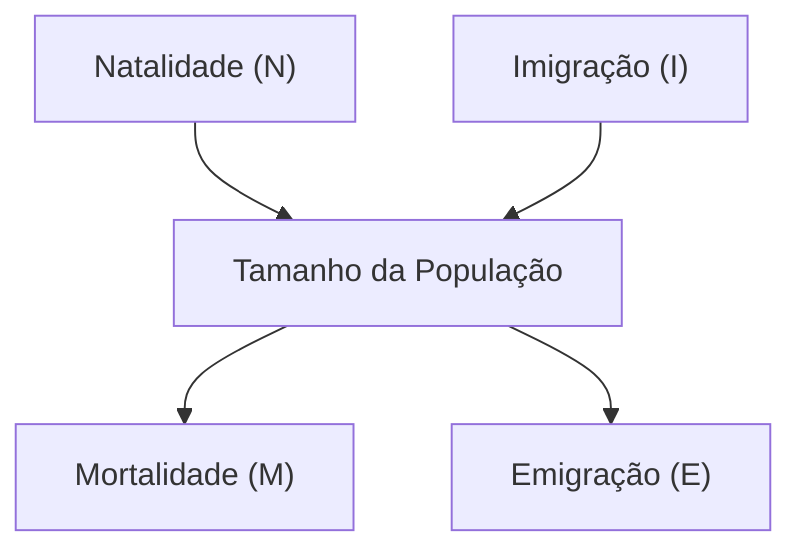
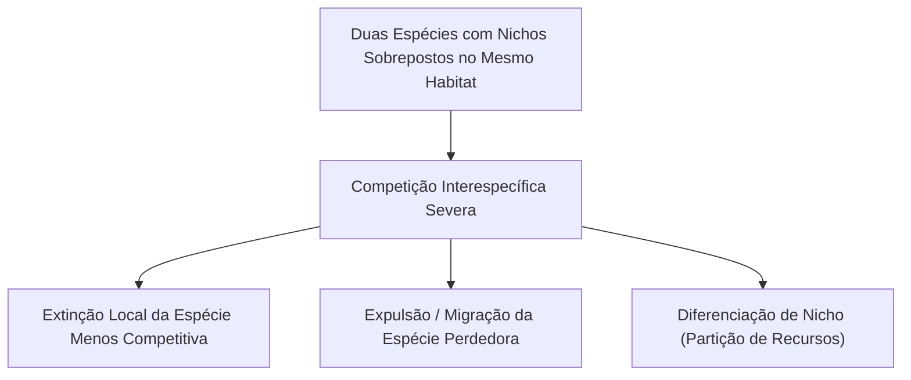
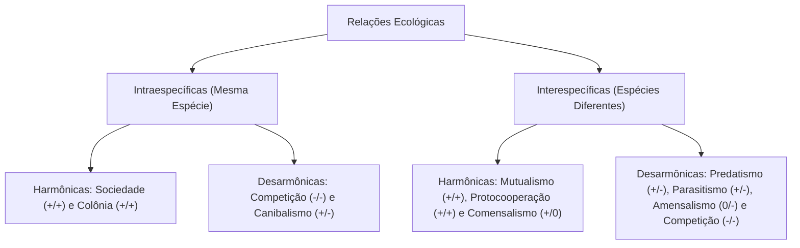
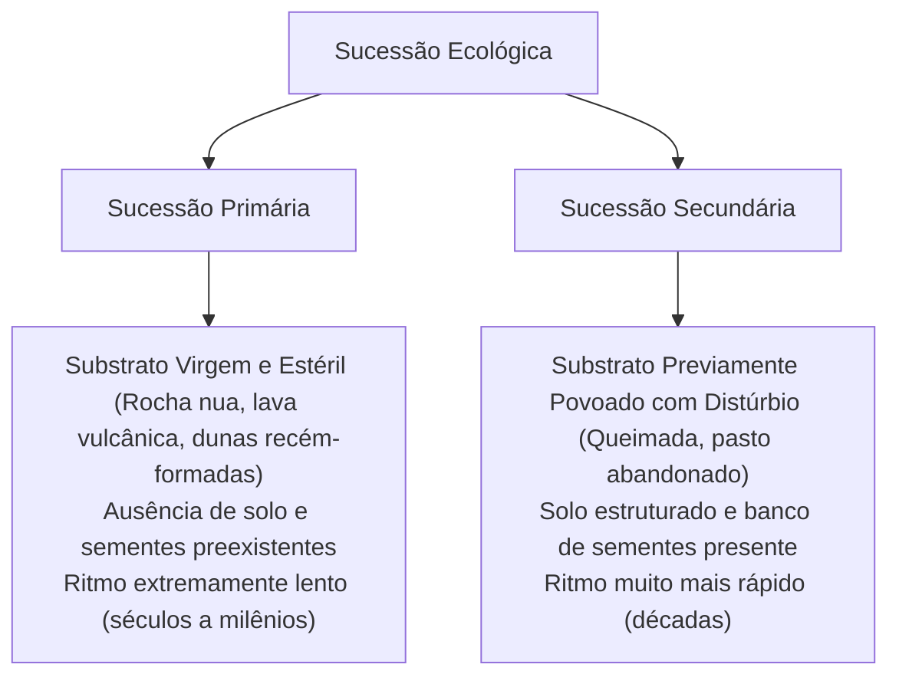
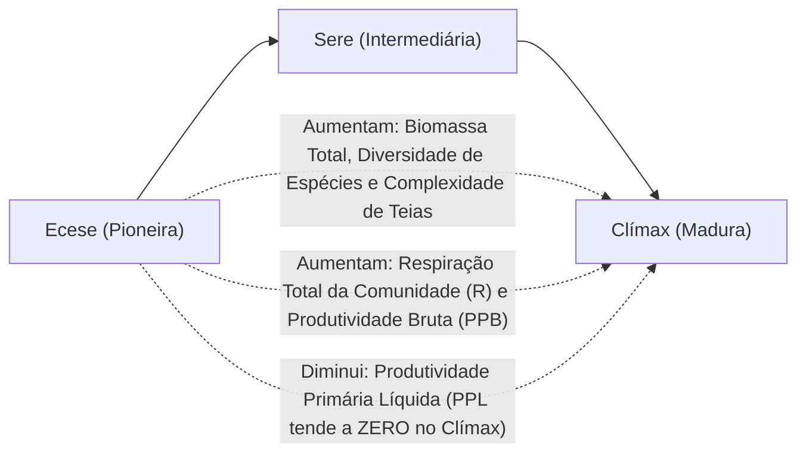
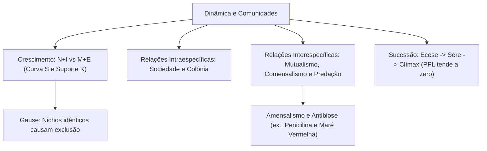

As populações biológicas não são conjuntos estáticos no tempo e no espaço. Elas sofrem flutuações quantitativas contínuas regidas pelas taxas de natalidade, mortalidade, imigração e emigração. Paralelamente, os indivíduos estabelecem uma rede intrincada de interações ecológicas com membros da própria espécie e com organismos de espécies distintas. Essas interações modulam a sobrevivência, a densidade demográfica e a própria evolução da comunidade por meio da sucessão ecológica. Este capítulo aborda as curvas de crescimento populacional, os ciclos predador-presa, o Princípio de Gause, as relações harmônicas e desarmônicas, as invasões biológicas e as fases da sucessão florestal.

> [!objetivos]
> - Analisar as variáveis demográficas fundamentais e diferenciar as curvas de crescimento em J e em S.
> - Compreender a dinâmica do potencial biótico, da resistência ambiental e da capacidade de suporte (K).
> - Compreender os ciclos populacionais de Lotka-Volterra e o Princípio da Exclusão Competitiva de Gause.
> - Classificar as relações ecológicas intraespecíficas e interespecíficas, identificando sinais de ganho e perda.
> - Mapear os estágios da sucessão ecológica primária e secundária até a comunidade clímax.

## Dinâmica Populacional e Modelos de Crescimento

A densidade populacional expressa o número de indivíduos de uma determinada espécie que ocupa certa área territorial ou volume aquático em determinado instante de tempo. Quatro variáveis demográficas fundamentais determinam as oscilações numéricas de qualquer população na biosfera:

- Fatores de incremento: Taxa de Natalidade (N) e Taxa de Imigração (I).
- Fatores de decréscimo: Taxa de Mortalidade (M) e Taxa de Emigração (E).

A variação populacional líquida resulta do confronto direto entre esses dois conjuntos operacionais:

1. População em crescimento: (N + I) > (M + E). O contingente demográfico expande-se.
2. População em declínio: (N + I) < (M + E). O contingente demográfico encolhe, com risco de extinção local.
3. População em equilíbrio estável: (N + I) = (M + E). A densidade mantém-se constante em torno da capacidade de suporte.

### Potencial Biótico e Curvas de Crescimento

O potencial biótico define a capacidade reprodutiva inata e teórica de uma população para gerar novos descendentes em condições perfeitas e ideais, sem qualquer limitação física ou biológica (alimento ilimitado, ausência de doenças e predadores). Sob potencial biótico irrestrito, o crescimento é puramente exponencial, gerando no gráfico cartesiano a chamada **curva em J**:

A curva em J é típica de microrganismos de multiplicação acelerada, como algas unicelulares durante eventos de eutrofização e bactérias em meio de cultura. O contingente cresce de forma explosiva, exaure rapidamente os nutrientes locais e sofre um colapso populacional massivo imediato.

Na imensa maioria das espécies animais e vegetais superiores, a reprodução enfrenta a **resistência ambiental**. A resistência do meio reúne a totalidade dos fatores bióticos e abióticos que freiam o potencial biótico: espaço restrito, escassez de água e nutrientes, competição por abrigo, clima hostil, parasitismo e pressão de predatismo.

A interação contínua entre o potencial biótico e a resistência do meio gera a curva de crescimento real logístico, representada graficamente pela **curva sigmoide em S**:

A curva em S desdobra-se em quatro fases sucessivas bem delimitadas:

- Fase Lag (ou fase de latência): crescimento numérico inicial lento, período em que os indivíduos recém-chegados adaptam-se às condições fisiológicas do biótopo.
- Fase Log (ou de aceleração exponencial): crescimento demográfico explosivo, no qual o potencial biótico sobrepuja a resistência do ambiente pouco povoado.
- Fase de desaceleração: a resistência ambiental intensifica-se à medida que a densidade sobe, reduzindo a taxa de acréscimo de novos indivíduos.
- Fase de estabilização em torno da capacidade de suporte (K): o tamanho populacional equilibra-se em torno do teto máximo de indivíduos que o ambiente é capaz de sustentar de forma contínua e sustentável.

| Modelo de Crescimento | Tipo de Curva | Características Demográficas | Ocorrência Biológica Típica |
| --- | --- | --- | --- |
| Potencial Biótico Teórico | Curva em J | Crescimento exponencial sem freio ambiental | Bactérias em laboratório e floração de algas |
| Crescimento Real Logístico | Curva em S | Ajuste gradual limitado pela capacidade de suporte K | Mamíferos, aves, árvores e répteis na natureza |

### Ciclos Populacionais Predador-Presa

As populações de predadores e presas mantêm oscilações numéricas acopladas e periódicas no tempo, modeladas pelas clássicas equações de Lotka-Volterra.

O exemplo clássico é o da lebre-americana e do lince-do-canadá. Quando a população de lebres herbívoras aumenta, a oferta farta de alimento possibilita a expansão reprodutiva da população de linces predadores. Com o aumento da densidade de linces, a pressão de caça eleva-se e provoca a queda acentuada na população de lebres. Em seguida, a escassez de presas faz a população de linces diminuir por inanição. Com a redução dos predadores, as lebres sobreviventes recuperam sua abundância, reiniciando o ciclo em ondas alternadas.

No plano da saúde pública humana, as enfermidades transmissíveis alteram os gráficos demográficos em três escalas epidemiológicas:

- Endemia: patologia infecciosa que se mantém presente de forma relativamente constante ao longo do tempo em uma região delimitada (como a malária na bacia amazônica e a doença de Chagas no semiárido).
- Epidemia: elevação abrupta e imprevisível no número de casos de uma doença que ultrapassa os padrões habituais em determinada época e localidade (como surtos sazonais de dengue e febre amarela).
- Pandemia: disseminação epidêmica descontrolada em escala continental ou global que atinge múltiplos países simultaneamente (como a pandemia de COVID-19 provocada pelo vírus SARS-CoV-2).

> [!atencao] Defasagem Temporal no Ciclo Predador-Presa
> Nos gráficos de flutuação temporal entre predador e presa, as duas curvas nunca atingem seus picos simultaneamente. A curva da população de presas atinge seu ápice cronológico primeiro. O pico da população de predadores ocorre sempre com certo atraso temporal, pois a conversão de biomassa alimentar em ninhadas de filhotes exige tempo de gestação.

## O Princípio da Exclusão Competitiva (Lei de Gause)

Em 1934, o biólogo soviético Georgy Gause realizou experimentos laboratoriais seminais cultivando duas espécies de protozoários ciliados: *Paramecium aurelia* e *Paramecium caudatum*.

Quando cultivadas em tubos de ensaio separados com fornecimento idêntico de bactérias alimentares, ambas as espécies exibiram curvas de crescimento logístico clássicas em S, alcançando estabilidade na capacidade de suporte. Entretanto, quando Gause colocou as duas espécies para conviver no mesmo tubo de ensaio disputando o mesmo alimento, o *Paramecium aurelia* (dotado de taxa reprodutiva ligeiramente superior) consumiu as bactérias mais rapidamente, levando o *Paramecium caudatum* à extinção completa em poucos dias.

> [!exemplo] Exclusão Competitiva de Paramécios
> O cultivo conjunto de *Paramecium aurelia* e *Paramecium caudatum* comprovou que nichos idênticos no mesmo meio geram exclusão competitiva inevitável. Em contraste, quando Gause testou *Paramecium caudatum* com *Paramecium bursaria*, ambas coexistiram em equilíbrio: *P. caudatum* alimentou-se de bactérias em suspensão no topo do tubo, enquanto *P. bursaria* consumiu leveduras no fundo, demonstrando a partição de nicho.

Esse experimento consolidou a **Lei de Gause** ou **Princípio da Exclusão Competitiva**: duas espécies que ocupam rigorosamente o mesmo nicho ecológico não podem coexistir indefinidamente no mesmo habitat estável.

Na natureza, a imensa diversidade biológica coexiste graças a mecanismos ecológicos de partição de recursos e diferenciação de nicho:

- Pássaros insetívoros que habitam a mesma árvore florestal forrageiam em alturas e partes diferentes da copa (folhas externas, casca do tronco ou ramos inferiores).
- Espécies de felinos predadores partilham presas dividindo horários de atividade (um com hábitos diurnos e outro com hábitos noturnos).

## Interações Biológicas e Relações Ecológicas

Os seres vivos em uma comunidade mantêm relações ecológicas que influenciam a sobrevivência de cada população. Essas interações classificam-se sob dois critérios estruturais:

1. Quanto à espécie dos envolvidos:
   - Relações intraespecíficas (ou homotípicas): estabelecidas entre indivíduos pertencentes à **mesma espécie**.
   - Relações interespecíficas (ou heterotípicas): estabelecidas entre indivíduos pertencentes a **espécies biológicas distintas**.
2. Quanto ao balanço ecológico de sobrevivência:
   - Relações harmônicas (ou positivas): não provocam prejuízo para nenhum dos participantes envolvidos (+/+, benefício mútuo, ou +/0, benefício para um sem afetar o outro).
   - Relações desarmônicas (ou negativas): pelo menos um dos participantes sofre dano ecológico, prejuízo energético ou morte (+/-, benefício com prejuízo alheio, -/-, prejuízo bilateral, ou 0/-, dano colateral).

### Relações Intraespecíficas

- **Sociedade (+/+):** agrupamento integrado de indivíduos da mesma espécie que mantêm independência anatômica entre si, mas cooperam estreitamente com **divisão social de trabalho** e especialização morfológica em castas corporais. A comunicação química interindividual realiza-se por meio de feromônios. Exemplos: formigas, abelhas melíferas, vespas e cupins.
- **Colônia (+/+):** associação anatômica e fisiológica íntima entre indivíduos da mesma espécie que se encontram **fisicamente unidos** entre si, formando uma unidade estrutural coesa. Podem ser isomorfas (indivíduos com a mesma forma e função, como corais pétreos e esponjas marinhas) ou heteromorfas (com divisão de tarefas entre indivíduos morfologicamente distintos, como a caravela-portuguesa, celenterado que integra indivíduos flutuadores, reprodutores e digestivos em um único corpo).
- **Competição intraespecífica (-/-):** disputa acirrada entre indivíduos da mesma espécie pelos mesmos recursos limitados do meio (fêmeas para cópula, água, alimento e abrigo territorial). O territorialismo — demarcação de território por urina de cães, canto de pássaros ou coaxar de rãs — reduz o confronto físico direto.
- **Canibalismo (+/-):** ato predatório no qual um organismo ingere outro indivíduo da sua própria espécie biológica. É comum em insetos como o louva-a-deus (em que a fêmea devora a cabeça do macho durante a cópula para suprir ovos com proteínas) e escorpiões sob estresse ou escassez nutricional.

### Relações Interespecíficas Harmônicas

- **Mutualismo obrigatório (+/+):** associação ecológica e fisiológica de dependência mútua estrita entre espécies distintas. A separação física causa a morte ou impede a sobrevivência autônoma dos indivíduos. Exemplos célebres:
  - Líquens: associação simbiótica entre fungos (que fornecem abrigo, umidade e minerais) e algas verdes ou cianobactérias (que fornecem compostos orgânicos por fotossíntese).
  - Micorrizas: associação entre hifas de fungos subterrâneos e raízes de plantas vasculares, ampliando a absorção de água e fósforo.
  - Ruminantes e protozoários/bactérias celulolíticas: microorganismos no rúmen de bois e veados digerem a celulose da forragem vegetal, liberando ácidos graxos voláteis absorvidos pelo animal.
- **Protocooperação ou mutualismo facultativo (+/+):** relação mútua benéfica em que ambos os parceiros auferem vantagens ecológicas, mas a convivência não é obrigatória: ambos podem viver perfeitamente isolados. Exemplos:
  - O caranguejo-eremita (paguro) e anêmonas-do-mar: a anêmona fixa-se na concha do paguro e o protege de predadores com seus tentáculos urticantes, enquanto ganha transporte e restos de alimento.
  - Jacaré-do-pantanal e pássaro-palito: a ave retira parasitas e sanguessugas da gengiva do réptil, obtendo alimento enquanto o crocodiliano realiza higiene bucal.
  - Pássaros polinizadores e flores com néctar.
- **Comensalismo (+/0):** interação em que uma espécie (comensal) é beneficiada com alimento, enquanto a outra espécie (hospedeira) não sofre benefício nem prejuízo ecológico. Exemplo: peixes-rêmora acoplados ventralmente à pele de tubarões por ventosas dorsais, alimentando-se dos restos de presas abandonados pelo predador sem feri-lo.
- **Inquilinismo (+/0):** modalidade especializada de comensalismo em que o organismo (inquilino) utiliza o corpo ou a morada de outra espécie como abrigo físico e suporte, sem roubar alimento nem causar dano tecidual. Exemplo: o peixe-agulha (*Fierasfer*), que busca proteção mecânica penetrando no ânus e intestino de pepinos-do-mar (holotúrias).
- **Epifitismo (+/0):** inquilinismo vegetal típico de florestas úmidas. Plantas epífitas (como orquídeas e bromélias) apoiam-se sobre os galhos altos de grandes árvores florestais unicamente para alcançar luminosidade solar favorável, absorvendo água e poeira do ar sem sugar a seiva do vegetal hospedeiro.

> [!esquema] Comparação entre Relações de Suporte Vegetal
> - **Epifitismo (+/0):** Orquídeas e bromélias vivem sobre o tronco apenas para obter suporte físico e luz solar. Não causam dano e não sugam seiva da árvore.
> - **Hemiparasitismo (+/-):** A erva-de-passarinho perfura o córtex com raízes sugadoras (haustórios) até o xilema para sugar seiva bruta (água e sais minerais), realizando sua própria fotossíntese foliar.
> - **Holoparasitismo (+/-):** O cipó-chumbo não possui clorofila; seus haustórios invadem o floema do hospedeiro para sugar seiva elaborada rica em açúcares, podendo levar o vegetal à morte.

### Relações Interespecíficas Desarmônicas

- **Predatismo (+/-):** interação na qual um organismo carnívoro de vida livre (predador) captura, abate e devora outro organismo (presa) para alimentar-se. A predação é a via mestra de fluxo energético entre os níveis tróficos heterótrofos das teias alimentares.
- **Herbivoria (+/-):** interação análoga à predação, em que animais herbívoros alimentam-se de partes de vegetais vivos (folhas, cascas, raízes ou frutos).
- **Parasitismo (+/-):** relação ecológica na qual uma espécie (parasita) vive sobre o corpo (ectoparasita: pulgas, piolhos, carrapatos) ou no interior dos tecidos (endoparasita: tênias, vermes *Ascaris*, plasmódios da malária) de outra espécie (hospedeiro), retirando nutrientes indispensáveis à sua sobrevivência. O parasita geralmente não provoca a morte imediata do hospedeiro, pois necessita da homeostase viva do hospedeiro para cumprir integralmente o seu ciclo de reprodução.
- **Competição interespecífica (-/-):** confronto ecológico entre indivíduos de espécies biológicas diferentes que disputam recursos compartilhados escassos (água, luz, alimento ou território). Ambas as espécies sofrem desgaste fisiológico e redução na fecundidade média em comparação a cenários de isolamento.
- **Esclavagismo ou Sinfilia (+/-):** relação em que uma espécie apropria-se do trabalho, do produto ou dos cuidados de outra espécie para benefício próprio. Exemplo: o pássaro chupim (*Molothrus bonariensis*), que põe seus ovos nos ninhos de tico-ticos para que estes choquem e alimentem seus filhotes alheios; ou formigas que mantêm pulgões confinados para coletar o líquido açucarado excretado por eles.
- **Amensalismo ou Antibiose (0/-):** relação na qual uma espécie libera substâncias químicas metabólicas no meio que impedem o crescimento, a reprodução ou provocam a morte de outra espécie, sem que a primeira obtenha vantagem direta. Exemplos clássicos:
  - Antibiose por *Penicillium*: o fungo filamentoso secreta no solo a penicilina, substância que inibe a síntese de parede celular bacteriana, exterminando bactérias ao redor.
  - Alelopatia vegetal: árvores como o eucalipto liberam compostos fenólicos por raízes e folhas caídas que inibem a germinação de sementes nativas ao redor do tronco.
  - Maré vermelha: proliferação explosiva de dinoflagelados marinhos microscópicos (*Gymnodinium*) que lançam toxinas lipossolúveis letais nas águas costeiras, envenenando peixes e moluscos.

| Relação Ecológica | Nível Específico | Efeito Populacional | Exemplo Típico da Natureza |
| --- | --- | --- | --- |
| Sociedade | Intraespecífica | Harmônica (+/+) | Formigas com castas de operárias e rainha |
| Colônia | Intraespecífica | Harmônica (+/+) | Caravela-portuguesa (*Physalia physalis*) |
| Competição | Intra ou Interespecífica | Desarmônica (-/-) | Leões e hienas disputando a mesma presa |
| Mutualismo | Interespecífica | Harmônica (+/+) | Líquens (associação obrigatória fungo e alga) |
| Protocooperação | Interespecífica | Harmônica (+/+) | Jacaré e pássaro-palito limpando a boca |
| Comensalismo | Interespecífica | Harmônica (+/0) | Rêmora acoplada na barriga de tubarões |
| Inquilinismo | Interespecífica | Harmônica (+/0) | Peixe-agulha no ânus do pepino-do-mar |
| Epifitismo | Interespecífica | Harmônica (+/0) | Orquídeas e bromélias sobre galhos florestais |
| Predatismo | Interespecífica | Desarmônica (+/-) | Gavião caçando e abatendo serpente |
| Parasitismo | Interespecífica | Desarmônica (+/-) | Carrapato sugando sangue de mamíferos |
| Amensalismo | Interespecífica | Desarmônica (0/-) | Fungo *Penicillium* exterminando bactérias |

## Invasões Biológicas: Riscos às Espécies Nativas

Uma espécie exótica é qualquer táxon vegetal, animal ou microbiano transportado pelo ser humano para fora de sua área geográfica de ocorrência natural histórica. Quando essa espécie consegue adaptar-se com sucesso ao novo ambiente, reproduz-se sem controle e expande sua distribuição causando desequilíbrios ecológicos e prejuízos econômicos, ela passa à categoria de **espécie exótica invasora**.

O sucesso biológico das espécies invasoras decorre de características ecológicas marcantes:

- Ausência de inimigos naturais (predadores, parasitas ou patógenos locais adaptados a caçá-la).
- Alta fecundidade reprodutiva, ciclo de vida curto e rápido alcance da maturidade sexual.
- Amplo espectro de tolerância ambiental a variáveis físico-químicas de temperatura e salinidade.
- Hábito alimentar generalista (onivoria oportunista).

Exemplos graves de invasões biológicas no território brasileiro incluem:

1. O caramujo-gigante-africano (*Achatina fulica*): introduzido ilegalmente no Brasil na década de 1980 como alternativa ao consumo culinário de escargot. Descartado na natureza após rejeição de mercado, multiplicou-se em escala continental sem predadores, competindo com moluscos nativos, devastando hortas e transmitindo vermes causadores de meningite e angiostrongilíase.
2. O mexilhão-dourado (*Limnoperna fortunei*): bivalve asiático introduzido por água de lastro de navios cargueiros. Fixa-se em densidades massivas em tubulações e turbinas de usinas hidrelétricas brasileiras, provocando entupimentos de comportas e alterando ecossistemas fluviais inteiros.
3. O javali-europeu (*Sus scrofa*): introduzido para caça esportiva e criação pecuária, cruzou com porcos domésticos gerando os javaporcos. Bandos destroem lavouras agrícolas, provocam erosão em nascentes e transmitem febre aftosa e peste suína a rebanhos locais.
4. O sagui-de-tufos-pretos (*Callithrix penicillata*): originário do Cerrado e da Caatinga, foi introduzido ilegalmente no litoral da Mata Atlântica do Sudeste. O animal compete com os saguis nativos locais (*Callithrix aurita*) e cruza geneticamente gerando híbridos férteis, empurrando as linhagens nativas autênticas à extinção por poluição genética.

> [!pegadinha] Exótica versus Invasora
> Nem toda espécie exótica introduzida pelo ser humano torna-se invasora. O arroz, o feijão e a mangueira são espécies exóticas cultivadas que necessitam de cuidados agronômicos humanos e não proliferam descontroladamente na mata nativa. A condição de invasora exige o estabelecimento autônomo e o dano ecológico comprovado à biota autóctone.

## Sucessão Ecológica: Da Rocha Nua ao Clímax Florestal

A sucessão ecológica consiste no processo ordenado, direcional e gradual de substituição temporal de comunidades biológicas em um mesmo espaço geográfico, culminando na formação de uma comunidade estável, madura e autorregulada denominada comunidade clímax.

Classificam-se duas modalidades fundamentais de sucessão ecológica:

### Sucessão Ecológica Primária

Desenvolve-se em ambientes virgens e estéreis que nunca foram povoados anteriormente por nenhuma forma de vida. Exemplos típicos incluem campos de lava vulcânica recém-resfriada, rochas recém-expostas pelo recuo de geleiras e dunas de areia marítima recém-depositadas.

O processo desdobra-se em três etapas canônicas:

- Ecese (Comunidade Pioneira): estabelecimento dos primeiros organismos vivos capazes de tolerar condições físicas extremas de dessecação e escassez nutricional. Os pioneiros clássicos em rochas são os **líquens**. Os ácidos liquênicos atacam quimicamente a superfície rochosa, desagregando minerais e iniciando a formação de uma camada microscópica inicial de solo primitivo, sobre a qual podem germinar esporos de musgos e samambaias.
- Sere (Estágio Seral ou Comunidades Intermediárias): fase de transição acelerada caracterizada pelo aumento gradual da umidade e do acúmulo de matéria orgânica no solo. Ervas e gramíneas substituem os musgos, seguidas por arbustos esclerófilos e pequenas árvores pioneiras heliófilas (que exigem pleno sol). A comunidade vegetal modifica ativamente o microclima local, retendo água e sombreando o terreno.
- Clímax (Comunidade Clímax): estágio final de equilíbrio ecológico dinâmico e homeostático. A comunidade atinge o grau máximo de complexidade estrutural compatível com o clima e o solo da região (como a floresta madura tropical pluvial ou a estepe arbustiva).

### Sucessão Ecológica Secundária

Ocorre em locais que já foram previamente habitados por comunidades biológicas consolidadas, mas sofreram perturbações ecológicas traumáticas que destruíram a vegetação preexistente, mantendo contudo o solo fértil já formado e um rico banco de sementes, raízes e propágulos dormentes. Exemplos: áreas de floresta devastadas por incêndios florestais ou queimadas, clareiras abertas por quedas de árvores gigantescas e pastagens agropecuárias abandonadas. A regeneração da sucessão secundária é consideravelmente mais célere que a primária, restabelecendo coberturas florestais densas em poucas décadas.

Durante a evolução da sucessão ecológica da fase pioneira em direção ao clímax florestal, ocorrem modificações biogeoquímicas regulares e previsíveis:

1. A biomassa orgânica total (peso seco) acumulada na comunidade aumenta expressivamente.
2. A riqueza e a diversidade de espécies biológicas aumentam, multiplicando o número de nichos ecológicos disponíveis e tornando as teias tróficas muito mais intrincadas e estáveis.
3. A taxa de Produtividade Primária Bruta (PPB) sobe devido à expansão da área foliar fotossintetizante.
4. A respiração celular total da comunidade (R) cresce em ritmo acelerado para sustentar a imensa biomassa viva acumulada nos troncos e animais.
5. A Produtividade Primária Líquida (PPL = PPB - R) cai continuamente até atingir **valores próximos de zero** na comunidade clímax estável. Em uma floresta clímax tropical madura, a fotossíntese bruta praticamente empata com a respiração total de suas árvores, animais e decompositores (PPB ≈ R). Por essa razão biológica sólida, a Amazônia madura não atua como o "pulmão do mundo" emissor líquido de oxigênio, pois consome em sua própria respiração quase todo o oxigênio e a glicose gerados.

> [!bizu] Resumo das Variações na Sucessão Ecológica
> - Rumo ao Clímax SOBEM: Biomassa viva, diversidade de espécies, estabilidade da teia trófica e Respiração (R).
> - Rumo ao Clímax CAEM: Produtividade Líquida (PPL tende a 0) e disponibilidade de nutrientes livres no solo (pois a matéria mineral passa a ficar estocada dentro da biomassa dos seres vivos).

## Mapa do capítulo

### Para fixar

- A população cresce quando N + I > M + E, e estabiliza-se na capacidade de suporte ambiental (K) na curva em S.
- O potencial biótico impulsiona a curva em J; a resistência ambiental do meio impõe a curva logística real em S.
- No ciclo predador-presa, o ápice da população de presas precede o pico populacional de predadores.
- O Princípio de Gause estabelece que espécies com nichos ecológicos idênticos não coexistem no mesmo habitat.
- Sociedades reúnem indivíduos anatomicamente livres com divisão de castas; colônias têm união física direta.
- O mutualismo obrigatório gera dependência vital (+/+); a protocooperação facultativa não é obrigatória (+/+).
- No comensalismo (+/0) e no epifitismo (+/0), uma espécie beneficia-se sem prejudicar ou beneficiar a hospedeira.
- Na sucessão primária para o clímax, aumentam a biomassa e a diversidade, enquanto a PPL cai e tende a zero.
