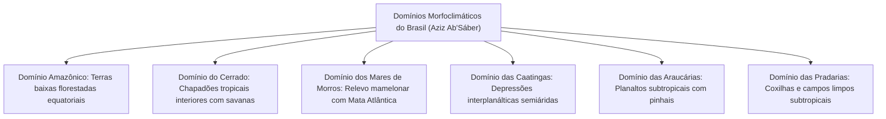
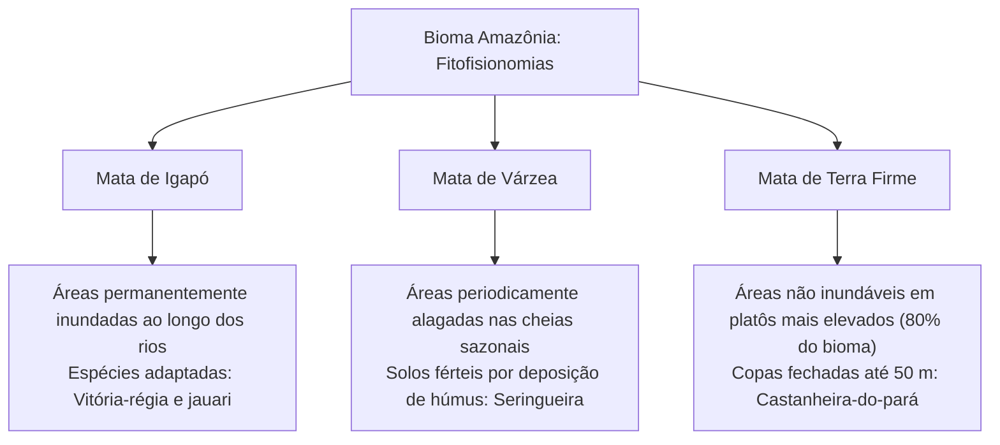
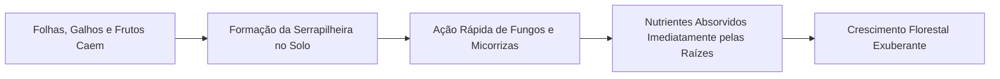
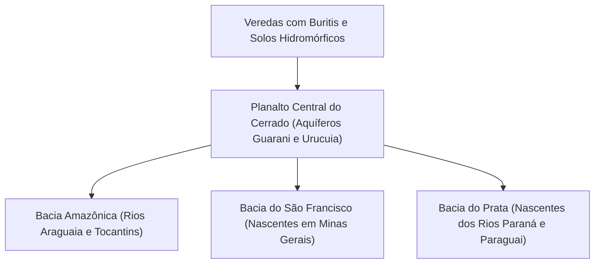
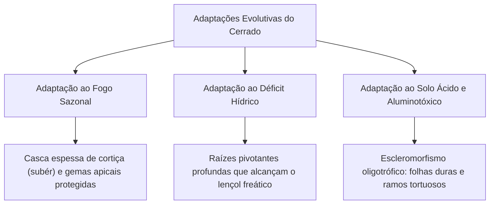
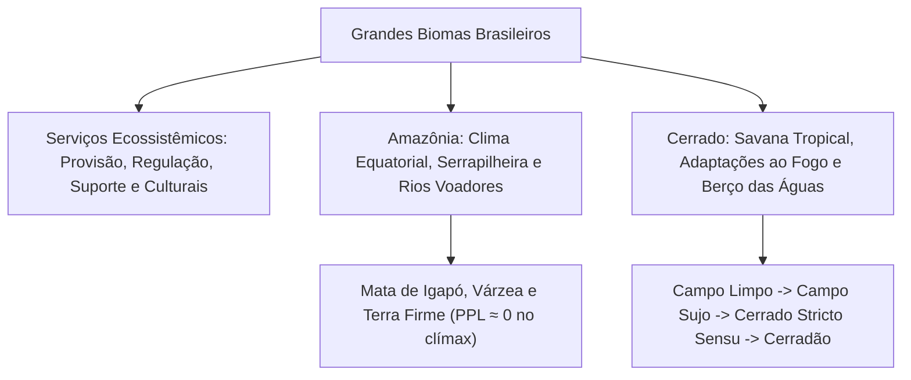

A biogeografia estuda a distribuição espacial dos seres vivos na Terra. Ela investiga fatores climáticos e geológicos que moldam a biosfera. O Brasil abriga uma das maiores megadiversidades do planeta. O país possui seis biomas continentais singulares e domínios morfoclimáticos complexos. A proteção dessas paisagens garante serviços ecossistêmicos vitais. Esses serviços incluem a regulação do clima e a segurança hídrica nacional. Este capítulo aborda a biogeografia brasileira, a classificação de Aziz Ab'Sáber e a ecologia da Amazônia e do Cerrado.

> [!objetivos]
> - Compreender os conceitos biogeográficos de bioma e domínio morfoclimático.
> - Categorizar os serviços ecossistêmicos de provisão, regulação, suporte e culturais.
> - Caracterizar a Amazônia: bacia hidrográfica, clima, solo, estratos florestais e o papel dos rios voadores.
> - Desmistificar a tese da Amazônia como "pulmão do mundo" sob as leis ecológicas.
> - Analisar o Cerrado: fisionomias vegetais, adaptações ao fogo e à seca, e sua função hidrológica nacional.

## Biogeografia, Domínios Morfoclimáticos e Serviços Ecossistêmicos

A distribuição dos seres vivos é condicionada pela latitude geográfica. Esse fator define a insolação, a temperatura média e o regime pluviométrico. Zonas tropicais equatoriais concentram grandes florestas pluviais e savanas biodiversas. Faixas subtropicais e temperadas abrigam campos e estepes.

No Brasil, o Ministério do Meio Ambiente e o IBGE reconhecem seis biomas continentais: Amazônia, Cerrado, Mata Atlântica, Caatinga, Pantanal e Pampa. Apenas o Pampa situa-se em clima subtropical. Os demais biomas localizam-se em faixas climáticas tropicais.

O geógrafo Aziz Ab'Sáber classificou o país em seis domínios morfoclimáticos. Eles combinam relevo, clima, hidrografia, solos e vegetação:

Entre os domínios nucleares estendem-se amplas faixas de transição ecológica (ecótonos). Bons exemplos são o Pantanal, o Agreste nordestino e a Mata dos Cocais.

### Serviços Ecossistêmicos e Bem-Estar Humano

A integridade dos biomas garante serviços ecossistêmicos vitais. Eles sustentam a economia e o bem-estar humano:

1. Serviços de Provisão: fornecem bens materiais tangíveis. Exemplos são alimentos, madeira, pescado, água doce, fibras e princípios farmacológicos.
2. Serviços de Regulação: proporcionam o amortecimento de extremos naturais. Exemplos são a retenção de cheias por matas ciliares, a polinização de plantações e o equilíbrio térmico.
3. Serviços de Suporte: asseguram as engrenagens básicas da vida. Incluem a ciclagem de nutrientes, a formação do solo e a produção primária fotossintética.
4. Serviços Culturais: geram benefícios imateriais e espirituais. Envolvem o turismo ecológico, a recreação ao ar livre e a identidade de povos tradicionais.

| Categoria de Serviço | Função Ecológica Básica | Exemplos Práticos no Brasil | Impacto da Degradação |
| --- | --- | --- | --- |
| Provisão | Fornecimento direto de insumos vitais | Castanha-do-pará, peixes e látex | Crise de abastecimento alimentar |
| Regulação | Amortecimento de extremos climáticos | Rios voadores amazônicos e contenção de encostas | Secas severas e deslizamentos |
| Suporte | Manutenção das engrenagens da vida | Fixação de nitrogênio e formação de solo | Desertificação e erosão |
| Cultural | Bem-estar psíquico e recreação | Ecoturismo no Pantanal e nascentes do Cerrado | Perda de patrimônio e renda |

## O Bioma Amazônia: Estrutura Ecológica e Rios Voadores

A Amazônia é o maior bioma do território brasileiro. Ela ocupa cerca de 4,2 milhões de quilômetros quadrados, abrangendo quase metade do país. A floresta estende-se por nove estados brasileiros e oito nações vizinhas da América do Sul.

### Hidrografia e Clima Equatorial

A bacia amazônica é a maior do globo terrestre. Ela drena cerca de seis milhões de quilômetros quadrados. O rio Amazonas descarrega cerca de 20% de toda a água doce fluvial que chega aos oceanos do planeta. Ele nasce na Cordilheira dos Andes e percorre cerca de 6.992 km até o Atlântico.

Seus afluentes exibem padrões hidrológicos distintos:
- Rios de águas brancas: carregam sedimentos andinos férteis e têm aspecto barrento (como o rio Madeira).
- Rios de águas pretas: são ácidos e ricos em matéria orgânica dissolvida (como o rio Negro).
- Rios de águas claras: drenam escudos cristalinos antigos e apresentam grande limpidez (como o rio Tapajós).

O clima dominante é o equatorial úmido. As temperaturas médias anuais variam entre 25 °C e 28 °C. A pluviosidade atinge entre 1.800 mm e 3.000 mm ao ano, com umidade do ar acima de 80%.

### Fitofisionomias e Estratificação Florestal

A vegetação amazônica divide-se em três estratos estruturais, condicionados pela dinâmica das cheias:

- Mata de Igapó: permanece inundada ao longo do ano nas margens dos rios. Abriga plantas aquáticas especializadas com raízes respiratórias, como a vitória-régia (*Victoria amazonica*).
- Mata de Várzea: sofre inundações sazonais periódicas no período das cheias. O solo recebe sedimentos ricos em minerais. Destacam-se árvores como a seringueira (*Hevea brasiliensis*).
- Mata de Terra Firme: ocupa mais de 80% do território do bioma. Fica localizada em platôs elevados que nunca inundam. Apresenta árvores gigantescas de até 50 metros com raízes tabulares de sustentação, como a castanheira-do-pará (*Bertholletia excelsa*).

### Fauna Amazônica e Dinâmica da Piracema

A bacia amazônica abriga a mais rica ictiofauna de água doce do planeta Terra, ultrapassando 2.400 espécies catalogadas de peixes (cerca de 80% de todas as espécies de peixes continentais da América do Sul). Destacam-se espécies emblemáticas como o pirarucu (*Arapaima gigas*), o tambaqui e o tucunaré. No período das enchentes sazonais, ocorre o fenômeno biológico da piracema: cardumes sobem as cabeceiras dos rios em migração reprodutiva sincronizada para desovar em trechos protegidos e oxigenados.

A avifauna conta com mais de 1.300 espécies, incluindo grandes rapinantes como o gavião-real ou harpia (*Harpia harpyja*). Entre os mamíferos, a Amazônia destaca-se como o maior centro global de radiação adaptativa de primatas, abrigando mais de cem espécies de macacos arborícolas. A mastofauna inclui ainda botos fluviais (boto-cor-de-rosa e tucuxi), peixes-bois e grandes predadores terrestres, como a onça-pintada e a ariranha.

### O Solo Amazônico e o Mecanismo dos Rios Voadores

O solo amazônico não é fértil por natureza. Ele é muito antigo, arenoso, ácido e pobre em nutrientes minerais. As chuvas diárias tendem a lixiviar os sais solúveis.

A exuberância da floresta mantém-se graças a um circuito fechado de ciclagem de nutrientes:

A queda constante de biomassa foliar forma sobre o chão uma camada superficial de matéria orgânica denominada **serrapilheira**. O calor e a umidade aceleram a decomposição por fungos e bactérias. As raízes superficiais associadas a micorrizas absorvem esses nutrientes no instante em que são liberados. Se a floresta for desmatada, as chuvas lavam os poucos nutrientes restantes, degradando o terreno rapidamente.

> [!exemplo] Dinâmica dos Rios Voadores
> Uma grande árvore amazônica pode bombear e transpirar mais de mil litros de água líquida por dia para a atmosfera. Milhões de árvores operando juntas geram imensas massas de vapor de água chamadas rios voadores. Essas correntes aéreas úmidas chocam-se com os Andes e viajam para o Centro-Oeste e Sudeste do Brasil, alimentando as chuvas que abastecem represas e lavouras agrícolas.

> [!pegadinha] O Mito da Amazônia como "Pulmão do Mundo"
> Dizer em prova que a Amazônia produz o oxigênio respirado pela humanidade é um erro clássico. A floresta amazônica é uma comunidade clímax estável. Quase todo o oxigênio liberado na fotossíntese é consumido à noite na respiração celular das árvores, dos animais e dos decompositores (PPL ≈ 0). O grande produtor líquido de oxigênio da Terra é o fitoplâncton marinho nos oceanos.

## O Bioma Cerrado: A Savana Brasileira e o Berço das Águas

Compreendendo cerca de dois milhões de quilômetros quadrados, o Cerrado destaca-se como a segunda mais extensa formação natural da América do Sul. Ele cobre quase um quarto do território brasileiro. Distribui-se pelo Distrito Federal e por estados como Minas Gerais, Bahia, Tocantins, Maranhão, Piauí, Mato Grosso e Mato Grosso do Sul.

O Cerrado é a savana mais biodiversa do mundo. É classificado como um hotspot global de biodiversidade: abriga milhares de espécies endêmicas e já teve mais de 50% de sua área convertida em pastos e lavouras.

### O Clima e a Função Hidrológica Nacional

O clima é tropical típico, com duas estações do ano muito nítidas:
- Estação chuvosa: ocorre no verão, com chuvas anuais entre 1.100 mm e 2.000 mm.
- Estação de estiagem: estende-se por cinco a seis meses no inverno, com umidade do ar frequentemente inferior a 20%.

O Cerrado funciona como a caixa-d'água do Brasil. Ele abriga os divisores de bacias e as cabeceiras dos rios São Francisco, Tocantins-Araguaia e da bacia do Prata (rios Paraná e Paraguai). Suas **veredas**, marcadas pela presença da palmeira buriti (*Mauritia flexuosa*), atuam como esponjas hídricas que retêm água e alimentam nascentes ao longo de todo o ano.

### Fitofisionomias do Cerrado e Gradiente de Biomassa

O Cerrado exibe um mosaico de fisionomias vegetais (*Cerrado sensu lato*) dispostas em um gradiente de biomassa arbórea:

1. Campo Limpo: formação puramente campestre dominada por gramíneas, sem elementos arbóreos.
2. Campo Sujo: estrato de gramíneas com pequenos arbustos esparsos.
3. Cerrado *sensu stricto*: formação savânica típica, com árvores baixas tortuosas e espaçadas sobre solo graminoso.
4. Cerradão: formação florestal fechada com árvores que atingem de 10 a 15 metros, formando dossel contínuo.
5. Matas de Galeria e Ciliares: florestas estreitas que margeiam rios, mantendo umidade e protegendo margens contra a erosão.

A flora do Cerrado reúne mais de 11 mil espécies de plantas vasculares, destacando-se uma extraordinária diversidade de espécies frutíferas nativas de alto valor ecológico e nutricional:
- Pequi (*Caryocar brasiliense*): árvore de frutos aromáticos ricos em lipídios e carotenoides, base alimentar da fauna silvestre e de comunidades rurais tradicionais.
- Buriti (*Mauritia flexuosa*): palmeira monumental típica de veredas, cujos frutos oleaginosos alimentam araras, antas e roedores aquáticos.
- Baru (*Dipteryx alata*): leguminosa arbórea que produz castanhas ricas em proteínas e ferro.
- Cagaita e Mangaba: árvores frutíferas adaptadas aos solos arenosos, que fornecem alimento abundante para aves e insetos na primavera.

### Adaptações ao Fogo, à Seca e à Toxicidade do Solo

A vegetação do Cerrado desenvolveu adaptações morfológicas singulares:

- Casca grossa suberosa: o súber espesso atua como isolante térmico contra as chamas superficiais rápidas.
- Gemas subterrâneas e xilopódios: órgãos subterrâneos que armazenam amido e água, permitindo rápido rebrotamento pós-queimada.
- Raízes pivotantes profundas: penetram mais de dez metros no subsolo, buscando água do lençol freático na estiagem.
- Escleromorfismo oligotrófico: folhas duras e galhos retorcidos não decorrem de falta de água, mas da alta concentração de alumínio tóxico (Al³⁺) e acidez do solo.

O fogo natural por raios no início das chuvas quebra a dormência de sementes e estimula brotos. Contudo, queimadas criminosas no auge da seca destroem a fauna nativa e favorecem capins invasores agressivos, como a braquiária.

> [!atencao] A Floresta Invertida
> Em provas de biologia, muitos erram ao pensar que o Cerrado é xerófilo. As árvores do Cerrado mantêm folhas verdes e florescem em plena seca de agosto porque suas raízes profundas alcançam o lençol d'água subterrâneo. Seus ramos retorcidos decorrem do solo ácido e da toxidade do alumínio.

> [!bizu] Resumo Operacional dos Biomas
> - **Amazônia:** Maior bioma, clima equatorial úmido, solo arenoso sustentado pela serrapilheira superficial; matas de igapó, várzea e terra firme; rios voadores sustentam as chuvas do centro-sul.
> - **Cerrado:** Savana mais rica do mundo (hotspot), clima tropical com seca invernal; raízes profundas, troncos tortuosos com cortiça e xilopódios; berço hidrográfico nacional.

## Mapa do capítulo

### Para fixar

- O Brasil abriga seis biomas continentais; apenas o Pampa é subtropical, os demais são tropicais.
- Os serviços ecossistêmicos dividem-se em provisão, regulação, suporte e culturais.
- O solo da Amazônia é arenoso e pobre; a fertilidade depende da reciclagem rápida da serrapilheira por fungos.
- Os rios voadores amazônicos transportam massas colossais de vapor que regulam o clima no Centro-Sul brasileiro.
- Na Amazônia madura em clímax, a produção de oxigênio equilibra-se com a respiração total da biota (PPL ≈ 0).
- O Cerrado é a savana mais rica do mundo e atua como a caixa-d'água das grandes bacias hidrográficas nacionais.
- A vegetação do Cerrado apresenta casca grossa suberosa, raízes profundas e xilopódios adaptados ao fogo e à seca.
- O gradiente savânico do Cerrado varia do Campo Limpo (herbáceo) ao Cerradão (formação florestal densa).
