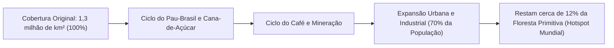
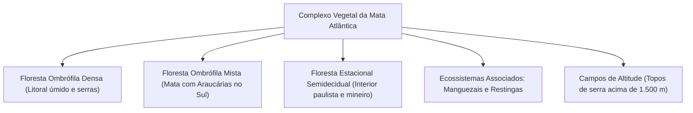
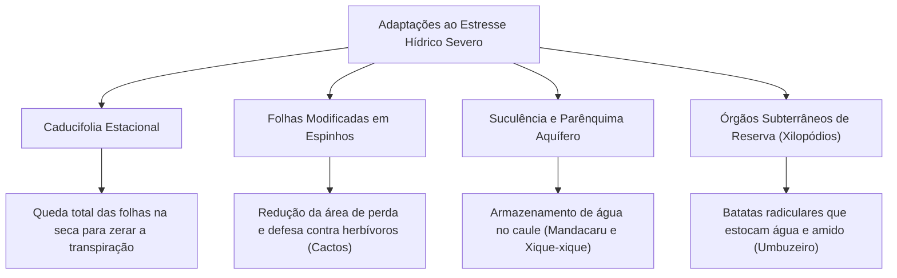
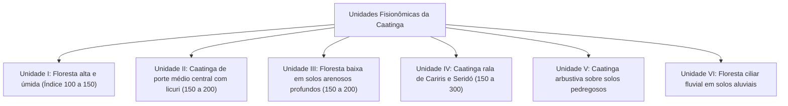
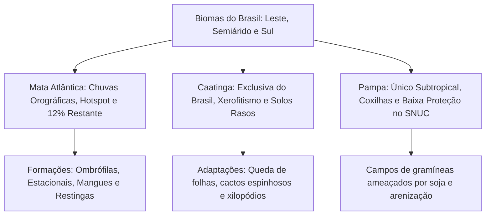

A diversidade biogeográfica brasileira reflete gradientes climáticos e geomorfológicos marcantes. Na fachada leste, as escarpas litorâneas abrigam a exuberante e ameaçada Mata Atlântica. No interior semiárido do Nordeste, estende-se a Caatinga, único bioma de ocorrência estritamente nacional. No extremo meridional do país, os campos planos e coxilhas do Pampa representam o único bioma sob clima subtropical do Brasil. O domínio das características ecológicas desses ecossistemas é indispensável para os concursos de segurança pública e defesa civil. Este capítulo detalha a estrutura da vegetação, o clima, os endemismos faunísticos e as ameaças de conservação desses três biomas.

> [!objetivos]
> - Compreender a ecologia da Mata Atlântica, suas fitofisionomias e seu status de hotspot mundial.
> - Caracterizar a Caatinga como bioma semiárido endêmico do Brasil e suas adaptações xeromórficas.
> - Analisar a estrutura fisionômica das seis unidades da Caatinga e o índice xerotérmico de Gaussen.
> - Caracterizar o Pampa como bioma campestre subtropical exclusivo do Rio Grande do Sul.
> - Comparar os níveis de degradação, representatividade no SNUC e riscos de desertificação.

## O Bioma Mata Atlântica: Riqueza e Fragmentação Crítica

A Mata Atlântica estendia-se originalmente por cerca de 1,3 milhão de quilômetros quadrados ao longo da costa atlântica brasileira, abrangendo 17 unidades federativas, desde o litoral potiguar até o extremo gaúcho. Ela penetrava pelo interior até o leste do Paraguai e a província de Misiones na Argentina.

Trata-se do bioma mais transformado e ameaçado do Brasil. A ocupação histórica pelo extrativismo do pau-brasil (*Paubrasilia echinata*), os ciclos econômicos da cana-de-açúcar e do café e a intensa urbanização reduziram a cobertura original para cerca de 12% da área primitiva. Cerca de 70% da população brasileira (mais de 145 milhões de habitantes) reside no território histórico do bioma. Essa concentração humana exerce pressão constante sobre os remanescentes florestais. A Mata Atlântica é reconhecida mundialmente como um dos 36 hotspots globais de biodiversidade.

### Clima, Relevo e Fitofisionomias Associadas

O relevo dominante da Mata Atlântica coincide com o domínio morfoclimático dos Mares de Morros, caracterizado por colinas mamelonares ("meias-laranjas") e escarpas serranas abruptas (Serra do Mar e Serra da Mantiqueira).

O clima predominante é o tropical úmido litorâneo. As chuvas são de natureza **orográfica** (chuvas de relevo): massas de ar oceânicas úmidas empurradas pelos ventos alísios chocam-se contra as encostas das serras, elevam-se, resfriam-se e condensam-se, descarregando grande volume pluviométrico. Esse relevo acidentado cria múltiplos microclimas e isolamentos que favorecem a especiação e o endemismo.

A Mata Atlântica reúne formações florestais e ecossistemas litorâneos associados:

- Floresta Ombrófila Densa: mata perenifólia higrófila nas encostas marítimas, com árvores de dossel fechado, cipós lenhosos e extraordinária densidade de epífitas (orquídeas e bromélias).
- Floresta Ombrófila Mista (Mata das Araucárias): típica dos planaltos subtropicais dos estados do Paraná, Santa Catarina e Rio Grande do Sul. É dominada pelo pinheiro-do-paraná (*Araucaria angustifolia*), gimnosperma de copas em formato de taça adaptada a geadas.
- Floresta Estacional Semidecidual: floresta do interior do país, onde parcela das árvores (20% a 50%) perde suas folhas durante a estação seca do inverno.
- Manguezais e Restingas: ecossistemas costeiros pioneiros que fazem a transição entre o continente e o oceano.

### Biodiversidade e Hidrografia

A Mata Atlântica abriga cerca de 20 mil espécies vegetais (aproximadamente 35% de todas as espécies brasileiras), sendo que 60% delas são endêmicas. Entre as bromélias e palmeiras, o endemismo atinge cerca de 70%. Destaca-se o palmito-juçara (*Euterpe edulis*), espécie-chave cuja frutificação alimenta centenas de aves e mamíferos.

A fauna inclui cerca de 900 espécies de aves e 370 de anfíbios anuros. O bioma abriga o mico-leão-dourado (*Leontopithecus rosalia*), o muriqui-do-sul e mais de metade de todas as espécies de animais ameaçadas de extinção no Brasil.

Em termos hidrológicos, o bioma recobre sete das nove grandes bacias hidrográficas nacionais (como bacias dos rios Paraná, Paraíba do Sul e São Francisco) e parte substancial do Aquífero Guarani. A preservação de suas matas ciliares é vital para a retenção do solo e o fornecimento contínuo de água às maiores metrópoles do país.

| Parâmetro Ecológico | Mata Atlântica | Caatinga | Pampa |
| --- | --- | --- | --- |
| Clima Predominante | Tropical úmido e subtropical | Tropical semiárido | Subtropical temperado |
| Índice Pluviométrico | 1.200 a mais de 3.000 mm | 500 a 700 mm | 500 a 1.000 mm |
| Regime Hídrico | Rios perenes caudalosos | Rios intermitentes temporários | Rios de planície perenes |
| Situação de Conservação | Restam cerca de 12% (Hotspot) | Cerca de 46% alterada | Restam menos de 40% |
| Representação no SNUC | Cerca de 8,5% protegida | Cerca de 7,5% protegida | Apenas 0,4% em UCs |

## O Bioma Caatinga: O Semiárido Exclusivo do Brasil

A Caatinga ocupa cerca de 844 mil quilômetros quadrados (cerca de 10% do território nacional), abrangendo todos os estados da Região Nordeste (Alagoas, Bahia, Ceará, Maranhão, Paraíba, Pernambuco, Piauí, Rio Grande do Norte e Sergipe) e a faixa norte de Minas Gerais.

O nome do bioma tem origem na língua indígena tupi e significa "mata branca" (caa = mata; tinga = branca), aludindo ao aspecto cinzento e esbranquiçado que os troncos desfolhados assumem durante a longa estiagem. Trata-se do **único bioma exclusivamente brasileiro**: toda a sua área geográfica situa-se dentro das fronteiras nacionais.

### Clima Tropical Semiárido e Hidrografia Intermitente

O clima característico é o tropical semiárido, marcado por pluviosidade escassa e irregular (entre 500 mm e 700 mm ao ano), elevadas médias térmicas anuais (27 °C a 29 °C) e alto déficit hídrico gerado pela intensa evapotranspiração potencial. As chuvas concentram-se em poucos meses do ano, seguidas por secas severas de sete a nove meses.

Os solos da Caatinga são de origem cristalina antiga: pedregosos, rasos e pouco profundos. Embora ricos em minerais básicos, são deficientes em matéria orgânica e possuem baixa permeabilidade. Isso faz com que a água das chuvas torrenciais escoe superficialmente sem infiltrar.

A rede de drenagem fluvial é predominantemente **intermitente ou temporária**: os rios e riachos secam completamente na estiagem. O único grande curso de água perene que atravessa o bioma é o rio São Francisco, cujas cabeceiras encontram-se fora da Caatinga, no Cerrado mineiro.

### Vegetação Xerófila e Flora Típica

A flora da Caatinga reúne mais de 3.150 espécies vegetais, com cerca de 23% de endemismo. A vegetação é estritamente **xerófila** (adaptada à seca) e **caducifólia**: as árvores e arbustos perdem totalmente a folhagem no início da estiagem para evitar a perda de água, recuperando a coloração verde em poucos dias após a primeira chuva.

Destacam-se três grupos funcionais de plantas:

1. Cactáceas: plantas suculentas que armazenam água em seus caules carnosos clorofilados (cladódios) e reduziram suas folhas a espinhos pontiagudos. Exemplos: mandacaru (*Cereus jamacaru*), xique-xique (*Pilosocereus gounellei*) e facheiro.
2. Árvores caducifólias com xilopódios: espécies que desenvolvem túberas subterrâneas que armazenam água e nutrientes. O umbuzeiro (*Spondias tuberosa*) é o maior símbolo dessa adaptação. O juazeiro (*Ziziphus joazeiro*) destaca-se por ser uma das raríssimas árvores que mantêm folhas verdes o ano todo, graças a raízes profundas que buscam lençóis subterrâneos.
3. Palmeiras ceríferas: como a carnaúba (*Copernicia prunifera*), palmeira que produz densa camada de cera impermeabilizante em suas folhas para bloquear a perda hídrica.

> [!exemplo] Resistência à Seca Extrema: Mandacaru e Umbuzeiro
> O mandacaru (*Cereus jamacaru*) realiza fotossíntese pelo caule verde e armazena grandes volumes de água em seus tecidos carnosos, protegidos por espinhos pontiagudos que reduzem a evapotranspiração e repelem herbívoros. Já o umbuzeiro (*Spondias tuberosa*) desenvolve batatas radiculares (xilopódios) capazes de estocar até dois mil litros de água e nutrientes, permitindo-lhe brotar e frutificar em pleno auge da estiagem sertaneja.

### Unidades Fitofisionômicas e o Índice Xerotérmico

A Caatinga não é homogênea. Ela subdivide-se em **seis unidades fitofisionômicas** principais, delimitadas pelo relevo, tipo de solo e pelo **índice xerotérmico de Gaussen** (que contabiliza o número de dias biologicamente secos no ano; quanto maior o índice, mais árido é o ambiente):

- Unidade I: a formação mais úmida do bioma, de porte arbóreo elevado, restrita ao norte de Minas Gerais e sul da Bahia (presença abundante da barriguda).
- Unidade II: núcleo central da Caatinga, de porte arbóreo médio a baixo, com dominância da palmeira licuri (*Syagrus coronata*).
- Unidade III: florestas baixas sobre solos arenosos profundos no interior da Bahia e de Pernambuco.
- Unidade IV: caatinga rala e de baixa estatura nos solos pedregosos dos Cariris Velhos (PB) e Seridó (PB/RN).
- Unidade V: caatinga arbustiva aberta com cactos rasteiros em solos rasos.
- Unidade VI: florestas ciliares ao longo das calhas dos rios maiores nos solos aluviais do Piauí e Ceará.

A degradação atinge cerca de 46% do bioma, motivada pelo corte de lenha para fornos industriais de cerâmica e siderurgia, pecuária caprina extensiva e queimadas. Cerca de 62% das áreas suscetíveis à **desertificação** no Brasil situam-se na Caatinga. Apenas 7,5% de sua área está protegida por Unidades de Conservação, como o Parque Nacional da Furna Feia e o Parque Estadual Mata da Pimenteira em Pernambuco. A fauna abrigava a ararinha-azul (*Cyanopsitta spixii*), espécie endêmica hoje considerada extinta na natureza silvestre.

> [!atencao] Exclusividade Biogeográfica
> Em itens de verdadeiro ou falso, as bancas adoram afirmar que o Cerrado ou a Amazônia são exclusivos do Brasil. Isso é falso: ambos avançam para países vizinhos. O **único bioma continental exclusivo do Brasil** é a **Caatinga**, cujo patrimônio genético reside inteiramente no território nacional.

## O Bioma Pampa: Os Campos Sulinos Subtropicais (Pampas)

O bioma Pampa, também denominado tradicionalmente no plural como Pampas (item 8.5 Pampas dos manuais de ecologia e geografia), ocupa 176.496 quilômetros quadrados, abrangendo cerca de 63% da área territorial do estado do Rio Grande do Sul (cerca de 2% do território nacional). Ele representa o prolongamento setentrional das pradarias do Uruguai e da Argentina.

Trata-se do **único bioma brasileiro de clima subtropical**. As temperaturas médias anuais situam-se entre 10 °C e 23 °C, marcadas por quatro estações do ano bem definidas, invernos rigorosos com geadas frequentes e precipitações bem distribuídas ao longo de todo o ano (entre 500 mm e 1.000 mm).

### Fitofisionomia e Fauna

A paisagem do Pampa é caracterizada pelo predomínio de formações campestres contínuas sobre colinas suaves e onduladas denominadas **coxilhas**, entremeadas por matas ciliares ao longo dos rios e banhados:

- Flora campestre: reúne cerca de 3.000 espécies vegetais, com mais de 450 espécies de gramíneas nativas perenes de alto valor forrageiro e mais de 150 espécies de leguminosas silvestres (como o trevo-nativo e o amendoim-nativo).
- Mastofauna e avifauna: abriga animais adaptados aos descampados abertos, como a ema (*Rhea americana*), o quero-quero (*Vanellus chilensis*), o veado-campeiro, o graxaim e mamíferos roedores subterrâneos endêmicos como o tuco-tuco (*Ctenomys flamarioni*).

### Ameaças de Conservação e Fragilidade Institucional

Os campos nativos do Pampa prestam serviços fundamentais de retenção de carbono no solo radicular, controle de erosão hídrica e conservação do Aquífero Guarani.

Contudo, resta menos de 40% da vegetação original campestre. As principais ameaças incluem:

1. Expansão acelerada da monocultura mecanizada da soja e silvicultura de eucaliptos.
2. Arenização do solo: em solos arenosos friáveis (especialmente no sudoeste gaúcho), o sobrepastoreio bovino destrói a grama e expõe o solo ao vento e à chuva, gerando extensos areais estéreis.
3. Invasão biológica pelo capim-annoni (*Eragrostis plana*), gramínea africana agressiva de péssimo valor forrageiro que infesta os campos e exclui as espécies nativas.

O Pampa é o bioma **menos protegido do país no Sistema Nacional de Unidades de Conservação (SNUC)**: apenas cerca de 0,4% da área continental do bioma encontra-se resguardada em unidades de conservação de proteção integral.

> [!pegadinha] Arenização não é Desertificação
> É erro frequente confundir os fenômenos do Pampa e da Caatinga em provas. A **desertificação** ocorre em áreas áridas ou semiáridas (como na Caatinga) sob grave déficit hídrico climático e degradação severa do solo. A **arenização**, por outro lado, ocorre no Pampa sob clima subtropical chuvoso: o pisoteio bovino expõe bancos de areia geológicos já existentes, que são remobilizados pelas águas e ventos sem qualquer relação com clima seco.

> [!bizu] Comparativo Síntese para a Prova
> - **Mata Atlântica:** Litoral, florestas ombrófilas, chuvas orográficas, hotspot com 12% restante e 70% da população brasileira.
> - **Caatinga:** Semiárido, bioma exclusivamente brasileiro, vegetação xerófila e caducifólia, solos rasos e pedregosos, ameaçado por desertificação (ararinha-azul).
> - **Pampa:** Único subtropical, restrito ao RS, campos nativos sobre coxilhas, ameaçado por arenização, monocultura de soja e menos protegido no SNUC (0,4%).

## Mapa do capítulo

### Para fixar

- A Mata Atlântica acompanha o litoral brasileiro; restam cerca de 12% de sua cobertura original (hotspot).
- As chuvas da Mata Atlântica são orográficas, formadas pelo relevo acidentado das serras costeiras.
- A Caatinga é o único bioma de ocorrência exclusivamente brasileira, marcada por clima semiárido.
- A vegetação da Caatinga é xerófila e caducifólia, perdendo folhas na seca e estocando água em cactos e raízes.
- O índice xerotérmico de Gaussen mede o número de dias biologicamente secos nas unidades da Caatinga.
- Mais de 60% das áreas brasileiras vulneráveis à desertificação situam-se no domínio da Caatinga.
- O Pampa é o único bioma subtropical do país, cobrindo 63% do Rio Grande do Sul com campos e coxilhas.
- O Pampa é o bioma menos protegido do Brasil no SNUC, com apenas 0,4% de sua área em unidades de conservação.
