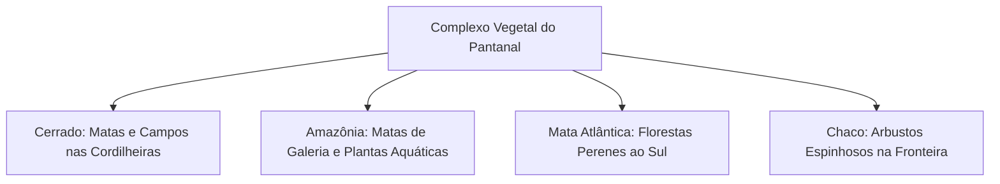
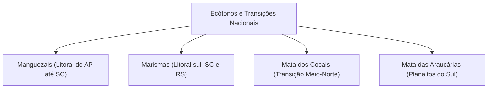
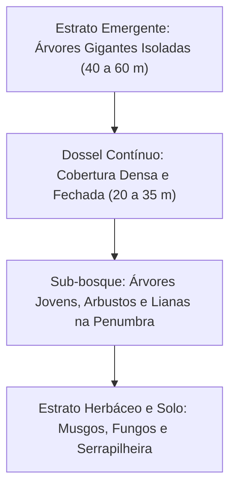
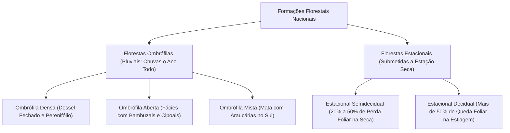
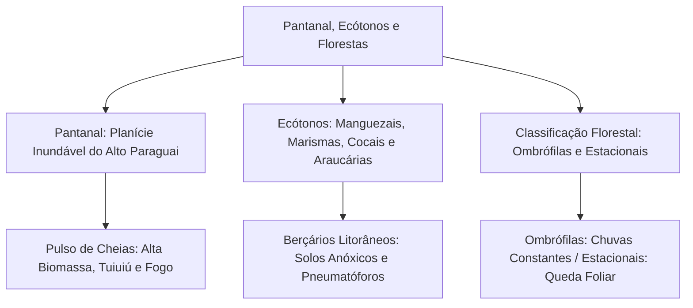

O território brasileiro encerra formações ecológicas singulares. Dentre essas paisagens destaca-se o Pantanal. Trata-se da maior planície de inundação contínua do globo terrestre. Ao lado dos grandes biomas continentais, o país abriga expressivos ecossistemas de transição. Destacam-se os manguezais litorâneos e a Mata dos Cocais. Compreender a estrutura das florestas nativas e suas tipologias é fundamental. O tema é recorrente nas provas de segurança pública e defesa civil. Este capítulo encerra o volume de Ecologia. Aqui você estudará o regime do Pantanal, os ecótonos nacionais e a classificação das florestas brasileiras.

> [!objetivos]
> - Caracterizar o Pantanal quanto à bacia do Alto Paraguai e seu pulso de inundação.
> - Compreender o Pantanal como mosaico de biomas e avaliar sua fauna e conservação.
> - Analisar os ecossistemas de transição: manguezais, marismas, Cocais e Araucárias.
> - Dominar a definição de floresta e a estratificação vertical de copas e sub-bosque.
> - Diferenciar as florestas ombrófilas das florestas estacionais brasileiras.

## O Bioma Pantanal: A Maior Planície Inundável (8.6 Pantanal)

O Pantanal ocupa cerca de 150 mil quilômetros quadrados no Brasil. Abrange parcelas de Mato Grosso e Mato Grosso do Sul (1,7% do território nacional). É o bioma de menor extensão territorial do país. Apesar disso, constitui a maior área úmida continental contínua de água doce do planeta. O bioma prolonga-se pelo norte do Paraguai e leste da Bolívia. Nesses países vizinhos, a região recebe o nome de Chaco.

### Pulso de Inundação e Hidrografia

O relevo pantaneiro forma uma vasta planície de baixa altitude. Situa-se entre 80 e 150 metros acima do nível do mar. A planície é cercada por planaltos e serras mais elevadas. Essa declividade suave retarda o escoamento das águas fluviais.

O regime ecológico local é regido pelo **pulso de inundação** sazonal. No verão (novembro a março), ocorrem chuvas intensas nas cabeceiras dos rios. Os afluentes da bacia do Alto Paraguai (Cuiabá, Miranda e Taquari) transbordam. As águas cobrem até 80% dos terrenos baixos da planície. 

No inverno (maio a outubro), a seca reduz o volume hídrico. As águas retornam lentamente ao leito do rio Paraguai. Esse recuo isola milhares de lagoas temporárias, chamadas de "baías". O evento aprisiona milhões de peixes em poças rasas. As aves piscívoras e os répteis encontram aí alimento abundante.

### Mosaico de Biomas e Riqueza Faunística

O Pantanal não possui vegetação uniforme. Os botânicos o definem como um **mosaico de biomas**. Ele integra espécies vegetais de quatro domínios vizinhos:

- Cerrado: domina as partes altas e arenosas que não alagam (cordilheiras e capões).
- Amazônia: fornece matas de galeria e plantas aquáticas flutuantes.
- Mata Atlântica: contribui com matas ciliares densas na porção sul.
- Chaco: aporta arbustos espinhosos na fronteira oeste de Mato Grosso do Sul.

A fauna apresenta concentração excepcional de biomassa animal. O endemismo do bioma é baixo, pois a maioria dos animais vem de regiões vizinhas. Todavia, a densidade de indivíduos é surpreendente:

- Peixes: cerca de 263 espécies registradas, como pacu, pintado e dourado.
- Répteis e anfíbios: 127 répteis, com destaque para multidões de jacarés-do-pantanal (*Caiman yacare*).
- Aves: mais de 650 espécies. O tuiuiú (*Jabiru mycteria*) é a ave símbolo oficial.
- Mamíferos: 152 espécies, registrando a maior densidade global de onças-pintadas (*Panthera onca*).

### Ameaças de Conservação

O Pantanal convive com novas pressões ambientais:

1. O avanço da agricultura de grãos nas cabeceiras dos planaltos causa erosão severa. A terra carreada pelas chuvas assoreia os rios, como o leito do rio Taquari.
2. Incêndios florestais devastadores na estação seca. As estiagens severas combinadas ao fogo criminoso consumiram milhões de hectares em 2020.
3. Pouca proteção formal no SNUC. Menos de 5% da área pantaneira está protegida por unidades de conservação (apenas 2,9% em proteção integral). A grande maioria do território pertence a fazendas particulares.

> [!atencao] Endemismo versus Abundância
> Concursos públicos costumam cobrar essa distinção. O Pantanal possui **baixo índice de endemismo**. Quase não há espécies exclusivas ali. Seu destaque ecológico reside na **extrema abundância e densidade de animais**, servindo de santuário biológico.

## Ecossistemas de Transição e Zonas Costeiras (8.7 Ecossistemas de transição)

Zonas de contato entre ecossistemas distintos denominam-se **ecótonos**. No Brasil, esses ambientes abrigam grande biodiversidade:

### Manguezais: Berçários da Vida Marinha

Os manguezais ocupam a costa brasileira do Amapá a Santa Catarina. Localizam-se em estuários, deltas e baías protegidas de ondas fortes. Nesses locais, a água doce dos rios mistura-se com a água salgada do mar.

O ambiente impõe condições físicas e químicas muito rigorosas:

- Solo lodoso e móvel: argila fina com grande carga de matéria orgânica.
- Anoxia do substrato: o lodo encharcado é quase destituído de oxigênio gasoso.
- Salinidade flutuante: a concentração de sal varia com as marés diárias.

A vegetação desenvolveu adaptações notáveis para enfrentar esse cenário:

1. Raízes-escoras (estribos): raízes arqueadas que saem do tronco para fixar a árvore na lama mole (mangue-vermelho, *Rhizophora mangle*).
2. Pneumatóforos (raízes respiratórias): projeções que crescem verticalmente para cima da lama. Possuem poros chamados **pneumatódios** para absorver ar na maré baixa (mangue-preto, *Avicennia schaueriana*).
3. Glândulas de sal foliares: estruturas que eliminam o cloreto de sódio em excesso (mangue-branco, *Laguncularia racemosa*).
4. Viviparidade embrionária: sementes germinam presas à planta-mãe, formando propágulos pontiagudos.

Os manguezais atuam como berçários biológicos marinhos fundamentais. As raízes emaranhadas fornecem refúgio contra predadores. Alimentam larvas e filhotes de peixes, siris e caranguejos-uçá (*Ucides cordatus*).

> [!bizu] Proteção Legal do Manguezal
> O Código Florestal (Lei Federal nº 12.651/2012) protege integralmente os manguezais. Eles são classificados como Áreas de Preservação Permanente (APP) em toda a sua área.

### Marismas: Pântanos Salgados do Sul

No litoral do sul de Santa Catarina e do Rio Grande do Sul, o frio impede o crescimento de árvores de mangue. Surgem as **marismas**. São pântanos salinos dominados por gramíneas e juncos herbáceos halófitos. Suas raízes fixam o solo contra as ressacas do mar. Servem de berçário estuarino e alimentam aves migratórias e juvenis de peixes.

### Mata dos Cocais: O Ecótono do Meio-Norte

A Mata dos Cocais situa-se no Maranhão, Piauí, Ceará e Tocantins. Constitui o ecótono entre três grandes domínios: Amazônia a oeste, Caatinga a leste e Cerrado ao sul. 

Destacam-se palmeiras de grande porte:

- Palmeira-babaçu (*Attalea speciosa*): espécie dominante com até vinte metros de altura. Suas sementes fornecem óleo e matérias-primas valiosas para quebradeiras de coco.
- Carnaúba (*Copernicia prunifera*): fornece cera protetora impermeabilizante, suportando trechos semiáridos.
- Buriti (*Mauritia flexuosa*): habita veredas úmidas e margens de riachos.

### Mata das Araucárias: A Floresta Subtropical

A Mata das Araucárias (Floresta Ombrófila Mista) ocupa os planaltos do Paraná, Santa Catarina e Rio Grande do Sul. O clima é subtropical úmido, com geadas no inverno e chuvas regulares o ano todo.

A conífera nativa pinheiro-do-paraná (*Araucaria angustifolia*) domina a cobertura com copas em taça. Suas sementes nuas são os nutritivos **pinhões**. A **gralha-azul** (*Cyanocorax caeruleus*) enterra pinhões na terra, permitindo que as sementes germinem. A exploração predatória de madeira no século passado reduziu a floresta a menos de 3% da cobertura original.

| Ecossistema | Localização | Clima | Vegetação Principal |
| --- | --- | --- | --- |
| Manguezais | Costa litorânea (AP a SC) | Tropical úmido | Árvores halófitas com pneumatóforos |
| Marismas | Litoral sul (SC e RS) | Subtropical | Herbáceas e gramíneas halófitas |
| Mata dos Cocais | Meio-Norte (MA, PI, CE) | Transição tropical | Palmeiras babaçu, carnaúba e buriti |
| Mata das Araucárias | Planaltos do Sul | Subtropical com geadas | Conífera *Araucaria angustifolia* |

## Estrutura e Serviços das Florestas Nacionais (9 – Florestas)

As florestas cobrem ampla extensão continental. Exercem papel vital no equilíbrio da biosfera.

### Definição Técnica de Floresta

A Organização das Nações Unidas para a Alimentação e a Agricultura (FAO) e o Serviço Florestal Brasileiro definem **floresta** por critérios estruturais:

1. Área contínua superior a meio hectare (0,5 ha ou 5.000 m²).
2. Árvores adultas capazes de atingir altura mínima superior a cinco metros.
3. Cobertura de copas superior a dez por cento (10%) da área do terreno.

### Estratificação Vertical da Floresta (9.2 Estrutura florestal)

A convivência vegetal em matas fechadas estrutura-se por camadas verticais de altura e iluminação:

1. Estrato Emergente: árvores colossais isoladas entre 40 e 60 metros de altura (sumaúmas e castanheiras). Recebem luz solar plena e ventos fortes.
2. Dossel: abóbada contínua de copas entre 20 e 35 metros de altura. Retém até 90% da luz solar e abriga a maioria dos animais da floresta.
3. Sub-bosque: camada sombreada com arbustos, árvores jovens e lianas lenhosas.
4. Estrato Herbáceo: chão sombreado recoberto por serrapilheira de folhas e galhos em decomposição por fungos e bactérias.

A queda natural de uma árvore madura abre uma **clareira ecológica**. A luz solar incidente acorda sementes no solo e renova a comunidade.

> [!pegadinha] Clareiras Naturais versus Desmatamento
> Clareiras naturais abertas por árvores velhas renovam a floresta e elevam a diversidade local. O desmate mecânico extensivo faz o oposto. Ele fragmenta habitats, desseca o microclima e facilita incêndios destrutivos.

## Formações Florestais Brasileiras (9.3 Formações florestais brasileiras)

O IBGE classifica as florestas do país segundo o regime de chuvas e o comportamento estacional das copas. Há duas grandes classes: florestas ombrófilas e estacionais.

### Florestas Ombrófilas: Chuvas Abundantes

O termo **ombrófila** vem do grego e significa "amiga da chuva". Designa florestas com altos índices de chuvas o ano todo, sem secas prolongadas:

1. Floresta Ombrófila Densa: mata perenifólia higrófila da Amazônia e encostas da Mata Atlântica. Tem dossel alto e fechado, muitas lianas e riquíssima carga de epífitas (orquídeas e bromélias).
2. Floresta Ombrófila Aberta: faixa de transição amazônica mais seca. As árvores distribuem-se de modo mais espaçado, favorecendo bambuzais e cipoais no sub-bosque.
3. Floresta Ombrófila Mista: é a Mata das Araucárias. Associa coníferas com angiospermas perenifólias em clima subtropical frio.

### Florestas Estacionais: Resposta ao Déficit Hídrico

As **florestas estacionais** enfrentam alternância anual entre estação chuvosa e estação seca prolongada. Suas árvores respondem com a perda estacional das folhas:

- Floresta Estacional Semidecidual: típica do interior do Sudeste e Sul. Na estação seca de inverno (3 a 5 meses), entre 20% e 50% das árvores perdem as folhas. As demais permanecem verdes.
- Floresta Estacional Decidual: ocorre onde a seca severa dura de 5 a 7 meses seguidos. Mais de 50% dos indivíduos arbóreos perdem toda a folhagem. O aspecto na estiagem fica cinzento, recuperando o verde nas primeiras chuvas de verão.
- Floresta Estacional Sempre-Verde: mantém as folhas durante a estiagem, pois suas raízes acessam água em solos profundos.

> [!exemplo] Floração na Seca
> Na Floresta Estacional Semidecidual, espécies como o ipê perdem suas folhas durante o inverno seco. Em seguida, desabrocham flores vibrantes antes do rebrotar das folhas. Esse comportamento atrai aves e abelhas polinizadoras com facilidade.

| Tipo Florestal | Chuvas Anuais | Período de Estiagem | Comportamento Foliar na Seca |
| --- | --- | --- | --- |
| Ombrófila Densa | Acima de 2.000 mm | Sem estiagem expressiva | Mantém folhas verdes o ano todo |
| Ombrófila Mista | 1.200 a 2.000 mm | Sem seca (chuvas regulares) | Araucárias e angiospermas perenes |
| Estacional Semidecidual | 1.000 a 1.500 mm | Seca curta de 3 a 5 meses | Perda foliar de 20% a 50% das árvores |
| Estacional Decidual | 700 a 1.000 mm | Seca longa de 5 a 7 meses | Queda foliar superior a 50% das árvores |

## Mapa do capítulo

### Para fixar

- O Pantanal é a maior planície úmida contínua do planeta, drenada pela bacia do Alto Paraguai.
- O pulso sazonal de cheias alaga até 80% da planície pantaneira e concentra animais aquáticos na estiagem.
- O Pantanal constitui um mosaico de biomas com baixo endemismo e extraordinária biomassa e densidade faunística.
- Os manguezais litorâneos abrigam solos lodosos e anóxicos, com árvores dotadas de raízes-escoras e pneumatóforos respiratórios.
- Por lei federal, os manguezais são Áreas de Preservação Permanente (APP) e operam como berçários marinhos indispensáveis.
- A Mata dos Cocais é o ecótono do Meio-Norte dominado por palmeiras babaçu, carnaúba e buriti.
- A FAO define floresta por área mínima de 0,5 hectare, árvores acima de 5 metros e copas acima de 10%.
- Florestas ombrófilas não possuem estiagem marcante, enquanto florestas estacionais perdem folhas durante a seca.
