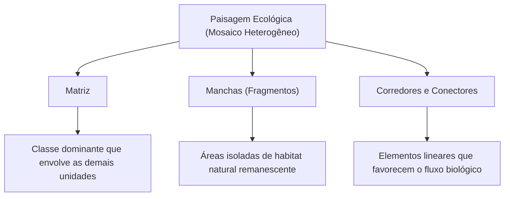
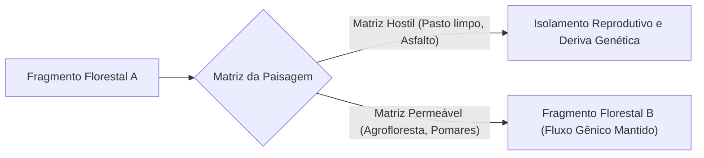
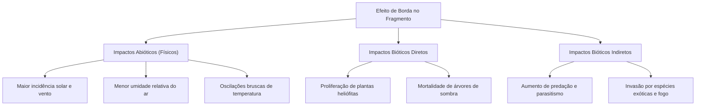
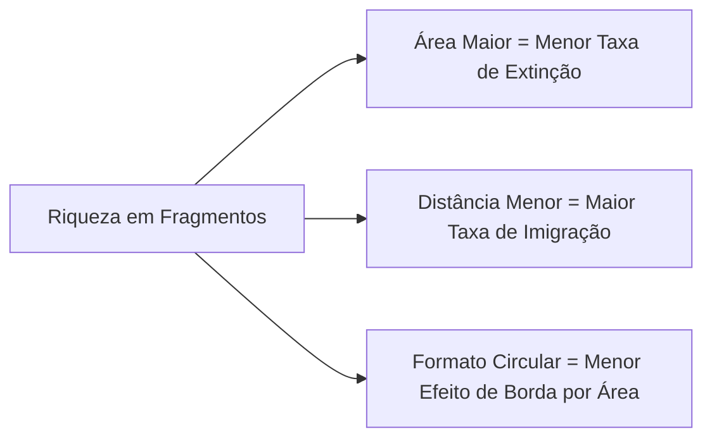
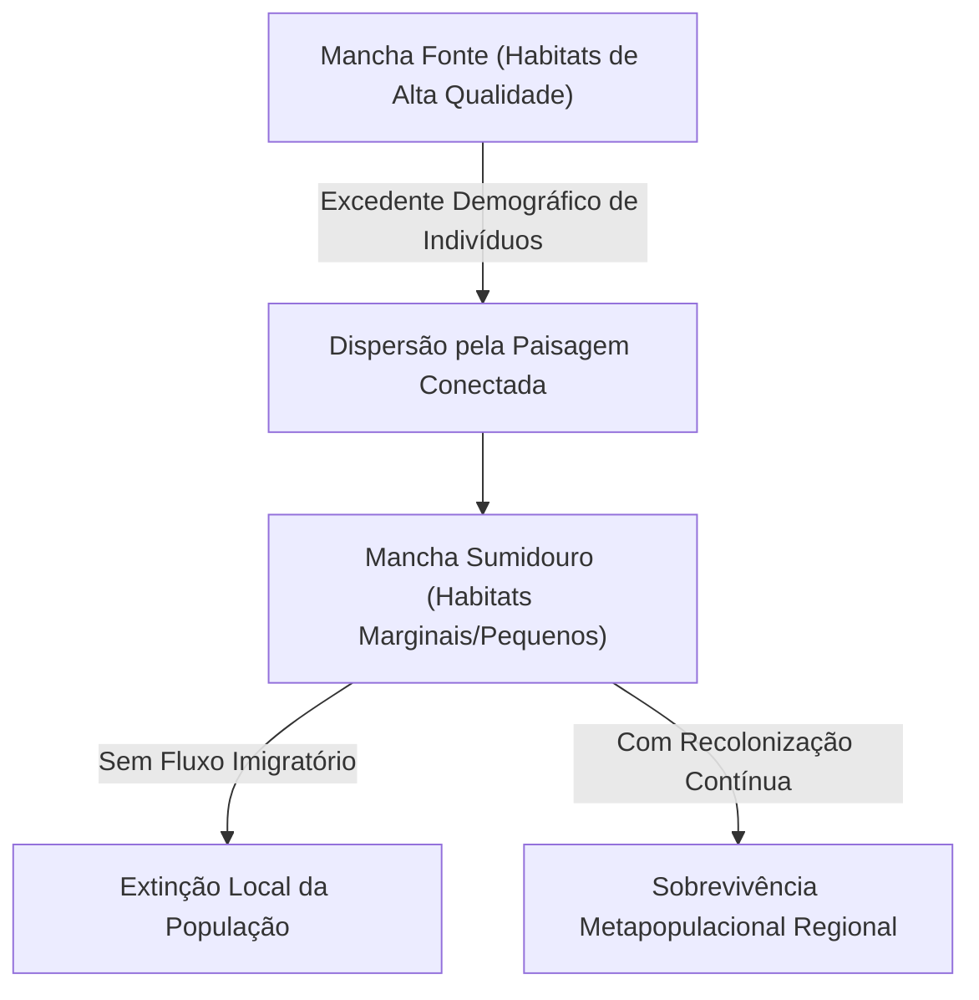
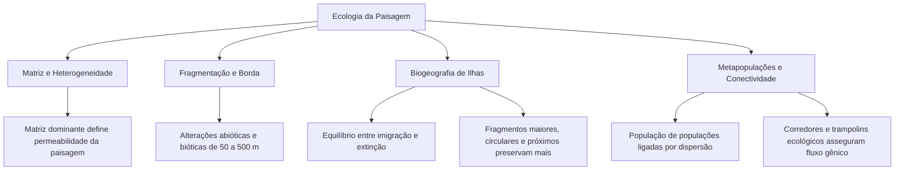

A conservação da biodiversidade exige compreender a distribuição espacial dos habitats. As atividades humanas alteram profundamente a cobertura original do solo. O avanço da agropecuária, a expansão urbana e a abertura de rodovias dividem florestas contínuas em fragmentos dispersos.

A Ecologia da Paisagem investiga esses padrões territoriais. Ela analisa a estrutura, o funcionamento e as transformações dos mosaicos ambientais. Essa ciência oferece diretrizes práticas para o manejo de espécies ameaçadas e para a criação de unidades de conservação.

Neste capítulo, estudaremos os conceitos fundamentais da ecologia da paisagem. Você aprenderá como a matriz do solo influencia o fluxo biológico. Examinaremos os impactos ecológicos e genéticos da fragmentação de habitats. Analisaremos as alterações microclimáticas do efeito de borda. Por fim, estudaremos a Teoria da Biogeografia de Ilhas, a dinâmica das metapopulações e os corredores ecológicos.

> [!objetivos]
> - Definir paisagem como mosaico heterogêneo e reconhecer as escalas ecológicas de análise.
> - Compreender o papel da matriz da paisagem e seu grau de permeabilidade biológica.
> - Diferenciar fragmentação de habitat de perda de cobertura vegetal e identificar os efeitos de borda.
> - Aplicar a Teoria da Biogeografia de Ilhas ao tamanho, formato e isolamento dos fragmentos.
> - Explicar a dinâmica de metapopulações e a importância dos corredores ecológicos.

---

## Fundamentos da Ecologia da Paisagem

A Ecologia da Paisagem consolidou-se na década de 1980 como ramo interdisciplinar da biologia moderna. Ela combina biogeografia, ecologia animal, botânica, geografia física, matemática e sensoriamento remoto por satélites. Seu foco primordial é a interação recíproca entre padrões espaciais e processos ecológicos contínuos.

O objeto de estudo é a **paisagem**. Na acepção científica de Jean Paul Metzger e Richard Forman, a paisagem é definida como um **mosaico heterogêneo** composto por ecossistemas e manchas de uso da terra em constante interação. A heterogeneidade espacial é o atributo estruturante desse mosaico. Em um mesmo território coexistem variações de relevo, tipos de solo, redes hidrográficas, matas nativas e cultivos agropecuários.

As pesquisas nessa área analisam como a disposição geométrica das manchas florestais influencia os fluxos de energia, matéria e seres vivos. Diferentes arranjos no relevo e na vegetação facilitam ou dificultam a polinização, a dispersão de sementes e a sobrevivência de espécies ameaçadas.

### O Fator Escala e a Percepção Biológica

O estudo da paisagem depende da delimitação da **escala**. Existem duas escalas fundamentais: a escala temporal e a escala espacial. A escala temporal analisa a velocidade histórica de modificação do território ao longo de anos e décadas. A escala espacial abrange a extensão territorial analisada e o nível de resolução cartográfica adotado.

Além das métricas geográficas formais, a biologia da conservação destaca a **escala de percepção da espécie**. Cada ser vivo percebe o mosaico conforme sua capacidade de locomoção e suas necessidades biológicas:
- Para grandes felinos, como a onça-pintada, a paisagem funcional engloba centenas de quilômetros quadrados. Esse animal utiliza florestas densas, capoeiras e bordas agrícolas para caçar grandes presas e manter territórios extensos.
- Para pequenos primatas, a paisagem abrange dezenas de hectares de copas contínuas de árvores interligadas.
- Para anfíbios de serapilheira e pequenos insetos, uma pequena poça d'água sob mata ciliar constitui toda a paisagem habitável disponível.

Assim, os planos de manejo ambiental devem adotar escalas compatíveis com os organismos monitorados. Um mesmo território pode ser percebido como contínuo por uma ave de rapina e como totalmente fragmentado por um pequeno sapo florestal.

---

## A Matriz da Paisagem e a Permeabilidade Ecológica

A **matriz** é o componente dominante da paisagem em área e conectividade física. Ela envolve as manchas isoladas de habitat nativo e exerce influência direta sobre os fluxos biológicos regionais.

No Brasil, vastas regiões perderam sua floresta contínua original. No interior do país, a matriz predominante é formada por pastagens e monocultivos agrícolas de soja, milho ou cana-de-açúcar. Nesses cenários, as florestas nativas sobrevivem apenas como pequenas manchas confinadas na matriz produtiva.

### Permeabilidade da Matriz

A circulação das espécies entre os fragmentos remanescentes depende da **permeabilidade da matriz**. A permeabilidade representa a facilidade ou a resistência oferecida pela matriz ao deslocamento dos seres vivos:

1. **Matriz hostil (baixa permeabilidade)**: Pastagens limpas sem árvores, plantações com agrotóxicos intensivos e malhas rodoviárias expressas. Essas áreas geram alta mortalidade por dessecação e atropelamento, bloqueando o trânsito animal.
2. **Matriz permeável (alta permeabilidade)**: Sistemas agroflorestais, pomares rurais, pastos arborizados e capoeiras em regeneração. Esses ambientes oferecem sombra e alimento temporário, viabilizando o trânsito biológico seguro entre remanescentes.

Além da permeabilidade, os biólogos distinguem entre **conectividade estrutural** e **conectividade funcional**:
- A **conectividade estrutural** avalia a continuidade física e a proximidade espacial entre os remanescentes de mata no mapa.
- A **conectividade funcional** mede o comportamento real de deslocamento das espécies através da matriz existente. Uma paisagem pode ter boa conectividade estrutural e pouca conectividade funcional se a espécie não conseguir cruzar vãos abertos entre copas.

> [!bizu] Matriz da Paisagem e Conservação
> A matriz é a unidade dominante da paisagem. O manejo conservacionista contemporâneo não atua apenas nos fragmentos protegidos. Ele também busca manejar a matriz produtiva para torná-la permeável ao trânsito da fauna silvestre.

> [!exemplo] Permeabilidade em Matrizes do Pontal do Paranapanema
> Na região do Pontal do Paranapanema, remanescentes de Mata Atlântica estão imersos em pastagens e canaviais. Pastos degradados e lavouras mecanizadas isolam totalmente populações de mico-leão-preto. A conversão de bordas em agroflorestas aumenta a permeabilidade e restabelece a circulação do primata.

---

## Fragmentação de Habitats e Dinâmica Populacional

A **fragmentação de habitat** é o processo pelo qual uma área contínua de ecossistema é subdividida em manchas menores e desarticuladas.

Esse fenômeno pode decorrer de causas naturais pontuais, como o traçado de rios e inundações periódicas. Contudo, a causa predominante no mundo moderno é de **origem antrópica**. O desmatamento, as queimadas e a urbanização são os motores da fragmentação.

| Origem da Fragmentação | Fatores Desencadeadores | Características de Ocorrência |
| :--- | :--- | :--- |
| **Natural** | Rios, inundações sazonais, incêndios naturais, relevo | Processo histórico gradual que molda ecótonos estáveis |
| **Antrópica** | Desmatamento, estradas, expansão urbana, monocultivos | Processo abrupto e veloz com elevado impacto destrutivo |

> [!atencao] Fragmentação versus Perda de Habitat
> Perda de habitat e fragmentação são conceitos distintos. A perda de habitat refere-se à redução pura da quantidade de cobertura nativa. A fragmentação é a divisão do habitat em pedaços isolados. Uma ferrovia que atravessa uma mata causa intensa fragmentação (efeito barreira), mesmo ocupando uma faixa estreita de terreno.

> [!pegadinha] Efeito Barreira em Infraestrutura Viária
> Rodovias e canais artificiais atuam como barreiras intransponíveis para pequenos roedores e anfíbios. Essas obras fragmentam geneticamente as populações sem provocar grande perda percentual de área total florestal.

### Danos Populacionais e Genéticos da Fragmentação

A divisão das florestas gera severos danos cumulativos à fauna e à flora:
- **Redução de alimento e abrigo**: Manchas menores oferecem menos recursos para as espécies especializadas.
- **Isolamento de subpopulações**: A população contínua original divide-se em grupos pequenos e vulneráveis.
- **Bloqueio ao fluxo gênico**: A matriz inóspita impede o intercâmbio de pólen, sementes e indivíduos reprodutores.
- **Deriva genética e endocruzamento**: Em subpopulações isoladas, alelos benéficos podem desaparecer por oscilações casuais. O cruzamento entre parentes próximos eleva a homozigose de mutações deletérias, causando depressão por consanguinidade.
- **Vulnerabilidade a oscilações ambientais**: Grupos diminutos sucumbem rapidamente a secas extremas, enchentes ou epidemias.

---

## O Efeito de Borda

Os fragmentos florestais diferem das matas contínuas em dois aspectos geométricos centrais: apresentam maior proporção de margens e possuem seu núcleo central muito próximo do exterior.

A **borda** é a linha de contato direto entre a mata nativa e a matriz antropizada. O conjunto de alterações ambientais que ocorre nessa faixa marginal constitui o **efeito de borda**.

### Classificação do Efeito de Borda

As perturbações de borda dividem-se em três categorias funcionais:

1. **Alterações abióticas (físicas)**:
   - Abertura lateral do dossel florestal que facilita a entrada de vento e sol.
   - Elevação da temperatura média do solo e do ar.
   - Queda severa na umidade relativa e rápida dessecação do folhedo.
2. **Alterações bióticas diretas**:
   - Morte de grandes árvores climácicas sensíveis ao estresse hídrico e ao vento mecânico.
   - Declínio populacional de anfíbios e fungos higrófilos que necessitam de umidade constante.
   - Avanço de trepadeiras, capins invasores e árvores pioneiras heliófitas nas margens iluminadas.
3. **Alterações bióticas indiretas**:
   - Aumento da taxa de predação de ninhos por animais oportunistas que rondam a periferia.
   - Crescimento do parasitismo e de doenças transmitidas por vetores da matriz.
   - Entrada facilitada de predadores domésticos, como cães e gatos ferais.
   - Risco constante de incêndios florestais propagados a partir de queimadas rurais vizinhas.

### Extensão do Efeito de Borda

A penetração das alterações de borda varia entre **50 metros e 500 metros** para o interior da floresta. Esse alcance varia conforme o vento, o relevo e o tipo de vegetação.

Em fragmentos menores que 20 hectares, a borda avança por todos os lados. Nesses remanescentes não resta nenhuma área de interior protegida. O fragmento inteiro converte-se em vegetação alterada de margem.

Para atenuar o efeito de borda, adotam-se as seguintes práticas de manejo:
- Criar unidades de conservação com grande extensão contínua de mata.
- Instituir **zonas de amortecimento** no entorno das reservas florestais.
- Promover o plantio de cortinas vegetais nativas densas ao redor das bordas.
- Manter e restaurar corredores ecológicos entre remanescentes vizinhos.

---

## Formato, Tamanho e Isolamento de Fragmentos

O estudo de habitats fragmentados apoia-se na **Teoria da Biogeografia de Ilhas**. Esse modelo foi proposto pelos cientistas Robert MacArthur e Edward Wilson em 1967.

A teoria demonstra que a riqueza de espécies em uma ilha resulta de duas taxas dinâmicas: a **taxa de imigração** de novas espécies e a **taxa de extinção** das populações locais:
- **Tamanho da área**: Áreas maiores possuem mais habitats diversificados. Elas abrigam populações numerosas e apresentam taxas baixas de extinção natural.
- **Distância da fonte**: Áreas próximas a maciços contínuos recebem mais dispersores. Suas taxas de imigração e colonização são muito mais elevadas.

### Geometria dos Remanescentes Florestais

O formato geométrico do fragmento determina a intensidade do efeito de borda. Isso se explica pela razão matemática entre o perímetro e a área:
- **Formato circular (arredondado)**: Apresenta o menor perímetro por unidade de superfície. Esse formato minimiza a faixa de borda e resguarda um amplo núcleo interno protegido.
- **Formato alongado ou recortado**: Possui um perímetro extenso em relação à área total. Quase toda a sua vegetação sofre impactos de borda, prejudicando espécies de mata fechada.

> [!esquema] Geometria dos Fragmentos e Razão Borda-Núcleo
> Considere dois fragmentos com a mesma área total de 100 hectares:
> - **Fragmento A (Circular)**: Perímetro curto. A borda ocupa apenas 30% da área, restando 70 hectares de núcleo florestal intacto.
> - **Fragmento B (Faixa estreita alongada)**: Perímetro muito longo. O efeito de borda atinge 100% da área, eliminando qualquer refúgio de interior.

> [!bizu] O Debate SLOSS na Conservação
> O acrônimo SLOSS (*Single Large or Several Small*) debate o desenho de reservas biológicas. Para proteger grandes mamíferos e aves de sub-bosque, **uma única área grande** é mais eficiente do que **várias áreas pequenas** de mesma metragem somada. A reserva ampla garante um núcleo protegido livre de ventos e dessecação.

---

## Dinâmica de Metapopulações

Em 1969, o ecólogo Richard Levins formulou o conceito de **metapopulação**. Uma metapopulação é uma **população de populações** locais que ocupam manchas discretas de habitat, conectadas pela migração eventual de indivíduos.

Cada fragmento abriga uma subpopulação local exposta a riscos de extinção fortuita. Porém, quando há dispersão entre as manchas, indivíduos de fragmentos vizinhos recolonizam áreas vagas. Essa troca constante garante a sobrevivência regional da espécie por longos períodos.

### Dinâmica de Fontes e Sumidouros

Dentro de uma metapopulação, os fragmentos desempenham papéis ecológicos distintos:
- **Manchas fonte (*sources*)**: Habitats preservados, volumosos e ricos em alimentos. Neles a taxa de reprodução supera a taxa de mortalidade. Essas áreas geram excedente contínuo de indivíduos jovens que se dispersam pelo território em busca de novos espaços.
- **Manchas sumidouro (*sinks*)**: Habitats degradados ou excessivamente reduzidos. Neles a taxa de mortalidade supera a taxa de nascimentos. Essas subpopulações locais não se sustentam sozinhas. Elas só sobrevivem quando recebem imigrantes contínuos das manchas fonte, fenômeno conhecido como efeito resgate.

Sem conectividade física ou funcional, as manchas sumidouro extinguem-se rapidamente. Se as manchas fonte forem desmatadas, toda a rede metapopulacional entra em colapso. Instala-se o chamado vórtice de extinção regional, que culmina no desaparecimento da espécie em todo o bioma.

---

## Conectividade: Corredores e Trampolins Ecológicos

A conservação de metapopulações exige restabelecer a **conectividade ecológica** da paisagem. A conectividade reflete a facilidade com que animais, pólen e sementes se movem entre as manchas de mata remanescentes.

Existem duas estruturas biológicas centrais para restabelecer essa circulação territorial:

1. **Corredores ecológicos**: Faixas lineares contínuas de mata nativa que ligam diretamente dois ou mais remanescentes florestais. Eles permitem o trânsito seguro de animais terrestres e facilitam a dispersão zoocórica de frutos e sementes. A recuperação de matas ciliares ao longo de cursos d'água em Áreas de Preservação Permanente (APPs) atua como excelente corredor ecológico natural.
2. **Trampolins ecológicos (*stepping stones*)**: Pequenas ilhas isoladas de vegetação distribuídas pela matriz da paisagem. Elas não formam faixas contínuas, mas funcionam como pontos de pouso, descanso e alimentação para aves frugívoras, morcegos polinizadores e insetos alados.

| Mecanismo de Conexão | Estrutura Espacial | Função Ecológica Primária |
| :--- | :--- | :--- |
| **Corredor Ecológico** | Faixa contínua linear de habitat | Trânsito seguro de fauna terrícola, fluxo gênico e dispersão contínua |
| **Trampolins Ecológicos** | Manchas descontínuas dispersas | Pouso temporário e travessia escalonada na matriz para dispersores aéreos |

A união planejada de fragmentos florestais, corredores lineares e trampolins reduz o isolamento reprodutivo. Esse arranjo espacial inteligente preserva a biodiversidade nativa mesmo em territórios intensamente modificados pelas atividades humanas.

---

## Mapa do Capítulo

### Para fixar

- Mosaico heterogêneo: A paisagem é composta por um mosaico dinâmico de manchas, corredores e matriz, dependente da escala de percepção de cada espécie biológica.
- Matriz e permeabilidade: A matriz é o uso do solo predominante em área e conectividade, definindo o grau de resistência imposto ao deslocamento dos organismos vivos.
- Fragmentação versus perda de habitat: A perda é a redução quantitativa da cobertura, enquanto a fragmentação é a divisão espacial em remanescentes isolados.
- Tríplice efeito de borda: Altera fatores abióticos (luz, vento, temperatura e dessecação), bióticos diretos (pioneiras e mortalidade de sombra) e bióticos indiretos (predação e invasões).
- Teoria da Biogeografia de Ilhas: A riqueza biológica decorre do equilíbrio dinâmico entre taxas de imigração e extinção, favorecendo fragmentos grandes, arredondados e próximos.
- Dinâmica de metapopulação: O modelo de Levins postula a sobrevivência regional de subpopulações conectadas por fluxo de indivíduos entre manchas fontes e sumidouros.
- Restauração de conectividade: Corredores ecológicos lineares contínuos e trampolins ecológicos pontuais garantem a dispersão de indivíduos e o fluxo gênico contra a deriva.
