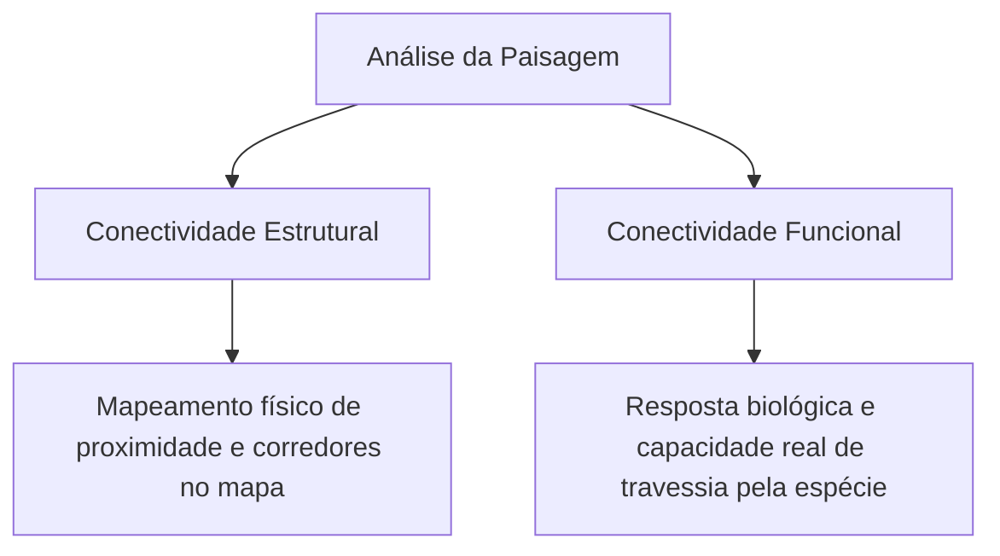
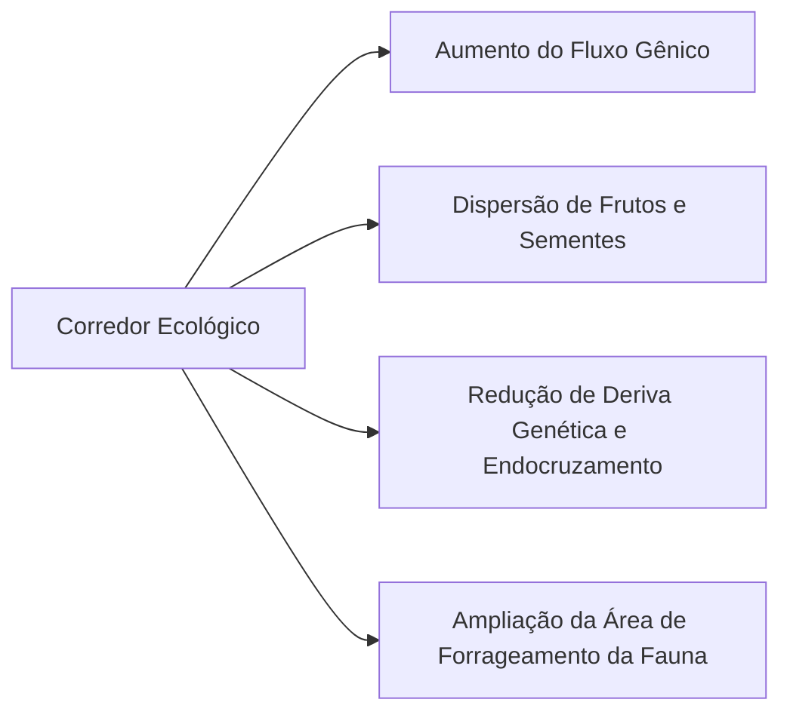
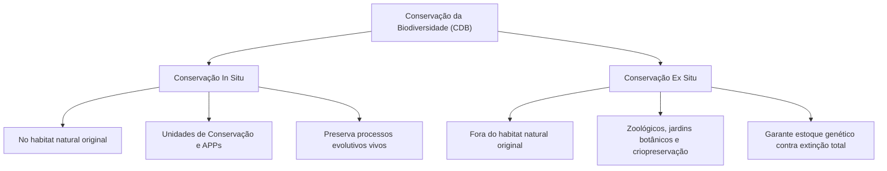
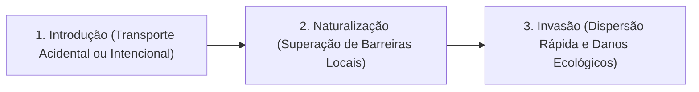
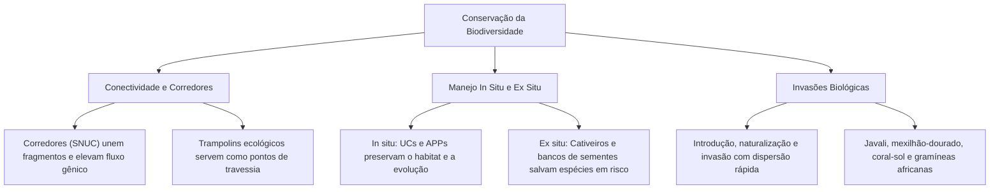

A conservação da diversidade biológica contemporânea enfrenta desafios complexos. O isolamento de populações em fragmentos florestais reduz a variabilidade genética e eleva o risco de extinção. Para mitigar esses impactos, a ecologia aplicada desenvolve ferramentas de restauração da conectividade e planos de manejo populacional.

Ao mesmo tempo, as atividades econômicas globais aceleram a perda de espécies nativas. A degradação ambiental e a introdução desordenada de organismos exóticos afetam ecossistemas inteiros. O avanço de espécies alóctones invasoras constitui a segunda principal causa de perda de biodiversidade no planeta.

Neste capítulo, estudaremos a estrutura e a função dos corredores ecológicos na legislação e na ciência. Analisaremos as fases e modalidades da dispersão biológica e seu papel no fluxo gênico. Examinaremos as causas globais do declínio de espécies e confrontaremos os métodos de conservação in situ e ex situ. Por fim, investigaremos os estágios de invasão biológica e os impactos socioambientais de espécies exóticas no Brasil.

> [!objetivos]
> - Compreender a definição legal e ecológica dos corredores florestais e seu papel no fluxo gênico.
> - Caracterizar as fases da dispersão biológica e diferenciar migração ativa e passiva.
> - Identificar as causas primárias de perda de biodiversidade e os atributos de vulnerabilidade ecológica.
> - Distinguir conservação in situ de conservação ex situ, avaliando vantagens e limitações de cada método.
> - Analisar os estágios da invasão biológica e os impactos de espécies exóticas invasoras no Brasil.

---

## Limiares Ecológicos e Conectividade Funcional

O planejamento da conservação ambiental utiliza imagens de satélite e sensoriamento remoto para mapear a cobertura vegetal. Esses dados espaciais revelam que as paisagens naturais apresentam **limiares ecológicos**.

Um **limiar crítico** representa um ponto de inflexão na estrutura da paisagem. Quando o desmatamento reduz a vegetação nativa abaixo desse limiar (geralmente entre 20% e 30% da cobertura original), ocorre uma queda abrupta e desproporcional na riqueza de espécies. Nesses cenários, a configuração espacial das manchas passa a ser tão determinante quanto a quantidade total de floresta restante.

A análise deve priorizar a **conectividade funcional**. A conectividade estrutural descreve apenas a proximidade física visível entre manchas no mapa. A conectividade funcional avalia a capacidade real de deslocamento da espécie-alvo através da matriz existente. Espécies tolerantes cruzam matrizes agrícolas com facilidade. Organismos especialistas evitam áreas abertas, mesmo diante de distâncias curtas.

---

## Corredores Ecológicos e Restauração de Fluxos

Os corredores ecológicos são faixas de vegetação que visam mitigar o isolamento provocado pela fragmentação de habitats. No ordenamento jurídico brasileiro, a Lei do Sistema Nacional de Unidades de Conservação (Lei nº 9.985/2000) consagrou uma definição formal:

> [!lei] Lei nº 9.985/2000 (SNUC), art. 2º, XIX
> "Corredores ecológicos: porções de ecossistemas naturais ou seminaturais, ligando unidades de conservação, que possibilitam o fluxo de genes e o movimento da biota, facilitando a dispersão de espécies e a recolonização de áreas degradadas, bem como a manutenção de populações que demandam para sua sobrevivência áreas com extensão maior do que aquela das unidades individuais."

Na ciência ecológica, o conceito é empregado de modo mais abrangente. Ele abarca qualquer faixa de vegetação que restabeleça a ligação biológica entre fragmentos florestais, mesmo fora de unidades de conservação oficiais.

### Benefícios Ecológicos dos Corredores

A implantação de corredores ecológicos gera impactos positivos essenciais:
- **Promoção do fluxo gênico**: Permite a circulação de indivíduos reprodutores entre subpopulações isoladas. Esse fluxo reduz o endocruzamento e combate a perda de variabilidade genética por deriva.
- **Dispersão e polinização**: Viabiliza o deslocamento de aves e morcegos frugívoros. Esses animais transportam sementes e pólen, acelerando a regeneração natural da mata.
- **Acesso a novos habitats**: Permite que animais de médio e grande porte explorem territórios mais amplos sem cruzar rodovias ou áreas abertas perigosas.

O desenho técnico do corredor deve respeitar as necessidades do grupo-alvo. Para primatas arborícolas, exige-se dossel florestal contínuo formado por espécies nativas. Para pequenos mamíferos terrestres, faixas arbustivas densas oferecem camuflagem suficiente contra predadores aéreos.

---

## Dispersão Biológica e Dinâmica Genética

A **dispersão biológica** compreende o deslocamento de um organismo para fora do seu local de nascimento ou do centro de sua população original. Esse movimento distribui-se em três etapas sucessivas:
1. **Partida**: Momento em que o organismo abandona seu sítio de origem.
2. **Transferência**: Deslocamento físico através da matriz ambiental.
3. **Liquidação (estabelecimento)**: Fixação do indivíduo em um novo território adequado para alimentação e reprodução.

### Modalidades de Dispersão

A dispersão pode ocorrer por duas vias operacionais:
- **Dispersão ativa (dependente)**: Ocorre por esforço locomotor próprio do indivíduo. A intensidade da dispersão cresce quando a densidade populacional local se eleva, gerando intensa competição por alimentos e parceiros.
- **Dispersão passiva (independente)**: O organismo ou seus propágulos são transportados por agentes externos, como o vento (anemocoria), a água (hidrocoria) ou outros animais (zoocoria).

A permanência do indivíduo no sítio de nascimento denomina-se **filopatria**. A filopatria é comum em animais sociais, nos quais o grupo familiar oferece proteção coletiva contra predadores.

| Forma de Migração | Escala Espacial e Temporal | Características Biológicas |
| :--- | :--- | :--- |
| **Salto de Dispersão** | Longa distância em curto intervalo | Travessia de grandes barreiras por eventos raros |
| **Difusão** | Gradual ao longo de gerações | Expansão contínua da área de distribuição geográfica |
| **Migração Secular** | Milhares de anos em escala geológica | Acompanha processos evolutivos e de especiação |
| **Migração Diária ou Sazonal** | Periódica e previsível | Movimentos pendulares em busca de clima e alimento |

---

## Causas Primárias da Perda de Biodiversidade

A biodiversidade representa a variedade total de seres vivos presentes em uma determinada área e momento. O desaparecimento de espécies afeta a estabilidade funcional das teias tróficas e a prestação de serviços ecossistêmicos.

As extinções de fundo sempre ocorreram na história geológica da Terra em ritmo lento. O desafio contemporâneo reside na velocidade extrema das perdas deflagradas pelas atividades antrópicas. A perda de biodiversidade é impulsionada por seis fatores globais principais:
1. **Destruição e fragmentação de habitats**: Conversão de florestas em lavouras e pastagens.
2. **Invasões biológicas**: Introdução intencional ou acidental de espécies exóticas com alta agressividade ecológica.
3. **Mudanças climáticas globais**: Alteração acelerada de padrões térmicos e regimes de precipitação pluviométrica.
4. **Poluição química e contaminação**: Despejo de efluentes industriais, agrotóxicos e resíduos plásticos nos ecossistemas.
5. **Superexploração de recursos**: Caça predatória, pesca predatória desregulada e biopirataria.
6. **Disseminação de patógenos**: Proliferação de fungos e vírus exóticos em populações silvestres debilitadas.

> [!atencao] Atributos de Vulnerabilidade à Extinção
> Nem todas as espécies respondem da mesma forma à degradação ambiental. Espécies com nicho ecológico muito especializado, baixa taxa de reprodução, grande porte corporal ou que ocupam o topo da cadeia alimentar desaparecem muito mais rápido quando o habitat sofre perturbações.

---

## Conservação In Situ e Ex Situ

Para conter a crise de extinções, a Convenção sobre Diversidade Biológica (CDB de 1992) consagrou duas abordagens metodológicas complementares: a conservação *in situ* e a conservação *ex situ*.

### Conservação In Situ (No Local de Origem)

A conservação *in situ* consiste na proteção das espécies dentro de seus ecossistemas naturais de ocorrência. No Brasil, essa abordagem materializa-se pela criação de Unidades de Conservação (SNUC), Terras Indígenas, Territórios Quilombolas e pela proteção de Áreas de Preservação Permanente (APPs) e Reserva Legal pelo Código Florestal (Lei nº 12.651/2012).

**Vantagens da conservação in situ**:
- Protege a comunidade ecológica inteira e as interações tróficas naturais.
- Preserva os processos evolutivos e adaptativos da espécie em resposta ao ambiente.
- Apresenta custo financeiro menor por unidade de área do que a manutenção em cativeiro artificial.

**Limitações**:
- Depende de fiscalização constante contra invasões, caça ilegal e queimadas.
- Fragmentos pequenos exigem manejo contínuo para evitar o colapso genético de subpopulações isoladas.

### Conservação Ex Situ (Fora do Local de Origem)

A conservação *ex situ* consiste na manutenção e multiplicação de componentes da biodiversidade fora dos seus habitats naturais originais. Realiza-se em zoológicos, aquários, jardins botânicos, criadouros científicos, bancos de germoplasma, bancos de sementes e laboratórios de criopreservação de tecidos e gametas.

**Vantagens da conservação ex situ**:
- Constitui o último refúgio para espécies já extintas na natureza.
- Viabiliza programas de reprodução assistida para posterior reintrodução na natureza.
- Resguarda estoques genéticos contra pragas fulminantes e desastres ambientais locais.

**Limitações**:
- Custo econômico e logístico muito elevado de manutenção diária.
- Capacidade física restrita, comportando apenas amostras reduzidas de indivíduos.
- Risco de perda de adaptações ecológicas e de domesticação involuntária em cativeiro.

> [!exemplo] Casos Históricos de Sucesso Ex Situ no Brasil
> A ararinha-azul (*Cyanopsitta spixii*), ave típica da Caatinga que foi declarada extinta na natureza nos anos 2000 em razão do tráfico, foi reproduzida em cativeiros científicos e reintroduzida em seu habitat original. Outro caso emblemático é o mutum-de-Alagoas (*Pauxi mitu*), cuja população silvestre foi salva graças a plantéis mantidos em cativeiro científico.

| Parâmetro | Conservação In Situ | Conservação Ex Situ |
| :--- | :--- | :--- |
| **Localização** | No habitat natural original | Em cativeiro, zoológicos ou laboratórios |
| **Foco de Ação** | População, comunidade e ecossistema | Indivíduo, genoma ou amostra populacional |
| **Processo Evolutivo** | Mantido ativo em resposta à seleção natural | Suspenso ou direcionado pelo manejo humano |
| **Custo Unitário** | Menor por hectare preservado | Elevado por animal ou planta mantida |
| **Principal Meta** | Autossustentação ecológica no ambiente | Salvaguarda genética e futura reintrodução |

---

## Invasões Biológicas por Espécies Exóticas

A introdução de espécies exóticas pelo ser humano representa uma perturbação profunda nas comunidades nativas. Uma **espécie exótica (ou alóctone)** é aquela que se encontra fora de sua área de distribuição biogeográfica natural histórica.

Quando essa espécie se adapta ao novo local, prolifera sem controle e passa a gerar impactos ecológicos, econômicos ou sanitários severos, ela é classificada como **espécie exótica invasora**. A invasão biológica constitui a segunda principal causa de extinção de espécies no planeta, superada apenas pela perda direta de habitats.

### As Etapas da Invasão Biológica

A invasão de um ecossistema desenvolve-se em três etapas bem definidas:
1. **Introdução**: Chegada do organismo a uma nova região por transporte humano (intencional para comércio ou acidental em cargas).
2. **Naturalização**: O organismo supera as barreiras climáticas e ambientais locais, sobrevivendo e reproduzindo-se sem auxílio humano. A ausência de parasitas e predadores nativos adaptados facilita a sobrevivência da espécie recém-chegada.
3. **Invasão**: A população estabelece rápida expansão geográfica e demográfica. Ela compete agressivamente por recursos vitais, sufoca espécies nativas e desequilibra as teias ecológicas locais.

> [!pegadinha] Espécie Exótica e Fronteiras Políticas
> O conceito de espécie exótica é de natureza biogeográfica e não depende de limites políticos ou fronteiras de países. Uma espécie nativa de um bioma brasileiro pode atuar como exótica se introduzida em outro bioma nacional. O tucunaré (*Cichla* spp.), originário da bacia Amazônica, atua como espécie exótica invasora e predadora voraz quando introduzido em rios do Sudeste e Nordeste do Brasil.

### Classificação e Nomenclatura Biológica

| Categoria | Definição Biológica | Exemplo Típico |
| :--- | :--- | :--- |
| **Exótica Casual** | Introduzida, sobrevive temporariamente sem formar população viável | Plantas de vaso que não se propagam na mata |
| **Exótica Naturalizada** | Forma populações reprodutivas sem invadir ecossistemas nativos | Árvores frutíferas em quintais rurais |
| **Exótica Invasora** | Dispersa rapidamente na natureza, causando danos e extinções | Javali (*Sus scrofa*) e mexilhão-dourado |
| **Superdominante** | Espécie **nativa** que prolifera excessivamente em áreas degradadas | Cipós e lianas na borda de florestas alteradas |

---

## Panorama das Espécies Invasoras no Brasil

O Brasil abriga centenas de espécies exóticas invasoras estabelecidas em ambientes terrestres, de água doce e marinhos. O controle dessas populações rege-se pelo Decreto federal nº 4.339/2002 (Política Nacional da Biodiversidade) e pelas diretrizes do Plano Nacional para Espécies Exóticas Invasoras.

### Exemplos Notórios da Fauna Invasora

- **Javali (*Sus scrofa*)**: Mamífero europeu introduzido para caça e pecuária. Causa destruição em lavouras, assoreamento de nascentes, transmissão de zoonoses para rebanhos e predação de fauna silvestre.
- **Mexilhão-dourado (*Limnoperna fortunei*)**: Molusco asiático introduzido por água de lastro de navios. Obstrui turbinas de usinas hidrelétricas e tubulações de saneamento, sufocando moluscos nativos.
- **Coral-sol (*Tubastraea* spp.)**: Cnidário invasor introduzido em plataformas de petróleo e cascos de navios. Ocupa recifes costeiros e compete agressivamente com corais nativos brasileiros.
- **Caracol-gigante-africano (*Achatina fulica*)**: Molusco terrestre introduzido como alternativa culinária ao escargot. Destrói hortas e atua como vetor de meningite eosinofílica e angiostrongilíase abdominal.

### Exemplos da Flora Invasora

No reino vegetal, destacam-se as gramíneas africanas (capim-braquiária e capim-gordura), que dominam o sub-bosque degradado do Cerrado e da Mata Atlântica. Essas gramíneas impedem a germinação de sementes nativas e acumulam palha altamente combustível, alterando a intensidade e o regime dos incêndios florestais. Outros exemplos incluem a leucena (*Leucaena leucocephala*) e a amendoeira-da-praia em restingas litorâneas.

---

## Mapa do Capítulo

### Para fixar

- Limiar crítico: Queda brusca na biodiversidade quando a área nativa cai abaixo do limiar estrutural, exigindo foco na conectividade funcional.
- Corredores ecológicos: A Lei nº 9.985/2000 define corredores como ligações que viabilizam o fluxo de genes e a dispersão biológica de populações.
- Fases da dispersão: Compreende partida, transferência na matriz e estabelecimento no novo território, podendo ser ativa ou passiva.
- Conservação in situ: Proteção no ecossistema original via Unidades de Conservação e Áreas de Preservação Permanente, resguardando o processo evolutivo.
- Conservação ex situ: Manutenção fora do ambiente natural em zoológicos e bancos de germoplasma, servindo de refúgio contra a extinção absoluta.
- Invasão biológica: Sucessão em três etapas (introdução, naturalização e invasão com dispersão acelerada), configurando grave ameaça global.
- Espécies invasoras no Brasil: Casos emblemáticos como javali, mexilhão-dourado, coral-sol, caracol-africano e gramíneas exóticas.
