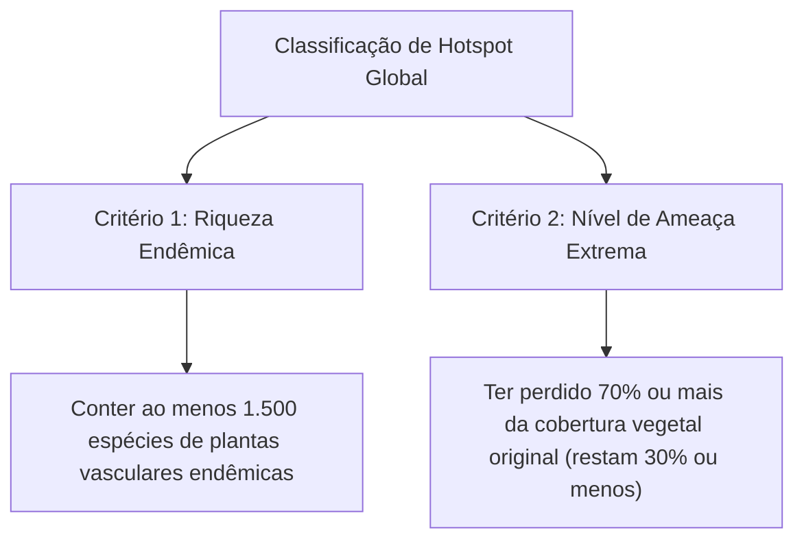
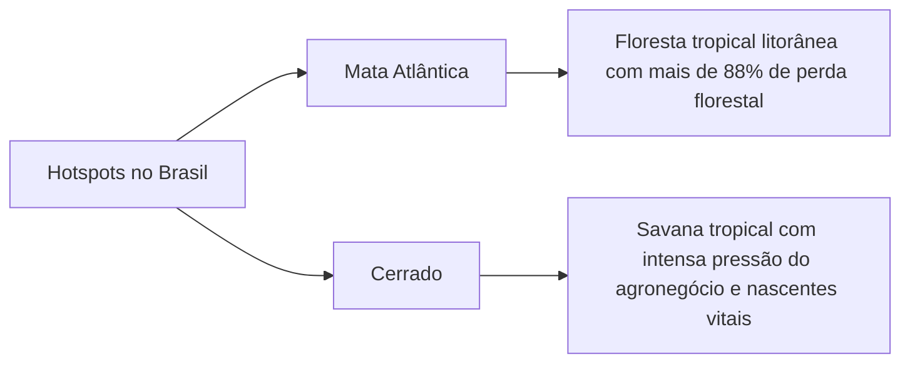
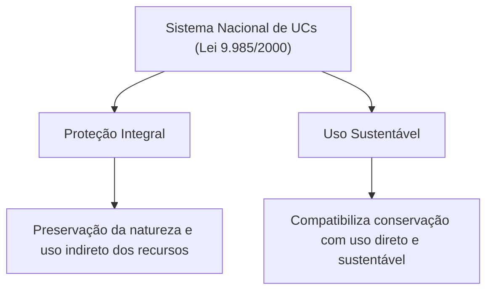
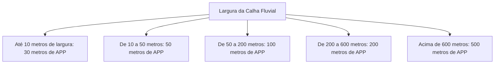
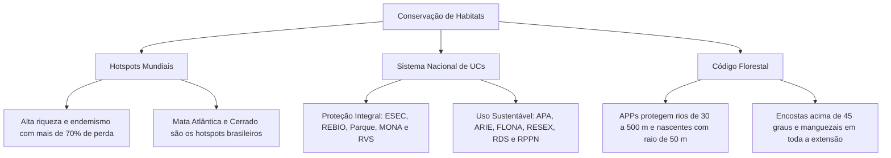

A conservação da biosfera requer o direcionamento criterioso de recursos humanos e financeiros. Como a perda de vegetação avança rapidamente, a comunidade científica estabeleceu prioridades geográficas globais para a proteção da vida silvestre. Esse planejamento apoia-se em conceitos biogeográficos precisos, como os centros de endemismo e os hotspots de biodiversidade.

No cenário nacional, o Brasil estruturou mecanismos legais avançados para resguardar seus patrimônios naturais. Destacam-se as áreas protegidas do SNUC (Lei federal nº 9.985/2000) e o regime de proteção da vegetação nativa do Código Florestal (Lei nº 12.651/2012).

Neste capítulo, estudaremos os critérios definidores dos hotspots mundiais e a relevância da Mata Atlântica e do Cerrado. Analisaremos o conceito de População Mínima Viável (PMV). Em seguida, examinaremos as doze categorias de unidades de conservação do SNUC, confrontando a proteção integral com o uso sustentável. Por fim, detalharemos as regras e metragens das Áreas de Preservação Permanente (APPs).

> [!objetivos]
> - Definir hotspots mundiais de biodiversidade e identificar os dois biomas brasileiros classificados nessa categoria.
> - Compreender a importância do endemismo e a estimativa da População Mínima Viável (PMV).
> - Diferenciar as Unidades de Proteção Integral das Unidades de Uso Sustentável no âmbito do SNUC.
> - Dominar a posse fundiária e as regras de visitação e conselho das categorias do SNUC.
> - Mapear as faixas marginais e critérios de delimitação das Áreas de Preservação Permanente do Código Florestal.

---

## Hotspots de Biodiversidade e Centros de Endemismo

A distribuição das espécies no planeta é profundamente desigual. Certas regiões concentram uma riqueza biológica excepcional associada a altos níveis de ameaça antrópica. Para identificar essas áreas críticas, o ecólogo britânico Norman Myers formulou o conceito de **hotspot de biodiversidade** em 1988.

Atualmente, a organização *Conservation International* reconhece cerca de 36 hotspots ao redor do globo. Somados, esses territórios cobrem apenas 2,3% da superfície emersa da Terra. Todavia, eles abrigam mais de 50% de todas as espécies de plantas vasculares e mais de 40% dos vertebrados terrestres conhecidos.

### O Conceito de Espécie Endêmica

O **endemismo** expressa a ocorrência restrita de um táxon a uma determinada área geográfica ou ecossistema delimitado. Espécies endêmicas não ocorrem naturalmente em nenhum outro ponto do planeta. Elas resultam de processos evolutivos de especiação alopátrica e barreiras biogeográficas duradouras.

O conceito oposto ao endemismo é a distribuição **cosmopolita**, na qual a espécie ocorre em múltiplos continentes e latitudes (como a coruja-da-igreja e a barata doméstica). Por terem distribuição restrita, as espécies endêmicas são altamente vulneráveis à supressão de habitat. A destruição de uma mancha florestal específica pode extinguir globalmente a espécie.

### Os Dois Hotspots Brasileiros: Mata Atlântica e Cerrado

O Brasil abriga dois biomas expressamente classificados como hotspots globais de biodiversidade:

1. **Mata Atlântica**:
   - É um dos biomas mais ameaçados do planeta, restando cerca de 12% de sua cobertura florestal original.
   - Apresenta mais de 8.000 espécies de plantas vasculares endêmicas e altíssima diversidade de anfíbios e primatas.
   - Mais da metade das espécies da fauna brasileira ameaçadas de extinção pertencem à Mata Atlântica.
   - Entre seus animais endêmicos emblemáticos destacam-se o mico-leão-dourado e o muriqui.

2. **Cerrado**:
   - É a savana tropical com a maior riqueza biológica do mundo.
   - Ocupa o planalto central e abriga as cabeceiras das três maiores bacias hidrográficas da América do Sul (Amazônica, Platina e do São Francisco).
   - Menos de 3% de sua extensão territorial encontra-se resguardada em unidades de conservação de proteção integral.
   - Sofre forte conversão por monocultivos de grãos, pastagens plantadas e queimadas desordenadas.

### Grandes Regiões Naturais

Em contraposição aos hotspots, a biogeografia define as **Grandes Regiões Naturais**. São vastas áreas silvestres contínuas que ainda mantêm mais de 70% de sua cobertura florestal original intacta. No Brasil, enquadram-se nessa definição a **Amazônia** e o **Pantanal**.

A preservação dessas grandes extensões contínuas apresenta custo financeiro por hectare consideravelmente menor do que a restauração de hotspots degradados. Porém, sua integridade também demanda vigilância constante contra o avanço predatório de fronteiras agrícolas e garimpos.

---

## População Mínima Viável (PMV)

O manejo conservacionista exige mensurar o tamanho populacional indispensável para garantir a persistência biológica de uma espécie ao longo do tempo evolutivo. Esse parâmetro denomina-se **População Mínima Viável (PMV)**.

A PMV é definida como o menor número isolado de indivíduos reprodutores capaz de assegurar uma probabilidade de sobrevivência de 99% para a espécie durante um horizonte temporal de 1.000 anos. A determinação quantitativa da PMV apoia-se em quatro componentes de incerteza biológica:
- **Estocasticidade demográfica**: Flutuações casuais nas taxas individuais de nascimento, fecundidade e mortalidade, com riscos agudos em populações reduzidas.
- **Estocasticidade ambiental**: Variações imprevisíveis no clima, estiagens sazonais, secas severas e oscilações na disponibilidade de alimentos.
- **Fatores genéticos**: Perda contínua de alelos raros por deriva genética, fixação de mutações prejudiciais e depressão consanguínea por cruzamento entre parentes.
- **Catástrofes naturais**: Ocorrência esporádica de grandes incêndios florestais, tempestades, inundações ou surtos de patógenos exóticos.

Na biologia da conservação, a clássica diretriz 50/500 estabelece que são necessários ao menos 50 indivíduos reprodutores para evitar a depressão por consanguinidade a curto prazo, e pelo menos 500 indivíduos para manter o potencial adaptativo da população frente a mudanças ambientais futuras.

---

## O Sistema Nacional de Unidades de Conservação (SNUC)

A principal ferramenta governamental de conservação *in situ* no Brasil é o arcabouço normativo do SNUC, regulado pela Lei federal nº 9.985/2000.

Uma Unidade de Conservação (UC) é um espaço territorial e seus recursos ambientais com características naturais relevantes, legalmente instituído pelo Poder Público com objetivos definidos de proteção. O ordenamento divide as áreas protegidas em duas classes funcionais: proteção integral e uso sustentável.

### Gestão e Criação de Unidades

A governança do SNUC estrutura-se no âmbito do Sistema Nacional do Meio Ambiente (SISNAMA):
- **Órgão consultivo e deliberativo**: Conselho Nacional do Meio Ambiente (CONAMA).
- **Órgão central e coordenador**: Ministério do Meio Ambiente e Mudança do Clima (MMA).
- **Órgãos executores federais**: Instituto Chico Mendes de Conservação da Biodiversidade (ICMBio) e Instituto Brasileiro do Meio Ambiente e dos Recursos Naturais Renováveis (IBAMA).

A criação de qualquer unidade de conservação exige a realização prévia de estudos técnicos e **consulta pública** à população local.

> [!atencao] Consulta Pública Obrigatória e Exceções no SNUC
> Em regra, a criação de unidades de conservação exige consulta pública prévia aos moradores e comunidades da região. Todavia, a legislação ambiental estabelece duas exceções taxativas: a criação de **Estação Ecológica (ESEC)** e de **Reserva Biológica (REBIO)** dispensa a realização de consulta pública obrigatória, priorizando o rigor científico de preservação.

Toda unidade de conservação deve dispor de um **Plano de Manejo**. Este documento técnico estabelece o zoneamento interno da área protegida e disciplina as normas de uso do solo na **zona de amortecimento** circundante.

---

## Unidades de Proteção Integral

O grupo de Proteção Integral tem por objetivo básico preservar a natureza intacta. Nelas é admitido apenas o **uso indireto** dos recursos naturais, isto é, atividades recreativas, turísticas, educacionais e de pesquisa científica que não envolvam consumo, coleta ou dano à biota.

O grupo é composto por cinco categorias:

1. **Estação Ecológica (ESEC)**:
   - Destina-se à preservação estrita da natureza e à realização de pesquisas científicas.
   - É de **posse e domínio públicos**. Áreas privadas inclusas em seus limites devem ser desapropriadas.
   - Visitação pública é proibida, permitindo-se apenas visitas educacionais previamente aprovadas.
2. **Reserva Biológica (REBIO)**:
   - Objetiva a preservação integral da biota sem interferência humana direta.
   - É de **posse e domínio públicos**.
   - Visitação pública é terminantemente vedada, ressalvadas visitas de estudantes com fins pedagógicos.
3. **Parque Nacional (PARNA)**:
   - Tem por finalidade proteger sítios ecológicos de excepcional valor paisagístico e ambiental, sendo de domínio estritamente público.
   - Admite turismo ecológico, recreação e pesquisa científica conforme o plano de manejo. Quando criado por Estado denomina-se Parque Estadual; por Município, Parque Natural Municipal.
4. **Monumento Natural (MONA)**:
   - Visa preservar sítios naturais raros, singulares ou de notável beleza cênica.
   - **Admite áreas particulares**. O proprietário particular pode manter a posse do imóvel, desde que as atividades desenvolvidas sejam compatíveis com os objetivos de preservação.
5. **Refúgio de Vida Silvestre (RVS)**:
   - Protege ambientes naturais indispensáveis para a reprodução e sobrevivência de espécies residentes ou migratórias.
   - **Admite áreas particulares** sob as mesmas condições do Monumento Natural.

| Categoria de Proteção Integral | Posse da Terra | Visitação Pública | Pesquisa Científica |
| :--- | :--- | :--- | :--- |
| **Estação Ecológica** | Pública obrigatória | Apenas educacional | Permitida mediante autorização |
| **Reserva Biológica** | Pública obrigatória | Apenas educacional | Permitida mediante autorização |
| **Parque Nacional** | Pública obrigatória | Permitida e incentivada | Permitida mediante autorização |
| **Monumento Natural** | Pública ou privada | Conforme plano de manejo | Permitida mediante autorização |
| **Refúgio de Vida Silvestre** | Pública ou privada | Conforme plano de manejo | Permitida mediante autorização |

---

## Unidades de Uso Sustentável

O grupo de Uso Sustentável busca harmonizar a conservação da biodiversidade com o **uso direto e sustentável** de parcela dos recursos naturais. Nelas é permitida a exploração econômica racional e a extração vegetal planejada.

O grupo abrange sete categorias:

1. **Área de Proteção Ambiental (APA)**:
   - Área geralmente extensa, com certo grau de ocupação humana.
   - Composta por terras **públicas e privadas**. Dispõe de Conselho presidido pelo órgão ambiental.
2. **Área de Relevante Interesse Ecológico (ARIE)**:
   - Área em geral pequena, com pouca ou nenhuma ocupação humana, que abriga espécies raras da biota local.
   - Pode ser constituída por terras **públicas ou privadas**.
3. **Floresta Nacional (FLONA)**:
   - Área com cobertura florestal nativa destinada ao manejo sustentável múltiplo de madeira e recursos florestais.
   - É de **posse e domínio públicos**. Dispõe de Conselho Consultivo.
4. **Reserva Extrativista (RESEX)**:
   - Destinada a salvaguardar os meios de vida e a cultura de populações tradicionais extrativistas.
   - É de **posse e domínio públicos**, com uso concedido às comunidades tradicionais. A caça predatória e a mineração industrial são expressamente proibidas. Dispõe de Conselho Deliberativo.
5. **Reserva de Fauna (REFAU)**:
   - Área natural com populações animais nativas adequada para estudos sobre manejo econômico sustentável da fauna.
   - É de **posse e domínio públicos**. A caça esportiva ou amadora é proibida.
6. **Reserva de Desenvolvimento Sustentável (RDS)**:
   - Abriga populações tradicionais que utilizam sistemas sustentáveis de exploração há várias gerações.
   - É de **posse e domínio públicos**. Dispõe de Conselho Deliberativo.
7. **Reserva Particular do Patrimônio Natural (RPPN)**:
   - Área privada gravada com **perpetuidade** mediante termo averbado no Registro de Imóveis competente.
   - O proprietário mantém o domínio da terra, permitindo-se apenas pesquisa científica e ecoturismo.

> [!exemplo] RPPN e a Preservação Voluntária Perpétua
> A RPPN constitui modelo notável de conservação em propriedades privadas. O proprietário rural decide voluntariamente proteger uma área de floresta nativa de sua fazenda. Uma vez averbada no cartório de registro de imóveis, a afetação ecológica torna-se perpétua, vinculando inclusive futuros herdeiros e compradores do imóvel.

> [!pegadinha] Domínio da Terra no SNUC
> Memorize as regras de desapropriação cobradas em concursos:
> - Na Proteção Integral, **ESEC, REBIO e Parques são 100% públicos**; **MONA e RVS aceitam terras particulares**.
> - No Uso Sustentável, **FLONA, RESEX, RDS e Reserva de Fauna são 100% públicas**; **APA e ARIE aceitam privadas**; e a **RPPN é a única 100% privada**.

---

## Proteção da Vegetação Nativa: APPs (Lei nº 12.651/2012)

O Código Florestal brasileiro (Lei federal nº 12.651/2012) disciplina os regimes de preservação em imóveis rurais e urbanos. O principal instrumento territorial é a **Área de Preservação Permanente (APP)**.

A APP é definida pelo legislador como área protegida, coberta ou não por vegetação nativa, com a função ambiental precípua de preservar os recursos hídricos, a paisagem, a estabilidade geológica, a biodiversidade e o fluxo gênico da fauna e flora.

### Principais Hipóteses Legais de APPs

O art. 4º da Lei nº 12.651/2012 estabelece as seguintes metragens mínimas obrigatórias:

| Elemento Geográfico Protegido | Faixa de Proteção Marginal Obrigatória |
| :--- | :--- |
| **Cursos d'água naturais** | De **30 a 500 metros**, conforme a largura da calha regular do rio |
| **Nascentes e olhos d'água perenes** | Raio mínimo de **50 metros** ao redor da nascente |
| **Lagos e lagoas naturais** | **100 metros** em zona rural (ou **50 metros** em corpos até 20 ha); **30 metros** em zona urbana |
| **Encostas íngremes** | Declividade superior a **45 graus** (equivalente a 100% na linha de maior declive) |
| **Restingas** | Em toda a extensão quando fixadoras de dunas ou estabilizadoras de mangues |
| **Manguezais** | Em toda a sua extensão territorial |
| **Topos de morros e serras** | Altura mínima de 100 metros e inclinação média superior a 25 graus (terço superior do morro) |
| **Veredas** | Faixa marginal de no mínimo **50 metros** a partir do espaço brejoso |
| **Altitudes elevadas** | Áreas em altitude superior a **1.800 metros**, qualquer que seja a vegetação |

> [!bizu] APPs Hídricas e Geológicas
> Para a prova, decore as medidas fixas mais cobradas: raio de 50 metros para nascentes perenes e declividade superior a 45 graus para encostas. Lembre-se também de que manguezais são protegidos em toda a sua extensão territorial.

---

## Mapa do Capítulo

### Para fixar

- Conceito de hotspot: Região com alta riqueza e ao menos 1.500 plantas vasculares endêmicas que já perdeu 70% ou mais da cobertura vegetal original.
- Hotspots no Brasil: A Mata Atlântica e o Cerrado são os dois biomas brasileiros formalmente classificados como hotspots mundiais.
- População Mínima Viável: Menor quantidade isolada de indivíduos capaz de assegurar 99% de chance de sobrevivência por 1.000 anos.
- Consulta pública no SNUC: É obrigatória na criação de unidades de conservação, dispensando-se apenas na criação de ESEC e REBIO.
- Proteção Integral versus Uso Sustentável: A Proteção Integral admite apenas uso indireto (turismo e ciência); o Uso Sustentável admite exploração direta racional.
- Regime fundiário do SNUC: ESEC, REBIO e Parques exigem posse pública; MONA, RVS, APA e ARIE admitem imóveis privados; e RPPN é puramente privada.
- Metragens de APP: Margens de rios variam de 30 a 500 metros, nascentes exigem raio de 50 metros, e encostas acima de 45 graus são protegidas integralmente.
