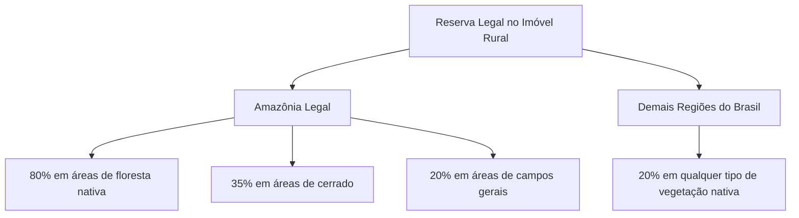
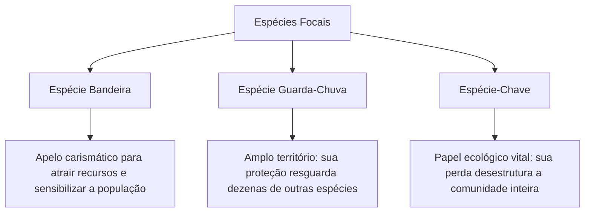
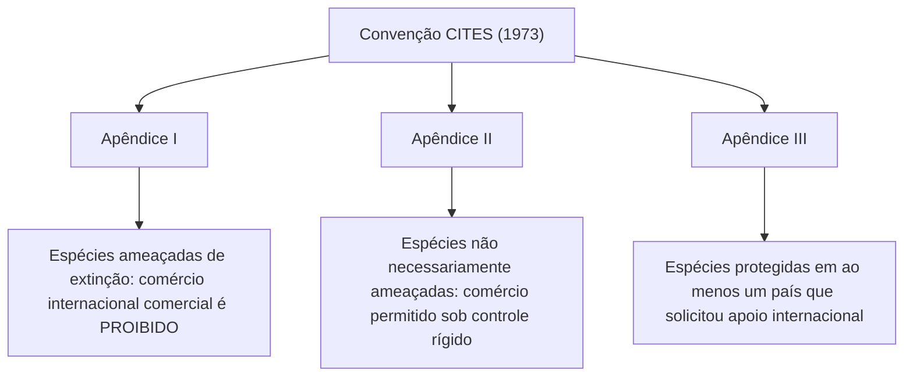
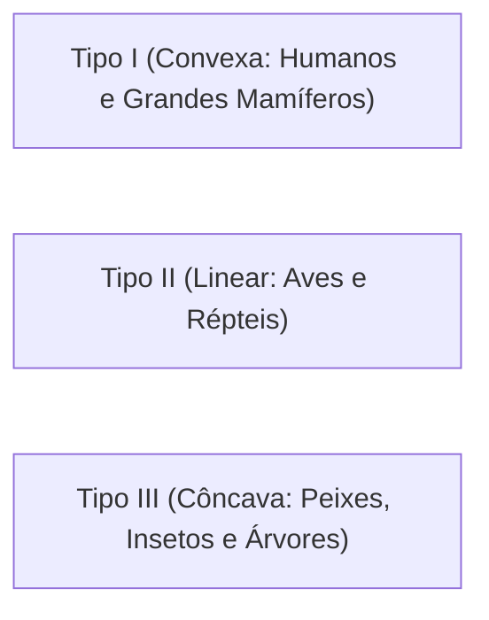
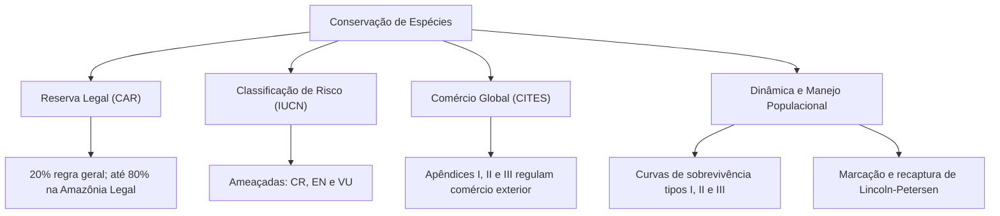

A preservação da vida silvestre combina a criação de áreas protegidas e ações focadas nas espécies ameaçadas. A degradação ambiental e a caça ilegal exigem diretrizes de intervenção direta. Cientistas e órgãos ambientais desenvolvem planos de monitoramento e manejo de fauna na natureza e em cativeiro.

Em escala internacional, o combate ao tráfico de animais e plantas é coordenado pela Convenção CITES. No plano nacional, o Código Florestal assegura a manutenção da Reserva Legal em imóveis rurais. Essas ferramentas resguardam a variabilidade genética e evitam o colapso dos ecossistemas.

Neste capítulo, estudaremos as regras da Reserva Legal e o Cadastro Ambiental Rural. Analisaremos as categorias de risco de extinção da IUCN e os conceitos de espécies bandeira e guarda-chuva. Examinaremos a Convenção CITES e seus apêndices de controle comercial. Por fim, investigaremos a dinâmica populacional, as curvas de sobrevivência e os métodos de manejo sustentável de fauna silvestre.

> [!objetivos]
> - Compreender as exigências percentuais da Reserva Legal no Código Florestal e o papel do CAR.
> - Conhecer as categorias de ameaça de extinção da Lista Vermelha da IUCN.
> - Diferenciar espécies bandeira de espécies guarda-chuva por meio de estudos de caso reais.
> - Analisar o funcionamento dos três apêndices comerciais da Convenção CITES.
> - Dominar os modelos de curvas de sobrevivência e o método de marcação e recaptura de populações.

---

## Reserva Legal no Código Florestal (Lei nº 12.651/2012)

O Código Florestal brasileiro impõe que todo imóvel rural mantenha uma área com cobertura de vegetação nativa a título de **Reserva Legal**.

A Reserva Legal tem por finalidade assegurar o uso econômico sustentável dos recursos florestais. Ela auxilia a conservação e a reabilitação dos processos ecológicos. Além disso, promove a conservação da biodiversidade e abriga a fauna silvestre nativa e a flora local. Ao contrário das APPs, a Reserva Legal admite o manejo florestal sustentável previamente aprovado pelo órgão ambiental competente.

### O Cadastro Ambiental Rural (CAR)

Todas as propriedades rurais devem ser registradas obrigatoriamente no **Cadastro Ambiental Rural (CAR)**. O CAR é um registro público eletrônico nacional gerido pelo órgão ambiental.

Esse sistema cartográfico integra as informações ambientais dos imóveis rurais. O CAR delimita digitalmente as Áreas de Preservação Permanente (APPs), a área de Reserva Legal e os remanescentes de florestas nativas. O cadastro atua como base de dados unificada para o controle, monitoramento, planejamento ambiental e combate ao desmatamento ilegal no país.

---

## Categorias de Ameaça da Lista Vermelha da IUCN

A União Internacional para a Conservação da Natureza (IUCN) mantém a **Lista Vermelha de Espécies Ameaçadas**. Essa classificação constitui o inventário global mais detalhado sobre o estado de conservação de animais, fungos e plantas.

O sistema da IUCN avalia o risco de desaparecimento com base na velocidade de declínio populacional, na área de distribuição geográfica e no número de indivíduos adultos reprodutores:

| Sigla | Categoria em Português | Significado Ecológico |
| :--- | :--- | :--- |
| **EX** | Extinta (*Extinct*) | Não resta nenhuma dúvida de que o último indivíduo da espécie morreu |
| **EW** | Extinta na Natureza (*Extinct in the Wild*) | Sobrevive apenas em cativeiro, zoológicos ou cultivo artificial |
| **CR** | Criticamente em Perigo (*Critically Endangered*) | Enfrenta risco extremamente elevado de extinção na natureza a curto prazo |
| **EN** | Em Perigo (*Endangered*) | Apresenta risco muito alto de extinção na natureza a médio prazo |
| **VU** | Vulnerável (*Vulnerable*) | Apresenta risco elevado de extinção na natureza a longo prazo |
| **NT** | Quase Ameaçada (*Near Threatened*) | Não preenche os critérios atuais, mas está próxima de ser ameaçada |
| **LC** | Pouco Preocupante (*Least Concern*) | Espécie abundante e com ampla distribuição geográfica atual |

> [!atencao] Grupo das Espécies Formalmente Ameaçadas
> Em provas de concurso, lembre-se de que o grupo formal das espécies **ameaçadas de extinção** é composto estritamente por três categorias: **Criticamente em Perigo (CR)**, **Em Perigo (EN)** e **Vulnerável (VU)**. As categorias NT e LC não são classificadas como ameaçadas.

---

## Espécies Bandeira e Espécies Guarda-Chuva

O planejamento ecológico utiliza conceitos funcionais para otimizar a alocação de recursos financeiros e a adesão da sociedade civil:

1. **Espécie bandeira**: É uma espécie carismática, visualmente atraente ou de forte apelo cultural. Ela é utilizada para sensibilizar o público, atrair recursos financeiros e impulsionar campanhas de educação ambiental. O panda-gigante e o mico-leão-dourado são exemplos mundiais de espécies bandeira.
2. **Espécie guarda-chuva**: É uma espécie que exige áreas geográficas muito amplas e ecossistemas diversificados e bem preservados para manter populações viáveis. Ao proteger o habitat dessa única espécie, protegem-se indiretamente centenas de outras espécies menores que compartilham o mesmo bioma.
3. **Espécie-chave (*keystone species*)**: É aquela cujo impacto sobre a estrutura da comunidade biológica é desproporcionalmente grande em relação à sua abundância numérica. Sua remoção desencadeia cascatas tróficas que desestruturam todo o ecossistema.

### Casos Notórios: Mico-Leão-Preto e Onça-Parda

- **Mico-leão-preto (*Leontopithecus chrysopygus*)**: Primata endêmico da Mata Atlântica paulista. Atua simultaneamente como espécie bandeira e guarda-chuva. Ações intensivas de reflorestamento e corredores ecológicos no Pontal do Paranapanema interligaram fragmentos isolados. Esse trabalho gerou a criação da Estação Ecológica Mico-Leão-Preto e melhorou seu status de CR para **EN (Em Perigo)**.
- **Onça-parda (*Puma concolor*)**: Grande felino topo de cadeia alimentar com ampla área de vida. No estado de São Paulo, o projeto do "Corredor das Onças" em Campinas interliga remanescentes de mata, reduzindo atropelamentos e conflitos com criadores de gado. Classificada globalmente como **LC (Pouco Preocupante)**, a onça-parda atua como espécie guarda-chuva e regula níveis tróficos inferiores.

---

## Convenção CITES (Tratado de Washington de 1973)

O comércio transfronteiriço de animais e vegetais silvestres é regulamentado pela CITES (Tratado de Washington de 1973), acordo multilateral que conta com a adesão de mais de 180 nações, incluindo a República Federativa do Brasil.

O objetivo da CITES é garantir que a exploração comercial de espécimes da fauna e flora não ameace a sobrevivência das populações naturais. O tratado estabelece um sistema de autorizações e certificados alfandegários rigorosos, dividindo as espécies protegidas em três **Apêndices**:

| Apêndice CITES | Nível de Ameaça | Regime Comercial Internacional |
| :--- | :--- | :--- |
| **Apêndice I** | Espécies sob iminente risco de extinção | Comércio comercial estritamente vedado; permitido apenas para pesquisa científica |
| **Apêndice II** | Espécies que podem entrar em risco se o comércio for livre | Comércio autorizado mediante licença prévia e comprovação de manejo não prejudicial |
| **Apêndice III** | Espécies sob proteção na legislação interna de um país membro | O país requer a cooperação internacional dos demais membros para controlar exportações |

> [!lei] CITES e a Proteção da Flora Brasileira
> Espécies vegetais brasileiras valiosas, como o pau-brasil (*Paubrasilia echinata*) e o mogno (*Swietenia macrophylla*), integram os apêndices da CITES. Essa medida visa coibir o comércio ilegal transfronteiriço de madeira nativa explorada sem plano de manejo florestal sustentável.

---

## Estrutura Populacional e Curvas de Sobrevivência

Uma população biológica é caracterizada pela sua distribuição espacial, densidade, razão sexual e estrutura etária. A estrutura etária é comumente representada por pirâmides de idade. A proporção entre jovens, adultos reprodutivos e senescentes revela se a população está em expansão, estabilizada ou em declínio.

A dinâmica entre nascimentos e mortes define as **curvas de sobrevivência**, que se agrupam em três padrões biológicos clássicos:

1. **Curva Tipo I (Convexa)**:
   - Baixa taxa de mortalidade no início e meio da vida. A maior parte das mortes concentra-se nas idades mais avançadas.
   - Característica de organismos com cuidado parental prolongado e baixa prole (como seres humanos e grandes mamíferos).
2. **Curva Tipo II (Linear ou Diagonal)**:
   - A probabilidade de morte é aproximadamente constante ao longo de todas as faixas etárias.
   - Comum em aves canoras adultas, pequenos répteis e alguns roedores.
3. **Curva Tipo III (Côncava)**:
   - Mortalidade extremamente elevada nas fases iniciais da vida (ovos, larvas e plântulas). Os poucos indivíduos que superam a fase jovem exibem alta longevidade posterior.
   - Padrão típico de peixes marinhos, anfíbios, ostras, insetos e grandes árvores de floresta tropical.

> [!exemplo] Aplicação da Curva Tipo III em Peixes e Árvores
> Em espécies marinhas como o bacalhau ou a ostra, uma fêmea adulta desova milhões de ovos na coluna d'água em um único evento reprodutivo. Mais de 99% desses ovos e larvas são consumidos rapidamente por predadores planctônicos ou morrem por correntes marinhas. Contudo, os raros indivíduos que atingem a fase juvenil e adulta apresentam elevada expectativa de vida e alta fecundidade.

### Reprodução: Semelparidade versus Iteroparidade

Os padrões reprodutivos dos seres vivos dividem-se conforme o número de eventos reprodutivos ao longo do ciclo de vida:
- **Organismos semélparos**: Reproduzem-se uma única vez durante toda a vida, investindo todos os seus recursos metabólicos nesse evento antes de morrerem. Exemplos incluem o salmão do Pacífico, certas espécies de polvos e plantas que florescem apenas uma vez após décadas de crescimento.
- **Organismos iteróparos**: Apresentam múltiplos ciclos reprodutivos ao longo de suas vidas, distribuindo o esforço energético em várias estações reprodutivas sucessivas. Exemplos incluem mamíferos, a maioria das aves e árvores perenes.

---

## Estimativa Populacional e Manejo de Fauna

Para gerenciar uma população silvestre, o ecólogo deve estimar com precisão o número de indivíduos existentes em campo. O método mais difundido para animais móveis é a técnica de **marcação e recaptura**, fundamentada no índice de Lincoln-Petersen.

O procedimento desenvolve-se em duas etapas:
1. Captura-se uma primeira amostra de M indivíduos na natureza. Todos são marcados com anilhas, brincos ou microchips e soltos no habitat.
2. Após um intervalo de tempo para redistribuição homogênea, captura-se uma segunda amostra com C indivíduos, dentre os quais R indivíduos já estavam marcados.

A estimativa do tamanho populacional total (N) obtém-se pela proporção matemática direta:
N = (M · C) / R

onde M é a quantidade de indivíduos capturados e marcados no primeiro evento, C é o total de indivíduos capturados no segundo evento e R é o número de indivíduos que portavam a marca na segunda amostragem.

> [!bizu] Método de Lincoln-Petersen
> Imagine que você capturou e marcou 100 peixes em uma lagoa. Na semana seguinte, você capturou 80 peixes, dos quais 20 estavam com a marca. Pela proporção direta, N = (100 · 80) / 20 = 400 peixes na lagoa. Esse cálculo simples é frequentemente cobrado em questões de ecologia de populações.

### Diretrizes do Manejo de Fauna Silvestre

O **manejo de fauna** consiste na intervenção técnica planejada sobre populações animais silvestres e seus habitats. As ações de manejo perseguem quatro objetivos ecológicos fundamentais:
- **Aumentar** o tamanho de populações ameaçadas de extinção.
- **Reduzir** a densidade de populações superabundantes ou exóticas invasoras.
- **Explorar de modo sustentável** espécies de interesse econômico ou cinegético regulamentado.
- **Monitorar sem intervenção** populações em equilíbrio estável.

Toda atividade de manejo exige autorização prévia dos órgãos ambientais competentes (como o IBAMA ou órgãos estaduais), responsabilidade técnica formal (ART) e monitoramento contínuo dos resultados obtidos.

---

## Noções de Estatística Aplicada à Conservação

A tomada de decisão técnica na conservação apoia-se em análises bioestatísticas rigorosas dos dados coletados em campo. O pesquisador deve escolher testes estatísticos compatíveis com a natureza das variáveis ecológicas e com a estrutura do delineamento amostral:

- **Estatística paramétrica**: Pressupõe que a variável quantitativa contínua segue uma distribuição teórica normal (Gaussiana) e exibe homocedasticidade (variâncias homogêneas). Permite estimar parâmetros populacionais fundamentais, como a média aritmética e o desvio-padrão. Ensaios como o teste t de Student e a Análise de Variância (ANOVA) avaliam diferenças de biomassa, taxas de crescimento ou densidade entre áreas preservadas e alteradas.
- **Estatística não paramétrica**: Não exige pressupostos rígidos sobre a forma da distribuição de probabilidade subjacente. É amplamente empregada para variáveis qualitativas em escala nominal (como presença e ausência de espécies) ou ordinal (como classes de abundância relativa e escores de degradação). Testes como Qui-Quadrado, Mann-Whitney e Kruskal-Wallis são indispensáveis para avaliar dados biológicos de censos rápidos com amostras pequenas ou dados com elevada assimetria.

Além dos testes de hipóteses, a ecologia quantitativa emprega índices clássicos de diversidade alfa e beta, como os índices de Shannon-Wiener e de Simpson, para quantificar a heterogeneidade e a equabilidade das comunidades monitoradas.

---

## Mapa do Capítulo

### Para fixar

- Percentuais de Reserva Legal: Imóveis rurais mantêm 20% de vegetação nativa no país, elevando-se para 80% em florestas da Amazônia Legal e 35% no cerrado daquela região.
- Categorias ameaçadas da IUCN: Apenas Criticamente em Perigo (CR), Em Perigo (EN) e Vulnerável (VU) compõem o grupo oficial de espécies sob risco formal de extinção.
- Espécies bandeira e guarda-chuva: A espécie bandeira mobiliza a opinião pública e atrai recursos; a espécie guarda-chuva protege indiretamente todo o ecossistema associado.
- Apêndices da CITES: O Apêndice I veda o comércio internacional comercial; o Apêndice II impõe controle rigoroso com licença; o Apêndice III atende a pedido de país membro.
- Curvas de sobrevivência: Tipo I concentra mortalidade na velhice (humanos); Tipo II mantém taxa constante (aves); Tipo III concentra perdas nas fases iniciais (peixes e árvores).
- Lincoln-Petersen: A técnica de marcação e recaptura estima a população total pela proporção de indivíduos recapturados marcados em relação à amostra total.
- Manejo de fauna: Requer projeto técnico fundamentado, autorização ambiental do órgão executor, Anotação de Responsabilidade Técnica e monitoramento constante.
