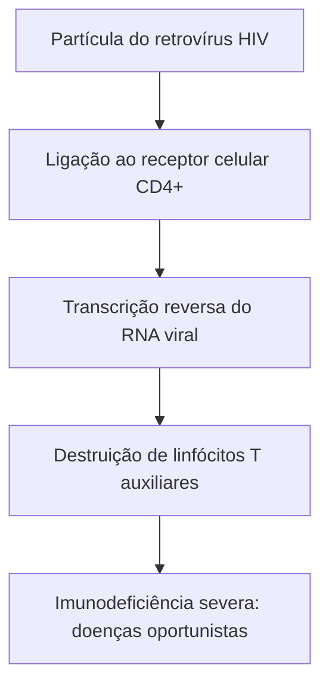
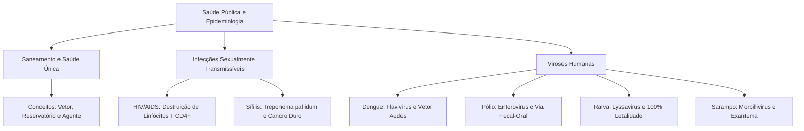

A saúde coletiva decorre da integração contínua entre saneamento básico, equilíbrio ambiental e hábitos de higiene. O estudo epidemiológico analisa a transmissão e o controle de agentes infecciosos em populações humanas. Neste capítulo, examinamos os princípios sanitários fundamentais, o vocabulário epidemiológico essencial, as principais infecções sexualmente transmissíveis e as viroses de notificação compulsória de grande impacto no Brasil.

> [!objetivos]
> Ao concluir este capítulo, você será capaz de:
> - Distinguir os conceitos de infecção, doença, vetor, reservatório e agente etiológico.
> - Compreender a importância do saneamento básico e do conceito de Saúde Única.
> - Analisar a transmissão, o quadro clínico e a profilaxia da infecção por HIV e da sífilis.
> - Caracterizar os agentes, os sintomas e a prevenção de dengue, pólio, raiva e sarampo.

## Princípios Básicos de Saúde Pública e Vocabulário Epidemiológico

A promoção da saúde humana baseia-se em infraestrutura sanitária e vigilância contínua. O saneamento básico envolve serviços indispensáveis. Ele reúne abastecimento de água potável, coleta e tratamento de esgoto, manejo de resíduos sólidos e drenagem pluvial. Falhas nesses sistemas propiciam a proliferação de vetores e a contaminação hídrica.

O modelo de Saúde Única (One Health) reconhece a interconexão indissociável entre saúde humana, animal e ambiental. O desmatamento desordenado e a degradação florestal reduzem barreiras ecológicas. Esse cenário intensifica o transbordamento zoonótico (spillover). Por meio desse processo biológico, patógenos de animais silvestres adaptam-se e passam a infectar humanos.

| Termo Técnico | Significado Epidemiológico | Exemplo Prático |
| :--- | :--- | :--- |
| Agente etiológico | Microrganismo ou parasita que causa a doença | Vírus do sarampo, bactéria da sífilis |
| Vetor | Ser vivo transmissor que inocula o patógeno | Fêmea do mosquito *Aedes aegypti* |
| Reservatório | Espécie ou ambiente em que o patógeno sobrevive | Humanos na poliomielite; cães e morcegos na raiva |
| Profilaxia | Conjunto de métodos de prevenção sanitária | Vacinação em massa, saneamento básico |
| Zoonose | Doença infecciosa transmissível entre animais e humanos | Raiva viral transmitida por mordeduras |
*Tabela 1: Vocabulário fundamental de saúde coletiva e epidemiologia.*

Existe distinção biológica nítida entre infecção e doença. A infecção caracteriza-se pela penetração e multiplicação de um agente infeccioso no hospedeiro. Ela pode transcorrer de forma assintomática. A doença manifesta-se clinicamente quando danos celulares e teciduais provocam sinais objetivos e sintomas perceptíveis.

> [!atencao]
> A antiga sigla DST foi formalmente substituída por IST (Infecção Sexualmente Transmissível). Essa alteração técnica destaca que pessoas assintomáticas portadoras da infecção transmitem o patógeno durante relações sexuais desprotegidas.

## Infecções Sexualmente Transmissíveis: HIV/AIDS e Sífilis

As Infecções Sexualmente Transmissíveis (ISTs) configuram graves problemas de saúde coletiva. Sua transmissão ocorre por contato sexual desprotegido, por via vertical da gestante para o filho e por contato sanguíneo em materiais perfurocortantes.

A Síndrome da Imunodeficiência Adquirida (AIDS) é causada pelo Vírus da Imunodeficiência Humana (HIV). Trata-se de um retrovírus que contém ácido ribonucleico (RNA) e a enzima transcriptase reversa. O HIV destrói seletivamente os linfócitos T auxiliares (células T CD4+). Essas células coordenam toda a resposta imune adaptativa. A queda progressiva de linfócitos CD4+ expõe o paciente a infecções oportunistas, como tuberculose, toxoplasmose cerebral e pneumonias graves.

*Figura 1: Sequência de eventos patogênicos provocados pelo HIV no sistema imunológico.*

O Sistema Único de Saúde (SUS) distribui gratuitamente a Terapia Antirretroviral (TARV). O tratamento contínuo suprime a replicação viral no organismo e eleva a expectativa de vida. Em exposições agudas de risco, recomenda-se a Profilaxia Pós-Exposição (PEP), com medicamentos iniciados em até 72 horas.

> [!bizu] Profilaxia Pós-Exposição (PEP)
> A PEP consiste no uso emergencial de medicamentos antirretrovirais por 28 dias após situações de risco, como violência sexual, acidentes ocupacionais com material biológico ou sexo desprotegido.

A sífilis é uma infecção sistêmica causada pela bactéria espiroqueta *Treponema pallidum*. A doença desenvolve-se em fases clínicas distintas:
1. Fase primária: surge o cancro duro cerca de três semanas após o contágio. Trata-se de úlcera indolor com bordas endurecidas no ponto de inoculação genital ou mucosa. A lesão cicatriza espontaneamente mesmo sem medicação. Isso leva muitos pacientes a acreditar equivocadamente que houve cura espontânea da enfermidade.
2. Fase secundária: surge semanas após a cicatrização do cancro. Ocorrem manchas avermelhadas na pele conhecidas como roséolas sifilíticas. O acometimento característico das palmas das mãos e plantas dos pés é típico dessa fase. Os pacientes podem apresentar febre baixa, mal-estar e aumento generalizado dos linfonodos.
3. Fase latente: período assintomático no qual a bactéria permanece viva no organismo. Apenas exames sorológicos laboratoriais detectam a presença do treponema.
4. Fase terciária: manifesta-se anos após o contágio inicial sem tratamento. Provoca lesões ósseas destrutivas, insuficiência da válvula aórtica, aneurismas e neurossífilis grave com demência.

A transmissão congênita ocorre quando a gestante infectada transmite a bactéria ao feto pela placenta. Essa transmissão vertical pode gerar aborto espontâneo, má-formação fetal ou cegueira neonatal. O diagnóstico pré-natal rotineiro no pré-natal e o tratamento imediato com penicilina benzatina são fundamentais para erradicar a transmissão vertical.

## Infecções Virais e Arboviroses: Dengue

Os vírus são parasitas intracelulares obrigatórios desprovidos de metabolismo próprio. Possuem material genético envolto por capsídeo proteico. Classificam-se em viroses respiratórias, gastrointestinais e arboviroses.

A dengue é a principal arbovirose urbana no Brasil. Seu agente causador é um vírus de RNA do gênero *Flavivirus*. O vírus apresenta quatro sorotipos distintos: DENV-1, DENV-2, DENV-3 e DENV-4. A infecção por um sorotipo gera imunidade permanente contra ele, mas confere proteção temporária contra os demais. Uma infecção subsequente por outro sorotipo eleva o risco de manifestação grave da doença.

*Figura 2: Ciclo básico da dengue e dependência hídrica do vetor.*

A transmissão ocorre pela picada da fêmea do mosquito *Aedes aegypti*. Os sintomas clássicos compreendem febre alta súbita, dor retro-orbital, cefaleia, mialgia intensa e prostração. A forma grave cursa com sangramentos e choque circulatório. O método preventivo central consiste em eliminar criadouros domiciliares com água parada.

## Grandes Viroses: Poliomielite, Raiva e Sarampo

A poliomielite é desencadeada pelo poliovírus, pertencente ao gênero *Enterovirus*. Trata-se de um vírus de RNA pequeno e sem envelope lipídico. Sua transmissão ocorre pela via fecal-oral, através de água e alimentos contaminados com fezes humanas. Também pode ocorrer por gotículas respiratórias nas fases iniciais. Em pequena fração dos infectados, o vírus alcança a corrente sanguínea e invade o sistema nervoso central. Ele destrói neurônios motores dos cornos anteriores da medula espinhal. Isso resulta em paralisia flácida assimétrica, frequentemente nos membros inferiores. Quando a infecção atinge o tronco encefálico, ocorre paralisia bulbar com insuficiência respiratória fatal. A imunização vacinal universal erradicou a circulação da pólio no país desde 1989. O calendário do SUS adota a vacina inativada (VIP) nas primeiras doses e a vacina oral atenuada (VOP) como reforço.

A raiva é uma zoonose causada por um vírus de RNA do gênero *Lyssavirus*, pertencente à família Rhabdoviridae. Acomete mamíferos domésticos e silvestres, como cães, gatos, macacos e morcegos hematófagos. A transmissão para humanos ocorre pela inoculação de saliva contaminada em mordeduras, arranhaduras ou lambeduras em pele lesionada. O patógeno atinge o sistema nervoso central por transporte retrógrado através dos axônios dos nervos periféricos. Os sintomas neurológicos evoluem com encefalite, agitação motora, delírios, salivação intensa e espasmos dolorosos da laringe ao tentar ingerir água (hidrofobia). Uma vez iniciados os sintomas clínicos, a letalidade é de praticamente 100%. A conduta preventiva imediata exige lavagem copiosa da ferida com água e sabão por vários minutos. Requer também avaliação médica urgente para prescrição oportuna de vacina e soro antirrábicos antes do aparecimento de qualquer sinal neurológico. Cães e gatos agressores devem permanecer em isolamento e observação veterinária rigorosa por dez dias.

| Virose | Agente Etiológico | Modo de Transmissão | Sintoma Notável | Profilaxia Principal |
| :--- | :--- | :--- | :--- | :--- |
| Poliomielite | *Enterovirus* (RNA) | Fecal-oral | Paralisia flácida | Vacinação infantil (VIP e VOP) |
| Raiva | *Lyssavirus* (RNA) | Saliva em ferimentos | Encefalite e hidrofobia | Vacinação animal e profilaxia pós-exposição |
| Sarampo | *Morbillivirus* (RNA) | Aerossóis respiratórios | Exantema craniocaudal | Vacina tríplice viral (SCR) |
*Tabela 2: Resumo comparativo das principais viroses estudadas.*

O sarampo é provocado por vírus de RNA do gênero *Morbillivirus*. Possui altíssima transmissibilidade biológica pelo ar, mediante gotículas e aerossóis expelidos ao tossir ou falar. O quadro manifesta febre alta, tosse seca, conjuntivite, manchas de Koplik na boca e exantema avermelhado com evolução craniocaudal. A profilaxia é garantida pela vacina tríplice viral.

> [!atencao]
> A sífilis é causada por uma bactéria (*Treponema pallidum*), passível de cura com antibióticos específicos. Em contraste, HIV, dengue, poliomielite, raiva e sarampo são todas causadas por vírus de genoma de RNA.

## Mapa do capítulo

*Figura 3: Visão integrada dos temas sanitários abordados no capítulo.*

### Para fixar

1. **Infecção e Doença**: Qual a diferença técnica entre infecção e doença?
   - Infecção é a colonização e multiplicação do agente no organismo, podendo ser assintomática. Doença manifesta sintomas clínicos decorrentes dos danos teciduais.

2. **Célula-alvo do HIV**: Qual população leucocitária é destruída pelo retrovírus HIV?
   - Os linfócitos T auxiliares CD4+, cuja redução desorganiza a resposta imune celular e humoral.

3. **Lesão inicial da Sífilis**: Como se manifesta a sífilis primária?
   - Manifesta-se pelo cancro duro, úlcera indolor de base endurecida no ponto de contágio.

4. **Transmissão da Raiva**: Como o vírus rábico penetra no organismo humano?
   - Pela inoculação de saliva de mamíferos contaminados através de mordeduras, arranhaduras ou lambeduras em ferimentos.

5. **Prevenção da Dengue**: Qual a intervenção prioritária no controle da dengue urbana?
   - A eliminação rotineira de recipientes com água parada que atuam como criadouros do mosquito *Aedes aegypti*.
