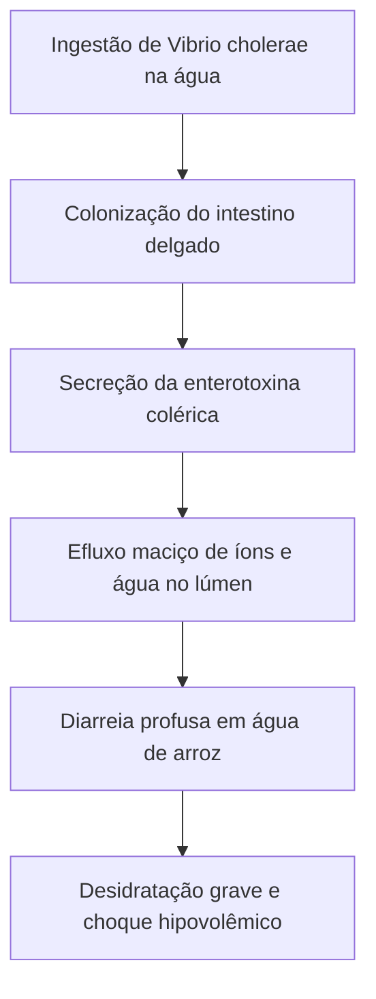
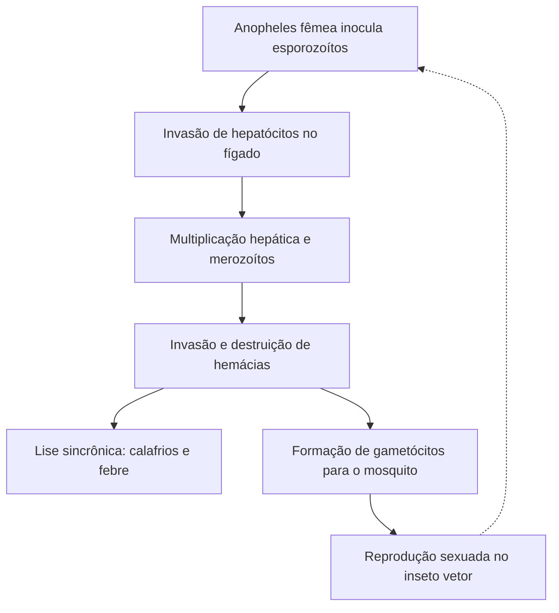
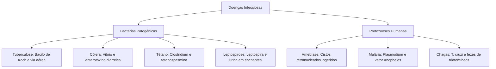

As infecções causadas por bactérias patogênicas e protozoários parasitas configuram grandes desafios sanitários para as populações humanas. O conhecimento dessas patologias ganha relevância máxima nas operações de salvamento e defesa civil. Inundações e desastres socioambientais expõem socorristas e cidadãos a águas contaminadas e vetores biológicos. Neste capítulo, estudamos as principais bactérias patogênicas (tuberculose, meningococo, cólera, tétano e leptospirose), os fundamentos da parasitologia médica e as três protozooses de maior impacto clínico no Brasil: amebíase, malária e doença de Chagas.

> [!objetivos]
> Ao concluir este capítulo, você será capaz de:
> - Caracterizar os agentes, a transmissão e a profilaxia das infecções bacterianas de notificação compulsória.
> - Compreender a correlação entre inundações pluviais e a transmissão da leptospirose e cólera.
> - Definir as relações de parasitismo e diferenciar hospedeiro intermediário de definitivo.
> - Mapear o ciclo biológico, os vetores e as fases clínicas da malária e da doença de Chagas.

## Panorama das Infecções Bacterianas: Tuberculose e Meningite

As bactérias são microrganismos procariontes unicelulares do reino Monera. Possuem parede celular peptídica e genoma disperso. Classificam-se quanto à morfologia em cocos, bacilos, espirilos e vibriões. Pela coloração de Gram, dividem-se em gram-positivas e gram-negativas. Muitas espécies são comensais. Porém, linhagens patogênicas produzem toxinas danosas.

A tuberculose é causada pelo *Mycobacterium tuberculosis* (bacilo de Koch). A bactéria possui parede rica em ácidos micólicos. Essa camada cerosa confere resistência física. A transmissão ocorre pela via respiratória, por inalação de gotículas expelidas pela tosse de indivíduos com a forma pulmonar ativa. Ambientes aglomerados facilitam a propagação do bacilo.

O quadro pulmonar cursa com tosse persistente por mais de três semanas, escarro sanguinolento, febre vespertina e emagrecimento. O tratamento no SUS associa antibióticos por seis meses contínuos. O abandono precoce seleciona cepas multirresistentes. A prevenção básica é a vacina BCG aplicada ao recém-nascido, que protege contra formas graves.

A doença meningocócica é desencadeada pela bactéria *Neisseria meningitidis* (meningococo). Trata-se de infecção aguda de evolução rápida que inflama as meninges. Transmite-se por contato respiratório direto com secreções nasofaríngeas. Os sintomas compreendem febre abrupta, cefaleia intensa, vômitos em jato e rigidez na nuca. Na forma grave ocorre a meningococcemia, com disseminação na corrente sanguínea, petéquias hemorrágicas e choque. A vacinação conjugada e a quimioprofilaxia de contatos íntimos representam as condutas centrais.

## Cólera, Tétano e Leptospirose

A cólera é uma enteropatia aguda decorrente do *Vibrio cholerae*. O contágio dá-se pela ingestão de água potável contaminada ou alimentos crus lavados com água imprópria. No intestino delgado, a bactéria adere à mucosa e secreta a enterotoxina colérica. Essa toxina estimula o efluxo maciço de água e íons cloreto para o lúmen intestinal.

O paciente colérico manifesta diarreia aquosa profusa e incolor com aspecto de água de arroz. Em poucas horas, a perda de líquidos gera desidratação profunda, acidose e choque hipovolêmico. O tratamento imediato exige hidratação oral e reposição eletrolítica venosa. A prevenção definitiva requer saneamento básico, água tratada e higiene alimentar.

*Figura 1: Cascata patogênica da infecção intestinal por Vibrio cholerae.*

O tétano é uma afecção não contagiosa causada pelo *Clostridium tetani*. É um bacilo anaeróbio estrito formador de esporos resistentes no solo e poeira. A contaminação ocorre pela entrada de esporos em cortes profundos da pele. Em tecidos com baixa oxigenação, os esporos germinam e liberam a neurotoxina tetanospasmina. Essa toxina bloqueia neurotransmissores inibitórios no sistema nervoso central.

Sem a inibição sináptica, os neurônios motores emitem estímulos contínuos. O paciente apresenta espasmos musculares dolorosos, trismo mandibular e postura em opistótono. Nos casos graves, ocorre espasmo respiratório fatal. O tétano não se transmite de pessoa para pessoa. A prevenção eficaz é a vacina antitetânica com reforços decenais.

*Figura 2: Rota biológica da infecção tetânica da ferida à contratura motora.*

A leptospirose é uma zoonose causada por bactérias espiroquetas do gênero *Leptospira*, sobretudo *Leptospira interrogans*. Ratos urbanos (*Rattus norvegicus*) atuam como principais reservatórios, eliminando a bactéria viva na urina. Em enchentes e inundações, a urina mistura-se às águas pluviais. A penetração no corpo humano dá-se pela pele com microlesões ou por imersão prolongada em água contaminada.

O quadro inicial manifesta febre alta, cefaleia intensa, mialgia concentrada nas panturrilhas e sufusão conjuntival. Em dez por cento dos casos, a infecção progride para a forma grave ictérica, denominada Síndrome de Weil. Essa síndrome cursa com insuficiência renal aguda, icterícia e hemorragia pulmonar. O controle exige combate a roedores, saneamento e uso de botas impermeáveis por equipes de socorro.

> [!exemplo] Atuação Operacional em Inundações
> Bombeiros militares em operações de enchente devem usar equipamentos de proteção individual impermeáveis. Qualquer contato de pele macerada com água de inundação requer monitoramento clínico para febre e mialgia nas panturrilhas.

| Doença Bacteriana | Agente Etiológico | Modo de Transmissão | Sintoma Marcante | Ação Preventiva Principal |
| :--- | :--- | :--- | :--- | :--- |
| Tuberculose | *Mycobacterium tuberculosis* | Gotículas pelo ar | Tosse persistente e hemoptise | Vacina BCG e tratamento precoce |
| Doença meningocócica | *Neisseria meningitidis* | Secreções respiratórias | Febre, cefaleia e rigidez de nuca | Vacina conjugada e quimioprofilaxia |
| Cólera | *Vibrio cholerae* | Água e alimentos | Diarreia aquosa profusa | Saneamento básico e água tratada |
| Tétano | *Clostridium tetani* | Ferimento perfurante | Espasmos musculares e trismo | Vacina antitetânica com reforços |
| Leptospirose | *Leptospira interrogans* | Urina de ratos em enchentes | Mialgia em panturrilha e icterícia | Controle de roedores e botas de borracha |
*Tabela 1: Síntese comparativa das principais infecções bacterianas.*

> [!atencao]
> A leptospirose não se transmite pela mordedura do rato, mas pelo contato com água ou lama contaminadas por urina de roedores. O tétano não é transmitido por ferrugem em si, mas pela contaminação de feridas por esporos bacterianos presentes na terra.

## Fundamentos de Parasitologia Médica

O parasitismo é uma relação desarmônica interespecífica essencial na ecologia médica. Nessa interação biológica, o parasita habita o corpo do hospedeiro para obter nutrientes vitais, provocando-lhe danos clínicos e teciduais. Os parasitas humanos dividem-se em três grandes grupos taxonômicos:
1. Protozoários: microrganismos eucariontes unicelulares e heterótrofos, como amebas, plasmódios e tripanossomas.
2. Helmintos: animais metazoários invertebrados dotados de tecidos verdadeiros e corpo vermiforme, abrangendo platelmintos e nematelmintos.
3. Ectoparasitas: artrópodes que habitam externamente a superfície corporal do hospedeiro, como piolhos, pulgas e carrapatos.

A correta identificação dos papéis desempenhados pelos hospedeiros é basilar na epidemiologia. Denomina-se hospedeiro definitivo aquele no qual o parasita atinge a maturidade biológica e realiza a reprodução sexuada com recombinação genética. Por sua vez, chama-se hospedeiro intermediário aquele que abriga apenas formas larvárias de desenvolvimento ou etapas de multiplicação puramente assexuada.

O diagnóstico laboratorial das parasitoses apoia-se em exames complementares de fezes e sangue. O exame parasitológico de fezes (EPF) analisa amostras mediante técnicas físicas padronizadas. Os métodos de sedimentação espontânea (método de Hoffman, Pons e Janer) aproveitam a ação da gravidade para concentrar cistos e ovos pesados no fundo do cálice. Os métodos de flutuação (método de Willis) empregam soluções de alta densidade para fazer com que cistos leves flutuem até a lâmina de microscopia. Para parasitas sanguíneos, a pesquisa direta em gota espessa corada por Giemsa continua sendo o padrão-ouro de campo.

## Protozooses Intestinais: Amebíase

A amebíase é causada pelo protozoário sarcodíneo *Entamoeba histolytica*. O ciclo evolutivo da ameba alterna duas formas biológicas fundamentais: o cisto e o trofozoíto. O cisto maduro possui quatro núcleos e parede espessa de quitina. Trata-se da forma de resistência e disseminação ambiental eliminada nas fezes humanas, tolerando variações de temperatura e dessecação moderada. O trofozoíto é a forma vegetativa ameboide móvel que coloniza os tecidos intestinais por meio de pseudópodes.

A transmissão ocorre pela ingestão de cistos maduros em água contaminada, verduras cruas mal higienizadas ou contato fecal-oral direto. No intestino delgado humano ocorre o desencistamento sob ação do suco digestivo. Os trofozoítos migram em seguida para o intestino grosso, fixando-se no ceco e cólon ascendente. Ali alimentam-se de bactérias e restos celulares.

Quando cepas virulentas liberam enzimas proteolíticas e colagenases, os trofozoítos ulceram a mucosa colônica. O quadro clínico cursa com cólicas intensas, tenesmo retal e disenteria com muco e sangue. Pelo sistema porta-hepático, os parasitas podem alcançar o fígado e formar abscessos amebianos necrosantes. A profilaxia requer saneamento básico, água filtrada ou fervida e fiscalização de manipuladores de alimentos.

## Protozooses Sistêmicas: Malária e Doença de Chagas

A malária é causada por protozoários esporozoários do gênero *Plasmodium*. As espécies principais no Brasil são *Plasmodium vivax* e *Plasmodium falciparum*. A transmissão ocorre pela picada da fêmea de mosquitos *Anopheles* (mosquito-prego).

No ciclo da malária, o mosquito é o hospedeiro definitivo (reprodução sexuada no estômago do inseto). O homem atua como hospedeiro intermediário (multiplicação assexuada). O mosquito inocula esporozoítos no sangue. Eles invadem hepatócitos no fígado e multiplicam-se gerando merozoítos.

Os merozoítos caem no sangue e invadem hemácias. Dentro das hemácias, multiplicam-se até rompê-las. A lise sincrônica de milhares de hemácias libera toxinas e hemozoína. Isso causa os picos de febre alta, calafrios e tremores. O ciclo repete-se a cada 48 horas no *P. vivax* (terçã benigna) e *P. falciparum* (terçã maligna), ou a cada 72 horas no *P. malariae* (quartã).

*Figura 3: Ciclo biológico do Plasmodium entre homem e mosquito Anopheles.*

A profilaxia envolve mosquiteiros com inseticida, repelentes, telas em habitações, controle de criadouros e tratamento medicamentoso rápido.

A doença de Chagas é provocada pelo protozoário flagelado *Trypanosoma cruzi*. O vetor é o inseto hemíptero hematófago conhecido como barbeiro. O inseto abriga-se durante o dia em frestas de casas de taipa.

A transmissão natural não ocorre pela picada do barbeiro. O inseto defeca sobre a pele ao sugar sangue. Ao coçar o local lesionado, a própria pessoa introduz as formas tripomastigotas presentes nas fezes no orifício da picada. A transmissão também ocorre por via oral pela ingestão de açaí ou caldo de cana moídos com o inseto.

*Figura 4: Mecanismo de transmissão fecal do Trypanosoma cruzi e evolução.*

O ciclo apresenta duas formas no corpo humano:
1. Tripomastigota: forma móvel e flagelada encontrada no sangue circulante na fase aguda.
2. Amastigota: forma arredondada intracelular que se multiplica no músculo cardíaco e plexos nervosos viscerais.

> [!atencao] Sinal de Romaña na Fase Aguda
> Na fase aguda de Chagas, o sinal de Romaña manifesta-se por edema palpebral inflamatório unilateral indolor quando a penetração ocorre pela mucosa ocular.

| Protozoose | Agente Etiológico | Vetor Biológico | Mecanismo de Contágio | Danos Clínicos Notáveis |
| :--- | :--- | :--- | :--- | :--- |
| Amebíase | *Entamoeba histolytica* | Inexistente (veiculação hídrica) | Ingestão de cistos maduros | Disenteria, úlceras e abscesso hepático |
| Malária | *Plasmodium vivax* e *falciparum* | Fêmea do mosquito *Anopheles* | Inoculação de esporozoítos por picada | Picos de febre terçã e anemia hemolítica |
| Doença de Chagas | *Trypanosoma cruzi* | Inseto triatomíneo (barbeiro) | Fezes infectadas na pele lesionada | Cardiomegalia, megaesôfago e megacólon |
*Tabela 2: Resumo das principais protozooses humanas.*

Na fase crônica da doença de Chagas, a destruição progressiva de fibras miocárdicas e gânglios nervosos provoca cardiomegalia severa com insuficiência cardíaca, megaesôfago e megacólon. A prevenção inclui melhoria habitacional de alvenaria e inseticidas.

> [!bizu] Distinções Críticas para a Prova
> 1. O barbeiro não inocula o *T. cruzi* pela saliva; ele defeca enquanto se alimenta de sangue.
> 2. O homem é o hospedeiro intermediário da malária; o mosquito *Anopheles* é o hospedeiro definitivo.
> 3. Cólera é causada por bactéria; amebíase é causada por protozoário. Ambas provocam diarreia intensa por contaminação hídrica.

## Mapa do capítulo

*Figura 5: Mapa conceitual integrado de infecções bacterianas e protozooses.*

### Para fixar

1. **Patogenia do Tétano**: Por que o *Clostridium tetani* precisa de ferimento com baixa oxigenação?
   - É bactéria estritamente anaeróbia; só germina e libera tetanospasmina em tecidos sem oxigênio.

2. **Leptospirose e Enchentes**: Como ocorre o contágio humano nas inundações pluviais?
   - A bactéria *Leptospira interrogans* da urina de ratos na água penetra por microfissuras da pele ou por maceração hídrica.

3. **Cistos da Amebíase**: Qual forma morfológica da *Entamoeba histolytica* é transmitida pela água?
   - O cisto maduro tetranucleado, protegido por parede resistente que sobrevive no ambiente externo.

4. **Febre da Malária**: O que provoca os picos periódicos de febre e calafrios na malária?
   - A ruptura simultânea de milhares de hemácias parasitadas, liberando merozoítos e hemozoína no sangue.

5. **Transmissão de Chagas**: Como o *Trypanosoma cruzi* é introduzido no organismo pelo barbeiro?
   - Pelas fezes que o inseto deposita perto da picada, inoculadas quando a pessoa coça a pele lesionada.
