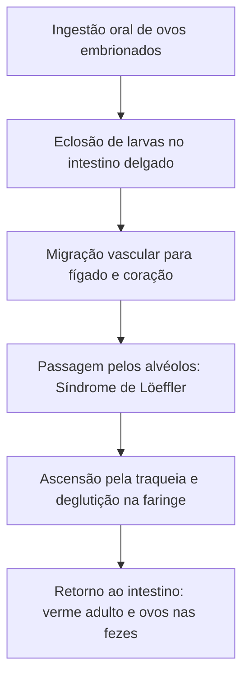
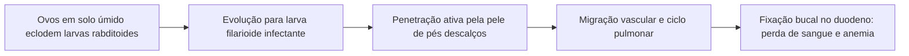
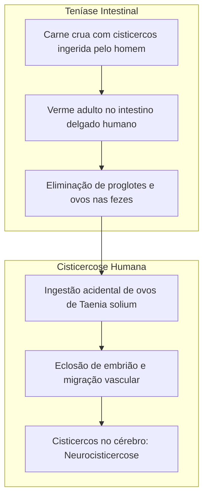
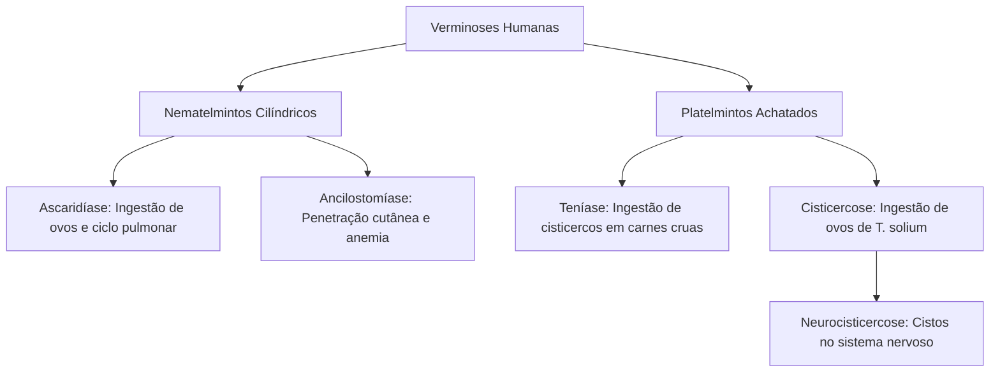

As verminoses compreendem doenças infecciosas provocadas por metazoários invertebrados que parasitam tecidos e órgãos do corpo humano. A persistência histórica dessas endemias no Brasil reflete a precariedade do saneamento básico, a carência de água encanada tratada e a falta de calçados em populações vulneráveis. Neste capítulo, estudamos as verminoses de maior relevância epidemiológica nacional: ascaridíase, ancilostomíase e o complexo teníase-cisticercose, destacando a biologia dos parasitas, seus ciclos evolutivos, quadros clínicos e medidas profiláticas.

> [!objetivos]
> Ao concluir este capítulo, você será capaz de:
> - Distinguir as características gerais de vermes nematelmintos e platelmintos parasitas.
> - Compreender o ciclo biológico do *Ascaris lumbricoides* e a síndrome de Löeffler.
> - Explicar a transmissão percutânea da ancilostomíase e a patogenia do amarelão.
> - Diferenciar a aquisição e as manifestações clínicas da teníase e da cisticercose humana.

## Introdução às Verminoses e Ascaridíase

As verminoses humanas são desencadeadas por vermes pertencentes a dois filos animais: Platyhelminthes (platelmintos, com corpo achatado dorsoventralmente) e Nematoda (nematelmintos, com corpo cilíndrico e extremidades afiladas). O ser humano atua com frequência como hospedeiro definitivo, no qual os vermes atingem a maturidade sexual e eliminam milhares de ovos no ambiente por meio das fezes.

A ascaridíase é a parasitose intestinal mais disseminada no território brasileiro, acometendo principalmente crianças em idade escolar. O agente etiológico é o nematódeo *Ascaris lumbricoides*, popularmente conhecido como lombriga. O verme adulto habita o intestino delgado humano, alimentando-se do quimo intestinal digerido pelo hospedeiro. As fêmeas realizam fecundação interna e liberam até duzentos mil ovos diariamente.

A contaminação humana ocorre pela ingestão de ovos embrionados presentes em água não tratada ou verduras e frutas cruas contaminadas com fezes. No duodeno humano, as larvas eclodem dos ovos e atravessam a parede da mucosa intestinal, caindo na circulação venosa e linfática. Através da veia porta-hepática e da veia cava, alcançam o coração direito e são bombeadas para os capilares dos pulmões. Nos alvéolos pulmonares, as larvas realizam mudas de crescimento e provocam microlesões com tosse e eosinofilia intensa, quadro denominado síndrome de Löeffler.

*Figura 1: Trajeto migratório do Ascaris lumbricoides no organismo humano.*

### Sintomas e Manifestações Clínicas da Ascaridíase

Na maioria dos indivíduos infectados, a ascaridíase pode evoluir de forma assintomática. Quando surgem sintomas manifestos, o paciente apresenta dor abdominal difusa, náuseas, vômitos, diarreia e perda ponderal. Na fase pulmonar, a tosse e o broncoespasmo caracterizam a síndrome de Löeffler. Em infecções com alta carga parasitária, o enovelamento de vermes adultos causa obstrução intestinal mecânica aguda e perfurações, exigindo intervenção cirúrgica de urgência. A profilaxia baseia-se em saneamento básico, higienização rigorosa de alimentos e tratamento dos doentes.

## Ancilostomíase: O Amarelão

A ancilostomíase, historicamente imortalizada pelo personagem Jeca Tatu de Monteiro Lobato, é uma grave verminose intestinal endêmica em regiões rurais e periféricas do Brasil. A enfermidade é causada por duas espécies de nematódeos hematófagos: *Ancylostoma duodenale* e *Necator americanus*. Os vermes adultos medem cerca de um centímetro de comprimento e fixam-se à mucosa do duodeno e jejuno por meio de sua cápsula bucal (dotada de dentes quitinosos no *Ancylostoma* e lâminas cortantes no *Necator*).

O ciclo inicia-se com a eliminação de ovos nas fezes em solo arenoso, úmido e sombreado. No meio externo, o ovo eclode em larva rabditoide de vida livre. Após sucessivas mudas na terra, a larva transforma-se na forma filarioide, que é a forma infectante dotada de bainha protetora. A transmissão ocorre pela penetração ativa da larva filarioide através da pele de indivíduos que andam descalços sobre o solo contaminado. No local da penetração surge prurido intenso e erupção eritematosa papulosa, popularmente chamada de coceira da terra.

*Figura 2: Ciclo de penetração percutânea e fixação intestinal do ancilóstomo.*

Caindo na circulação venosa, as larvas passam pelo coração e pulmões, sobem pela traqueia, são deglutidas e chegam ao intestino delgado. Presos à mucosa intestinal, os vermes laceram capilares e secretam anticoagulantes salivares para sugar sangue continuamente. A perda crônica de sangue e ferro deflagra anemia microcítica ferropriva profunda, acompanhada de hipoproteinemia, fraqueza muscular generalizada, prostração, tonturas e palidez cutânea amarelada, característica que originou o nome popular amarelão. A prevenção exige saneamento básico e o uso sistemático de calçados protetores.

> [!bizu] Penetração Cutânea versus Ingestão Oral
> Na ancilostomíase, a transmissão principal ocorre pela penetração ativa de larvas filarioides através da pele descalça. Já na ascaridíase, a transmissão dá-se exclusivamente pela ingestão oral de ovos embrionados em água ou alimentos contaminados.

## Complexo Teníase-Cisticercose

O complexo teníase-cisticercose engloba duas entidades patológicas clinicamente distintas provocadas pelo mesmo verme platelminto em diferentes fases de seu ciclo de vida. As espécies causadoras pertencem à classe Cestoda: *Taenia solium* (tênia do porco) e *Taenia saginata* (tênia do boi). Os vermes adultos são hermafroditas e parasitam o intestino delgado do ser humano, que atua como único hospedeiro definitivo natural da forma adulta.

O corpo do verme adulto (a solitária) divide-se morfologicamente em três regiões fundamentais:
1. Escólex: extremidade anterior modificada para fixação na mucosa intestinal, provida de quatro ventosas musculares. Em *T. solium*, o escólex possui rostro com coroa de acúleos (ganchos quitinosos); em *T. saginata*, o escólex é inerme (sem ganchos).
2. Colo: zona de proliferação celular contínua onde novos segmentos são formados.
3. Estróbilo: cadeia linear composta por centenas de segmentos denominados proglotes.

As proglotes terminais tornam-se grávidas, repletas de milhares de ovos microscopicamente idênticos entre as espécies. Essas proglotes desprendem-se espontaneamente do estróbilo e são eliminadas com as fezes humanas no meio ambiente.

| Parâmetro Comparativo | Teníase Intestinal | Cisticercose Humana |
| :--- | :--- | :--- |
| Forma do parasita | Verme adulto hermafrodita no intestino | Larva (*Cysticercus cellulosae*) em tecidos |
| Mecanismo de contágio | Ingestão de carne crua ou malcozida com cisticercos | Ingestão oral de ovos embrionados de *Taenia solium* |
| Espécies envolvidas | *Taenia solium* (porco) e *Taenia saginata* (boi) | Exclusivamente *Taenia solium* |
| Danos clínicos | Fome excessiva, dor abdominal e perda de peso | Neurocisticercose com convulsões e lesão ocular |
*Tabela 1: Síntese clínica comparativa entre teníase e cisticercose.*

Na teníase, suínos e bovinos atuam como hospedeiros intermediários típicos. Ao ingerirem água ou pastagens contaminadas com fezes humanas contendo ovos de tênia, os embriões hexacantos (oncosferas) eclodem no estômago do animal, perfuram a mucosa intestinal e ganham a circulação sanguínea. Alojando-se nos músculos estriados do animal, desenvolvem-se em larvas císticas denominadas cisticercos (popularmente chamados de canjiquinha ou pipoca na carne suína). Quando o homem alimenta-se de carne crua ou malpassada contendo cisticercos viáveis, o cisto evagina no duodeno, fixa seu escólex e desenvolve o verme adulto no intestino.

A cisticercose humana ocorre quando o próprio ser humano assume acidentalmente o papel de hospedeiro intermediário. Isso ocorre pela ingestão direta de ovos viáveis de *Taenia solium* presentes em verduras cruas, água contaminada ou por autoinfecção fecal-oral. Os embriões liberados no intestino do homem caem na corrente sanguínea e migram para órgãos vitais, desenvolvendo cisticercos no tecido celular subcutâneo, nos músculos, no bulbo ocular (cisticercose ocular com cegueira) e no sistema nervoso central (neurocisticercose).

*Figura 3: Vias biológicas divergentes que geram teníase intestinal e neurocisticercose tecidual.*

### Sintomas e Complicações da Teníase e da Cisticercose

Os sintomas da teníase intestinal são frequentemente leves ou inespecíficos. O paciente costuma relatar apetite aumentado associado a perda de peso, desconforto epigástrico e presença visível de proglotes móveis nas fezes ou nas roupas íntimas. Em contraste, os sintomas da cisticercose humana dependem criticamente do órgão afetado pela larva. Na cisticercose ocular, o paciente experimenta redução visual e dor orbital. Na neurocisticercose, os cistos no parênquima cerebral provocam sintomas neurológicos severos, incluindo cefaleia persistente, crises convulsivas epilépticas, hipertensão intracraniana e distúrbios motores.

> [!atencao] Pegadinha Clássica de Concurso
> A cisticercose humana não é adquirida pelo consumo de carne de porco com cisticercos. O consumo de carne suína com cisticercos produz unicamente a teníase intestinal. A cisticercose humana é causada pela ingestão de ovos de *Taenia solium* eliminados nas fezes de humanos portadores da tênia adulta. Ademais, *Taenia saginata* não provoca cisticercose em seres humanos.

> [!exemplo] Controle Sanitário e Inspeção Veterinária
> Frigoríficos autorizados realizam cortes de inspeção sistemática nos músculos masseteres e no coração dos animais abatidos. Peças que exibem grânulos de cisticercos viáveis são condenadas ou encaminhadas para tratamento térmico industrial prolongado, impedindo a chegada da carne contaminada ao consumidor final.

## Mapa do capítulo

*Figura 4: Mapa conceitual integrado dos nematódeos e do complexo teníase-cisticercose.*

### Para fixar

1. **Ciclo da Ascaridíase**: Como as larvas de *Ascaris lumbricoides* alcançam a árvore respiratória?
   - Eclodem dos ovos no intestino, atravessam a parede mucosa, ganham a veia porta e o coração e chegam aos alvéolos pulmonares.

2. **Causa da anemia no amarelão**: Qual o mecanismo patológico da perda de ferro na ancilostomíase?
   - Os vermes adultos fixam-se com lâminas ou dentes bucais na mucosa intestinal e alimentam-se continuamente de sangue do hospedeiro.

3. **Teníase versus Cisticercose**: O que uma pessoa desenvolve ao comer carne de porco malcozida com cisticercos?
   - Desenvolve teníase intestinal (verme adulto no intestino), e nunca cisticercose.

4. **Origem da Cisticercose humana**: Como uma pessoa contrai neurocisticercose?
   - Pela ingestão acidental de ovos viáveis de *Taenia solium* presentes em água ou alimentos contaminados com fezes humanas.

5. **Uso de calçados na profilaxia**: Para qual das verminoses estudadas o uso de calçados é a medida preventiva primordial?
   - Para a ancilostomíase, cujas larvas filarioides infectantes penetram ativamente pela pele descalça.
