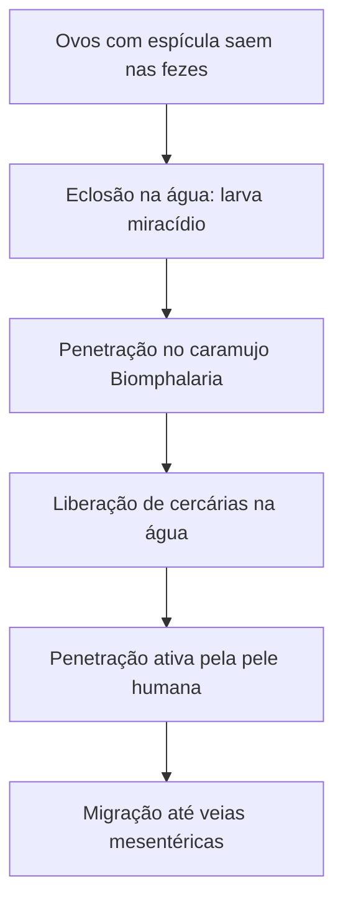

A esquistossomose mansônica exemplifica com clareza a dependência entre endemias parasitárias, coleções hídricas doces e carência de saneamento básico no Brasil. Concomitantemente, o estudo das defesas do organismo humano esclarece como o sistema imunológico responde a invasões patogênicas por meio de mecanismos ativos e passivos de proteção. Neste capítulo, analisamos a biologia do *Schistosoma mansoni*, seu ciclo biológico heteroxênico, suas manifestações clínicas, as diretrizes profiláticas e o funcionamento comparativo de vacinas e soros terapêuticos.

> [!objetivos]
> Ao concluir este capítulo, você será capaz de:
> - Descrever o ciclo biológico do *Schistosoma mansoni* e os papéis dos hospedeiros.
> - Identificar as formas larvárias de miracídio e cercária no ambiente aquático.
> - Compreender a patogenia da fase crônica da esquistossomose e a formação de ascite.
> - Diferenciar imunidade ativa e imunidade passiva quanto à duração e memória imune.

## Esquistossomose: Agente e Ciclo Biológico

A esquistossomose mansônica, popularmente designada por barriga d’água ou xistose, é uma verminose crônica provocada pelo platelminto trematódeo *Schistosoma mansoni*. Ao contrário da maioria dos platelmintos, que são hermafroditas, o *Schistosoma* apresenta sexos separados com nítido dimorfismo sexual. O macho é mais espesso e possui uma fenda longitudinal denominada canal ginecóforo, na qual aloja a fêmea, mais longa e cilíndrica, durante a cópula permanente nas veias do sistema porta-hepático e plexos mesentéricos.

O ciclo biológico do parasita é heteroxênico e necessita de dois hospedeiros. O ser humano atua como hospedeiro definitivo, abrigando os vermes adultos. Moluscos aquáticos do gênero *Biomphalaria*, com destaque para a espécie suscetível *Biomphalaria glabrata*, funcionam como hospedeiros intermediários em cursos de água doce lentos. O ciclo inicia-se quando fezes humanas contendo ovos com espícula lateral característica contaminam corpos hídricos sem saneamento básico.

Na água doce, a diferença osmótica estimula a eclosão do ovo, liberando o miracídio ciliado. O miracídio nada até penetrar nos tecidos do caramujo *Biomphalaria*. Dentro do molusco, multiplica-se e origina cercárias de cauda bifurcada. As cercárias abandonam o caramujo e nadam à procura do ser humano.


*Figura 1: Etapas evolutivas do Schistosoma mansoni entre caramujos e humanos.*

A transmissão ocorre pela penetração ativa da cercária na pele de banhistas em águas infestadas (lagoas de coceira). Ao perfurar a epiderme, a cercária perde a cauda e torna-se esquistossômulo. O esquistossômulo ganha a circulação, atravessa pulmões e coração, migrando em seguida até as veias do sistema porta-hepático e mesentéricas, onde atinge a maturidade sexual.

## Sintomas, Manifestações Clínicas e Profilaxia

No momento da penetração das cercárias na pele, o paciente experimenta prurido cutâneo intenso e erupção urticariforme, denominada dermatite cercariana. Na fase aguda, semanas após a infecção, surgem febre, calafrios, cefaleia, dores abdominais e tosse seca decorrente da passagem dos esquistossômulos pelos capilares pulmonares.

A fase crônica decorre da reação inflamatória granulomatosa contra os ovos nos tecidos. Parte dos ovos expelidos nas veias mesentéricas é levada pelo fluxo sanguíneo até o fígado, originando granulomas fibróticos periovulares.

A fibrose hepática obstrui ramos da veia porta, provocando hipertensão portal, esplenomegalia, varizes esofágicas e ascite (acúmulo de líquido peritoneal que origina o nome barriga d’água). A profilaxia consiste em implantar redes de esgoto, tratar os doentes, combater os caramujos e evitar banhos em lagoas suspeitas.

> [!atencao]
> A esquistossomose não é transmitida por ingestão de carne nem por picada de insetos. A infecção ocorre exclusivamente pelo contato da pele com água doce onde nadam cercárias liberadas por caramujos do gênero *Biomphalaria*.

## As Defesas do Organismo: Imunidade Ativa e Imunidade Passiva

O sistema imunitário humano dispõe de mecanismos sofisticados para defender o organismo contra agentes patogênicos e toxinas biológicas. A imunidade adquirida ou adaptativa divide-se fundamentalmente em duas modalidades fisiológicas: ativa e passiva.

| Característica Imunológica | Imunidade Ativa | Imunidade Passiva |
| :--- | :--- | :--- |
| Origem dos anticorpos | Produzidos pelo próprio organismo do indivíduo | Fornecidos prontos a partir de outro doador |
| Tempo para início de ação | Lento (dias a semanas para produzir clones) | Imediato (os anticorpos atuam instantaneamente) |
| Formação de células de memória | Sim (linfócitos B e T de memória duradoura) | Não (não induz seleção clonal própria) |
| Duração da proteção conferida | Prolongada (anos, décadas ou para toda a vida) | Temporária (semanas, enquanto durarem as imunoglobulinas) |
| Exemplos típicos | Infecção natural curada e vacinas preventivas | Amamentação (IgA colostral) e soros antipeçonhentos |
*Tabela 1: Quadro comparativo entre imunidade ativa e passiva.*

Na imunidade ativa, o organismo entra em contato com antígenos e processa resposta imune humoral e celular. Ocorre após a cura de infecções ou pela vacinação com microrganismos atenuados ou fragmentos antigênicos. Ao induzir a produção de linfócitos B e T de memória, assegura resposta secundária rápida e duradoura contra contágios futuros.

Na imunidade passiva artificial, o indivíduo recebe anticorpos prontos, sem participação de seus linfócitos na síntese de imunoglobulinas. Ocorre pela administração de soros hiperimunes heterólogos produzidos por centros de referência nacionais como o Instituto Butantan e a Fundação Ezequiel Dias. Esses imunobiológicos são obtidos a partir da inoculação controlada de antígenos ou venenos em cavalos doadores, que produzem anticorpos neutralizantes específicos purificados em laboratório. O soro possui ação curativa imediata contra toxinas já circulantes, mas não gera memória celular duradoura.

> [!bizu] Vacina versus Soro
> Grave a regra mnemônica para os concursos: vacina previne (imunidade ativa com memória biológica); soro cura em emergências (imunidade passiva temporária sem memória celular).

## Mapa do capítulo

```mermaid Síntese estrutural do capítulo sobre esquistossomose e imunologia
flowchart TD
    CAP["Esquistossomose e Imunologia"] --> ESQ["Esquistossomose Mansônica"]
    CAP --> IMU["Mecanismos de Imunidade"]
    
    ESQ --> CIC["Ciclo: Fezes -> Miracídio -> Biomphalaria -> Cercária"]
    ESQ --> PAT["Patogenia: Granuloma hepático, hipertensão portal e ascite"]
    ESQ --> PRO["Prevenção: Saneamento e evitar lagoas de coceira"]
    
    IMU --> ATI["Ativa: Vacinas, produção própria e memória duradoura"]
    IMU --> PAS["Passiva: Soros, anticorpos prontos e ação imediata"]
```
*Figura 2: Visão integrada do ciclo da esquistossomose e dos tipos de imunidade.*

### Para fixar

1. **Hospedeiro Intermediário do *Schistosoma***: Qual organismo desempenha o papel de hospedeiro intermediário no Brasil?
   - Os caramujos gastrópodes aquáticos de água doce pertencentes ao gênero *Biomphalaria*.

2. **Formas Larvárias da Esquistossomose**: Qual a forma que infecta o caramujo e qual infecta o ser humano?
   - O miracídio ciliado penetra no caramujo; a cercária com cauda bifurcada penetra ativamente na pele humana.

3. **Origem da Ascite**: Por que a esquistossomose crônica causa barriga d'água?
   - Porque os ovos do verme no fígado provocam fibrose e hipertensão na veia porta, gerando extravasamento de plasma na cavidade peritoneal.

4. **Vacina versus Soro na Imunologia**: Qual a principal diferença funcional entre vacina e soro terapêutico?
   - A vacina estimula a imunidade ativa produzindo anticorpos e memória imune duradoura; o soro introduz anticorpos prontos de ação imediata e temporária, sem memória.

5. **Exemplo de Imunidade Passiva Natural**: Como o recém-nascido obtém imunidade passiva natural?
   - Pela transferência de anticorpos maternos através da placenta durante a gestação e pela ingestão de colostro e leite durante a amamentação.
