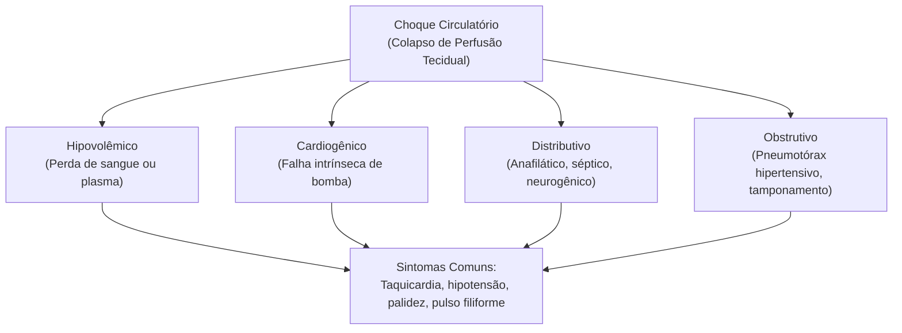

Os primeiros socorros englobam medidas imediatas e temporárias destinadas a preservar a vida de indivíduos acometidos por agravos súbitos ou traumas físicos até a chegada de equipes especializadas de resgate. Na atividade operacional do socorrista militar, a observância estrita dos protocolos técnicos de segurança de cena, triagem e suporte ventilatório estabelece a linha divisória entre a sobrevida da vítima e sequelas irreversíveis.

> [!objetivos]
> - Compreender a distinção conceitual e prática entre urgência e emergência médica.
> - Aplicar as diretrizes do plano de emergência e os critérios de segurança da cena.
> - Dominar a sequência cronológica das quatro fases do atendimento pré-hospitalar.
> - Executar a abordagem primária do trauma com o protocolo mnemônico XABCDE.
> - Avaliar sinais vitais e identificar alterações hemodinâmicas pelo método HIT.

## Aspectos Iniciais do Atendimento Pré-Hospitalar

O atendimento pré-hospitalar compreende a assistência prestada fora do hospital a vítimas de acidentes, traumas ou males clínicos repentinos. Essa intervenção visa estabilizar o quadro funcional básico. Ela busca reduzir o sofrimento físico. Além disso, garante o transporte seguro até uma unidade de saúde. O socorrista militar atua como o primeiro elo da corrente de sobrevivência. Sua atuação exerce papel decisivo logo nos instantes iniciais após a ocorrência.

No vocabulário operacional e nas provas de concurso público, a diferenciação conceitual entre emergência e urgência exige rigor apurado. A emergência médica envolve situações críticas com perigo iminente de morte. Trata-se de uma condição inadiável que demanda intervenção na mesma hora. A atuação imediata impede a perda funcional irreversível de órgãos vitais. São exemplos clássicos de emergência a parada cardiorrespiratória, a asfixia mecânica aguda, o choque hemorrágico grave e as hemorragias arteriais maciças. Nesses casos, o socorrista inicia os procedimentos sem qualquer espera.

Por sua vez, a urgência médica compreende quadros graves e dolorosos que exigem tratamento em curto prazo. Contudo, não há risco fatal imediato nos primeiros minutos de evolução. A vítima de urgência necessita de suporte qualificado. Todavia, suporta um período controlado de espera para estabilização ou transporte. Fraturas ósseas fechadas sem lesão vascular evidente, luxações articulares, cólicas agudas e ferimentos superficiais ilustram as urgências. Na urgência busca-se estabilizar a lesão e atenuar a dor. Na emergência combate-se diretamente o colapso vital iminente.

```mermaid Linha de classificação entre emergência e urgência no atendimento pré-hospitalar
flowchart TD
    A["Ocorrência Pré-Hospitalar"] --> B{"Risco Iminente de Morte?"}
    B -- "Sim: Intervenção Imediata" --> C["EMERGÊNCIA MÉDICA\n(Parada cardíaca, asfixia, hemorragia arterial maciça)"]
    B -- "Não: Estabilização sem risco fatal imediato" --> D["URGÊNCIA MÉDICA\n(Fraturas fechadas, luxações, dor aguda intensa)"]
    C --> E["Suporte Imediato à Vida"]
    D --> F["Imobilização e Transporte Monitorado"]
```

O atendimento pré-hospitalar moderno apoia-se nas diretrizes do Prehospital Trauma Life Support. O manual define o trauma como um evento nocivo decorrente da liberação de formas de energia física no corpo. Essa energia mecânica, térmica, química, elétrica ou radiante ultrapassa os limites fisiológicos dos tecidos. O dano celular também surge da interrupção do fluxo de elementos vitais, como oxigênio e glicose.

Nas colisões e quedas de nível, diferentes forças atuam sobre a anatomia humana. Ocorrem impactos diretos de compressão tecidual, desaceleração brusca e forças cortantes de cisalhamento. O cisalhamento rompe ligamentos internos e lacera grandes vasos sanguíneos profundos. O socorrista precisa antecipar lesões ocultas a partir da leitura cuidadosa do mecanismo do trauma.

> [!pegadinha]
> A banca examinadora costuma inverter os conceitos de urgência e emergência para confundir o candidato. Lembre-se: parada cardiorrespiratória e choque hemorrágico são emergências com risco inadiável de morte na hora. Por outro lado, fraturas ósseas fechadas e entorses são urgências médicas que admitem estabilização e transporte ordenado sem risco imediato de óbito.

## Plano de Emergência e Segurança da Cena

O plano de emergência consiste em um conjunto formal de procedimentos operacionais pré-estabelecidos. Ele serve para coordenar ações e otimizar recursos sob condições de estresse elevado. Essa padronização minimiza o improviso no terreno. O plano estabelece um roteiro passo a passo para a equipe de socorro. Planos desse tipo orientam corporações militares, brigadas de combate a incêndio, escolas e indústrias.

A preparação da equipe começa ainda durante o deslocamento da viatura de resgate. Com base nas informações da central, o comandante traça a rota ideal. Ele antecipa perigos prováveis e dimensiona o apoio complementar de policiamento ou concessionárias de energia. Essas atitudes preliminares reduzem o tempo de resposta e ampliam a eficácia do salvamento.

Ao atingir o local do sinistro, a primeira e absoluta prioridade de todos consiste na avaliação geral da cena. O socorrista militar nunca deve entrar em um ambiente inseguro. A proteção individual do socorrista e da sua equipe tem precedência hierárquica completa sobre o socorro às vítimas. Se houver perigo ativo, o socorrista deve resolver o problema de segurança antes de iniciar o atendimento de campo.

> [!atencao]
> Regra imperativa: o socorrista não deve entrar em cena insegura. Um socorrista ferido transforma-se em uma nova vítima. Isso sobrecarrega a guarnição, drena recursos escassos e paralisa o resgate dos acidentados. A neutralização de cabos elétricos caídos, vazamentos de gás e tráfego veloz é condição prévia indispensável.

A sinalização e o isolamento da área impedem novos acidentes. Em rodovias, viaturas devem ser posicionadas em diagonal para criar uma barreira física de proteção. Cones reflexivos devem ser distribuídos a distâncias seguras de frenagem dos demais motoristas. Em locais confinados ou industriais, a presença de produtos tóxicos exige o emprego de detectores de gás e trajes especiais.

Quando a ocorrência envolve múltiplas vítimas, a demanda de cuidados supera os recursos locais imediatos. Esse cenário configura um incidente com múltiplas vítimas. Nessa situação, o atendimento individualizado tradicional é temporariamente suspenso. A meta passa a ser atingir o melhor resultado para o maior número viável de sobreviventes. A triagem classifica as prioridades com base na gravidade das lesões e na chance real de sobrevida.

| Nível de Triagem | Categoria | Critério Clínico de Seleção | Conduta Prioritária |
|---|---|---|---|
| Prioridade 1 | Vermelha | Risco imediato à vida com alta probabilidade de sobrevida | Atendimento imediato e estabilização de vias aéreas e circulação |
| Prioridade 2 | Amarela | Lesões sistêmicas graves sem risco fatal iminente | Atendimento secundário e transporte monitorado em até duas horas |
| Prioridade 3 | Verde | Lesões leves e superficiais com marcha preservada | Triagem no local e encaminhamento ambulatorial postergado |
| Prioridade 4 | Cinza ou Preta | Óbito evidente ou lesões anatômicas incompatíveis com a vida | Manejo digno postergado sem alocação de recursos urgentes |

## As Quatro Fases do Atendimento Pré-Hospitalar

A conduta padronizada no atendimento de urgência estrutura-se didaticamente em quatro fases universais. O socorrista deve cumprir cada passo com disciplina para evitar omissões diagnósticas graves:

1. **Avaliação do Local e Segurança da Cena**: checar perigos circundantes, gerenciar riscos ambientais, isolar o perímetro e utilizar equipamentos de proteção individual.
2. **Manutenção da Vida e Suporte Imediato**: corrigir de imediato as ameaças fatais em curto prazo, estancando hemorragias maciças, liberando vias aéreas e garantindo a oxigenação.
3. **Checagem de Sinais Vitais e Histórico Sucinto**: aferir parâmetros vitais e perguntar à vítima consciente sobre eventos prévios, alergias e queixas principais.
4. **Avaliação Física Detalhada**: realizar o exame minucioso dos segmentos corporais da cabeça aos pés para identificar fraturas, contusões e ferimentos ocultos.

Na fase de manutenção da vida, os protocolos internacionais do PHTLS adotam a sequência mnemônica XABCDE. Essa abordagem prioriza o controle de hemorragias catastróficas antes mesmo do manejo das vias aéreas. A perda de volume sanguíneo arterial maciço provoca choque letal em poucos minutos, esgotando o oxigênio celular com rapidez extrema.

```mermaid Protocolo mnemônico XABCDE para estabilização de trauma pré-hospitalar
flowchart LR
    X["X\nHemorragia Exsanguinante"] --> A["A\nVias Aéreas e Coluna"]
    A --> B["B\nRespiração e Ventilação"]
    B --> C["C\nCirculação e Perfusão"]
    C --> D["D\nDisfunção Neurológica"]
    D --> E["E\nExposição e Hipotermia"]
```

Na etapa **X** (exsanguinação), o socorrista atua sobre sangramentos externos jorrantes em membros e junções. Ele aplica pressão direta forte com curativos compressivos ou utiliza torniquetes homologados. Nenhuma outra conduta avança enquanto o sangramento ativo não for contido.

Na etapa **A** (airway), inspeciona-se a cavidade oral para desobstrução de corpos estranhos, secreções e vômito. Simultaneamente, mantém-se o alinhamento neutro e a estabilização bimanual da coluna cervical. Manobras de flexão ou hiperextensão do pescoço são proibidas em vítimas de trauma.

Na etapa **B** (breathing), o socorrista avalia a expansibilidade torácica e a frequência dos movimentos respiratórios. Ele identifica lesões graves como pneumotórax aberto ou hipertensivo para restabelecer a ventilação pulmonar.

Na etapa **C** (circulation), monitora-se a perfusão sistêmica. Examina-se a qualidade dos pulsos periféricos e centrais, a temperatura cutânea e o tempo de enchimento capilar.

Na etapa **D** (disability), avalia-se o nível de consciência de forma rápida. O socorrista verifica a simetria pupilar e o reflexo fotomotor. Por fim, na etapa **E** (exposure), remove-se a roupa da vítima para inspecionar lesões adicionais, cobrindo o paciente logo em seguida para prevenir a hipotermia.

> [!bizu]
> O socorrista deve gravar a prioridade do passo X no atendimento moderno. O estancamento de sangramentos arteriais jorrantes antecede a via aérea porque o choque hemorrágico consome as reservas de oxigênio do cérebro com velocidade avassaladora.

## Avaliação Física pelo Método HIT e Exame Físico

Após conter as ameaças vitais e confirmar que o paciente respira espontaneamente, o socorrista inicia a avaliação detalhada. Esse exame visa diagnosticar fraturas, lesões musculares e ferimentos que requerem imobilização e curativos. O método mnemônico HIT orienta a exploração diagnóstica em campo:

- **Histórico (H)**: reunir relatos sobre o sinistro com a vítima e testemunhas. Perguntar o que ocorreu, que sintomas ela sente e se possui doenças preexistentes ou alergias a fármacos.
- **Inspeção (I)**: observar visualmente cada região anatômica. O socorrista procura deformidades, inchaço, escoriações, palidez e sangramentos contidos.
- **Toque (T)**: palpar suavemente as estruturas do corpo com as pontas dos dedos. A palpação deve começar longe da lesão e seguir gradativamente em direção ao ponto doloroso.

| Etapa HIT | Ação do Socorrista | Finalidade no Atendimento |
|---|---|---|
| H - Histórico | Perguntar dados à vítima e testemunhas | Compreender a dinâmica do acidente e sintomas prévios |
| I - Inspeção | Checar sinais visíveis na superfície corporal | Identificar deformidades, hematomas e assimetrias |
| T - Toque | Palpar suavemente com as pontas dos dedos | Avaliar dor pontual, crepitação óssea e temperatura |

Durante o toque, a polpa digital do socorrista avalia a presença de crepitação enfisematosa sob a pele e espasmos de defesa muscular. Na palpação de pulsos, o examinador deve usar os dedos indicador e médio. O polegar possui pulsação arterial própria que pode causar confusão clínica no diagnóstico.

> [!bizu]
> O método HIT deve ser aplicado apenas quando as funções vitais estiverem plenamente estabilizadas. O socorrista não perde tempo com histórico detalhado em vítimas com via aérea obstruída ou hemorragia arterial descontrolada.

## Sinais Vitais e Parâmetros Fisiológicos

Os sinais vitais refletem o estado funcional dos sistemas cardiovascular, respiratório e neurológico. Alterações nesses parâmetros revelam descompensações hemodinâmicas precoces. O socorrista deve registrar esses dados com exatidão para transmiti-los à equipe de suporte médico avançado.

A **temperatura corporal** retrata o equilíbrio térmico interno do organismo. Em adultos normais, os valores de referência oscilam entre 36,0 e 37,2 graus Celsius. A temperatura axilar superior a 37,8 graus caracteriza febre ou hipertermia. Valores inferiores a 35,0 graus definem hipotermia, distúrbio frequente em vítimas de trauma expostas ao vento e à chuva.

O **pulso arterial** corresponde à onda de expansão sentida nas artérias a cada sístole ventricular. Em adultos em repouso, a frequência cardíaca situa-se entre 60 e 100 batimentos por minuto, estado denominado normocardia. Frequências superiores a 100 batimentos por minuto caracterizam taquicardia, sinal precoce de dor, medo ou perda de sangue. Frequências abaixo de 60 batimentos por minuto configuram bradicardia, comum em atletas e em lesões do sistema nervoso central. Em crianças, a frequência de repouso é mais alta, variando de 80 a 120 batimentos.

| Parâmetro Vital | Padrão Normal em Adulto | Valor Abaixo do Normal | Valor Acima do Normal |
|---|---|---|---|
| Frequência Cardíaca | 60 a 100 batimentos por minuto | Bradicardia (menos de 60 bpm) | Taquicardia (mais de 100 bpm) |
| Frequência Respiratória | 12 a 20 incursões por minuto | Bradipneia (menos de 12 ipm) | Taquipneia (mais de 20 ipm) |
| Pressão Sistólica | 100 a 120 milímetros de mercúrio | Hipotensão (menos de 90 mmHg) | Hipertensão (mais de 140 mmHg) |
| Temperatura Axilar | 36,0 a 37,2 graus Celsius | Hipotermia (menos de 35,0 graus) | Hipertermia (mais de 37,8 graus) |

A **frequência respiratória** avalia o intercâmbio de gases nos pulmões. O padrão eupneico adulto oscila entre 12 e 20 incursões ventilatórias por minuto. A taquipneia sinaliza dor intensa, hipoxemia tecidual ou acidose metabólica. A bradipneia decorre de intoxicações exógenas ou traumatismo cranioencefálico com lesão de tronco encefálico. A dispneia consiste na dificuldade objetiva e subjetiva para respirar.

A **pressão arterial** mede a força exercida pelo sangue contra a parede interna dos vasos condutores. A pressão sistólica em repouso varia em torno de 120 milímetros de mercúrio. A pressão diastólica situa-se em torno de 80 milímetros. Pressão sistólica abaixo de 90 milímetros de mercúrio sinaliza colapso circulatório grave e choque descompensado.

O **exame pupilar** fornece dados sobre o tronco cerebral e a oxigenação cerebral. Pupilas de diâmetro idêntico denominam-se isocóricas. Quando ambas se apresentam contraídas, tem-se a miose. Quando ambas estão amplamente dilatadas, define-se a midríase. A anisocoria caracteriza-se por pupilas de tamanhos desiguais, indicando traumatismo craniano com compressão do terceiro par craniano.

> [!exemplo]
> Uma vítima de colisão frontal apresenta pulso radial rápido e fraco de 128 batimentos por minuto, frequência respiratória de 26 incursões, palidez cutânea e extremidades frias e pegajosas. Esse quadro traduz choque hipovolêmico compensado decorrente de hemorragia interna. A conduta requer aquecimento corporal, oferta de oxigênio e transporte imediato.


### Avaliação da Perfusão e Oximetria de Pulso

No ambiente pré-hospitalar, devemos checar a perfusão tecidual periférica de maneira contínua. O teste de enchimento capilar avalia a velocidade de retorno do sangue aos capilares após compressão do leito ungueal. O socorrista comprime a unha da vítima por alguns segundos até que ela fique pálida. Ao soltar a pressão, o leito ungueal deve retomar a sua coloração rosada normal em até dois segundos.

Quando o retorno capilar demora mais de dois segundos, isso indica má perfusão periférica. Essa lentidão traduz vasoconstrição intensa por choque ou hipotermia. Em ambientes externos sob temperatura fria, o teste pode apresentar falso atraso pelo frio local. Por essa razão, a análise da perfusão deve ser combinada com a aferição dos pulsos periféricos e a temperatura cutânea.

A oximetria de pulso mede a porcentagem de hemoglobina saturada de oxigênio no sangue arterial. Em condições normais ao nível do mar, a saturação de oxigênio situa-se entre 95 e 100 por cento. Valores abaixo de 94 por cento revelam hipoxemia leve a moderada. Níveis inferiores a 90 por cento configuram hipoxemia grave que exige oferta imediata de oxigênio medicinal sob máscara facial com reservatório.

A leitura do oxímetro de pulso pode sofrer interferências no atendimento de campo. Esmaltes escuros nas unhas, tremores musculares por frio e choque hipovolêmico reduzem a precisão da leitura digital. Na vigência de intoxicação por monóxido de carbono em incêndios, o aparelho comete leitura falsa de saturação normal. O gás liga-se à hemoglobina formando carboxiemoglobina, que engana o sensor óptico do equipamento.

### Escala de Resposta Neurológica AVDI

A avaliação do estado neurológico no exame primário apoia-se no método mnemônico simplificado AVDI. Essa escala permite mensurar o nível de vigília e orientação da vítima em poucos segundos:

- **Alerta (A)**: a vítima está acordada e com olhos abertos espontaneamente, respondendo de modo coerente ao socorrista.
- **Verbal (V)**: a vítima não está completamente alerta, mas responde quando o socorrista fala em tom audível.
- **Dor (D)**: a vítima não responde ao estímulo verbal, manifestando reação apenas ao estímulo doloroso periférico controlado.
- **Inconsciente (I)**: a vítima não demonstra nenhuma reação motora ou verbal a qualquer estímulo aplicado.

A identificação precoce do rebaixamento na escala AVDI alerta para sofrimento encefálico grave. A deterioração de alerta para resposta à dor sinaliza progressão de hematoma intracraniano ou hipóxia cerebral severa. Nesses quadros, a guarnição deve tomar atitudes imediatas de suporte ventilatório e agilizar a remoção. As bancas de concurso cobram essa correlação clínica com frequência em questões de atendimento pré-hospitalar militar.

## Situações Diversas: Fisiopatologia do Choque e Oxigenação Tecidual

O metabolismo das células corporais requer oxigenação contínua. Para compreender os agravos circulatórios e ventilatórios, o socorrista deve distinguir com precisão três conceitos fisiopatológicos correlatos:

- **Isquemia**: diminuição ou interrupção transitória do aporte de sangue arterial a um tecido ou órgão isolado, decorrente de obstrução mecânica ou espasmo vascular.
- **Hipoxemia**: baixa concentração de oxigênio molecular diluído no sangue arterial circulante, detectável na prática por oximetria de pulso inferior a 95 por cento.
- **Hipóxia**: ausência ou deficiência crítica de oxigênio nas células e tecidos para sustentar a respiração aeróbica, conduzindo à morte celular e acidose.

O choque circulatório traduz a incapacidade do sistema cardiovascular de manter a perfusão sanguínea tecidual adequada. As células deixam de receber oxigênio e glicose, acumulando ácido lático e toxinas metabólicas.

O **choque hipovolêmico** é a forma mais frequente no trauma físico. Ele decorre da perda expressiva de sangue em ferimentos vasculares ou de plasma em queimaduras extensas. O organismo reage com vasoconstrição periférica intensa para direcionar o fluxo de sangue aos órgãos nobres, como cérebro e coração.

O **choque cardiogênico** decorre da falha do músculo cardíaco como bomba hidráulica. Ele ocorre no infarto agudo do miocárdio e na contusão miocárdica traumática. O **choque distributivo** manifesta-se por vasodilatação generalizada e perda do tônus vascular periférico, como se observa nas crises anafiláticas e na sepse grave. O **choque obstrutivo** instala-se por impedimento mecânico ao fluxo de sangue, como no tamponamento cardíaco e no pneumotórax hipertensivo.



No suporte pré-hospitalar, a assistência ao choque envolve o controle imediato de perdas sanguíneas, a imobilização de fraturas em ossos longos e o aquecimento da vítima. Deve-se ofertar oxigênio suplementar e garantir transporte rápido com regulação médica contínua.

> [!bizu]
> No choque traumático, o socorrista combate a tríade letal: hipotermia, acidose e coagulopatia. A queda da temperatura corporal inibe a coagulação do sangue, agravando a hemorragia. Manter a vítima aquecida com mantas térmicas é uma medida de socorro essencial e de alto impacto na sobrevida.

## Mapa do capítulo

```mermaid Síntese estrutural do atendimento pré-hospitalar e sinais vitais
flowchart TD
    SC["Segurança da Cena\n(Prioridade absoluta do socorrista)"] --> TRI["Triagem de Vítimas\n(Máxima utilidade coletiva)"]
    TRI --> PROT["Protocolo XABCDE\n(Hemorragia maciça antes da via aérea)"]
    PROT --> HIT["Método HIT\n(Histórico, Inspeção e Toque)"]
    HIT --> SV["Monitoração de Sinais Vitais\n(FC, FR, PA, Temperatura e Pupilas)"]
    SV --> COMB["Combate ao Choque\n(Aquecimento e oxigenação tecidual)"]
```

### Para fixar

- Primeiros socorros são medidas imediatas e temporárias prestadas no local do evento até a chegada de socorro especializado.
- Emergência médica envolve perigo iminente de morte na hora; urgência médica compreende lesão sem risco fatal imediato.
- A segurança da cena é a prioridade inicial absoluta; o socorrista não entra em locais com perigos descontrolados.
- Em acidentes com múltiplas vítimas, a triagem busca o maior benefício terapêutico para o maior número viável de pessoas.
- O protocolo XABCDE prioriza o controle de hemorragias exsanguinantes externas no passo X antes do manejo da via aérea.
- O método HIT organiza a avaliação secundária em três etapas lógicas: histórico do fato, inspeção visual e toque tátil delicado.
- Na aferição do pulso arterial periférico, utilizam-se apenas os dedos indicador e médio, vedando-se o uso do polegar do socorrista.
- Pupilas anisocóricas apresentam diâmetros desiguais e sinalizam lesão expansiva no crânio ou hipertensão intracraniana grave.
