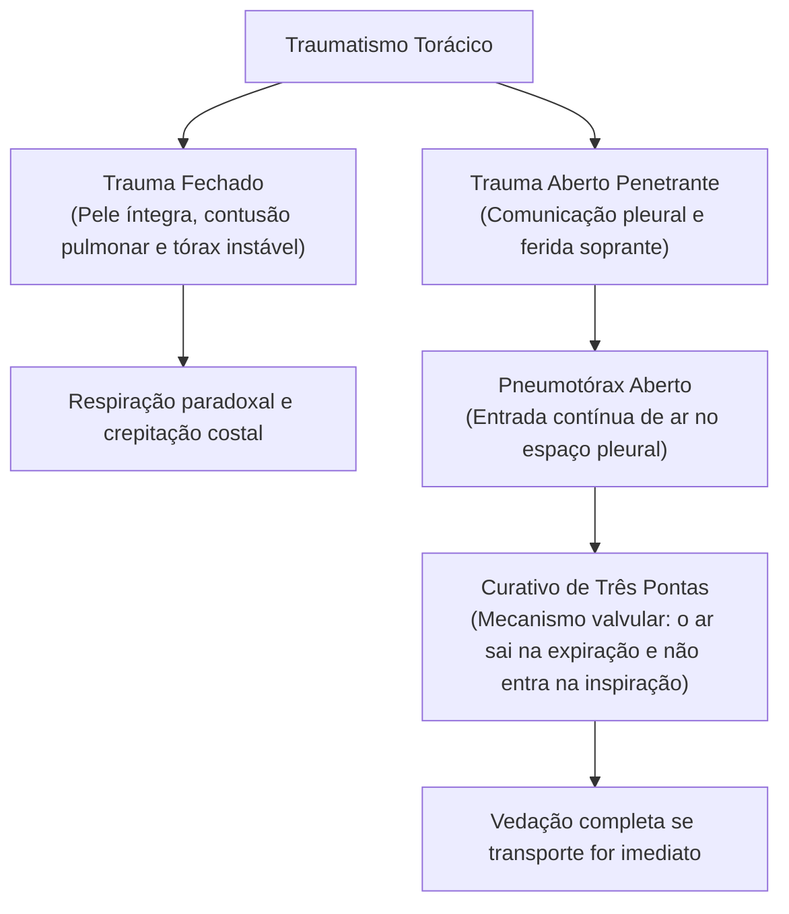

As lesões osteomusculares e os traumatismos no crânio e no tórax representam as ocorrências mais graves e frequentes enfrentadas pelas guarnições de resgate em colisões no trânsito, acidentes industriais e quedas de nível. O socorrista militar precisa dominar os critérios de imobilização provisória e a identificação imediata de sinais de falência neurológica ou respiratória para garantir a sobrevida do acidentado.

> [!objetivos]
> - Diferenciar entorses, estiramentos musculares, luxações e fraturas ósseas.
> - Aplicar as regras técnicas universais de imobilização provisória com talas.
> - Identificar sinais de gravidade clínica no traumatismo cranioencefálico.
> - Reconhecer os mecanismos do trauma torácico aberto e fechado.
> - Executar o curativo valvulado ou compressivo em ferimentos torácicos penetrantes.

## Entorses, Estiramentos, Luxações e Fraturas

No atendimento pré-hospitalar ao trauma do aparelho locomotor, a correta diferenciação anatômica das lesões orienta o tipo de imobilização a ser empregado no local do acidente:

- **Entorse**: lesão ligamentar traumática decorrente de movimento articular forçado que ultrapassa os limites anatômicos habituais. Ocorre estiramento ou ruptura dos ligamentos de suporte, sem perda permanente de contato entre as superfícies ósseas da articulação. O tornozelo e o joelho são as estruturas mais acometidas. O quadro cursa com dor aguda, edema local rápido e limitação funcional de movimento.
- **Estiramento**: lesão muscular ou miotendínea decorrente de esforço contrátil excessivo ou alongamento forçado além da elasticidade biológica das fibras. Manifesta-se por dor pontual intensa durante o movimento ativo, espasmo muscular reflexo e incapacidade de desenvolver força.
- **Luxação**: deslocamento ósseo traumático no qual ocorre perda completa e duradoura da congruência anatômica entre as superfícies que compõem uma articulação. A cápsula articular e os ligamentos rompem-se de modo severo. A articulação acometida apresenta deformidade visual grotesca, impotência funcional absoluta e dor lancinante.
- **Fratura**: descontinuidade estrutural completa ou incompleta de uma peça óssea, provocada por trauma mecânico direto ou indireto. Classifica-se didaticamente em **fratura fechada**, na qual a pele sobrejacente permanece íntegra, e **fratura aberta ou exposta**, na qual há ruptura cutânea com comunicação direta entre o foco fraturado e o meio externo.

| Tipo de Lesão | Estrutura Primária Acometida | Características Clínicas Típicas | Conduta Imediata no APH |
|---|---|---|---|
| Entorse | Ligamentos articulares | Dor aguda, inchaço rápido e instabilidade articular temporária | Crioterapia com gelo local, compressão elástica suave e repouso |
| Estiramento | Fibras musculares e tendões | Dor aos esforços ativos e espasmo muscular localizado | Repouso muscular, elevação do segmento e frio local nas primeiras horas |
| Luxação | Superfícies articulares ósseas | Deformidade visual evidente, bloqueio motor e dor extrema | Imobilização rigorosa na posição encontrada sem tentar reduzir |
| Fratura | Estrutura cortical e medular óssea | Crepitação à palpação, edema, impotência funcional e deformidade | Alinhamento cuidadoso se fechada, tala acolchoada e transporte |

Na abordagem de campo das lesões osteomusculares, a conduta primária fundamenta-se na imobilização rígida e no controle sintomático com frio local nas fases agudas. A aplicação de bolsas de gelo envoltas em pano limpo induz vasoconstrição reflexa, ameniza a formação de hematomas e alivia a dor por redução da condução nervosa periférica. O calor é contraindicado nas primeiras quarenta e oito horas, pois provoca vasodilatação que piora o edema e a hemorragia tecidual.

> [!pegadinha]
> O socorrista nunca deve tentar recolocar uma articulação luxada no lugar no ambiente pré-hospitalar. A manobra de redução articular exige anestesia, relaxamento muscular adequado e controle radiológico hospitalar. A tentativa de forçar a redução no campo pode lacerar vasos sanguíneos profundos e nervos motores periféricos, provocando isquemia e paralisia permanente do membro. A conduta correta é imobilizar a articulação exatamente na posição em que ela se encontra.

### Princípios Universais de Imobilização de Fraturas

A imobilização do foco de fratura impede o deslocamento de pontas ósseas afiadas contra artérias, veias e feixes nervosos adjacentes. Além disso, reduz a dor e previne o choque neurogênico secundário ao sofrimento físico extremo.

As regras fundamentais do PHTLS devem ser observadas com absoluto rigor técnico pelo socorrista militar:

- **Imobilizar as articulações proximal e distal**: ao imobilizar a fratura de um osso longo, a tala deve obrigatoriamente abranger a articulação localizada acima e a articulação situada abaixo do segmento lesado. Em fraturas de perna, imobilizam-se o joelho e o tornozelo; em fraturas de antebraço, imobilizam-se o cotovelo e o punho.
- **Acolchoamento das talas**: talas rígidas de madeira, alumínio moldável ou papelão devem ser revestidas internamente com mantas, espumas ou compressas para evitar pontos de necrose por pressão sobre proeminências ósseas anatômicas.
- **Amarração estratégica das bandagens**: os tirantes e ataduras devem ser amarrados acima e abaixo da linha do foco fraturado, nunca diretamente sobre a região da fratura. O aperto deve ser firme o suficiente para evitar mobilidade, mas suave para não interromper o fluxo sanguíneo arterial periférico.
- **Retirada profilática de adornos**: anéis, relógios e pulseiras devem ser removidos imediatamente antes da imobilização. O edema reacional progressivo estrangula os dedos do paciente nas horas subsequentes se esses objetos forem mantidos no membro lesado.

> [!atencao]
> Princípio obrigatório nas fraturas expostas: nunca tente empurrar o fragmento ósseo projetado para dentro dos tecidos moles. O osso exposto encontra-se contaminado por partículas de terra e bactérias ambientais. Ao empurrá-lo, o socorrista introduz microrganismos patogênicos no canal medular, causando osteomielite grave. O fragmento deve ser protegido e recoberto com gaze estéril umedecida com soro fisiológico antes da colocação das talas.

Antes e após a fixação de qualquer tala de imobilização, o socorrista deve obrigatoriamente checar três parâmetros periféricos na extremidade do membro lesado: o pulso arterial distal, o tempo de enchimento capilar e a sensibilidade neurológica com resposta motora ativa. A perda súbita do pulso distal após a amarração das faixas indica que a tala foi fixada de forma demasiadamente apertada, comprimindo vasos axiais ou desencadeando síndrome compartimental aguda.

```mermaid Sequência técnica para imobilização de fraturas em ambiente pré-hospitalar
flowchart TD
    FRAT["Suspeita de Fratura Óssea"] --> EXP{"O Osso está Exposto?"}
    EXP -- "Sim: Fratura Exposta" --> CUR["Cobrir osso com gaze estéril umedecida\n(NUNCA empurrar para dentro)"]
    EXP -- "Não: Fratura Fechada" --> ALIN["Manter alinhamento anatômico suave\n(Interromper se houver resistência mecânica)"]
    CUR --> TALA["Aplicar tala acolchoada abrangendo\narticulação proximal e articulação distal"]
    ALIN --> TALA
    TALA --> CHEC["Checar pulso distal, perfusão e sensibilidade\n(Antes e após a fixação das bandagens)"]
```

## Traumatismo Cranioencefálico (TCE)

O traumatismo cranioencefálico constitui a principal causa isolada de óbito e invalidez permanente em ocorrências de acidentes veiculares e atropelamentos. As estatísticas epidemiológicas demonstram que o dano encefálico traumático contribui direta ou indiretamente para cerca de cinquenta por cento de todas as mortes ocorridas na fase pré-hospitalar.

No atendimento de resgate, todo paciente vítima de trauma cranioencefálico com mecanismo de alta energia cinética é considerado como portador potencial de lesão associada na coluna cervical até prova em contrário. O socorrista deve executar o controle bimanual imediato do alinhamento cervical neutro, impedindo flexões e rotações cervicais antes da instalação do colar cervical e estabilizadores laterais de cabeça.

### Fisiopatologia das Lesões Cranianas

As alterações cerebrais decorrentes do trauma classificam-se quanto à sua gênese mecânica:

- **Lesões Diretas (Primárias)**: ocorrem no momento exato do impacto físico mecânico, resultando em fraturas de calota craniana, lacerações de tecido nervoso encefálico e contusões vasculares imediatas.
- **Lesões Indiretas (Secundárias)**: desenvolvem-se ao longo de minutos e horas após o impacto, englobando edema cerebral difuso, hemorragias intracranianas progressivas, hipóxia cerebral e isquemia celular decorrente do aumento descontrolado da pressão intracraniana.

As fraturas de crânio dividem-se em fraturas da abóbada craniana e fraturas da base do crânio. As fraturas lineares da calota são comumente assintomáticas por si sós, mas sinalizam impacto de alta energia. As fraturas com afundamento craniano provocam compressão mecânica direta do córtex cerebral ou penetração de espículas ósseas no parênquima encefálico.

As fraturas de base de crânio acometem ossos profundos da estrutura craniana e manifestam sinais clínicos tardios altamente sugestivos:

- **Equimose Periorbitária (Sinal do Guaxinim)**: manchas violáceas ao redor de ambas as órbitas oculares decorrentes do extravasamento de sangue na fossa anterior da base do crânio.
- **Equimose Retroauricular (Sinal de Battle)**: manchas arroxeadas sobre a região da apófise mastoide, atrás do pavilhão auditivo, indicando fratura da fossa média.
- **Fístula Liquórica**: saída de líquor cefalorraquidiano claro e translúcido ou sanguinolento pelo nariz (rinorreia liquórica) ou pelos ouvidos (otorreia liquórica).

```mermaid Mecanismos e diferenciação clínica no traumatismo cranioencefálico
flowchart TD
    TCE["Traumatismo Cranioencefálico"] --> CONC["Concussão Cerebral\n(Disfunção funcional sem lesão macroscópica visível)"]
    TCE --> CONT["Contusão Cerebral\n(Laceração tecidual e hemorragia focal no córtex)"]
    CONC --> SCONC["Perda breve de consciência, amnésia retrógrada e cefaleia"]
    CONT --> SCONT["Déficits motores focais, anisocoria e convulsões"]
    TCE --> FBASE["Fratura de Base de Crânio"]
    FBASE --> SFBASE["Sinal do Guaxinim, Sinal de Battle e Otorreia/Rinorreia"]
```

Na **concussão cerebral**, ocorre uma perturbação funcional transitória da atividade neural sem sangramentos macroscópicos detectáveis. O indivíduo perde a consciência por períodos breves, recuperando a vigília acompanhado de cefaleia, tonturas, náuseas e amnésia de eventos passados. Na **contusão cerebral**, verifica-se sangramento focal do tecido encefálico por choque da massa cinzenta contra as cristas ósseas internas da caixa craniana, podendo desencadear sonolência progressiva, convulsões e assimetria pupilar.

A **anisocoria pupilar**, caracterizada pela desigualdade no diâmetro das pupilas, representa sinal de alarme crítico no paciente com TCE. Ela indica que um hematoma intracraniano em expansão está empurrando o lobo temporal contra a fenda da tenda do cerebelo, comprimindo as fibras parassimpáticas do terceiro par craniano. Essa compressão paralisa a constrição pupilar do lado afetado, produzindo midríase unilateral paralítica.

Em estágios de herniação cerebral terminal e compressão do tronco encefálico, o paciente inconsciente assume posturas patológicas características aos estímulos nociceptivos. A **postura de decorticação** caracteriza-se por flexão patológica dos braços contra o tórax com punhos fechados e extensão rígida das pernas, sinalizando lesão hemisférica profunda. A **postura de descerebração** manifesta-se por extensão forçada dos membros superiores com adução e pronação interna das mãos, traduzindo sofrimento grave do mesencéfalo e ponte.

> [!bizu]
> Nunca tente conter ou taponar a saída de sangue ou líquor pelo nariz ou ouvido da vítima de trauma craniano. O líquor escoa porque a pressão dentro do crânio está elevada. Se o socorrista bloquear o orifício com gazes ou algodão, o sangue e o líquor acumulam-se no espaço intracraniano, disparando a pressão interna e facilitando a ascensão de bactérias do ambiente para as meninges. Aplique apenas uma compressa estéril frouxa para absorver o excedente externamente.

### Condutas Mandatórias no Atendimento ao TCE

O socorrista militar deve priorizar a oxigenação celular cerebral contínua e a manutenção de níveis pressóricos adequados. Episódios únicos de hipotensão sistólica abaixo de 90 milímetros de mercúrio ou hipoxemia com saturação de oxigênio inferior a noventa por cento duplicam a taxa de mortalidade no traumatismo cranioencefálico grave.

As regras de conduta pré-hospitalar compreendem:

1. Garantir via aérea permeável e oferta de oxigênio a cem por cento sob máscara de alta concentração.
2. Manter a cabeça e o tronco alinhados em posição neutra a zero grau na prancha rígida.
3. Não retirar objetos perfurantes encravados na caixa craniana; deve-se apenas estabilizar o objeto com ataduras e compressas laterais volumosas.
4. Jamais fornecer líquidos ou alimentos pela via oral, haja vista o risco elevado de vômitos incoercíveis e broncoaspiração química pulmonar.
5. Vigiar ativamente crises convulsivas e prevenir aspiração de secreções por rolamento em bloco sincronizado da vítima.

## Traumatismo Torácico

O tórax abriga estruturas vasculares de alto calibre e órgãos vitais para a respiração e a circulação sistêmica. Lesões torácicas graves conduzem a colapso de oxigenação tecidual e parada cardiorrespiratória em poucos instantes se não forem diagnosticadas e tratadas de pronto pelas equipes de resgate.

Classificam-se as lesões torácicas em duas modalidades fundamentais:

- **Traumatismo Torácico Fechado**: a integridade cutânea da parede do tórax permanece preservada, mas a energia mecânica de impacto causa fraturas múltiplas de arcos costais, contusão pulmonar ou contusão cardíaca. Quando dois ou mais arcos costais adjacentes se quebram em dois pontos distintos de sua extensão, instala-se o **tórax instável**. Esse segmento fraturado perde a continuidade rígida com o gradeado costal, manifestando o fenômeno da **respiração paradoxal**: o fragmento retrai na inspiração e expande-se na expiração, desorganizando as pressões intratorácicas.
- **Traumatismo Torácico Aberto**: ocorre solução de continuidade na parede torácica com perfuração da pleura parietal, provocada por disparos de arma de fogo, armas brancas ou estilhaços industriais.



No traumatismo torácico aberto com ferimento penetrante de grande diâmetro, a resistência mecânica ao fluxo de ar através da ferida torna-se menor do que a resistência através das vias aéreas naturais da traqueia. A cada movimento inspiratório do diafragma, o ar atmosférico ingressa preferencialmente pela abertura parietal para dentro do espaço pleural, gerando o **pneumotórax aberto** com ruído sibilante e espumoso característico (ferida soprante torácica).

O acúmulo progressivo de ar atmosférico no espaço intrapleural colapsa o parênquima pulmonar do lado lesado. Se o ar continuar aprisionado sob pressão crescente, os vasos cavas e o mediastino são empurrados para o lado oposto, caracterizando o **pneumotórax hipertensivo**, complicação letal que bloqueia o retorno venoso de sangue ao coração e desencadeia choque obstrutivo fulminante.

### Manejo Pré-Hospitalar do Trauma Torácico

A abordagem de campo de vítimas com ferimentos torácicos abertos requer ações mecânicas rápidas e decisivas:

- **Curativo de Três Pontas (Válvula Unidirecional)**: consiste na colocação de um plástico estéril impermeável sobre o orifício da lesão, fixando-o com fita adesiva larga em apenas três dos seus quatro lados. Essa disposição atua como válvula de alívio: durante a expiração da vítima, o ar acumulado no espaço pleural empurra o plástico e escapa pelo lado aberto; durante a inspiração, a pressão negativa puxa o plástico contra a pele, selando o orifício e impedindo a entrada de ar externo.
- **Curativo Oclusivo Completo**: quando preconizado em manuais operacionais militares para transporte urgente assistido, veda-se integralmente a abertura com compressas estéreis fixadas firmemente com bandagens circulares no tórax, monitorando-se de forma ininterrupta os sinais de desconforto respiratório para descompressão se surgir tensão pleural.
- **Posicionamento da Vítima**: caso não haja suspeita de trauma associado na coluna vertebral e o paciente encontre-se deitado, a posição lateral de segurança sobre o **lado lesado** pode ser empregada para deixar o hemitórax saudável superior livre para expandir-se sem restrições mecânicas contra o solo.

> [!exemplo]
> Durante a assistência a um trabalhador acidentado com perfuração metálica torácica à direita, o socorrista observa saída de bolhas sanguinolentas e som de sucção de ar a cada inspiração. O socorrista aplica imediatamente uma compressa plástica fixada em três bordas. Durante o transporte, o paciente passa a apresentar turgência patológica de veias jugulares, cianose labial acentuada e hipotensão grave. O socorrista diagnostica que o curativo colabou e funcionou como válvula oclusiva. Ele remove temporariamente o curativo, permitindo o alívio imediato do ar hipertensivo sob pressão antes de recolocá-lo.

## Considerações Finais sobre Imobilização e Remoção

A fase final do atendimento pré-hospitalar consiste na preparação cuidadosa para o transporte terrestre ou aéreo. O manuseio de vítimas politraumatizadas exige técnicas sincronizadas de rolamento em bloco a noventa graus para inserção da prancha longa rígida, garantindo que o eixo formado pela cabeça, pescoço e coluna toracolombar permaneça imóvel durante todo o procedimento.

Após a colocação na prancha rígida e o posicionamento do colar cervical homologado e coxins laterais, o paciente deve ser afixado firmemente por meio de tirantes cruzados em aranha no tórax, pelve e membros inferiores. A fixação correta impede deslizamentos e lesões secundárias durante curvas acentuadas ou frenagens da viatura de resgate.

Em gestantes no terceiro trimestre gestacional acometidas por traumas severos, o peso do útero gravídico sobre a veia cava inferior reduz drasticamente o débito cardíaco quando a paciente permanece deitada em decúbito dorsal plano. Nesses casos, o socorrista deve lateralizar a prancha longa rígida em cerca de quinze graus para o lado esquerdo com apoio de cunhas ou deslocar manualmente o útero para o flanco esquerdo para aliviar a compressão vascular e assegurar a perfusão materno-fetal.

> [!bizu]
> Suspeitas de fratura de bacia e pelve em vítimas de colisões graves exigem imobilização circunferencial imediata com lençol largo ou cinta pélvica comercial ao nível dos grandes trocânteres do fêmur. A pelve pode comportar até três litros de sangue em sangramentos retroperitoneais ocultos. A compressão circunferencial estabiliza os ossos ilíacos, coíbe a expansão da cavidade pélvica e reduz o sangramento venoso por tamponamento tecidual direto.

## Mapa do capítulo

```mermaid Síntese estrutural do manejo de lesões osteomusculares, TCE e trauma torácico
flowchart TD
    LO["Lesões Osteomusculares\n(Entorses, luxações e fraturas)"] --> IMOB["Imobilização Provisória\n(Articulação acima e abaixo da fratura)"]
    LO --> EXP["Fratura Exposta\n(Cobrir osso e nunca empurrar para dentro)"]
    TCE["Traumatismo Cranioencefálico\n(Concussão, contusão e hematomas)"] --> SINAIS["Sinais Críticos:\nAnisocoria, fístula liquórica e postura patológica"]
    TCE --> COND["Conduta no TCE:\nControle cervical, oxigenação e não tamponar líquor"]
    TT["Traumatismo Torácico\n(Pneumotórax aberto e respiração paradoxal)"] --> CUR["Selamento com curativo de três pontas\ne transporte rápido"]
```

### Para fixar

- A entorse compromete ligamentos articulares sem perda permanente de contato; a luxação desloca o osso com perda total da congruência articular.
- Em luxações de campo, é expressamente proibido tentar recolocar o osso no lugar; a articulação deve ser imobilizada na posição exata em que se encontra.
- Na imobilização de fratura em osso longo, a tala acolchoada deve abranger obrigatoriamente a articulação proximal e a articulação distal do membro.
- Em fraturas expostas, nunca se deve empurrar o fragmento ósseo para o interior dos tecidos; deve-se cobrir a lesão com gaze estéril umedecida.
- O traumatismo cranioencefálico exige controle estrito da coluna cervical e manutenção da cabeça e tronco alinhados em posição neutra.
- Sinais de fratura de base de crânio incluem equimose periorbitária (guaxinim), equimose retroauricular (Battle) e fístula liquórica por nariz ou ouvido.
- É contraindicado conter ou estancar a saída de líquor cefalorraquidiano pelo nariz ou ouvido da vítima de trauma no crânio.
- No ferimento penetrante do tórax com pneumotórax aberto, emprega-se o curativo de três pontas que atua como válvula de escape unidirecional.
