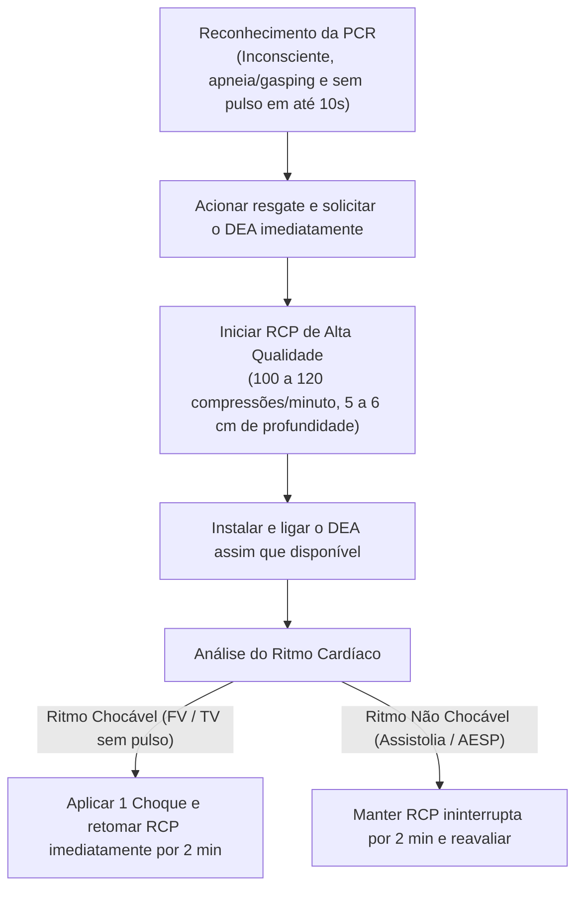

O domínio das técnicas de estancamento hemorrágico, desobstrução mecânica das vias respiratórias e ressuscitação cardiopulmonar constitui o cerne das atribuições operacionais do socorrista militar. A perda descontrolada de sangue e a parada anóxica cerebral causam danos biológicos irreversíveis em poucos minutos. Essa condição exige condutas ágeis e respaldadas nas melhores evidências científicas.

> [!objetivos]
> - Reconhecer os sinais clínicos e as características das hemorragias capilar, venosa e arterial.
> - Compreender a classificação volêmica das hemorragias em quatro classes pelo ATLS.
> - Aplicar as técnicas de hemostasia por pressão direta, curativos compressivos e torniquetes.
> - Executar a desobstrução de vias aéreas superiores pela manobra de Heimlich.
> - Conduzir o suporte básico de vida na parada cardiorrespiratória com uso precoce do DEA.

## Primeiros Socorros e Sangramentos Comuns

Os sangramentos externos decorrem do rompimento mecânico da barreira cutânea e das paredes vasculares subjacentes. Em pequenos cortes e escoriações, o risco de colapso sistêmico é baixo. Contudo, a exposição dos tecidos favorece infecções bacterianas secundárias:

- **Abrasões e Ralados**: ferimentos superficiais que acometem a epiderme e a porção papilar da derme, com múltiplos pontos de sangramento capilar miúdo. A conduta requer lavagem abundante com água corrente limpa e sabão neutro para remoção de sujidades mecânicas, seguida de cobertura com gaze estéril seca.
- **Cortes Lineares**: ferimentos produzidos por lâminas, vidros ou metais que seccionam camadas teciduais com bordas regulares. O socorrista deve conter o sangramento com pressão firme e contínua de gaze. Em seguida, encaminha a vítima para avaliação de sutura cirúrgica.
- **Corpos Estranhos Superficiais**: pequenas partículas de poeira ou vidro soltas na superfície do ferimento podem ser removidas com irrigação suave de soro fisiológico ou pinças estéreis. Corpos estranhos perfurantes encravados profundamente no corpo jamais devem ser removidos no ambiente pré-hospitalar, sob pena de descolar trombos e acelerar hemorragias fatais.

| Tipo de Ferimento Superficial | Característica Mecânica | Conduta de Higiene no APH | Conduta de Hemostasia |
|---|---|---|---|
| Abrasão (escoriação) | Desprendimento da epiderme por fricção áspera | Lavagem cuidadosa com água e sabão neutro | Compressão suave e curativo protetor seco |
| Corte (incisão) | Solução de continuidade com bordas nítidas | Limpeza com soro fisiológico estéril | Pressão direta contínua com compressa de gaze |
| Laceração | Bordas denteadas por tração e rasgamento | Irrigação abundante de resíduos soltos | Curativo compressivo moderado e encaminhamento |

Na execução da compressão direta para estancamento de sangramentos externos, a primeira camada de gaze posicionada em contato com a ferida não deve ser retirada quando estiver encharcada de sangue. A retirada da gaze desprende a rede de fibrina recém-formada. Essa ação destrói o coágulo inicial e reinicia a perda de sangue.

> [!bizu]
> Caso a gaze fique encharcada de sangue, não a retire. O socorrista deve acrescentar novas compressas secas por cima das anteriores. Isso mantém a força mecânica sem romper o coágulo fisiológico.


No atendimento inicial, a atitude correta é lavar a região afetada com água corrente. Em ferimentos na cavidade oral ou lábios, a vítima deve ser avaliada por médico ou dentista para reconstrução dos tecidos. Se não houver gaze estéril, pode ser usado um pano limpo para pressionar o local do sangramento. Em termos de volume corporal, um adulto possui cerca de cinco litros de sangue. A perda de mais de um litro e meio gera colapso grave. O socorro adequado deve ser feito sem demora para salvar vidas.

## Classificação das Hemorragias Externas

As hemorragias externas subdividem-se anatomicamente segundo o tipo de vaso sanguíneo rompido pela energia mecânica do trauma. A identificação do padrão vascular do sangramento define a prioridade e a agressividade da conduta de hemostasia:

- **Hemorragia Capilar**: lesão de capilares microscópicos da derme superficial. O sangue apresenta coloração mista intermediária e extravasa lentamente em lençol sobre a superfície lesada. Tende a cessar espontaneamente em poucos minutos pela ativação natural da hemostasia primária.
- **Hemorragia Venosa**: ruptura de veias que conduzem sangue desoxigenado de volta ao coração. O sangue venoso apresenta coloração vermelho-escura. Ele é rico em dióxido de carbono. O fluxo é contínuo e uniforme, sem jatos pulsáteis. Ele corre sob baixa pressão hidrostática. Quase sempre cessa com pressão direta firme.
- **Hemorragia Arterial**: laceração de vasos arteriais sistêmicos que transportam sangue oxigenado sob alta pressão ejetada pelo ventrículo esquerdo. O sangue arterial possui tom vermelho-vivo e brilhante. Ele jorra em pulsos vigorosos sincronizados com o coração. Essa lesão representa emergência gravíssima com risco imediato de morte.

```mermaid Comparação dos padrões vasculares de hemorragia e condutas no APH
flowchart TD
    HEM["Hemorragia Externa"] --> CAP["Capilar\n(Sangue em lençol, escorrimento lento)"]
    HEM --> VEN["Venosa\n(Sangue escuro, fluxo contínuo e uniforme)"]
    HEM --> ART["Arterial\n(Sangue vermelho vivo em jatos pulsáteis)"]
    CAP --> CURSIMP["Compressão leve e curativo simples"]
    VEN --> PRESD["Pressão direta e curativo compressivo"]
    ART --> TORNIQ["Pressão direta imediata e TORNIQUETE precoce\n(Se em extremidade com risco à vida)"]
```

Antigamente, recomendava-se elevar o membro e comprimir pontos arteriais indiretos. Hoje, as diretrizes do PHTLS baniram essas práticas. Elas não possuem comprovação científica no controle de sangramentos graves.

O **torniquete tático de extremidade**, antes classificado de modo equivocado como último recurso excepcional, consolidou-se como equipamento indispensável e de primeira escolha no atendimento pré-hospitalar ao trauma militar. O dispositivo deve ser instalado de pronto sempre que a pressão manual direta falhar ou em amputações traumáticas e ferimentos arteriais maciços em braços ou pernas.

> [!atencao]
> O torniquete deve ser colocado cerca de cinco a sete centímetros acima da lesão. Nunca o aplique sobre articulações como cotovelo ou joelho. Gire a barra de torção até que o sangramento cesse por completo. Em seguida, anote o horário exato da aplicação na fita do aparelho.

## Classes de Hemorragia Sistêmica segundo o ATLS

O Advanced Trauma Life Support classifica a hemorragia sistêmica em quatro classes clínicas progressivas, correlacionando o volume de sangue perdido com as manifestações hemodinâmicas apresentadas pelo paciente adulto padrão de setenta quilos:

- **Classe I**: perda sanguínea de até 750 mililitros de sangue, correspondendo a menos de quinze por cento da volemia corporal total. O indivíduo permanece hemodinamicamente estável, mantendo a frequência cardíaca abaixo de cem batimentos por minuto e pressão arterial sistólica rigorosamente normal.
- **Classe II (Hemorragia Moderada)**: perda de 750 a 1500 mililitros, equivalente a quinze a trinta por cento do volume sanguíneo. Ocorre taquicardia compensatória reflexa entre 100 e 120 batimentos por minuto e taquipneia discreta, embora a pressão arterial sistólica permaneça normal ou discretamente compensada pela intensa vasoconstrição periférica.
- **Classe III (Hemorragia Severa)**: perda de 1500 a 2000 mililitros, alcançando trinta a quarenta por cento da volemia total. Instala-se hipotensão arterial evidente com queda da pressão sistólica abaixo de noventa milímetros de mercúrio, taquicardia pronunciada acima de cento e vinte batimentos por minuto, sudorese fria, confusão mental e redução acentuada da diurese.
- **Classe IV (Hemorragia Gravíssima)**: perda superior a dois mil mililitros de sangue, superando quarenta por cento do volume circulatório. O paciente encontra-se em choque hipovolêmico profundo descompensado, com pulso periférico quase impalpável, letargia profunda ou coma, pele acinzentada fria e parada cardiorrespiratória iminente.

| Classe ATLS | Perda Sanguínea (mL) | % do Volume Corporal | Frequência Cardíaca (bpm) | Nível de Pressão Arterial |
|---|---|---|---|---|
| Classe I | Menos de 750 mL | Menos de 15% | Normal (menos de 100) | Normal |
| Classe II | 750 a 1.500 mL | 15% a 30% | Taquicardia (100 a 120) | Mantida ou normal |
| Classe III | 1.500 a 2.000 mL | 30% a 40% | Taquicardia severa (mais de 120) | Hipotensão evidente |
| Classe IV | Mais de 2.000 mL | Mais de 40% | Extrema (mais de 140) ou filiforme | Hipotensão profunda crítica |

> [!pegadinha]
> Fique atento às armadilhas de prova da banca examinadora: as questões frequentemente misturam os valores limites de volume em mililitros e porcentagens da volemia, ou tentam afirmar que a pressão arterial cai logo na Classe I. A hipotensão arterial sistólica só surge como sinal clínico mensurável a partir da Classe III de hemorragia, quando os mecanismos corporais de compensação adrenérgica entram em colapso.

## Desobstrução das Vias Aéreas Superiores e Manobra de Heimlich

A asfixia mecânica aguda por obstrução de vias aéreas por corpo estranho representa causa súbita de morte evitável. No ambiente de refeições ou de acidentes, pedaços de alimentos, próteses dentárias ou vômitos podem bloquear a passagem de ar na altura da laringe:

- **Obstrução Parcial ou Leve**: o paciente consegue tossir com energia, falar com voz rouca e movimentar ar nos pulmões, apesar do ruído estridente. O socorrista deve apenas acalmar a vítima e estimular a tosse vigorosa autônoma, sem intervir com golpes mecânicos nas costas ou compressões abdominais que possam deslocar o objeto para uma posição mais oclusiva.
- **Obstrução Total ou Grave**: a vítima não consegue tossir, não emite nenhum som vocal e manifesta o sinal universal de engasgo, levando desesperadamente ambas as mãos à garganta. Em poucos segundos, surge cianose labial progressiva. Sem intervenção imediata, a vítima desmaia e evolui para parada cardíaca hipóxica.

A **manobra de Heimlich** consiste na aplicação de compressões subdiafragmáticas rápidas para forçar a elevação do diafragma, comprimindo o ar residual contido nos pulmões para expelir o corpo estranho como uma rolha:

1. O socorrista posiciona-se em pé atrás da vítima adulta consciente, passando os braços ao redor do abdome do indivíduo.
2. Fecha uma das mãos em punho, posicionando a face plana do polegar entre a cicatriz umbilical e a extremidade inferior do osso esterno (apêndice xifoide).
3. Envolve o punho fechado com a outra mão e aplica compressões vigorosas com vetor direcionado para dentro e para cima (movimento em formato da letra J).
4. Repete os ciclos de cinco compressões sucessivas até a expulsão completa do objeto ou até que o paciente perca a consciência.

> [!exemplo]
> Em uma confraternização, um militar engasga-se com alimento sólido, fica mudo e leva as mãos ao pescoço com olhos arregalados. O socorrista militar posiciona-se atrás dele e executa compressões subdiafragmáticas firmes para dentro e para cima. Na quarta compressão, o alimento é projetado para fora da boca e a respiração espontânea restabelece-se de imediato. Caso o militar tivesse desfalecido e caído no solo, o socorrista deveria posicioná-lo em decúbito dorsal plano e iniciar de pronto o ciclo de massagem cardíaca da RCP.

## Parada Cardiorrespiratória (PCR) e Ressuscitação Cardiopulmonar (RCP)

A parada cardiorrespiratória define-se pela cessação súbita e inesperada da atividade mecânica do coração e da ventilação espontânea. Trata-se da emergência médica máxima no atendimento pré-hospitalar:

O reconhecimento rápido da parada cardiorrespiratória apoia-se em três pilares fundamentais checados simultaneamente em no máximo dez segundos:

1. Ausência de resposta ao estímulo tátil firme nos ombros e verbal em tom alto.
2. Ausência de respiração espontânea ou presença de respiração agônica ineficaz (gasping).
3. Ausência de pulso central palpável na artéria carótida em adultos (ou artéria braquial em lactentes).

Constatada a PCR, o socorrista deve imediatamente chamar socorro especializado, solicitar o Desfibrilador Externo Automático (DEA) e iniciar de imediato as compressões torácicas no centro do peito.



Os parâmetros técnicos indispensáveis da RCP de alta qualidade segundo a American Heart Association abrangem:

- **Frequência de Compressão**: 100 a 120 compressões por minuto.
- **Profundidade**: 5 a 6 centímetros de depressão esternal em adultos. Isso permite o retorno elástico completo do gradeado torácico após cada compressão sem retirar as mãos do peito.
- **Posicionamento**: mãos sobrepostas e dedos entrelaçados na metade inferior do osso esterno, com cotovelos estendidos e tronco do socorrista alinhado verticalmente sobre a vítima.
- **Relação Compressão-Ventilação**: relação padrão de 30 compressões para 2 ventilações de resgate com bolsa-válvula-máscara em adultos. Se o socorrista leigo não possuir dispositivo de barreira ou treinamento, deve realizar apenas compressões torácicas contínuas.

O Desfibrilador Externo Automático (DEA) deve ser ligado e acoplado ao tórax da vítima assim que estiver disponível na cena. Os ritmos que exigem choque elétrico imediato são a **Fibrilação Ventricular (FV)** e a **Taquicardia Ventricular sem pulso (TV)**. Os ritmos que não respondem ao choque são a **Assistolia** e a **Atividade Elétrica Sem Pulso (AESP)**, nos quais a sobrevida depende exclusivamente de compressões mecânicas contínuas e suporte farmacológico avançado.

> [!bizu]
> Na utilização do DEA, assim que o aparelho instruir a emissão do choque elétrico, o socorrista deve ordenar em voz alta: "Afastem-se todos!", garantindo visualmente que ninguém esteja tocando no corpo da vítima ou na prancha metálica. Imediatamente após o disparo da descarga, deve-se retomar as compressões torácicas sem pausa para checar pulso. O pulso só será reavaliado após dois minutos completos de RCP.

## Mapa do capítulo

```mermaid Síntese estrutural do manejo de hemorragias, vias aéreas e suporte básico de vida
flowchart TD
    HEM["Hemorragias\n(Capilar, venosa e arterial)"] --> HEMOST["Controle de Sangramentos:\nPressão direta, curativo e torniquete precoce"]
    HEMOST --> ATLS["Classes ATLS I a IV\n(Hipotensão sistólica surge na Classe III)"]
    OVACE["Obstrução de Via Aérea"] --> HEIM["Manobra de Heimlich\n(Compressões para dentro e para cima)"]
    PCR["Parada Cardiorrespiratória"] --> SBV["Suporte Básico de Vida:\nCompressões de 100 a 120/min, profundidade 5 a 6 cm"]
    SBV --> DEA["DEA Precoce:\nDesfibrilação para FV e TV sem pulso"]
```

### Para fixar

- Em sangramentos comuns, nunca se deve retirar a primeira gaze encharcada; aplicam-se novas compressas sobrepostas por cima.
- A hemorragia arterial manifesta sangue vermelho-vivo em jatos pulsáteis sob alta pressão. Essa condição exige hemostasia agressiva imediata.
- O torniquete de extremidade é equipamento de primeira escolha em hemorragias arteriais graves e amputações traumáticas no APH militar.
- A hipotensão arterial na classificação do ATLS surge como manifestação clínica a partir da Classe III de perda volêmica (mais de 1500 mL).
- Na obstrução leve de via aérea com tosse preservada, a conduta correta é apenas estimular a tosse espontânea sem bater nas costas.
- A manobra de Heimlich em adultos conscientes consiste em compressões abdominais vigorosas direcionadas para dentro e para cima.
- Se a vítima de engasgo perder a consciência, deve ser deitada no solo e o socorrista inicia de pronto os ciclos de compressão torácica da RCP.
- A RCP de alta qualidade em adultos requer 100 a 120 compressões por minuto, com 5 a 6 centímetros de profundidade e uso prioritário do DEA.
