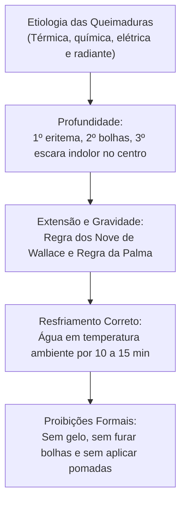

As queimaduras configuram lesões traumáticas agudas decorrentes da exposição tecidual a fontes extremas de temperatura, agentes químicos corrosivos, eletricidade ou radiação ionizante. Na rotina operacional do bombeiro militar, o atendimento a queimados exige avaliação rápida da extensão corporal afetada, estabilização respiratória e proteção estéril do leito lesado para prevenir infecções e choque hipovolêmico.

> [!objetivos]
> - Compreender a etiologia e os mecanismos físicos das queimaduras.
> - Classificar as queimaduras quanto à profundidade em primeiro, segundo, terceiro e quarto graus.
> - Calcular a superfície corporal queimada pela Regra dos Nove de Wallace.
> - Aplicar as condutas padronizadas de resfriamento e proteção das lesões térmicas.
> - Identificar as condutas proibidas e mitos populares que agravam o prognóstico do paciente.

## Etiologia e Mecanismos das Queimaduras

A queimadura representa uma agressão celular complexa que rompe a homeostase do revestimento cutâneo. A pele humana exerce funções indispensáveis de barreira mecânica contra invasões bacterianas, controle da evaporação hídrica e regulação da temperatura corpórea. A destruição desse tegumento provoca desidratação maciça por perda contínua de plasma, além de inflamação sistêmica profunda.

As lesões térmicas decorrem de calor direto por chamas vivas, líquidos superaquecidos (escaldaduras), sólidos incandescentes e vapores inflamáveis. As queimaduras químicas resultam do contato prolongado com ácidos fortes, que provocam necrose de coagulação, ou bases álcalis, que causam necrose de liquefação profunda. As queimaduras elétricas derivam da passagem de corrente pelo corpo, liberando calor interno por efeito Joule ao atravessar tecidos com alta resistência mecânica, como ossos e músculos. O frio extremo também gera queimaduras denominadas geladuras, congelando a água intracelular e destruindo os capilares sanguíneos.

```mermaid Classificação etiológica das queimaduras no atendimento pré-hospitalar
flowchart TD
    Q["Queimaduras"] --> TERM["Térmicas\n(Chamas, líquidos quentes, sólidos e vapores)"]
    Q --> QUIM["Químicas\n(Ácidos corrosivos e bases álcalis)"]
    Q --> ELETR["Elétricas\n(Corrente de alta e baixa voltagem, efeito Joule)"]
    Q --> RAD["Radiantes e Frio\n(Radiação UV, nuclear e congelamento por geladura)"]
    TERM --> FIS["Fisiopatologia Comum:\nPerda de barreira epitelial, exsudação plasmática e risco de choque"]
    QUIM --> FIS
    ELETR --> FIS
    RAD --> FIS
```

A severidade clínica do paciente queimado depende da interação entre a temperatura da fonte agressora e o tempo total de contato com os tecidos. Temperaturas a partir de quarenta e quatro graus Celsius já provocam desnaturação proteica se o contato for prolongado. Temperaturas acima de setenta graus produzem necrose celular instantânea em menos de um segundo de exposição.

> [!bizu]
> Em grandes queimados, o choque não decorre de perda de sangue vivo, mas do extravasamento maciço de plasma sanguíneo dos capilares dilatados para o espaço intersticial. Esse edema volumoso reduz a volemia intravascular eficaz, exigindo reposição hidroeletrolítica intensiva em ambiente intra-hospitalar.

## Classificação das Queimaduras quanto à Profundidade

O dimensionamento da profundidade anatômica das lesões orienta o diagnóstico clínico e o prognóstico funcional de cicatrização:

- **Primeiro Grau (Espessura Superficial)**: atinge exclusivamente as camadas celulares da epiderme. A pele apresenta eritema avermelhado vivo e calor local. Há dor moderada a intensa que melhora ao toque. Não ocorrem flictenas (bolhas). O edema é discreto e a cura completa ocorre em torno de três a seis dias, sem deixar marcas ou cicatrizes anatômicas permanentes. A queimadura solar branda ilustra essa categoria.
- **Segundo Grau (Espessura Parcial)**: compromete a epiderme e porções variáveis da derme papilar ou reticular. Caracteriza-se pela presença marcante de **flictenas (bolhas)** contendo plasma límpido e restos celulares. O leito subjacente apresenta-se úmido, avermelhado ou rosado e extremamente doloroso ao contato com o ar. Subdivide-se em superficial, que cicatriza em duas semanas preservando anexos pilosos, e profunda, que destrói a maioria das terminações nervosas e requer enxertia cirúrgica.
- **Terceiro Grau (Espessura Total)**: atinge todas as camadas da pele, destruindo a epiderme, a derme completa e o tecido subcutâneo adjacente. O aspecto visual é coriáceo, seco, rígido e inelástico, formando uma **escara**. A tonalidade varia do branco nacarado ao marrom escuro ou preto carbonizado. As terminações nervosas locais são calcinadas, tornando o centro da ferida insensível à dor ao teste de punctura com agulha.
- **Quarto Grau (Lesão Estrutural Profunda)**: estende-se além do tecido celular subcutâneo, carbonizando fáscias musculares, massas musculares, tendões, vasos calibrosos e estruturas ósseas esqueléticas. É comum em acidentes elétricos industriais de alta voltagem e exige amputações e debridamentos radicais.

| Grau de Profundidade | Camadas Acometidas | Aparência Clínica Característica | Sensibilidade Dolorosa |
|---|---|---|---|
| 1º Grau (Superficial) | Apenas epiderme | Eritema vivo, pele seca, sem bolhas | Dor em queimação preservada |
| 2º Grau (Espessura parcial) | Epiderme e derme | Flictenas (bolhas), leito úmido e rosado | Dor intensa hipersensível ao ar |
| 3º Grau (Espessura total) | Epiderme, derme e hipoderme | Escara coriácea branca, marrom ou preta | Centro insensível (anestesia focal) |
| 4º Grau (Profunda) | Fáscia, músculo e osso | Carbonização profunda e necrose estrutural | Terminações nervosas destruídas |

> [!pegadinha]
> As bancas costumam afirmar que a queimadura de terceiro grau é completamente indolor para a vítima. Embora o centro da escara seja insensível devido à destruição das terminações nervosas locais, as bordas circundantes apresentam queimaduras de segundo e primeiro graus. Por essa razão, o paciente com lesões de terceiro grau sofre com dores excruciantes nas regiões periféricas adjacentes.

A profundidade de uma queimadura pode evoluir nas primeiras vinte e quatro a quarenta e oito horas após o sinistro. Áreas que aparentavam segundo grau superficial podem aprofundar-se para segundo grau profundo ou terceiro grau caso ocorra infecção secundária, desidratação do leito ou hipotermia tecidual. Por esse motivo, o socorrista deve proteger o local com curativos estéreis e umedecidos sem emitir julgamentos diagnósticos definitivos no campo.

## Extensão Corporal e Gravidade Clínica

A extensão da área de superfície corporal queimada possui correlação direta com as taxas de morbimortalidade. Queimaduras de segundo e terceiro graus que superam cinquenta por cento da superfície corporal costumam ser letais, sobretudo em crianças de tenra idade e idosos vulneráveis.

No atendimento pré-hospitalar a adultos, o cálculo da extensão apoia-se na clássica **Regra dos Nove de Wallace**, que distribui as áreas anatômicas corporais em frações de nove por cento:

- **Cabeça e Pescoço**: 9% no total (4,5% face anterior e 4,5% região posterior do crânio).
- **Membro Superior Direito**: 9% no total (4,5% face anterior e 4,5% face posterior).
- **Membro Superior Esquerdo**: 9% no total (4,5% face anterior e 4,5% face posterior).
- **Tronco Anterior (Tórax e Abdome)**: 18% no total (tórax 9% e abdome 9%).
- **Tronco Posterior (Dorso e Região Lombar)**: 18% no total (dorso superior 9% e região lombar/glúteos 9%).
- **Membro Inferior Direito**: 18% no total (9% face anterior e 9% face posterior).
- **Membro Inferior Esquerdo**: 18% no total (9% face anterior e 9% face posterior).
- **Região Perineal e Genitália**: 1% no total.

| Região Anatômica | Percentual em Adultos (Regra dos Nove) | Percentual em Crianças Pequenas |
|---|---|---|
| Cabeça e pescoço | 9% (4,5% frente / 4,5% verso) | 18% (9% frente / 9% verso) |
| Membros superiores (cada um) | 9% cada (4,5% frente / 4,5% verso) | 9% cada (4,5% frente / 4,5% verso) |
| Tronco anterior (tórax e abdome) | 18% (9% tórax / 9% abdome) | 18% (9% tórax / 9% abdome) |
| Tronco posterior (dorso e lombar) | 18% (9% dorso / 9% glúteos) | 18% (9% dorso / 9% glúteos) |
| Membros inferiores (cada um) | 18% cada (9% frente / 9% verso) | 14% cada (7% frente / 7% verso) |
| Genitália e períneo | 1% | 1% |

Para lesões de formatos irregulares ou manchas dispersas sobre a superfície do corpo, o socorrista recorre à **Regra da Palma da Mão**. A área da palma da mão da própria vítima, mantendo-se os dedos estendidos e unidos, equivale a aproximadamente um por cento da sua superfície corporal total.

A gravidade clínica do paciente queimado orienta a regulação médica para centros especializados de queimaduras:

- **Queimado Leve**: queimaduras de primeiro grau abaixo de vinte por cento; segundo grau abaixo de quinze por cento em adultos; terceiro grau abaixo de dois por cento sem atingir áreas críticas.
- **Queimado Moderado**: primeiro grau acima de cinquenta por cento; segundo grau entre quinze e vinte e cinco por cento em adultos; terceiro grau entre dois e dez por cento.
- **Grande Queimado (Grave)**: qualquer queimadura de segundo grau superior a vinte e cinco por cento em adultos; terceiro grau acima de dez por cento; ou qualquer lesão de espessura total em face, mãos, pés, pescoço, períneo ou articulações nobres.

> [!atencao]
> A presença de suspeita de queimadura por inalação em vias aéreas qualifica o paciente compulsoriamente como grande queimado grave, independentemente da extensão na pele. Sinais de alarme incluem queimadura de sobrancelhas e vibrissas nasais, rouquidão súbita, tosse produtiva com fuligem carbonácea e histórico de confinamento em incêndio em ambiente fechado. O edema da glote instala-se velozmente, exigindo intubação traqueal precoce antes do fechamento da via aérea.

## Primeiros Socorros e Cuidados Proibidos em Queimaduras

O socorrista militar deve agir com rapidez e precisão para interromper o processo de agressão térmica e proteger o leito cruento das lesões:

O primeiro passo consiste em interromper o processo térmico, afastando a vítima da fonte agressora com segurança para a guarnição. Se as vestes estiverem pegando fogo, o indivíduo nunca deve correr. A corrida ventila o tecido e alimenta as chamas. A pessoa deve ser orientada a parar, deitar-se no solo e rolar da cabeça aos pés, enquanto os socorristas abafam o fogo com mantas ou casacos limpos. Se a roupa estiver embebida de combustíveis voláteis como gasolina ou álcool, não se deve jogar água sem antes extinguir o fogo por abafamento mecânico.

O resfriamento inicial das queimaduras térmicas deve ser realizado com água corrente limpa em temperatura ambiente (quinze a vinte graus Celsius) por cerca de dez a quinze minutos. O resfriamento imediato estanca a condução de calor para as camadas profundas e alivia a dor. Em queimaduras extensas, a aplicação de água deve ser restrita e pontual para não desencadear hipotermia sistêmica grave.

> [!bizu]
> É terminantemente proibido o emprego de água gelada, gelo triturado ou compressas congeladas sobre queimaduras. O frio intenso provoca vasoconstrição arterial reflexa vigorosa, interrompe o fluxo sanguíneo da derme e converte lesões de segundo grau em necroses isquêmicas de terceiro grau, ampliando a destruição celular.

### Condutas Terminantemente Proibidas no Manejo de Queimaduras

No atendimento de emergência a queimados, a observância de proibições formais previne infecções invasivas e lesões mecânicas iatrogênicas:

- **Nunca romper flictenas (bolhas)**: a película epitelial que recobre a bolha constitui curativo biológico natural estéril que isola a derme da invasão de bactérias externas. O rompimento acidental ou deliberado expõe as terminações nervosas ao ar e abre porta de entrada direta para infecções graves.
- **Nunca aplicar remédios caseiros ou pomadas no campo**: pastas de dente, café moído, manteiga, óleo de cozinha, graxas minerais ou pomadas de farmácia são contraindicadas no APH. Essas substâncias contaminam a lesão e precisarão ser raspadas com escovação mecânica dolorosa pela equipe médica hospitalar para permitir a assepsia cirúrgica.
- **Nunca arrancar tecidos sintéticos grudados à pele**: roupas de tecidos sintéticos que derreteram e aderiram firmemente à pele queimada não devem ser puxadas à força. O socorrista deve recortar cuidadosamente o tecido ao redor com tesoura de trauma ponta romba, deixando o material fundido intacto para remoção pelo cirurgião plástico.

```mermaid Resumo de condutas preconizadas e proibidas no manejo de queimaduras
flowchart TD
    COND["Condutas no APH de Queimaduras"] --> OK["CONDUTAS CORRETAS:\n- Resfriar com água corrente em temperatura ambiente\n- Proteger com plástico filme estéril ou papel-alumínio\n- Retirar anéis e adornos antes do edema\n- Manter paciente aquecido contra hipotermia"]
    COND --> NO["CONDUTAS PROIBIDAS:\n- NUNCA usar gelo ou água gelada\n- NUNCA furar flictenas ou bolhas\n- NUNCA passar pasta de dente, manteiga ou café\n- NUNCA arrancar tecidos fundidos na pele"]
```

Na cobertura do paciente, o material de escolha na ambulância de resgate é o plástico filme transparente estéril de PVC ou o papel-alumínio cirúrgico. Esses revestimentos protegem contra contaminantes ambientais, retêm a umidade, evitam a perda de calor corporal e não aderem ao leito queimado, garantindo uma remoção indolor no hospital.

Em queimaduras químicas por substâncias líquidas, o local deve ser lavado continuamente sob água corrente por vinte a trinta minutos. Caso o produto agressivo seja um pó químico seco (como cal virgem), o socorrista deve escovar o pó da pele da vítima **antes** de irrigar com água, visto que muitos compostos reagem com água liberando calor exotérmico severo.

Nas queimaduras elétricas, a guarnição deve confirmar o desligamento da rede antes de tocar no indivíduo. O socorrista deve inspecionar o ponto de entrada da corrente e o ponto de saída no corpo. Essas lesões associam-se habitualmente a fibrilação ventricular fatal, fraturas por contratura muscular violenta e destruição muscular profunda oculta.

> [!exemplo]
> Em uma fábrica de baterias, um funcionário sofre queimadura por ácido sulfúrico concentrado nos braços. A brigada de socorro retira as roupas contaminadas do operador e posiciona os membros sob chuveiro de emergência com água corrente contínua durante vinte e cinco minutos ininterruptos. Em seguida, os braços são envoltos em plástico filme estéril sem aplicação de pomadas. Essa conduta correta remove o agente químico por diluição mecânica contínua e impede o aprofundamento das lesões teciduais.

## Mapa do capítulo



### Para fixar

- Queimaduras resultam de calor, substâncias químicas corrosivas, eletricidade, radiação ou congelamento por frio extremo.
- O primeiro grau atinge apenas a epiderme com eritema e dor; o segundo grau forma flictenas (bolhas); o terceiro grau produz escara coriácea de espessura total.
- O centro da queimadura de terceiro grau é insensível ao teste de dor, mas as bordas vizinhas manifestam sofrimento doloroso severo.
- Pela Regra dos Nove de Wallace em adultos, a cabeça equivale a 9%, cada membro superior a 9%, tronco anterior a 18%, tronco posterior a 18% e cada membro inferior a 18%.
- A presença de queimadura de vias aéreas por inalação classifica compulsoriamente a vítima como grande queimado grave.
- O resfriamento inicial deve ser realizado exclusivamente com água em temperatura ambiente; o uso de gelo é expressamente contraindicado.
- É absolutamente proibido romper bolhas, aplicar pasta de dente, café ou manteiga, e puxar roupas sintéticas grudadas na lesão.
- Queimaduras químicas exigem irrigação com água corrente contínua por vinte a trinta minutos; pós secos devem ser escovados antes da lavagem.
