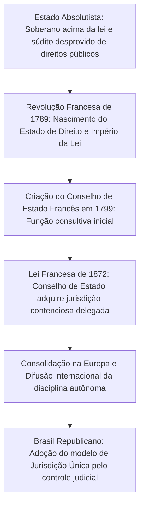
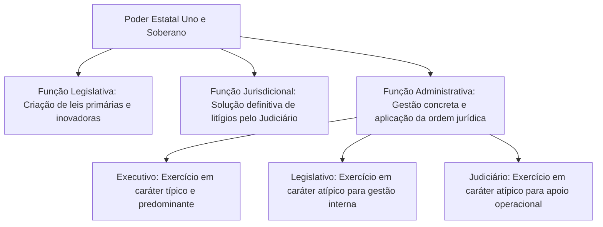
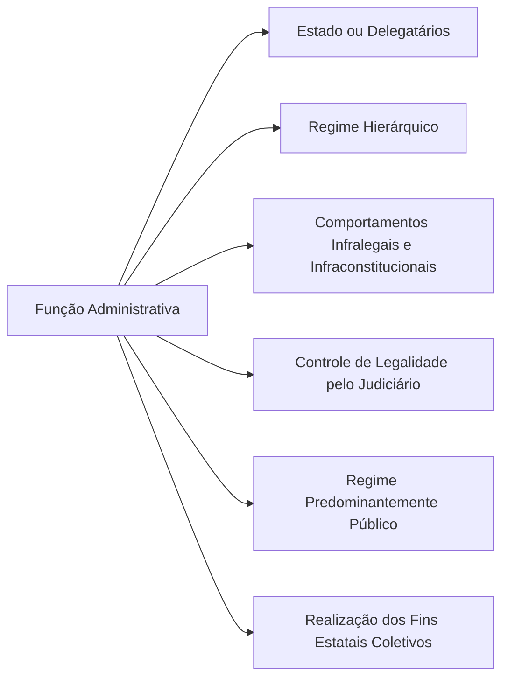
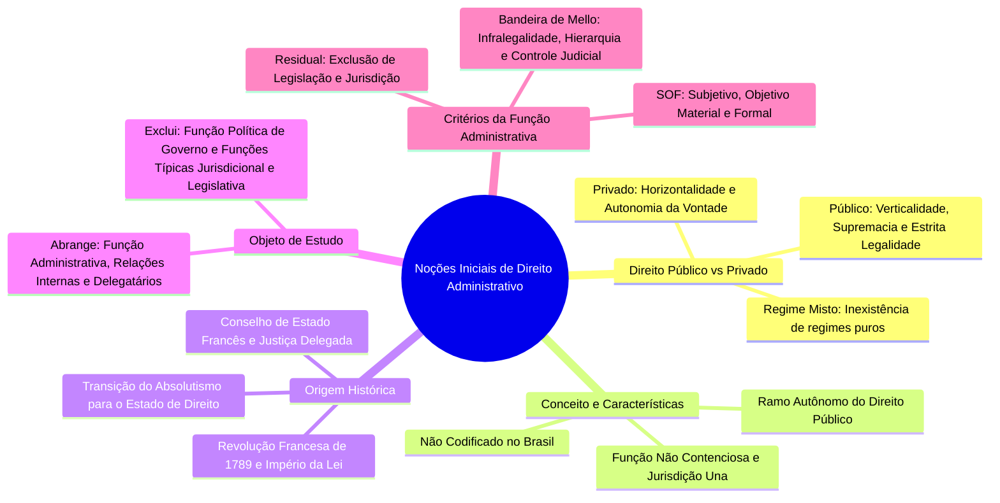

O Direito Administrativo organiza a atuação do Estado na gestão dos interesses da coletividade. Em qualquer sociedade organizada, a convivência humana exige normas claras para evitar a prevalência da força bruta e assegurar direitos essenciais, como a segurança, a saúde e a propriedade. Este capítulo inaugural apresenta os fundamentos que sustentam toda a matéria: a distinção entre direito público e privado, o conceito e os elementos da disciplina, a sua gênese histórica na Europa pós-revolucionária, o seu objeto central e os critérios doutrinários que definem a função administrativa.

Compreender essas noções é indispensável para resolver questões de prova, pois tais conceitos formam a base teórica exigida para o estudo posterior dos princípios, dos atos e dos poderes da Administração Pública.

> [!objetivos]
> - Diferenciar as características e a lógica do direito público e do direito privado.
> - Conceituar o Direito Administrativo e identificar seus traços distintivos no ordenamento brasileiro.
> - Explicar o surgimento histórico da disciplina e o papel do Conselho de Estado francês.
> - Delimitar o objeto do Direito Administrativo, indicando o que nele se inclui e o que dele se exclui.
> - Analisar os critérios doutrinários definidores da função administrativa e seus elementos estruturantes.

## O direito, as normas e a dicotomia entre público e privado

O Direito existe para viabilizar a vida em sociedade e pacificar conflitos de interesse. Se uma pessoa vivesse em total isolamento em uma ilha deserta, não haveria necessidade de um sistema jurídico regulando sua conduta diária. No instante em que novos indivíduos chegam a essa mesma localidade, a criação de regras e limites torna-se imperativa. Sem regras cogentes, prevaleceria a vontade do mais forte, inviabilizando a convivência pacífica e a segurança jurídica mútua.

As normas jurídicas dividem-se em duas grandes espécies complementares: as regras e os princípios.
- As **regras** possuem caráter descritivo e objetivo. Elas estabelecem comandos diretos de conduta, aplicando-se na lógica do "tudo ou nada". Quando uma regra válida incide sobre um fato concreto, ela deve ser plenamente cumprida, salvo declaração de invalidade.
- Os **princípios**, por sua vez, expressam valores fundamentais, diretrizes éticas e mandamentos de otimização. Eles possuem maior nível de abstração e orientam a criação, a interpretação e a integração do ordenamento jurídico. Em eventuais tensões entre princípios, não há eliminação de um pelo outro, mas sim harmonização e ponderação concreta de interesses no caso específico.

Dentro da ciência jurídica, a divisão entre Direito Público e Direito Privado constitui uma ferramenta metodológica indispensável para compreender como o Estado atua perante os cidadãos.

### Relações horizontais e relações verticais

No Direito Privado, as relações jurídicas são pautadas pela **horizontalidade**. Isso significa que as partes envolvidas encontram-se em patamar de igualdade formal. Ninguém pode impor unilateralmente a sua vontade a outrem sem previsão legal expressa ou consentimento prévio. Vigora amplamente o postulado da autonomia da vontade, de modo que o particular é livre para fazer tudo aquilo que a lei não proíbe expressamente.

No Direito Público, por outro lado, a relação jurídica caracteriza-se pela **verticalidade**. O Estado atua com supremacia sobre o indivíduo particular, porque não defende interesses meramente pessoais ou patrimoniais do governante, mas sim as necessidades e aspirações de toda a coletividade. Em razão dessa finalidade coletiva, a ordem jurídica concede ao Poder Público prerrogativas especiais de autoridade, permitindo-lhe impor comandos e obrigações a terceiros mesmo sem a prévia anuência destes.

Essa autoridade estatal não representa arbitrariedade. Ela é rigidamente equilibrada pelo princípio da estrita legalidade administrativa. Enquanto o cidadão comum pode praticar qualquer conduta não vedada pela lei, a Administração Pública somente pode agir quando houver expressa autorização ou imposição legal. A tabela a seguir sintetiza os traços distintivos entre os dois regimes jurídicos.

O quadro comparativo abaixo sintetiza as principais diferenças estruturais entre o Direito Privado e o Direito Público.

| Critério de comparação | Direito Privado | Direito Público |
| --- | --- | --- |
| Posição das partes | Horizontalidade (igualdade formal entre os sujeitos) | Verticalidade (supremacia jurídica do Estado) |
| Postulado de ação | Autonomia da vontade e liberdade negocial | Prerrogativas públicas e estrita legalidade |
| Limite de atuação | Permitido fazer tudo o que a lei não proíbe | Permitido fazer apenas o que a lei autoriza ou impõe |
| Finalidade visada | Satisfação de interesses individuais ou corporativos | Realização direta do interesse público coletivo |
| Ramos tradicionais | Direito Civil, Direito Comercial e Empresarial | Direito Administrativo, Constitucional, Penal, Tributário |

> [!exemplo]
> Um cidadão não possui autoridade para determinar que um motorista desconhecido interrompa o deslocamento de seu automóvel na via pública. Em contrapartida, um policial militar ou agente de trânsito possui a prerrogativa legal de realizar a parada forçada em fiscalização de rotina. Essa ordem estatal deve ser obedecida compulsoriamente, porque protege a incolumidade física e a segurança do tráfego de toda a sociedade.

### Inexistência de regimes puros na atuação estatal

Embora a distinção entre Direito Público e Direito Privado seja clara no plano conceitual, ela não opera de forma estanque na prática administrativa cotidiana. Não existe regime puramente público ou puramente privado quando o Estado se manifesta no mundo concreto.

Mesmo quando o Poder Público celebra negócios jurídicos tipicamente privados, como a locação de um imóvel urbano de propriedade particular para instalar uma delegacia de polícia, incidem normas públicas indeclináveis. A escolha do imóvel e a fixação do preço exigem procedimento administrativo formal, motivação expressa e observância das regras financeiras públicas.

De igual modo, as empresas públicas e sociedades de economia mista que desempenham atividade econômica de produção ou comercialização de bens sujeitam-se ao regime jurídico próprio das empresas privadas (CF, art. 173, § 1º, II). Essa disciplina especial busca evitar concorrência desleal com o setor produtivo particular. Todavia, mesmo essas entidades estatais econômicas realizam concurso público para admissão de novos empregados, contratam obras e serviços mediante licitação pública e submetem suas contas ao controle externo do Tribunal de Contas.

> [!pegadinha]
> Afirmar que uma empresa estatal exploradora de atividade econômica atua sob regime exclusivamente de direito privado é um erro frequente em provas de concurso. O regime jurídico dessas entidades é híbrido: predominantemente privado quanto à atividade de mercado, mas vinculado aos princípios constitucionais da moralidade, impessoalidade e publicidade, além do controle pelo Tribunal de Contas.

## Conceito e características do Direito Administrativo

O Direito Administrativo não possui uma definição legal única fixada em texto normativo. O conceito foi construído ao longo de décadas pela doutrina especializada nacional e estrangeira. Autores consagrados apresentam formulações distintas com base em suas ênfases teóricas:
- Na lição clássica de Hely Lopes Meirelles, o ramo administrativo articula princípios que disciplinam os órgãos estatais, o corpo funcional e as ações voltadas à consecução das finalidades do Estado.
- Para Maria Sylvia Zanella Di Pietro, o foco recai sobre a estrutura orgânica da Administração, o exercício de atividades jurídicas sem caráter de definitividade judicial e a tutela dos bens afetados ao bem-estar coletivo.
- Na perspectiva de José dos Santos Carvalho Filho, sobressai a regulação tanto das dinâmicas internas da estrutura burocrática quanto dos vínculos jurídicos mantidos com os cidadãos sob a égide do interesse público.

Apesar das pequenas variações de redação entre os autores, a doutrina concorda amplamente quanto aos elementos centrais que estruturam o ramo administrativo.

O esquema em formato de tabela abaixo organiza os quatro elementos estruturantes do conceito contemporâneo de Direito Administrativo.

| Elemento estruturante | Conteúdo conceitual | Desdobramento prático |
| --- | --- | --- |
| Natureza jurídica | Ramo autônomo do Direito Público | Subordina-se à supremacia e indisponibilidade do interesse público |
| Regime normativo | Conjunto integrado de regras e princípios | Engloba normas constitucionais, leis esparsas e postulados fundamentais |
| Âmbito subjetivo | Pessoas jurídicas, órgãos e agentes públicos | Abrange a Administração Direta e Indireta em todas as esferas federativas |
| Âmbito material | Exercício concreto da função administrativa | Compreende serviços públicos, fomento, polícia e intervenção estatal |

O Direito Administrativo apresenta três características essenciais que são recorrentemente cobradas nas provas de concursos civis e militares:

1. **Ramo autônomo do Direito Público**: possui metodologia própria, terminologia científica específica e princípios fundamentais próprios, como a supremacia do interesse público sobre o privado e a indisponibilidade do interesse público pela Administração.
2. **Inexistência de codificação**: ao contrário do Direito Penal, do Direito Civil e do Direito Processual, o Direito Administrativo brasileiro não se encontra reunido em um único Código legal sistemático.
3. **Função administrativa de natureza não contenciosa**: a atuação da Administração Pública não produz coisa julgada no sentido técnico-processual definitivo. O Brasil adota o sistema de jurisdição única, de modo que toda e qualquer lesão ou ameaça a direito praticada pelo Estado pode ser revista pelo Poder Judiciário.

> [!atencao] O Direito Administrativo não é codificado
> No Brasil, não existe um "Código de Direito Administrativo". As regras administrativas encontram-se dispersas em uma infinidade de diplomas legais, tais como a Lei 14.133/2021 (Licitações e Contratos), a Lei 8.429/1992 (Improbidade Administrativa), a Lei 9.784/1999 (Processo Administrativo Federal) e os diversos estatutos de servidores públicos da União, dos Estados e dos Municípios.

A atividade administrativa do Estado caracteriza-se por sua índole estritamente **não contenciosa**. Quando a autoridade pública profere uma decisão aplicando uma penalidade administrativa a um servidor ou indeferindo a licença requerida por um particular, essa deliberação encerra a via administrativa, operando a denominada "coisa julgada administrativa". Contudo, tal decisão não impede que o cidadão prejudicado acione o Poder Judiciário para anular o ato lesivo.

> [!lei] CF, art. 5º, XXXV
> a lei não excluirá da apreciação do Poder Judiciário lesão ou ameaça a direito;

Em virtude do princípio constitucional da inafastabilidade da tutela jurisdicional, nenhum conflito resolvido internamente pela Administração Pública adquire imutabilidade absoluta perante o Poder Judiciário.

## Origem histórica e evolução da disciplina

O surgimento do Direito Administrativo como ramo autônomo da ciência jurídica está intimamente vinculado à transição do Estado Absolutista para o **Estado de Direito**.

Durante o regime absolutista dos séculos XVII e XVIII, a figura do monarca personificava o próprio Estado. Não existia submissão do governante à ordem jurídica, pois sua autoridade emanava de fundamentação teocrática e dinástica. Prevalecia a máxima do soberano infalível: *"o rei não pode errar"* (*the king can do no wrong*). Sob tal perspectiva, era impensável conceber que o cidadão pudesse exigir reparação judicial contra abusos cometidos pela coroa. O direito limitava-se essencialmente a ordenar as relações patrimoniais e familiares travadas entre os súditos no âmbito privado.

Com a eclosão da **Revolução Francesa de 1789** e a difusão dos ideais liberais, consolidou-se o Estado de Direito, edificado sobre três postulados fundamentais:
- O império da lei (princípio da legalidade), determinando que governantes e governados subordinam-se estritamente às normas criadas pela representação popular;
- A separação dos poderes, concebida para fragmentar o exercício da autoridade estatal em funções distintas e evitar a concentração tirânica de poder;
- O reconhecimento e a garantia dos direitos individuais e liberdades fundamentais do cidadão contra os arbítrios estatais.

O fluxograma abaixo detalha a linha histórica de evolução do Direito Administrativo desde o Absolutismo até a sua consolidação no ordenamento brasileiro.

Na França revolucionária, os legisladores mantinham forte desconfiança em relação aos juízes dos tribunais comuns judiciais (*Parlements*), que historicamente pertenciam à nobreza e sabotavam as reformas republicanas. Por essa razão, a Lei de 16-24 de agosto de 1790 proibiu expressamente os tribunais judiciais de interferir nos negócios da Administração ou de julgar os atos praticados pelo Poder Executivo.

Para solucionar os litígios envolvendo a Administração Pública, Napoleão Bonaparte instituiu, em dezembro de 1799, o **Conselho de Estado francês** (*Conseil d'État*). Em seus primeiros anos, esse órgão desempenhava função de justiça retida: analisava os recursos administrativos e apresentava propostas de decisão que precisavam ser homologadas pelo próprio Chefe de Estado.

Somente em **1872**, por meio de reforma legislativa formal, a França conferiu ao Conselho de Estado a chamada justiça delegada, transformando-o em um verdadeiro tribunal administrativo independente e com poder de emitir decisões imutáveis. Esse marco consolidou o sistema da **dualidade de jurisdição** francês, também conhecido como sistema do contencioso administrativo.

No Brasil Imperial, a influência francesa fez surgir um Conselho de Estado dotado de atribuições meramente consultivas. Com a proclamação da República e a promulgação da Constituição de 1891, o ordenamento brasileiro rompeu com o modelo francês de contencioso e adotou o sistema norte-americano de **jurisdição una**. Desde então, o controle definitivo sobre a legalidade dos atos administrativos no Brasil pertence com exclusividade ao Poder Judiciário.

## Objeto do Direito Administrativo

O objeto de estudo do Direito Administrativo é amplo e coincide essencialmente com a **função administrativa**. Esse objeto não se limita às repartições internas do Poder Executivo, abrangendo múltiplos aspectos das atividades estatais e sociais.

A disciplina tem por finalidade regular:
1. **As relações internas da Administração Pública**: a distribuição de competências entre pessoas jurídicas públicas e entidades descentralizadas, o regime jurídico de criação e extinção de órgãos públicos e as normas disciplinares aplicáveis aos servidores civis e militares.
2. **As relações entre a Administração Pública e os cidadãos administrados**: a expedição de licenças e autorizações, a fiscalização sanitária e ambiental, a aplicação de sanções administrativas, a cobrança de tarifas públicas e a celebração de contratos administrativos com particulares.
3. **A prestação de serviços públicos delegados a particulares**: as concessões e permissões concedidas a empresas privadas para operar rodovias, ferrovias, transporte coletivo e fornecimento de energia elétrica, submetidas ao princípio da continuidade do serviço público.
4. **O regime jurídico dos bens públicos e a responsabilidade civil do Estado**: a gestão do patrimônio imobiliário público, a afetação de bens ao uso coletivo e o dever estatal de indenizar os prejuízos causados por seus agentes a terceiros.
5. **A função administrativa exercida pelos Poderes Legislativo e Judiciário**: as atividades instrumentais desempenhadas pelas casas parlamentares e tribunais para viabilizar seu funcionamento interno cotidiano.

A tabela a seguir discrimina de maneira taxativa o que integra o objeto do Direito Administrativo e o que dele é excluído.

| Abrangência temática | Matérias incluídas no objeto | Justificativa técnica |
| --- | --- | --- |
| Matérias abrangidas | Relações orgânicas e funcionais internas | Disciplina a hierarquia, competências e deveres funcionais |
| Matérias abrangidas | Relações externas com os cidadãos administrados | Rege o poder de polícia, serviços públicos e fomento |
| Matérias abrangidas | Atividades materiais delegadas a particulares | Exige conformidade com o regime público de prestação |
| Matérias abrangidas | Função administrativa no Legislativo e Judiciário | Regula licitações, contratos e gestão de servidores próprios |
| Matérias excluídas | Função política ou de governo | Atos de soberania e escolhas constitucionais superiores |
| Matérias excluídas | Função legislativa típica | Criação primária, abstrata e inovadora de leis no Parlamento |
| Matérias excluídas | Função jurisdicional típica | Resolução definitiva de lides com força de coisa julgada |

> [!exemplo]
> Quando o Tribunal de Justiça de Pernambuco realiza um concurso público para provimento de cargos de analista judiciário ou homologa um pregão eletrônico para aquisição de computadores, não está desempenhando atividade jurisdicional. Trata-se do exercício legítimo de função administrativa atípica pelo Poder Judiciário, regulada pelas normas gerais de Direito Administrativo.

Por outro lado, encontram-se terminantemente excluídas do objeto do Direito Administrativo:
- **A função política ou de governo**: atos de direção superior do Estado pautados diretamente pela Constituição Federal, tais como a sanção e o veto presidencial a projetos de lei, a declaração de guerra ou a decretação de estado de defesa.
- **As funções típicas do Legislativo e do Judiciário**: a elaboração de leis formais pelo Congresso Nacional e o julgamento de ações judiciais contenciosas pelos magistrados com força de coisa julgada material.

## Função administrativa e critérios de conceituação

O poder estatal é uno e indivisível, decorrente da soberania popular. Para melhor realizar os fins coletivos, o Estado reparte o exercício desse poder em três funções estruturais básicas: legislativa, jurisdicional e administrativa.

O esquema mermaid a seguir ilustra a separação das funções estatais e destaca o campo de abrangência da função administrativa.

Para definir o que constitui verdadeiramente a **função administrativa**, a teoria geral do direito desenvolveu diferentes critérios explicativos.

### O critério residual ou negativo

O **critério residual** sustenta que a função administrativa abrange todas as atividades estatais que não constituem legislação nem jurisdição. Trata-se de uma definição por exclusão: após subtrair os atos de criação primária do direito e as decisões judiciais definitivas, o que sobrar na atuação do Estado corresponde à função administrativa.

Embora esse critério seja intuitivo e ajude a demarcar fronteiras conceituais, a doutrina dominante o considera excessivamente vago e insuficiente. Ele não aponta quais são os atributos materiais e jurídicos que identificam a conduta administrativa em sua essência.

### Critérios subjetivo, objetivo material e objetivo formal

Para suprir as limitações do critério residual, os doutrinadores estruturaram três abordagens complementares:
1. **Critério subjetivo ou orgânico**: define a função administrativa a partir do sujeito ou órgão que a desempenha. Por essa ótica, função administrativa seria aquela praticada exclusivamente pelos órgãos que compõem o Poder Executivo e sua estrutura burocrática. Esse critério é manifestamente falho, pois ignora que o Legislativo e o Judiciário também desempenham tarefas administrativas cotidianas em suas funções atípicas.
2. **Critério objetivo material**: define a função a partir do conteúdo substantivo da atividade em si, independentemente de quem a execute. Reconhece que a gestão de servidores, a contratação de obras e a prestação de serviços configuram atividade administrativa, seja no âmbito de um ministério do Executivo, seja no âmbito de uma câmara de vereadores ou tribunal regional.
3. **Critério objetivo formal**: analisa o regime jurídico sob o qual a atividade é executada pelo Estado, isto é, a submissão aos princípios e prerrogativas próprios do direito público.

A tabela a seguir compara os quatro critérios doutrinários utilizados para a definição da função administrativa.

| Critério doutrinário | Foco da definição | Vantagem principal | Deficiência ou crítica |
| --- | --- | --- | --- |
| Residual ou Negativo | Exclusão das funções legislativa e jurisdicional | Fácil delimitação por contraste inicial | Critério vago; não define os atributos próprios da função |
| Subjetivo ou Orgânico | Sujeito ou órgão executor (Poder Executivo) | Identifica a estrutura formal do aparelho estatal | Ignora a função administrativa atípica nos outros Poderes |
| Objetivo Material | Conteúdo intrínseco da atividade desempenhada | Reconhece a função em qualquer dos Poderes da República | Dificuldade prática em delimitar o que é essência material |
| Objetivo Formal | Regime jurídico público disciplinador do ato | Destaca as prerrogativas e sujeições especiais da função | Insuficiente se desvinculado dos fins e dos sujeitos públicos |

> [!bizu] Mnemônico dos critérios da função administrativa
> Guarde a chave **SOF**:
> - **S**ubjetivo: olha para o **sujeito** que executa (quem faz).
> - **O**bjetivo Material: olha para a **matéria** ou conteúdo da conduta (o que faz).
> - **F**ormal: olha para a **forma** e o regime jurídico incidente (como faz).

Nenhum desses critérios é suficiente de modo isolado. A definição completa e aceita pelos tribunais e bancas exige a conjugação equilibrada do sujeito competente, da matéria pública e do regime de prerrogativas e sujeições.

### Elementos da função para Celso Antônio Bandeira de Mello

Entre as formulações doutrinárias de maior prestígio nos concursos públicos, destaca-se a sistematização desenvolvida pelo jurista Celso Antônio Bandeira de Mello. Em sua construção analítica, a função administrativa traduz-se no encargo que o Poder Público ou seus delegatários desempenham no interior de uma dinâmica hierarquizada, atuando tipicamente por meio de comandos subordinados à lei e sujeitos à plena fiscalização jurisdicional.

Para fixar a matéria com máxima clareza, decompomos essa célebre formulação em seus seis elementos estruturantes:

1. **Desempenhada pelo Estado ou por quem lhe faça as vezes**: abrange as pessoas jurídicas políticas estatais, as entidades da Administração Indireta e também os particulares delegatários de serviços públicos, como as empresas concessionárias de transporte coletivo.
2. **Estrutura e regime hierárquicos**: a atividade administrativa opera internamente sob a égide do poder hierárquico, permitindo que autoridades superiores comandem, fiscalizem, deleguem atribuições e avoquem competências de seus subordinados.
3. **Comportamentos infralegais ou infraconstitucionais**: a Administração encontra-se subordinada à lei e à Constituição. Seus atos são subordinados à legislação (infralegais). Excepcionalmente, o ordenamento confere fundamento direto na Constituição sem necessidade de lei ordinária intermediária, como ocorre nos decretos autônomos expedidos pelo Chefe do Executivo.

> [!lei] CF, art. 84, VI
> VI - dispor, mediante decreto, sobre:
> a) organização e funcionamento da administração federal, quando não implicar aumento de despesa nem criação ou extinção de órgãos públicos;
> b) extinção de funções ou cargos públicos, quando vagos;

A expedição de decreto presidencial extinguindo cargos ou funções públicas quando vagos exemplifica a atuação administrativa de caráter diretamente infraconstitucional, sem demandar lei prévia para sua concretização.

4. **Submissão universal ao controle judicial de legalidade**: em conformidade com o art. 5º, XXXV, da Constituição Federal, todos os atos administrativos sujeitam-se à fiscalização de legalidade e legitimidade exercida pelos juízes e tribunais.
5. **Regime jurídico predominantemente público**: o exercício da função estatal confere prerrogativas de autoridade e impõe sujeições rígidas, tais como o dever de licitar e a exigência de concurso público.
6. **Orientação para os fins estatais**: a atividade administrativa destina-se unicamente a atender às necessidades coletivas, sendo vedada qualquer busca de proveito pessoal para os agentes públicos.

O diagrama estruturado abaixo reúne e sintetiza visualmente os seis componentes da função administrativa formulados por Bandeira de Mello.

### A Escola das Prerrogativas Públicas (Puissance Publique)

Na evolução do Direito Administrativo francês, a chamada **Escola das Prerrogativas Públicas** (*puissance publique*) procurou definir a disciplina com base na clássica distinção entre atos de autoridade e atos de gestão.
- **Atos de autoridade** (*actes d'autorité*): são aqueles em que o Estado atua amparado por suas prerrogativas de supremacia pública. O Poder Público manifesta-se em posição de superioridade jurídica em face do particular, editando atos unilaterais imperativos e impondo obrigações compulsórias.
- **Atos de gestão** (*actes de gestion*): são aqueles em que a Administração Pública atua despida de privilégios estatais, comportando-se em condições de paridade jurídica com o cidadão comum, sob regime regido preponderantemente pelo direito privado. Exemplifica essa categoria a contratação rotineira de serviços de conservação mecânica para automóveis da frota municipal.

A tabela abaixo confronta analiticamente as categorias da Escola da Puissance Publique.

| Categoria de atos | Posição jurídica do Estado | Regime jurídico aplicável | Exemplos típicos |
| --- | --- | --- | --- |
| Atos de autoridade (*puissance publique*) | Superioridade jurídica e unilateralidade de comando | Direito Público estrito | Interdição de estabelecimento, desapropriação e autuação de trânsito |
| Atos de gestão (*actes de gestion*) | Paridade jurídica e horizontalidade negocial | Direito Privado subsidiado | Aluguel de prédio comercial e manutenção de veículos oficiais |

A crítica doutrinária a essa escola reside no fato de que o Direito Administrativo não regula unicamente os atos unilaterais de autoridade. A disciplina alcança com igual intensidade atos negociais públicos, tais como licenças, permissões de uso e atos de fomento, nos quais não há coerção ou imposição estatal autoritária.

> [!pegadinha]
> Algumas bancas examinadoras tentam confundir os candidatos afirmando que os atos de gestão da Administração Pública não se submetem a nenhuma norma de Direito Público. Isso é incorreto. Mesmo ao praticar atos de gestão sob o direito privado, a Administração permanece vinculada aos princípios da moralidade e da impessoalidade e ao controle dos órgãos fiscalizadores.

## Mapa do capítulo

O diagrama em formato de mapa mental abaixo condensa os pilares teóricos desenvolvidos neste primeiro capítulo.

### Para fixar

- O Direito Privado é regido pela horizontalidade e pela autonomia da vontade, enquanto o Direito Público baseia-se na verticalidade e na estrita legalidade.
- Não existem regimes inteiramente puros na atuação do Estado; mesmo sob predominância privada, aplicam-se princípios fundamentais de direito público.
- O Direito Administrativo é o ramo autônomo do direito público que rege a função administrativa, seus órgãos, agentes e bens destinados ao interesse público.
- O ordenamento jurídico brasileiro não possui um Código de Direito Administrativo, estando as normas dispersas em leis e atos normativos diversos.
- A função administrativa tem natureza não contenciosa, submetendo-se ao princípio da inafastabilidade da tutela jurisdicional do art. 5º, XXXV, da CF.
- A disciplina nasceu historicamente na França com o advento do Estado de Direito pós-1789 e o desenvolvimento do Conselho de Estado francês.
- O objeto da matéria é a função administrativa, excluindo-se as funções políticas de governo e as funções típicas legislativa e jurisdicional.
- Pelo critério objetivo material, os Poderes Legislativo e Judiciário também exercem função administrativa em suas atividades atípicas de gestão interna.
- Para Celso Antônio Bandeira de Mello, a função administrativa é hierarquizada, infralegal ou infraconstitucional e submissa ao controle judicial de legalidade.
- A Escola das Prerrogativas Públicas diferencia atos de autoridade, dotados de supremacia, e atos de gestão, praticados em paridade com o particular.
