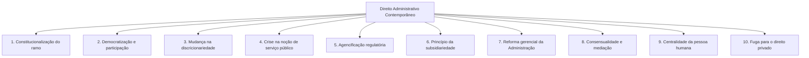

O Direito Administrativo consolidou sua identidade teórica por meio de sucessivas tentativas doutrinárias de definição. Ao longo dos séculos XIX e XX, diferentes escolas jurídicas buscaram identificar o elemento central capaz de delimitar com exatidão o campo de incidência desse ramo do direito público. Cada corrente elegeu um aspecto específico como eixo central, gerando críticas e aperfeiçoamentos que culminaram no critério acolhido no Brasil.

Além do debate conceitual, o Direito Administrativo brasileiro reflete a síntese de múltiplas tradições jurídicas estrangeiras, combinando institutos europeus e norte-americanos. No cenário contemporâneo, a disciplina vivencia transformações profundas impulsionadas pela supremacia constitucional, pela busca de eficiência e pela substituição paulatina de modelos autoritários por práticas consensuais e participativas.

> [!objetivos]
> - Comparar os oito critérios doutrinários de definição do Direito Administrativo e reconhecer suas deficiências.
> - Explicar a distinção entre serviço público e poder de polícia, diferenciando seus sentidos amplo e estrito.
> - Identificar o critério da Administração Pública como o modelo acolhido no ordenamento jurídico brasileiro.
> - Detalhar as contribuições do direito francês, italiano, alemão e anglo-americano na formação do direito pátrio.
> - Analisar as dez principais tendências contemporâneas que remodelam a disciplina, destacando a consensualidade e a jurisprudência vinculante.

## Os critérios doutrinários de definição do Direito Administrativo

A doutrina jurídica elaborou ao menos oito critérios distintos para tentar conceituar o Direito Administrativo de maneira autônoma. Cada uma dessas correntes procurou eleger um foco exclusivo, mas quase todas apresentaram lacunas quando confrontadas com a complexidade real do Estado contemporâneo.

### Panorama crítico dos critérios tradicionais

1. **Critério das prerrogativas públicas** (Escola da *Puissance Publique*, França):
Sustenta que o Direito Administrativo cuida unicamente dos atos de autoridade praticados pelo Estado com superioridade sobre o administrado. A principal crítica a essa corrente é que ela exclui os atos de gestão e os atos negociais públicos, tais como licenças, autorizações e permissões, nos quais o Poder Público atua sem coerção ou imposição unilateral.

2. **Critério do serviço público** (Escola de Bordeaux, liderada por Léon Duguit):
Afirma que a disciplina é o conjunto de regras que disciplina a criação, a organização e o funcionamento dos serviços públicos. A falha reside na enorme dificuldade de conceituar o que é serviço público em termos objetivos, além de deixar de fora atividades estatais cruciais, especialmente o poder de polícia e as intervenções estatais.

3. **Critério do Poder Executivo** (Critério subjetivista ou italiano):
Restringe o Direito Administrativo às normas que governam as atividades desenvolvidas pelo Poder Executivo. O equívoco desse critério é duplo: por um lado, ignora que o Poder Legislativo e o Poder Judiciário exercem função administrativa atípica ao licitar e gerir servidores; por outro lado, esquece que o Executivo também desempenha funções políticas governamentais, como a sanção e o veto de projetos de lei, que não possuem natureza administrativa.

4. **Critério legalista** (Exegético, empírico ou caótico, de origem francesa):
Reduz a matéria ao estudo exclusivo dos textos das leis positivas vigentes. Esse enfoque mostra-se insuficiente porque o direito não se resume à letra fria da lei escrita. A disciplina é fortemente orientada por princípios constitucionais implícitos e explícitos, pela jurisprudência dos tribunais e pela interpretação integrativa.

5. **Critério das relações jurídicas**:
Define a disciplina como o complexo de normas disciplinadoras das relações travadas entre a Administração Pública e os cidadãos administrados. A deficiência consiste em ignorar as relações meramente internas do aparelho estatal, como o processo administrativo disciplinar de um servidor, além de desconsiderar que certas relações com particulares são disciplinadas por outros ramos, como o Direito Tributário e o Direito Eleitoral.

6. **Critério teleológico ou finalista**:
Conceitua o ramo a partir das atividades do Estado voltadas à realização de seus fins essenciais. O problema metodológico é a imprecisão na fixação dos "fins estatais", visto que outras funções, como a atividade jurisdicional de pacificação de litígios, também constituem fins do Estado e não integram o Direito Administrativo.

7. **Critério negativo ou residual**:
Propõe conceituar a matéria por exclusão, considerando administrativo tudo o que resta após afastar a Constituição, as leis ordinárias, as decisões judiciais e as relações privadas patrimoniais. Trata-se de um critério vazio em substância, pois não define quais características próprias identificam a função administrativa.

8. **Critério da Administração Pública**:
Define o Direito Administrativo como o conjunto harmônico de normas e princípios que regem a estrutura orgânica, os meios instrumentais e as atividades concretas da Administração Pública na satisfação dos interesses coletivos.

A tabela abaixo sintetiza e confronta os oito critérios doutrinários com suas respectivas falhas teóricas.

| Critério doutrinário | Foco conceitual básico | Deficiência ou crítica principal |
| --- | --- | --- |
| Prerrogativas Públicas | Atos de autoridade e supremacia | Exclui os atos de gestão e os atos negociais públicos |
| Serviço Público | Gestão de serviços coletivos essenciais | Deixa de fora o poder de polícia e a atividade de fomento |
| Poder Executivo | Atuação do Poder Executivo | Ignora a gestão no Legislativo/Judiciário e inclui atos políticos |
| Legalista ou Exegético | Estudo estrito dos textos legais | Despreza o papel central dos princípios e da jurisprudência |
| Relações Jurídicas | Vínculo entre Estado e administrado | Ignora as relações internas e temas regidos por outros ramos |
| Teleológico ou Finalista | Realização dos fins estatais | Fins do Estado são amplos e abrangem a legislação e jurisdição |
| Negativo ou Residual | Exclusão das demais funções estatais | Conceito puramente negativo; não define a substância do ramo |
| Administração Pública | Organização, bens e atividades públicas | Critério integrador e completo; adotado expressamente no Brasil |

### O critério acolhido no Brasil

No ordenamento jurídico brasileiro, a doutrina amplamente majoritária e a jurisprudência adotam o **critério da Administração Pública**.

Esse modelo é considerado o mais adequado porque consegue articular cinco pilares complementares em uma visão integrada:
- O **regime normativo**: congrega regras e princípios de direito público;
- A **função administrativa**: engloba as atividades de execução prática da ordem jurídica;
- A **estrutura subjetiva**: abrange os entes federativos, as entidades da administração indireta, os órgãos e os agentes estatais;
- O **complexo instrumental**: compreende os atos administrativos, os contratos, os poderes e os bens públicos;
- As **finalidades públicas**: direciona a atuação estatal para a satisfação das necessidades sociais concretas.

> [!atencao] Critério da Administração Pública é a regra das bancas
> Quando as bancas examinadoras questionam qual critério define o Direito Administrativo no Brasil, a resposta correta aponta para o critério da Administração Pública. Ele harmoniza o sujeito administrativo, a atividade exercida e o regime de direito público incidente.

### Serviço público em sentido amplo e estrito

Ao examinar o critério do serviço público, a doutrina costuma distinguir dois alcances conceituais:
- **Serviço público em sentido amplo**: abrange toda e qualquer atividade desempenhada pelo Estado para cumprir seus misteres, incluindo a elaboração de leis, o julgamento de processos e a atividade industrial. Essa amplitude excessiva torna o conceito inútil para a delimitação do ramo administrativo.
- **Serviço público em sentido estrito**: corresponde à atividade material concreta prestada pelo Estado ou por seus delegatários diretamente aos administrados, sob regime de direito público, para atender a reclamos coletivos, tais como transporte coletivo, fornecimento de água encanada e distribuição de energia elétrica.

Enquanto o **serviço público** possui natureza essencialmente **prestacional e positiva** (o Estado disponibiliza uma utilidade, prestação ou facilidade ao cidadão), o **poder de polícia** atua com caráter **restritivo e negativo** (o Estado limita, disciplina ou condiciona o exercício de liberdades e direitos individuais em proveito do bem-estar geral da sociedade).

A tabela a seguir evidencia o contraste entre as duas categorias operacionais do Estado.

| Aspecto comparativo | Serviço Público (sentido estrito) | Poder de Polícia Administrativa |
| --- | --- | --- |
| Natureza da atividade | Prestacional e de oferecimento material | Restritiva, disciplinadora e fiscalizatória |
| Caráter de intervenção | Positivo (concede utilidade ou comodidade) | Negativo (condiciona e limita condutas privadas) |
| Relação com o cidadão | Usuário ou beneficiário do serviço | Administrado fiscalizado ou submetido a limites |
| Exemplos no cotidiano | Linhas de ônibus urbanas, saneamento básico | Fiscalização de trânsito, vigilância sanitária |

## Influência do direito estrangeiro na formação brasileira

O Direito Administrativo brasileiro não se formou de maneira isolada. Ele resultou de uma evolução histórica marcada pela absorção de institutos e teorias forjadas em diferentes experiências internacionais.

A formação histórica brasileira passou por três fases estruturais:
1. **Período Colonial**: vigência direta da legislação e dos costumes portugueses, sintetizados nas Ordenações Afonsinas, Manuelinas e Filipinas.
2. **Período do Império**: influência marcante do direito francês e das ideias liberais decorrentes do constitucionalismo europeu. O Brasil chegou a criar um Conselho de Estado em moldes assemelhados ao francês, mas atribuiu-lhe caráter puramente consultivo, sem conferir poderes de julgamento jurisdicional.
3. **Período Republicano**: a Constituição de 1891 aboliu o Poder Moderador e extinguiu o Conselho de Estado, afastando de vez a dualidade de jurisdição francesa. Em seu lugar, o Brasil adotou o modelo norte-americano da **jurisdição una**, submetendo toda e qualquer controvérsia administrativa ao crivo final do Poder Judiciário.

O diagrama abaixo retrata a transição dos sistemas de controle da Administração ao longo da história brasileira.


A doutrina brasileira assimilou contribuições específicas de diversos ordenamentos jurídicos ocidentais.

O quadro analítico a seguir discrimina as contribuições legadas por cada nação ao nosso Direito Administrativo.

| País de origem | Principais institutos incorporados ao Direito Brasileiro |
| --- | --- |
| França | Teoria dos atos administrativos; atributo da autoexecutoriedade; responsabilidade civil objetiva do Estado; conceito estrito de serviço público; prerrogativas públicas; regime dos contratos administrativos (cláusulas exorbitantes, fato do príncipe, fato da administração e equilíbrio econômico-financeiro). |
| Itália | Conceito de mérito administrativo (conveniência e oportunidade); criação da figura das autarquias e entidades paraestatais; consolidação da noção de interesse público primário; método científico de estudo dogmático. |
| Alemanha | Princípio da razoabilidade e da proporcionalidade; teoria dos conceitos jurídicos indeterminados; princípio da segurança jurídica e da proteção à confiança legítima; centralidade da pessoa humana e irradiação constitucional. |
| Portugal e Espanha | Disciplina e regime histórico das terras públicas devolutas; aperfeiçoamento dos conceitos jurídicos indeterminados e controle dos excessos discricionários. |
| Sistema do Common Law (EUA e Inglaterra) | Sistema de jurisdição una (monopólio judicial definitivo); remédios constitucionais fundamentais (mandado de segurança e mandado de injunção); devido processo legal formal e substantivo; modelo de agencificação e criação de agências reguladoras independentes; parcerias público-privadas. |

> [!bizu] Mapeamento rápido das matrizes estrangeiras
> Para memorizar as origens mais cobradas:
> - **França**: Atos e contratos administrativos, autoexecutoriedade e responsabilidade do Estado.
> - **Itália**: Mérito administrativo e regime autárquico.
> - **Alemanha**: Razoabilidade, proporcionalidade e segurança jurídica.
> - **EUA / Common Law**: Jurisdição una, agências reguladoras e remédios constitucionais.

## As dez tendências contemporâneas do Direito Administrativo

O Direito Administrativo não é um ramo estático. Nas últimas décadas, em especial após a promulgação da Constituição Federal de 1988, a disciplina tem passado por transformações profundas sistematizadas pela doutrina nacional, notadamente nas obras de Maria Sylvia Zanella Di Pietro.

O fluxograma conceitual abaixo mapeia as dez transformações fundamentais do Direito Administrativo moderno.



### Constitucionalização do Direito Administrativo

A constitucionalização opera em duas vertentes complementares:
- **Elevação material de temas administrativos**: matérias outrora reguladas apenas por leis ordinárias passaram para o corpo permanente da Constituição (art. 37 e seguintes), tais como a disciplina da estabilidade, os limites remuneratórios, a exigência de concurso público e as regras de licitação.
- **Irradiação valorativa**: as normas e princípios fundamentais da Carta de 1988 irradiam seus efeitos sobre toda a legislação infraconstitucional.

Como reflexo desse fenômeno, o antigo princípio da estrita legalidade passa a ser compreendido sob a ótica da **juridicidade** ou princípio da constitucionalidade. A Administração não se submete apenas à letra fria da lei, mas a todo o bloco constitucional de direitos e princípios fundamentais. Em decorrência, o Poder Judiciário passou a exercer um controle mais incisivo sobre os atos administrativos, provocando um estreitamento proporcional do mérito e da margem de discricionariedade do administrador.

> [!pegadinha]
> A constitucionalização do Direito Administrativo não aboliu a discricionariedade administrativa. O gestor público continua dispondo de liberdade de escolha nos limites autorizados pela lei, mas sua conduta submete-se ao controle jurisdicional sob os parâmetros da razoabilidade, da proporcionalidade e da moralidade administrativa.

### Democratização da Administração Pública

O modelo autoritário e unilateral cede espaço a mecanismos de democracia participativa e cidadania ativa. O ordenamento confere instrumentos diretos de fiscalização e intervenção ao cidadão:
- O direito de obter informações públicas perante os órgãos de Estado (CF, art. 5º, XXXIII), regulamentado detalhadamente pela Lei 12.527/2011 (Lei de Acesso à Informação);
- A legitimidade ativa de qualquer cidadão, partido político, associação ou sindicato para denunciar irregularidades ao Tribunal de Contas da União (CF, art. 74, § 2º);
- A realização de audiências públicas e consultas públicas em procedimentos licitatórios e regulatórios;
- A celebração de parcerias com entidades da sociedade civil organizada, nos termos da Lei 13.019/2014.

### Alterações no conceito de discricionariedade

A discricionariedade sofreu um duplo movimento:
- **Redução pelo controle principiológico**: a incidência dos princípios da moralidade, impessoalidade e proporcionalidade restringe opções que antes eram imunes ao exame judicial.
- **Ampliação técnica setorial**: o surgimento de setores altamente especializados demandou a chamada "discricionariedade técnica", conferida aos órgãos reguladores para definir parâmetros tarifários, padrões de segurança e normas ambientais com fundamento em evidências científicas.

### Crise na noção de serviço público e delegação de polícia

O conceito tradicional de serviço público sofreu impactos diretos com a abertura de setores estratégicos à livre iniciativa e ao regime de concorrência. Determinadas atividades de infraestrutura e comunicação passaram a ser executadas pelo mercado sob regulação estatal.

Além disso, a jurisprudência dos tribunais superiores reformulou dogmas clássicos sobre as atividades estatais indelegáveis. Historicamente, entendia-se que o poder de polícia administrativa jamais poderia ser desempenhado por pessoas jurídicas de direito privado. Esse entendimento foi expressamente flexibilizado pelo Supremo Tribunal Federal em tema de enorme repercussão para concursos.

> [!jurisprudencia] STF, RE 633.782/MG (Tema 532 de Repercussão Geral)
> É constitucional a delegação do poder de polícia, por meio de lei, a pessoas jurídicas de direito privado integrantes da Administração Pública indireta de capital social majoritariamente público que prestem exclusivamente serviço público de atuação própria do Estado e em regime não concorrencial.

Dessa forma, empresas públicas e sociedades de economia mista que cumpram cumulativamente tais requisitos podem aplicar penalidades administrativas e multas decorrentes de fiscalização, como ocorre com as companhias de trânsito e transporte municipal.

### Movimento de agencificação

A partir da reforma administrativa iniciada nos anos 1990, o Brasil importou o modelo anglo-saxão das agências reguladoras. Essas entidades foram constituídas sob a forma jurídica de autarquias em regime especial, dotadas de autonomia administrativa, orçamentária e técnica.

Para assegurar estabilidade nas políticas setoriais, os dirigentes das agências reguladoras são investidos com mandato por prazo fixo, sendo vedada a sua exoneração arbitrária sem justa causa apurada em processo regular.

As agências exercem funções atípicas relevantes:
- **Função quase-legislativa**: competência para editar normas técnicas com força vinculante no setor regulado, mediante autorização legal expressa e sem inovar contra a lei ordinária.
- **Função quase-jurisdicional**: poder de conciliar e deliberar administrativamente sobre litígios travados entre prestadores de serviços concedidos e usuários, sempre sujeitas à revisão judicial definitiva.

> [!atencao] Mandato com prazo determinado nas agências
> Os dirigentes de agências reguladoras não ocupam cargos de livre exoneração (*ad nutum*). Eles cumprem mandatos por prazo fixo previstos em lei, visando conferir neutralidade técnica e independência funcional em relação às mudanças de governo político transitório.

### Princípio da subsidiariedade

O princípio da subsidiariedade orienta que o Estado não deve assumir tarefas que a iniciativa privada ou a própria comunidade organizada tenham capacidade de realizar de forma eficiente e justa.

O Poder Público retira-se da exploração direta da economia por meio de desestatizações e privatizações, concentrando seus esforços no fomento, na regulação e na fiscalização. O crescimento do terceiro setor (fundações privadas, associações beneficentes e entidades de cooperação) corporifica a aplicação prática dessa diretriz.

### Reforma da Administração e o modelo gerencial

O modelo de administração gerencial, introduzido de forma pioneira pela Emenda Constitucional 19/1998, buscou substituir a lentidão dos controles burocráticos rígidos pelo controle finalístico voltado a resultados e metas concretas.

Os desdobramentos desse modelo incluem:
- A previsão expressa do contrato de gestão, ampliando a autonomia institucional mediante compromisso de eficiência;
- A introdução do princípio constitucional da eficiência no caput do art. 37;
- A qualificação de entidades do terceiro setor como Organizações Sociais (Lei 9.637/1998) e como entidades qualificadas pelo marco da Lei 9.790/1999;
- A criação de consórcios públicos federativos para gestão associada de serviços comuns (Lei 11.107/2005).

> [!lei] CF, art. 37, § 8º
> A autonomia gerencial, orçamentária e financeira dos órgãos e entidades da administração direta e indireta poderá ser ampliada mediante contrato, a ser firmado entre seus administradores e o poder público, que tenha por objeto a fixação de metas de desempenho para o órgão ou entidade...

### Consensualidade e a administração negociada

A consensualidade constitui uma das marcas mais visíveis do Direito Administrativo contemporâneo. O modelo tradicional, marcado pela imposição autoritária e unilateral da vontade pública com apoio no poder extroverso, tem sido progressivamente substituído por soluções negociadas, participativas e dialogadas com a coletividade.

O quadro analítico a seguir sintetiza os instrumentos mais frequentes da administração negociada e consensual.

| Instrumento consensual | Mecanismo de atuação | Efeito prático principal |
| --- | --- | --- |
| Termo de Ajustamento de Conduta (TAC) | Compromisso solene firmado com o administrado | Previne ações judiciais e corrige ilegalidades com agilidade |
| Contrato de gestão | Ajuste firmado com fixação de metas públicas | Amplia a autonomia institucional em troca de eficiência medida |
| Consórcio público | Cooperação interfederativa formal | Permite a realização conjunta de obras e serviços regionais |
| Mediação e arbitragem | Métodos alternativos de solução de controvérsias | Resolve litígios patrimoniais disponíveis sem morosidade judicial |
| Audiência e consulta pública | Diálogo institucional prévio com a comunidade | Confere legitimidade social e técnica a decisões regulatórias |

> [!exemplo]
> Em vez de interditar compulsoriamente um matadouro municipal clandestino por força de ato unilateral imediato, o órgão de fiscalização ambiental e a prefeitura celebram um Termo de Ajustamento de Conduta. Fixa-se um cronograma de doze meses para adequação estrutural dos efluentes e tratamento sanitário, sob pena de multa diária. Essa medida atinge o resultado ambiental pretendido sem desabastecer o mercado consumidor local de carne.

### Centralidade da pessoa humana e supremacia pública

A tradicional supremacia do interesse público sobre o particular tem sido reinterpretada pela doutrina e pelos tribunais constitucionais. Não se trata de revogar ou suprimir a supremacia, visto que o bem comum continua prevalecendo sobre interesses meramente individuais e egoísticos em situações de conflito genuíno.

Entretanto, essa supremacia não confere um "cheque em branco" ao Estado para atropelar garantias individuais. Ela deve ser ponderada à luz da dignidade da pessoa humana, da razoabilidade e da proporcionalidade. A atuação estatal existe para servir à pessoa humana e promover seus direitos fundamentais, e não o inverso.

### Privatização e fuga para o direito privado

Diante da rigidez das normas públicas de licitações, concursos e finanças, o Estado busca recorrentemente adotar formatos e regimes típicos do direito privado para ganhar celeridade. Esse fenômeno é conhecido como "fuga para o direito privado".

Essa transição ocorre mediante a criação de empresas estatais exploradoras de atividade econômica, a contratação de empregados sob o regime da CLT e a terceirização de serviços auxiliares. Contudo, essa fuga jamais é total ou irrestrita: o administrador permanece obrigado a prestar contas aos Tribunais de Contas e a respeitar os princípios reitores do art. 37 da Constituição.

## Mapa do capítulo

O diagrama em formato de mapa mental abaixo resume os aspectos conceituais e a evolução doutrinária abordados neste capítulo.

```mermaid Síntese dos critérios conceituais e tendências do Direito Administrativo
mindmap
  root((Critérios e Evolução))
    Critérios Doutrinários
      Prerrogativas: Atos de império vs Gestão
      Serviço Público: Duguit e caráter positivo prestacional
      Poder Executivo: Ignora Legislativo e Judiciário
      Administração Pública: Critério adotado no Brasil
    Matrizes Estrangeiras
      França: Atos administrativos, contratos e autoexecutoriedade
      Itália: Mérito e regime autárquico
      Alemanha: Proporcionalidade e segurança jurídica
      Common Law: Jurisdição una e agências reguladoras
    Tendências Modernas
      Constitucionalização: Do princípio da legalidade à juridicidade
      Consensualidade: TAC, mediação, arbitragem e audiências
      Agencificação: Regime especial, mandato fixo e autonomia técnica
      Poder de Polícia: Delegação a estatais não concorrenciais RE 633782
      Pessoa Humana: Releitura da supremacia sob a ótica dos direitos fundamentais
```

### Para fixar

- O critério da Administração Pública é o modelo acolhido no Brasil por integrar sujeitos, atividades e fins em um regime de direito público.
- O critério do Poder Executivo falha por ignorar as funções administrativas atípicas do Legislativo e do Judiciário.
- O critério das prerrogativas públicas deixa de fora os atos negociais públicos, nos quais não há manifestação de coerção estatal.
- O serviço público possui natureza positiva e prestacional, ao passo que o poder de polícia atua de maneira negativa e restritiva de liberdades.
- Do direito francês vieram os atos administrativos, a autoexecutoriedade, as cláusulas exorbitantes e a teoria da responsabilidade do Estado.
- Do sistema norte-americano e do Common Law o Brasil importou a jurisdição una, os remédios constitucionais e o modelo das agências reguladoras.
- A constitucionalização elevou matérias administrativas à Carta Política e substituiu a legalidade formal pelo princípio da juridicidade.
- Os dirigentes das agências reguladoras exercem mandatos por prazo fixo, não se submetendo a livre exoneração arbitrária pelo governante.
- O STF admite a delegação do poder de polícia a pessoas jurídicas de direito privado da Administração Indireta em regime não concorrencial (RE 633.782).
- A consensualidade substitui paulatinamente imposições unilaterais por Termos de Ajustamento de Conduta, contratos de gestão e audiências públicas.
