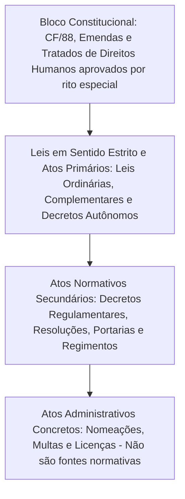
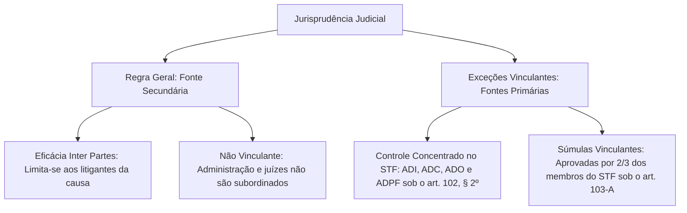
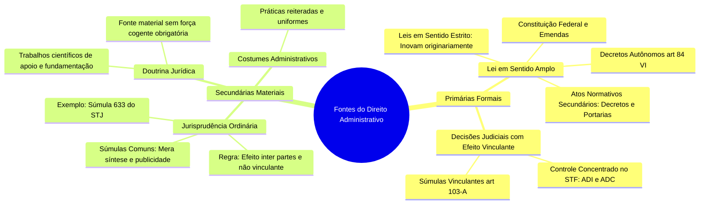

As fontes do Direito Administrativo constituem as matrizes de onde brotam as regras e os princípios que balizam a conduta dos agentes públicos. Na ciência jurídica, a expressão "fonte" reporta-se metaforicamente à nascente de um rio, indicando a origem e os fundamentos de validade de determinado ordenamento. Como a matéria não dispõe de um código único e sistemático, compreender como essas fontes se articulam e se hierarquizam torna-se essencial para identificar quais comandos vinculam compulsoriamente a Administração Pública e quais atuam apenas como vetores de interpretação e auxílio decisório.

Este capítulo examina detalhadamente a classificação bipartite entre fontes primárias e secundárias, a densidade normativa da lei em sentido amplo, o papel transformador da jurisprudência e de suas súmulas vinculantes e o influxo integrador da doutrina jurídica especializada.

> [!objetivos]
> - Classificar as fontes do Direito Administrativo em primárias e secundárias, formais e materiais.
> - Compreender a abrangência da lei em sentido amplo e sua hierarquia no ordenamento brasileiro.
> - Identificar a controvérsia doutrinária relativa à natureza dos atos normativos secundários.
> - Analisar a jurisprudência como fonte secundária e distinguir as hipóteses excepcionais de efeito vinculante.
> - Reconhecer a função da doutrina jurídica na criação legislativa e na fundamentação das decisões administrativas.

## A classificação geral das fontes administrativas

As fontes que alimentam o Direito Administrativo dividem-se em dois grandes agrupamentos doutrinários, estabelecidos em razão de sua obrigatoriedade formal e de seu processo de positivação: fontes primárias e fontes secundárias.

### Fontes primárias ou formais

As **fontes primárias** (também denominadas formais, organizadas, imediatas ou escritas) são aquelas que criam originariamente o direito positivo e impõem deveres jurídicos de observância compulsória. No ordenamento brasileiro, a fonte primária por excelência é a **lei em sentido amplo**.

A primazia da lei decorre diretamente do princípio da legalidade administrativa (CF, art. 37, caput). A Administração Pública encontra-se estritamente subordinada à vontade popular manifestada pelos diplomas legislativos. O administrador público só pode atuar quando a lei permitir, determinar ou autorizar expressamente. Por essa razão, atos que colidam frontalmente com as normas legais vigentes são portadores de vício insanável de nulidade, impondo-se a sua imediata anulação.

### Fontes secundárias ou materiais

As **fontes secundárias** (também chamadas de materiais, não organizadas, mediatas, supletivas ou subsidiárias) compreendem a **jurisprudência**, a **doutrina** e os **costumes**.

Essas fontes são qualificadas como "não organizadas" ou "não escritas" não porque inexista texto registrado em papel ou meio digital, mas sim porque não derivam do rito legislativo solene e padronizado do processo constitucional de elaboração normativa. Elas emergem diretamente da vida social, da práxis administrativa e da reflexão dos juristas, servindo como esteio hermenêutico e fonte material de inspiração para a produção legislativa formal. A Lei 9.784/1999, que disciplina o processo administrativo federal, é um exemplo emblemático dessa simbiose: o legislador positivou entendimentos que já haviam sido construídos pela doutrina e pelos tribunais, a exemplo do princípio da segurança jurídica e da gratuidade dos processos administrativos ordinários.

O quadro comparativo a seguir organiza as principais diferenças estruturais entre as duas classes de fontes.

| Critério distintivo | Fontes Primárias (Formais) | Fontes Secundárias (Materiais) |
| --- | --- | --- |
| Espécies abrangidas | Lei em sentido amplo (Constituição, leis e atos normativos) | Jurisprudência (em regra), Doutrina e Costumes |
| Força cogente | Obrigatória e vinculante para toda a Administração | Meramente indicativa, persuasiva e integradora |
| Processo de formação | Procedimento solene, numerado e publicado oficialmente | Construção histórica, reiterada e descentralizada |
| Papel funcional | Inova na ordem jurídica criando direitos e obrigações | Orienta a interpretação e inspira novas leis escritas |
| Consequência da violação | Ilegalidade imediata com dever de invalidação do ato | Não gera nulidade direta, salvo desrespeito à regra legal |

> [!bizu] Mnemônico das fontes primárias e secundárias
> Guarde a relação simples:
> - **Fonte Primária**: **LEI** em sentido amplo (e decisões com efeito vinculante).
> - **Fontes Secundárias**: mnemônico **JDC** (**J**urisprudência, **D**outrina e **C**ostumes).

## A lei em sentido amplo e a pirâmide normativa

No Direito Administrativo, a expressão "lei" deve ser compreendida em seu **sentido amplo** (*lato sensu*). Ela engloba qualquer ato normativo estatal dotado dos atributos fundamentais de **generalidade**, **abstração** e **impessoalidade**.
- A **generalidade** assegura que o mandamento se destina a um número indeterminado de indivíduos que venham a se encontrar na situação descrita.
- A **abstração** significa que a norma prevê uma hipótese fática aplicável a ocorrências futuras e sucessivas, não se esgotando em uma aplicação pontual e única.
- A **impessoalidade** impede que a norma seja editada com o propósito escuso de favorecer ou prejudicar determinada pessoa nominalmente identificada.

O esquema mermaid a seguir ilustra a hierarquia das espécies normativas no ordenamento jurídico brasileiro.

### O Bloco de Constitucionalidade

No ápice de toda a pirâmide situa-se a **Constituição Federal de 1988**, acompanhada de suas Emendas Constitucionais e dos tratados internacionais de direitos humanos aprovados em cada Casa do Congresso Nacional, em dois turnos, por três quintos dos votos dos respectivos membros (CF, art. 5º, § 3º).

Nenhuma norma ou comportamento administrativo pode subsistir se contrariar a Carta Magna. A conformidade deve ser dupla:
- **Conformidade formal**: respeito ao devido processo legislativo e às regras rígidas de iniciativa privativa. Como ilustração, projetos de lei que disponham sobre o regime jurídico dos militares estaduais ou fixem o efetivo das forças públicas são de iniciativa reservada do respectivo Governador de Estado.
- **Conformidade material**: compatibilidade substantiva com os princípios republicanos e com os direitos fundamentais insculpidos no texto constitucional.

### Leis em sentido estrito

As leis em sentido estrito (*stricto sensu*) constituem atos estatais **primários**, dotados da força originária de **inovar na ordem jurídica**, criando diretamente direitos, deveres, vedações e obrigações para os administrados. Integram esse patamar as espécies enumeradas no art. 59 da Constituição: leis complementares, leis ordinárias, leis delegadas e medidas provisórias com força de lei.

Ao lado das leis formais aprovadas pelo Parlamento, o ordenamento brasileiro admite uma hipótese específica de ato privativo do Chefe do Poder Executivo dotado de eficácia primária autônoma: os **decretos autônomos**, previstos no art. 84, VI, da Constituição Federal. Esses decretos encontram fundamento direto na própria Constituição, prescindindo de lei anterior, desde que destinados à organização do aparelho público sem aumento de despesas ou à extinção de cargos públicos vagos.

### Atos normativos administrativos secundários

Abaixo das leis situam-se os **atos normativos administrativos**. Tratando-se de atos secundários e infralegais, eles não possuem aptidão para criar obrigações novas nem para inovar originariamente na ordem jurídica. Sua destinação exclusiva é detalhar, explicitar e viabilizar a fiel execução dos comandos previstos nas leis formais.

A espécie mais relevante dessa categoria é o **decreto regulamentar** (ou executivo), expedido privativamente pelo Chefe do Poder Executivo com esteio no art. 84, IV, da Constituição. Além dos decretos, essa classe abrange as resoluções de órgãos colegiados, as portarias normativas expedidas por ministros e secretários de Estado, as instruções normativas e os regimentos internos de tribunais e casas legislativas.

Por fim, no patamar inferior, encontram-se os **atos administrativos concretos**, como a aplicação de uma penalidade de advertência ou a emissão de uma certidão de tempo de serviço. Esses atos possuem destinatário individualizado e produzem efeitos práticos imediatos; em razão de sua índole concreta e individual, **não configuram fontes** do Direito Administrativo, mas mera aplicação singular do direito existente.

### A controvérsia sobre os atos normativos secundários

Existe uma relevante polêmica teórica quanto ao enquadramento dos atos normativos secundários no quadro de fontes da disciplina:

A tabela abaixo sintetiza os dois posicionamentos doutrinários concorrentes sobre o tema.

| Corrente doutrinária | Posição sobre atos normativos | Argumento central de sustentação |
| --- | --- | --- |
| Posição Majoritária (Di Pietro e corrente moderna) | Considera **Fonte Primária** | Inserem-se no conceito de lei em sentido amplo; impõem deveres de cumprimento obrigatório a toda a Administração. |
| Posição Tradicional (Hely Lopes Meirelles) | Considera **Fonte Secundária** | Apenas a Constituição e as leis em sentido estrito inovam originariamente; atos secundários apenas detalham a lei prévia. |

> [!pegadinha]
> Não confunda a natureza do ato com a classificação da fonte. Um decreto regulamentar é um **ato normativo secundário** (porque não inova originariamente na ordem jurídica e depende de lei prévia). Todavia, para a corrente doutrinária amplamente dominante nas bancas de concurso, os decretos regulamentares constituem **fonte primária** do Direito Administrativo, pois integram o conceito abrangente de legalidade imposta à atuação dos órgãos públicos.

### Tratados internacionais

Os tratados, convenções e acordos internacionais constituem fontes supranacionais que passam a integrar formalmente o direito interno após a sua regular incorporação ao ordenamento brasileiro (celebração pelo Presidente da República, referendo pelo Congresso Nacional e promulgação por decreto presidencial).

Uma vez integrados, funcionam como fontes primárias do direito público, com hierarquia normativa variável segundo a matéria versada e o procedimento congressual adotado:
- **Status constitucional**: tratados de direitos humanos aprovados pelo quórum qualificado do art. 5º, § 3º, da CF;
- **Status supralegal**: tratados de direitos humanos celebrados pelo procedimento legislativo ordinário, situando-se abaixo da Constituição, mas acima de todas as leis infraconstitucionais ordinárias;
- **Status de lei ordinária**: tratados internacionais comuns que disponham sobre matérias tributárias, comerciais, administrativas ou aduaneiras.

## A jurisprudência como fonte e suas exceções vinculantes

A **jurisprudência** traduz-se no conjunto harmônico e reiterado de decisões proferidas pelos órgãos judiciais sobre uma mesma matéria jurídica controvertida. Não se trata de uma manifestação judicial isolada ou de um julgamento esparso, mas de uma linha interpretativa contínua e consolidada ao longo do tempo.

Os tribunais administrativos e os órgãos de controle externo, a exemplo do Tribunal de Contas da União e do Tribunal de Contas do Estado de Pernambuco, também produzem entendimentos consolidados que orientam as condutas dos administradores públicos, embora tais manifestações não possuam definitividade jurisdicional.

### O papel da súmula ordinária

A **súmula** nada mais é do que um instrumento técnico de formalização, síntese e publicidade da jurisprudência consolidada de um tribunal. Ela não cria direito novo, limitando-se a enunciar em termos concisos a tese jurídica pacificada em sucessivos julgamentos anteriores.

> [!jurisprudencia] STJ, Súmula 633
> Na ausência de legislação processual específica nos estados e municípios, incide subsidiariamente a disciplina da Lei Federal 9.784/1999, notadamente o limite decadencial para a autotutela anulatória de atos benéficos ao administrado.

A Súmula 633 do STJ demonstra com perfeição como a jurisprudência supre lacunas normativas locais: em municípios ou estados que não editaram leis locais de processo administrativo, aplica-se o prazo decadencial de cinco anos previsto no art. 54 da Lei 9.784/1999 para que a Administração anule atos favoráveis aos administrados praticados de boa-fé.

### A regra geral: fonte secundária e eficácia inter partes

Como regra geral, a jurisprudência é classificada como **fonte secundária** do Direito Administrativo. Essa classificação fundamenta-se no fato de que os provimentos judiciais comuns produzem efeitos apenas subjetivos (*inter partes*), vinculando exclusivamente os sujeitos litigantes que participaram daquela relação processual específica.

Por essa razão, uma decisão judicial que ordene a nomeação de um determinado candidato aprovado em concurso público não obriga a Administração a nomear automaticamente todos os demais candidatos aprovados na mesma situação fática. Para obter tutela similar, os outros interessados precisarão acionar individualmente as vias judiciais competentes ou obter provimento com eficácia coletiva.

> [!atencao] Jurisprudência comum não vincula o administrador
> Em regra, a jurisprudência não possui força vinculante perante a Administração Pública nem perante os próprios magistrados. Um órgão estatal pode continuar aplicando determinada interpretação administrativa, mesmo sabendo que os tribunais possuem orientação contrária, até que sobrevenha decisão com eficácia erga omnes ou imposição de ordem judicial específica.

### As exceções obrigatórias: fontes primárias vinculantes

Modernamente, o sistema jurídico brasileiro consagrou exceções de enorme relevo em que as deliberações do Poder Judiciário adquirem **eficácia erga omnes** (contra todos) e **efeito vinculante**, transformando-se em autênticas **fontes primárias** do Direito Administrativo.

O diagrama conceitual abaixo contrapõe a regra geral e as hipóteses vinculantes no âmbito jurisprudencial.

Essas hipóteses excepcionais dividem-se em duas categorias normativas:

1. **Decisões em controle concentrado de constitucionalidade**:
Conforme estabelece o art. 102, § 2º, da Carta Política, os julgamentos terminativos de mérito exarados pelo Supremo Tribunal Federal em sede de controle abstrato de constitucionalidade (em ADI e ADC) ostentam eficácia universal e subordinam compulsoriamente os magistrados e todo o aparato administrativo estatal nos três níveis de governo.

2. **Súmulas Vinculantes**:
Instituídas pela Emenda Constitucional 45/2004 e reguladas pelo art. 103-A da Carta Magna, as súmulas vinculantes são editadas com exclusividade pelo Supremo Tribunal Federal.

> [!lei] CF, art. 103-A, caput
> O Supremo Tribunal Federal poderá, de ofício ou por provocação, mediante decisão de dois terços dos seus membros, após reiteradas decisões sobre matéria constitucional, aprovar súmula que, a partir de sua publicação na imprensa oficial, terá efeito vinculante em relação aos demais órgãos do Poder Judiciário e à administração pública direta e indireta, nas esferas federal, estadual e municipal, bem como proceder à sua revisão ou cancelamento, na forma estabelecida em lei.

A edição de uma súmula vinculante exige a verificação cumulativa de dois pressupostos formais rígidos:
- Existência de decisões reiteradas da Suprema Corte sobre matéria exclusivamente constitucional;
- Aprovação por quórum qualificado mínimo de dois terços dos membros do STF (oito ministros).

Uma vez publicada no Diário Oficial, a Súmula Vinculante vincula prontamente toda a estrutura burocrática dos entes federados e os demais órgãos da Justiça brasileira. Na hipótese de ato administrativo ou decisão judicial descumprir o teor de uma Súmula Vinculante, a parte prejudicada pode ingressar diretamente com Reclamação Constitucional perante o Supremo Tribunal Federal.

> [!jurisprudencia] STF, Súmula Vinculante 44
> É obrigatória a prévia instituição em lei formal para que a aprovação em exame psicotécnico seja exigida como condição de habilitação de candidato em certame público.

O enunciado da SV 44 ilustra o impacto das súmulas vinculantes na rotina administrativa: antes de sua edição, muitos órgãos previam exames psicológicos eliminatórios exclusivamente no edital de abertura do certame. Com a súmula, qualquer edital que exija exame psicotécnico sem esteio em lei formal em sentido estrito é prontamente suspenso pelo Poder Judiciário.

A tabela comparativa a seguir destaca as diferenças fundamentais entre a súmula comum e a súmula vinculante.

| Elemento de contraste | Súmula Ordinária (Comum) | Súmula Vinculante |
| --- | --- | --- |
| Órgãos emissores | Todos os tribunais do país (STF, STJ, TST, TJ, TRF) | Exclusividade do Supremo Tribunal Federal |
| Quórum de aprovação | Definido nos regimentos internos de cada tribunal | Quórum constitucional qualificado de 2/3 (oito ministros) |
| Efeito perante a Administração | Persuasivo e indicativo; não obriga o administrador | Vinculante e compulsório para toda a Administração Direta e Indireta |
| Instrumento de impugnação | Recursos judiciais ordinários contra o ato | Reclamação Constitucional direta perante o STF |
| Natureza como fonte | Fonte secundária (regra geral) | Fonte primária (exceção qualificada com eficácia erga omnes) |

## A doutrina jurídica como fonte do Direito Administrativo

A **doutrina** é constituída pelo conjunto de reflexões teóricas, manuais, tratados científicos, artigos e teses formulados pelos estudiosos do direito. Historicamente, desempenhou papel pioneiro e indispensável na estruturação dos principais institutos da disciplina, delineando conceitos que hoje são universais, como o mérito administrativo, os poderes da autoridade pública e as teorias da responsabilidade civil do Estado.

Trata-se de uma autêntica **fonte secundária e material**. A doutrina não possui qualquer eficácia cogente ou vinculante. Nenhum magistrado ou autoridade pública é obrigado a seguir os ensinamentos de determinado autor, por mais renomado e respeitado que seja o jurista no cenário nacional.

Entretanto, sua força persuasiva é imensa. A doutrina atua ativamente na formação e aplicação prática da disciplina por meio de três funções primordiais:
1. **Função hermenêutica e de fundamentação decisória**: serve de subsídio técnico para motivar e fundamentar juridicamente sentenças, despachos administrativos e pareceres de procuradorias públicas;
2. **Função construtora da dogmática e dos princípios**: concebe categorias jurídicas e sintetiza princípios que posteriormente são incorporados pela jurisprudência dos tribunais;
3. **Função legiferante ou de inspiração legislativa**: subsidia e orienta o legislador no processo de criação das leis formais, antecipando soluções para problemas práticos observados na sociedade.

## Mapa do capítulo

O diagrama em formato de mapa mental abaixo condensa de forma clara toda a estrutura de fontes examinada no capítulo.

### Para fixar

- As fontes primárias são obrigatórias e inovam na ordem jurídica, tendo a lei em sentido amplo como expoente central.
- As fontes secundárias são a jurisprudência ordinária, a doutrina e os costumes, exercendo função hermenêutica integradora.
- A lei em sentido estrito inova originariamente na ordem jurídica, ao passo que os atos normativos secundários detalham a lei existente.
- Para a corrente majoritária, os atos normativos administrativos são atos secundários, mas atuam como fonte primária do direito.
- Os decretos autônomos (CF, art. 84, VI) inovam na ordem jurídica e possuem fundamento direto na Carta Magna.
- A jurisprudência comum é fonte secundária, produz efeitos inter partes e não vincula compulsoriamente a Administração Pública.
- As decisões em controle concentrado de constitucionalidade no STF e as súmulas vinculantes são fontes primárias com efeito erga omnes.
- A súmula vinculante é privativa do STF e exige aprovação de dois terços de seus ministros (CF, art. 103-A).
- A Súmula Vinculante 44 estabelece que a exigência de exame psicotécnico em concurso público depende obrigatoriamente de lei formal.
- A doutrina é fonte secundária e material, servindo de base teórica para a criação de leis e para a fundamentação de decisões públicas.
