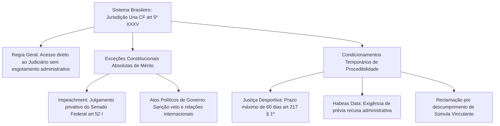
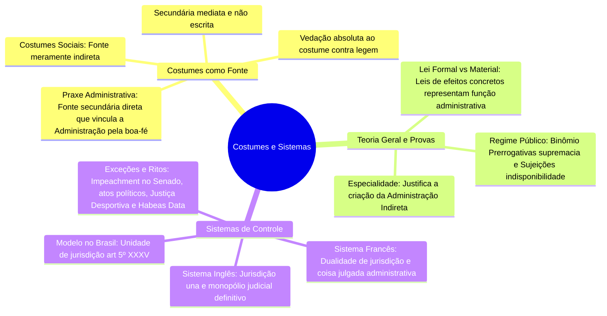

A compreensão das fontes do Direito Administrativo completa-se com a análise dos costumes e das práticas reiteradas que orientam a conduta dos agentes públicos. Em paralelo, a preservação do Estado de Direito exige mecanismos institucionais eficazes para controlar a legalidade dos atos estatais. A forma como um país estrutura a fiscalização sobre a conduta de seus governantes define o seu sistema administrativo de controle.

Este capítulo examina a força normativa residual dos costumes administrativos e da praxe funcional, sintetiza distinções conceituais cobradas pelas bancas examinadoras e aprofunda o confronto entre o sistema francês do contencioso administrativo e o sistema inglês de jurisdição una consagrado pela Constituição Federal de 1988.

> [!objetivos]
> - Definir os costumes como fonte secundária e distinguir costumes sociais de costumes administrativos.
> - Compreender os limites de validade do costume e a vedação absoluta à prática contra a lei.
> - Diferenciar lei formal de lei material e reconhecer a função administrativa em leis de efeitos concretos.
> - Comparar o sistema francês de dualidade de jurisdição e o sistema inglês de jurisdição una.
> - Identificar a adoção da jurisdição una no Brasil e suas raras exceções constitucionais.

## O costume como fonte do Direito Administrativo

O **costume** traduz-se na reiteração uniforme, constante e pública de determinado comportamento ao longo do tempo, acompanhada da convicção social de que aquela conduta é juridicamente obrigatória (*opinio juris vel necessitatis*). Ele decorre da prática espontânea e contínua dos indivíduos ou das autoridades diante de situações repetitivas.

Com a consolidação do princípio da legalidade administrativa e a expansão do direito positivo escrito, o costume perdeu grande parte de sua relevância prática original. No Direito Administrativo contemporâneo, a atuação estatal é regida predominantemente por regras escritas e vinculantes. Nada obstante a proliferação legislativa, o costume permanece classificado pela doutrina como uma **fonte secundária, mediata e não escrita**.

### Requisitos de validade do costume

Para que determinada prática consuetudinária possa ser reconhecida como fonte válida no âmbito administrativo, a doutrina exige a presença de três requisitos cumulativos:
1. **Elemento temporal ou objetivo**: a prática deve ser observada de modo contínuo, pacífico e uniforme durante período prolongado de tempo;
2. **Elemento subjetivo ou psicológico**: deve existir a consciência coletiva de que aquela conduta é juridicamente exigível, gerando legítima expectativa de estabilidade nas relações;
3. **Subordinação à legalidade**: o costume jamais pode contrariar disposição de lei expressa.

No Direito Público brasileiro, vigora a vedação categórica ao costume que contrarie a lei (*contra legem*). Nenhum hábito reiterado ou tolerância administrativa possui o condão de revogar norma legal válida ou convalidar condutas ilícitas. A inércia de órgãos de trânsito em multar estacionamentos irregulares em determinada via pública não transforma essa infração em direito adquirido do motorista.

O costume é admitido exclusivamente em duas modalidades complementares:
- **Costume segundo a lei** (*secundum legem*): a própria regra legal remete aos usos e costumes para integrar a aplicação do preceito;
- **Costume na omissão da lei** (*praeter legem*): atua de maneira subsidiária para suprir lacunas legislativas e orientar procedimentos internos nos quais inexista vedação expressa.

> [!atencao] Vedação absoluta ao costume contra legem
> Em Direito Administrativo, o costume jamais pode afastar o cumprimento de uma norma legal imperativa. A tolerância prolongada da autoridade com práticas ilegais não gera direitos nem desobriga o agente público do dever funcional de cumprir a lei.

### Costumes sociais versus costumes administrativos

Os administrativistas Marcelo Alexandrino e Vicente Paulo propõem uma relevante distinção conceitual entre costumes sociais e costumes administrativos:

- **Costumes sociais**: são regras de conduta não escritas observadas espontaneamente pela sociedade em geral. No Direito Administrativo, os costumes sociais atuam apenas como **fonte indireta**, influenciando o legislador ou a jurisprudência quando estes decidem acolher tais comportamentos no plano positivo.
- **Costumes administrativos (praxe administrativa)**: consistem nas práticas e rotinas procedimentais reiteradamente observadas pelos próprios agentes estatais no expediente cotidiano das repartições públicas.

Na presença de lacuna normativa, a praxe administrativa atua como verdadeira **fonte secundária direta**. Ela cria padrões decisórios estáveis que vinculam a própria Administração em respeito aos princípios da moralidade, da lealdade e da **boa-fé objetiva** (Lei 9.784/1999, art. 2º, parágrafo único, IV).

A tabela abaixo confronta analiticamente as duas categorias consuetudinárias.

| Critério de distinção | Costumes Sociais | Costumes Administrativos (Praxe) |
| --- | --- | --- |
| Sujeito originador | Comunidade e sociedade em geral | Agentes e repartições públicas estatais |
| Âmbito de incidência | Relações sociais amplas e interindividuais | Rotinas procedimentais internas da Administração |
| Natureza como fonte | Fonte meramente indireta | Fonte secundária supletiva direta |
| Desdobramento jurídico | Podem inspirar futuras leis e teses judiciais | Podem gerar direitos subjetivos ao administrado de boa-fé |

> [!exemplo]
> Uma repartição pública municipal sempre atendeu ao público externo até as dezessete horas, fixando essa prática costumeira ao longo de anos sem contestação. No último dia do prazo para um munícipe protocolar recurso em processo de fiscalização de obras, a chefia do setor encerra o expediente às quinze horas, sem divulgação prévia. O munícipe que comparece às dezesseis horas não pode ter seu recurso considerado intempestivo. A praxe administrativa consolidada gerou legítima confiança, que não pode ser frustrada por decisão abrupta da autoridade.

## Síntese de temas fundamentais em provas de concurso

Antes de avançar para os sistemas de controle, convém sistematizar certos pontos teóricos da teoria geral do Direito Administrativo frequentemente explorados pelas bancas organizadoras.

### Leis em sentido formal e leis em sentido material

A doutrina constitucional e administrativa classifica as leis em duas categorias fundamentais:
- **Lei em sentido material**: é o ato estatal que possui conteúdo intrínseco de norma jurídica, caracterizado pela generalidade e abstração. Uma lei que estabelece os tipos de infrações ambientais ou o regimento interno de um tribunal de justiça constitui lei em sentido material, pois disciplina hipóteses futuras aplicáveis a qualquer indivíduo.
- **Lei em sentido formal**: é o diploma que percorreu fielmente todo o processo legislativo constitucional de elaboração perante o Parlamento, recebendo o número e a forma de lei, independentemente de seu conteúdo ser abstrato ou concreto.

Essa distinção é crucial para o Direito Administrativo. Há hipóteses em que o Poder Legislativo aprova uma **lei formal de efeitos concretos**, isto é, uma lei que se dirige a uma situação individual e com destinatário específico.

Como exemplo clássico, cite-se a lei federal que concede uma pensão especial individualizada à viúva de um ex-combatente da Segunda Guerra Mundial. Embora revista a forma solene de lei, esse diploma não inova abstratamente na sociedade; ele realiza a aplicação concreta do direito a um caso pontual. Ao editar essa lei, o Poder Legislativo desempenha materialmente uma **função administrativa atípica**.

### Prerrogativas e sujeições no regime público

O regime jurídico-administrativo fundamenta-se em um binômio indissociável concebido por Celso Antônio Bandeira de Mello:
- **Prerrogativas da Administração**: traduzem a supremacia do interesse público sobre o privado. Conferem ao Estado privilégios e poderes que o colocam em posição de superioridade perante o cidadão, a exemplo da rescisão unilateral de contratos administrativos e da autoexecutoriedade de atos de polícia.
- **Sujeições administrativas**: derivam do postulado da **indisponibilidade do interesse público**. Esse princípio não se dirige ao administrado, mas sim ao **administrador público**. O gestor não é dono da coisa pública, mas mero guardião de bens e interesses que pertencem a toda a sociedade.

Em razão da indisponibilidade, o agente público submete-se a restrições que não existem na vida privada:
1. Imposição indeclinável de realização de concurso público para provimento de cargos e empregos efetivos (CF, art. 37, II);
2. Dever estrito de realizar licitação prévia para a contratação de obras, serviços e aquisições (CF, art. 37, XXI);
3. Limitações formais rígidas para a alienação e penhora de bens públicos;
4. Obrigação contínua de prestar contas de recursos e dinheiros públicos.

## Sistemas administrativos de controle

Os **sistemas administrativos** (também denominados sistemas de controle) constituem o conjunto integrado de instituições e garantias processuais contempladas no ordenamento jurídico destinadas a fiscalizar a legalidade e a legitimidade da atuação administrativa.

Sem um sistema de controle institucionalizado, a Administração Pública poderia incidir em ilegalidades flagrantes sem que o cidadão lesado dispusesse de instrumentos eficazes de defesa. No direito comparado, destacam-se dois grandes modelos antagônicos: o sistema francês e o sistema inglês.

### O Sistema Francês (Contencioso Administrativo ou Dualidade de Jurisdição)

O **sistema francês**, também denominado sistema do **contencioso administrativo** ou da **dualidade de jurisdição**, caracteriza-se pela coexistência harmônica de dois ramos jurisdicionais soberanos, independentes e dotados de competências estanques:

1. **A Jurisdição Administrativa**: exercida por tribunais administrativos especializados, tendo no ápice o prestigioso Conselho de Estado francês (*Conseil d'État*). Esse ramo possui competência material exclusiva para processar e julgar todos os litígios nos quais a Administração Pública seja parte.
2. **A Jurisdição Comum (Poder Judiciário)**: exercida pelos tribunais judiciais comuns, incumbidos de apreciar exclusivamente as controvérsias de natureza civil, penal e comercial travadas entre particulares.

A marca indelével do sistema francês reside na circunstância de que os tribunais administrativos proferem decisões dotadas de **força de definitividade absoluta**. A deliberação final da justiça administrativa francesa opera coisa julgada material, não podendo ser revista nem anulada pelos juízes do Poder Judiciário comum.

Historicamente, esse modelo nasceu da desconfiança dos revolucionários de 1789 em relação aos juízes aristocráticos dos antigos parlamentos judiciais franceses, que tentavam barrar as medidas republicanas. Para impedir interferências indevidas, vedou-se aos juízes judiciais conhecer de litígios administrativos, instituindo-se tribunais no seio da própria estrutura executiva.

### O Sistema Inglês (Jurisdição Una ou Monopólio da Jurisdição)

O **sistema inglês**, conhecido doutrinariamente como **sistema de jurisdição una**, **unidade de jurisdição** ou **monopólio de jurisdição**, assenta-se na premissa de que apenas os órgãos do Poder Judiciário exercem jurisdição em sentido próprio.

Nesse modelo, todos os conflitos de interesses surgidos na sociedade, sejam controvérsias travadas entre particulares, sejam litígios envolvendo o Estado e os cidadãos, podem ser submetidos à apreciação final e definitiva dos juízes e tribunais integrantes do Poder Judiciário.

A existência da jurisdição una não impede que a Administração Pública aprecie defesas, julgue recursos internos e solucione controvérsias no âmbito administrativo. Todavia, essas deliberações não adquirem caráter imutável perante a Justiça. Se o administrado ou o próprio Estado discordar do resultado administrativo, a matéria poderá ser levada ao crivo judicial a qualquer tempo, onde será proferida a decisão definitiva transitada em julgado.

A tabela a seguir confronta detalhadamente as características estruturais dos dois sistemas administrativos.

| Parâmetro de comparação | Sistema Francês (Dualidade de Jurisdição) | Sistema Inglês (Jurisdição Una) |
| --- | --- | --- |
| Estrutura de julgamento | Dois ramos jurisdicionais autônomos e soberanos | Ramo judicial único (Poder Judiciário exclusivo) |
| Julgamento de atos do Estado | Privativo dos tribunais da Justiça Administrativa | Privativo dos juízes e tribunais do Poder Judiciário |
| Definitividade administrativa | Decisões administrativas produzem coisa julgada | Decisões administrativas podem ser revistas pelo Judiciário |
| Revisão judicial de atos estatais | Vedada aos tribunais judiciais comuns | Universal e ampla quanto à legalidade e legitimidade |
| Adoção histórica no Brasil | Vigente apenas no Império de modo consultivo | Adotado na República desde 1891 e mantido na CF/88 |

## O sistema adotado no Brasil e suas exceções constitucionais

O ordenamento jurídico brasileiro adota categoricamente o **sistema inglês de jurisdição una**. A consagração desse princípio decorre diretamente do texto expresso da Constituição Federal de 1988.

> [!lei] CF, art. 5º, XXXV
> a lei não excluirá da apreciação do Poder Judiciário lesão ou ameaça a direito;

Esse dispositivo consagra o **princípio da inafastabilidade da tutela jurisdicional** (ou princípio do livre acesso à Justiça). Nenhuma lei infraconstitucional ou ato administrativo pode impedir que o indivíduo que sofreu lesão ou ameaça a direito busque o amparo do Poder Judiciário.

### Autotutela e controle administrativo

A vigência da jurisdição una não suprime a capacidade fiscalizatória da própria Administração Pública sobre sua atividade. O Poder Executivo não precisa recorrer previamente ao Judiciário para desfazer atos ilegais praticados por seus próprios agentes.

Esse poder-dever é materializado pelo princípio da **autotutela administrativa**, sintetizado na clássica jurisprudência do Supremo Tribunal Federal.

> [!jurisprudencia] STF, Súmula 473
> A administração pode anular seus próprios atos, quando eivados de vícios que os tornam ilegais, porque deles não se originam direitos; ou revogá-los, por motivo de conveniência ou oportunidade, respeitados os direitos adquiridos, e ressalvada, em todos os casos, a apreciação judicial.

A anulação de atos ilegais e a revogação de atos inoportunos são manifestações legítimas do controle interno da Administração, mas permanecem sempre ressalvadas ao controle jurisdicional caso haja alegação de lesão a direito.

### Exceções e condicionamentos ao acesso judicial

No Brasil, vigora a regra geral de que **o acesso ao Poder Judiciário independe do prévio esgotamento das instâncias administrativas**. O servidor punido ou o cidadão que teve licença negada não precisa interpor todos os recursos administrativos previstos na lei para ajuizar ação anulatória perante a Justiça comum.

> [!pegadinha]
> Afirmar que o administrado é obrigado a esgotar todos os recursos na via administrativa antes de ingressar com ação no Poder Judiciário é uma armadilha clássica de concurso. A regra geral constitucional assegura o acesso direto ao Judiciário, mesmo que a via administrativa não tenha sido deflagrada ou se encontre pendente de julgamento.

Todavia, a própria Constituição Federal e a legislação trazem situações pontuais de exceções absolutas e de condicionamentos temporários que devem ser dominados para a prova.

O fluxograma mermaid abaixo resume as manifestações da jurisdição una e suas hipóteses de conformação no sistema brasileiro.

As hipóteses delimitadas pela doutrina e pela jurisprudência organizam-se da seguinte forma:

1. **Julgamento de impeachment pelo Senado Federal**:
Nos termos do art. 52, I, da Constituição Federal, compete privativamente ao Senado Federal processar e julgar o Presidente da República nos crimes de responsabilidade. Trata-se de julgamento de natureza político-jurídica, cuja condenação é proferida por dois terços dos votos dos senadores. O Poder Judiciário pode exercer o controle de regularidade formal e de garantias constitucionais do rito, mas não pode adentrar o mérito da decisão condenatória ou absolutória soberanamente adotada pelo Parlamento.

2. **Atos políticos ou de governo**:
Atos praticados com fundamento direto na Constituição pelo Chefe do Poder Executivo, como a escolha de vetar projeto de lei por motivo de interesse público ou a condução de relações diplomáticas com outras nações, não admitem revisão judicial em seu mérito político.

3. **Justiça Desportiva**:
O art. 217, § 1º, da Constituição estabelece que o Poder Judiciário somente admitirá ações relativas à disciplina e às competições desportivas após esgotarem-se as instâncias da justiça desportiva. Não se trata de uma justiça autônoma dotada de coisa julgada material, mas de um condicionamento temporário de procedibilidade que se encerra compulsoriamente no prazo máximo de sessenta dias.

4. **Habeas Data**:
O ajuizamento de habeas data perante a Justiça exige a demonstração inequívoca de recusa prévia da autoridade administrativa em fornecer os dados pessoais requeridos pelo cidadão, ou o decurso dos prazos legais sem manifestação do órgão estatal (Súmula 2 do STJ).

5. **Reclamação contra descumprimento de Súmula Vinculante**:
A Lei 11.417/2006 (art. 7º, § 1º) determina que, contra omissão ou ato da Administração Pública que contrarie Súmula Vinculante, somente caberá Reclamação Constitucional perante o STF após o esgotamento das vias administrativas prévias.

## Mapa do capítulo

O diagrama em formato de mapa mental abaixo resume os conceitos fundamentais de costumes e sistemas administrativos estudados neste capítulo.

### Para fixar

- O costume é fonte secundária, não escrita e subsidiária do Direito Administrativo, aplicável apenas na omissão legal (*praeter legem*).
- É terminantemente vedada a incidência de costumes que contrariem a lei (*contra legem*).
- A praxe administrativa constitui costume dos agentes públicos e vincula a conduta estatal com esteio na lealdade e na boa-fé.
- Leis em sentido formal de efeitos concretos consubstanciam o exercício de função administrativa pelo Poder Legislativo.
- O princípio da indisponibilidade do interesse público dirige-se ao administrador e impõe os deveres de licitar e realizar concurso público.
- O princípio da especialidade é o fundamento da criação de entidades descentralizadas da Administração Indireta.
- O sistema francês opera a dualidade de jurisdição, na qual tribunais administrativos decidem com força de definitividade absoluta.
- O sistema inglês adota a jurisdição una, cabendo exclusivamente ao Poder Judiciário proferir decisões com autoridade de coisa julgada material.
- O Brasil adota a jurisdição una com esteio no princípio da inafastabilidade da tutela jurisdicional do art. 5º, XXXV, da CF.
- O mérito da condenação por crime de responsabilidade pelo Senado Federal (art. 52, I, da CF) e atos políticos não são revistos judicialmente.
