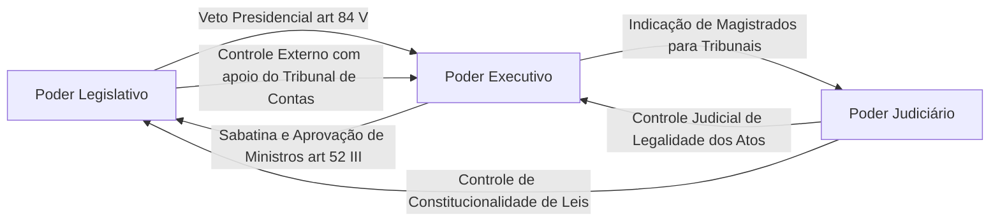
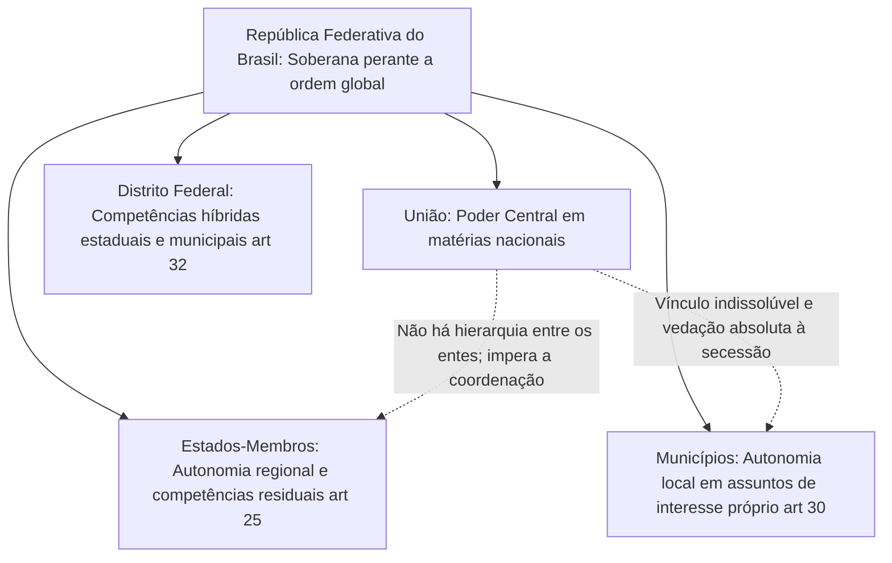
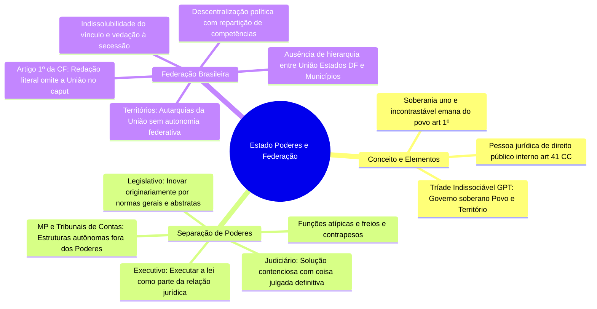

O Direito Administrativo tem por finalidade central disciplinar o funcionamento do aparelho estatal na consecução das necessidades da coletividade. Para compreender como a atividade administrativa se desenvolve na prática, é indispensável examinar a própria estrutura do Estado, a divisão funcional de seus poderes e o modelo federativo de repartição territorial e política de competências. O Estado não atua de modo arbitrário ou desordenado: organiza-se sob os ditames do Estado Democrático de Direito, submetendo governantes e governados ao primado das normas constitucionais.

Neste capítulo, estudam-se os elementos constitutivos do Estado, a clássica tripartição de funções concebida por Montesquieu, a dinâmica harmoniosa entre funções típicas e atípicas com seu sistema de freios e contrapesos e as características estruturantes da Federação brasileira, concluindo com uma introdução técnica ao conceito de governo.

> [!objetivos]
> - Definir o conceito de Estado sob os prismas político, sociológico e jurídico, identificando seus três elementos constitutivos.
> - Compreender os postulados do Estado de Direito e a separação dos Poderes estatais.
> - Distinguir com precisão as funções típicas e atípicas exercidas pelos Poderes Legislativo, Executivo e Judiciário.
> - Analisar o mecanismo de freios e contrapesos e a natureza institucional de órgãos autônomos como o Ministério Público e o Tribunal de Contas.
> - Identificar as características fundamentais da forma federativa de Estado acolhida no Brasil e a situação jurídica dos entes federados e dos Territórios.

## Conceito de Estado e seus elementos constitutivos

O Estado moderno emergiu das revoluções liberais ocorridas no final do século XVIII, notadamente com a independência norte-americana de 1776 e a Revolução Francesa de 1789. Com a superação dos regimes absolutistas, o indivíduo deixou de ser um súdito submisso para assumir a condição de cidadão titular de direitos inalienáveis perante o poder público.

Sob o ponto de vista jurídico, o Estado constitui uma **pessoa jurídica de direito público interno** (Código Civil, art. 41, I). No plano internacional, manifesta-se como sujeito de direito soberano nas relações diplomáticas perante outras nações. No plano interno, atua como entidade personalizada dotada de capacidade plena para adquirir direitos patrimoniais e contrair obrigações jurídicas.

A teoria geral do Estado costuma analisar o instituto sob três ângulos conceituais:
- **Prisma sociológico**: corporação territorial dotada de poder de mando originário;
- **Prisma político**: comunidade humana fixada de forma estável sobre um território delimitado, organizada politicamente sob uma autoridade superior de coerção;
- **Prisma constitucional**: pessoa jurídica de direito público territorial e politicamente soberana.

Para que exista um Estado de maneira plena, a doutrina é pacífica ao exigir a coexistência de três elementos originários e indissociáveis: **povo**, **território** e **governo soberano**.

O quadro analítico a seguir discrimina os três elementos formadores da estrutura estatal.

| Elemento do Estado | Natureza jurídica | Papel e desdobramento prático |
| --- | --- | --- |
| Povo | Componente humano e demográfico | Conjunto de cidadãos ligados ao Estado pelo vínculo da nacionalidade |
| Território | Base física e espacial | Espaço geográfico delimitado onde o Estado exerce com exclusividade sua soberania |
| Governo Soberano | Elemento condutor e político | Poder supremo e incontrastável de auto-organização, autodeterminação e coerção legítima |

> [!bizu] Mnemônico dos elementos do Estado
> Lembre-se da sigla **GPT**:
> - **G**overno soberano (capacidade de comando e coerção legítima);
> - **P**ovo (elemento humano nacional);
> - **T**erritório (base geográfica de validade da ordem jurídica).

A **soberania** representa o atributo definidor do poder estatal. No plano externo, expressa a independência e a igualdade jurídica do Brasil perante outros países; no plano interno, traduz-se no poder supremo de criar a ordem jurídica e de se fazer obedecer compulsoriamente em todo o território nacional. Conforme preconiza o art. 1º, parágrafo único, da Constituição da República, todo o poder emana do povo, que o exerce por meio de representantes eleitos ou diretamente.

## O Estado de Direito e a separação de poderes

O **Estado de Direito** consolida a vitória histórica da legalidade sobre o absolutismo monárquico. Sob essa matriz republicana, o Estado cria o direito por meio de seus órgãos constituídos, mas permanece estritamente vinculado às próprias normas que edita. Governantes e governados subordinam-se à ordem jurídica vigente.

A estruturação do Estado de Direito assenta-se sobre três pilares clássicos:
1. **Primazia da legalidade**: a autoridade pública não atua por mero capricho pessoal; sua conduta depende de expressa autorização ou determinação legal;
2. **Universalidade da tutela jurisdicional**: todos os atos praticados pelo Poder Público sujeitam-se a controle contencioso independente perante a Justiça;
3. **Tripartição dos poderes estatais**: o exercício do poder divide-se em funções orgânicas especializadas para evitar a tirania e a concentração desmedida de atribuições.

Em sua célebre obra *"O Espírito das Leis"* (1748), o Barão de Montesquieu sistematizou a separação dos poderes para garantir a liberdade individual. O poder estatal, embora substancialmente uno e indivisível, tem o seu exercício atribuído a diferentes complexos orgânicos. A Carta Magna de 1988 consagrou esse postulado de forma solene.

> [!lei] CF, art. 2º
> São Poderes da União, independentes e harmônicos entre si, o Legislativo, o Executivo e o Judiciário.

A separação dos Poderes constitui garantia tão estruturante da ordem democrática que o constituinte originário a alçou à condição de **cláusula pétrea**, insuscetível de abolição ou supressão mediante emenda à Constituição (CF, art. 60, § 4º, III).

### Funções típicas e funções atípicas dos Poderes

Nenhum dos Poderes da República exerce com exclusividade absoluta uma única tarefa estatal. Cada Poder desempenha com preponderância uma **função típica** (atribuída primariamente pela Constituição segundo sua especialização orgânica) e desempenha, de modo secundário e expressamente previsto, certas **funções atípicas**.

As funções estatais delineiam-se materialmente da seguinte forma:
- **Função legislativa (normativa)**: edição de atos normativos primários, gerais e abstratos, com fundamento direto na Constituição, inovando originariamente no ordenamento jurídico. Ao criar a lei, o Estado permanece acima e à margem da relação privada que disciplina.
- **Função jurisdicional**: resolução imparcial de controvérsias concretas mediante aplicação do direito objetivo com força de definitividade (*coisa julgada material*). O Estado atua como terceiro desinteressado provocável.
- **Função administrativa**: execução concreta e contínua das determinações legais e constitucionais para atender às necessidades sociais no interior de uma estrutura hierarquizada. Ao administrar, o Estado participa diretamente como parte da relação jurídica instaurada.

A tabela comparativa abaixo detalha o exercício típico e atípico de funções por cada um dos três Poderes da União.

| Poder constitucional | Função Típica | Funções Atípicas constitucionalmente outorgadas |
| --- | --- | --- |
| Poder Legislativo | Função normativa (elaborar leis formais e fiscalizar o Executivo) | **Administrativa**: realiza licitações, concursos e gerencia seus servidores; **Jurisdicional**: o Senado processa e julga o Presidente nos crimes de responsabilidade (art. 52, I). |
| Poder Judiciário | Função jurisdicional (julgar conflitos com definitividade) | **Administrativa**: contrata serviços, faz concurso e concede férias a servidores; **Legislativa**: elabora os regimentos internos de seus tribunais (art. 96, I, a). |
| Poder Executivo | Função administrativa (gerir serviços públicos e executar a lei) | **Legislativa**: edita medidas provisórias (art. 62), leis delegadas (art. 68) e decretos autônomos de organização (art. 84, VI). |

> [!pegadinha]
> Ao Poder Executivo **é terminantemente vedado o desempenho de jurisdição autêntica**. Quando uma junta administrativa de recursos ou um conselho tributário julga a impugnação de um contribuinte, opera-se apenas a chamada "coisa julgada administrativa". A decisão encerra o debate no âmbito burocrático interno, mas não produz coisa julgada material definitiva nem impede que o administrado acione o Poder Judiciário para anular o ato.

### O sistema de freios e contrapesos (Checks and Balances)

A convivência harmônica e independente preconizada no art. 2º da Constituição é assegurada pelo mecanismo de **freios e contrapesos** (*checks and balances*). Trata-se de controles recíprocos e legítimos que impedem a hegemonia ou a prepotência de um Poder sobre os demais.

O diagrama estrutural abaixo sintetiza as principais interferências mútuas entre os três Poderes da República.

São manifestações clássicas de freios e contrapesos no direito brasileiro:
- A prerrogativa do Presidente da República de vetar projetos de lei aprovados pelo Parlamento (CF, art. 84, V);
- A competência do Congresso Nacional de rejeitar o veto presidencial ou sustar atos normativos do Executivo que exorbitem do poder regulamentar (CF, art. 49, V);
- O poder dos juízes e tribunais de declarar a inconstitucionalidade de leis ou atos do Poder Público;
- A atribuição do Senado Federal de sabatinar e aprovar a nomeação de ministros dos tribunais superiores e do Procurador-Geral da República indicados pelo Chefe do Executivo (CF, art. 52, III).

### Estruturas independentes fora dos três Poderes

A doutrina constitucional e administrativa dominante assinala com firmeza que a divisão tripartite acolhida no Brasil não é uma "quadripartição". Certas instituições republicanas exercem prerrogativas insuprimíveis de extrema relevância sem se subordinar a nenhum dos três Poderes clássicos:
- O **Ministério Público** (CF, art. 127): instituição permanente e autônoma, essencial à função jurisdicional do Estado, incumbida da defesa da ordem jurídica, do regime democrático e dos interesses sociais e individuais indisponíveis;
- Os **Tribunais de Contas** (CF, arts. 71 e 75): órgãos dotados de autonomia orgânica, orçamentária e técnica, incumbidos de exercer o controle externo contábil, financeiro e operacional da Administração Pública, atuando como órgãos auxiliares independentes do Parlamento.

> [!atencao] Ministério Público e Tribunais de Contas não integram Poderes
> É incorreto afirmar em questões de concurso que o Tribunal de Contas da União pertence à estrutura burocrática do Poder Legislativo ou que o Ministério Público integra o Poder Executivo ou o Judiciário. Ambas são estruturas constitucionais autônomas e independentes, não subordinadas a nenhum dos três Poderes da República.

## Forma de Estado e a Federação brasileira

Na lição clássica do constitucionalista Pedro Lenza, a organização estatal projeta-se sobre três dimensões complementares: a forma de Estado, a forma de governo e o sistema de governo.

A **forma de Estado** diz respeito à maneira pela qual o poder político distribui-se no território geográfico do país. Sob esse critério, contrapõem-se dois grandes modelos:
- **Estado Unitário**: caracteriza-se pela centralização política. Existe um único polo ou centro de poder governamental com competência legislativa e administrativa sobre toda a nação e suas coletividades regionais (o Uruguai representa o modelo clássico na América do Sul).
- **Estado Federado (Federação)**: fundamenta-se na descentralização política institucionalizada. O território abriga uma multiplicidade de ordens políticas autônomas que convivem de maneira coordenada nos níveis nacional, regional e local.

A tabela comparativa a seguir destaca as divergências fundamentais entre as duas modalidades organizacionais de Estado.

| Critério de contraste | Estado Unitário | Estado Federado (Federação) |
| --- | --- | --- |
| Distribuição do poder | Centralizado em um único núcleo governamental | Descentralizado em núcleos políticos autônomos |
| Centros de legislação | Unidade legislativa nacional plena | Múltiplos polos legiferantes (federal, estadual e municipal) |
| Autonomia das regiões | Meramente administrativa ou descentralizada | Autonomia política, orçamentária e auto-organizatória |
| Vínculo entre as ordens | Subordinação hierárquica ao centro | Coordenação e equilíbrio sem subordinação entre os entes |
| Exemplo de adoção | Uruguai, França, Portugal | Brasil, Estados Unidos, Alemanha, México |

### Traços característicos da Federação no Brasil

O Brasil constitui uma República Federativa. Essa opção política reflete uma federação madura, caracterizada por traços essenciais sistematizados pela doutrina:

1. **Descentralização política com repartição constitucional de competências**: a Carta de 1988 fixa rigidamente as atribuições privativas, comuns e concorrentes dos entes federados (arts. 21 a 24 e art. 30);
2. **Constituição rígida**: a estabilidade do pacto federativo assenta-se em uma Carta Magna solene, cujo processo de alteração por emendas exige rito qualificado e votação em dois turnos por três quintos de cada Casa legislativa (CF, art. 60);
3. **Inexistência de direito de secessão (Indissolubilidade do vínculo)**: uma vez integrado à Federação, nenhum Estado ou Município possui a faculdade jurídica de separar-se ou proclamar independência territorial. A forma federativa constitui **cláusula pétrea expressa** (CF, art. 60, § 4º, I);
4. **Soberania do Estado Federal versus autonomia dos entes**: a **soberania** pertence com exclusividade à República Federativa do Brasil como um todo (o país perante a ordem internacional). Os entes federados integrantes (União, Estados, Distrito Federal e Municípios) possuem unicamente **autonomia política, administrativa e financeira**, exercida nos limites estritos traçados pela Constituição;
5. **Mecanismo de intervenção federal**: instrumento extremo de preservação da ordem constitucional destinado a reequilibrar crises institucionais graves e garantir a integridade nacional (CF, art. 34);
6. **Auto-organização dos Estados-membros**: poder de elaborar suas próprias Constituições Estaduais e leis locais (CF, art. 25);
7. **Representação paritária no Parlamento**: os Estados e o Distrito Federal contam com representação política igualitária perante a câmara alta do Congresso Nacional, corporificada no Senado Federal (CF, art. 46);
8. **Guardião da Constituição**: competência deferida ao Supremo Tribunal Federal para dirimir conflitos federativos e assegurar a prevalência das regras de competência (CF, art. 102, I, f);
9. **Repartição de receitas tributárias**: transferências obrigatórias de fundos de participação para assegurar viabilidade financeira e diminuir disparidades regionais (CF, arts. 157 a 159).

O esquema em formato mermaid abaixo ilustra a conformação estrutural da Federação brasileira.

### Inexistência de hierarquia entre os entes federados

No sistema federativo brasileiro, **não existe qualquer relação de subordinação ou hierarquia** entre a União, os Estados, o Distrito Federal e os Municípios. Do mesmo modo, não há hierarquia abstrata entre leis federais, estaduais e municipais.

Eventual aparente conflito entre atos normativos emanados de diferentes esferas não se resolve pela superioridade de um ente sobre o outro, mas sim pelas regras constitucionais de partilha de competências com base no postulado da **preponderância de interesses**:
- À **União** competem as matérias de interesse geral e predominância nacional (defesa externa, emissão de moeda, relações internacionais);
- Aos **Estados-membros** reserva-se a competência remanescente ou residual de interesse regional (CF, art. 25, § 1º);
- Aos **Municípios** incumbem os assuntos de predominante interesse local e a prestação do transporte coletivo urbano (CF, art. 30, I e V);
- Ao **Distrito Federal** veda-se a divisão em municípios, acumulando em sua esfera orgânica todas as competências legislativas e materiais atribuídas aos Estados e aos Municípios (CF, art. 32, § 1º).

### A situação dos Territórios Federais e a literalidade do art. 1º da CF

Dois detalhes pontuais exigem atenção redobrada dos candidatos em razão de sua exploração recorrente pelas bancas:

Em primeiro lugar, os **Territórios Federais não são entes federativos**. Conforme dispõe o art. 18, § 2º, da Carta Política, os Territórios integram a pessoa jurídica da União e configuram meras autarquias territoriais descentralizadas, desprovidas de autonomia política originária.

> [!atencao] Territórios Federais não possuem autonomia política
> Caso venham a ser criados por lei complementar, os Territórios Federais não integram a Federação como entes autônomos. Eles constituem autarquias administrativas pertencentes à própria União.

Em segundo lugar, cabe destacar a singularidade redacional observada no caput do art. 1º da Lei Fundamental de 1988:

> [!lei] CF, art. 1º, caput
> A República Federativa do Brasil, formada pela união indissolúvel dos Estados e Municípios e do Distrito Federal, constitui-se em Estado Democrático de Direito...

> [!pegadinha]
> O texto literal do dispositivo inaugural da Carta Magna omite a palavra "União", consignando apenas a união indissolúvel dos Estados, Municípios e DF. Embora a doutrina pacífica reconheça que a União integra a Federação como ente político autônomo (como expressamente confirma o art. 18, caput), as bancas cobram com frequência a reprodução estrita dessa redação originária.

## Noção introdutória de governo

Para compreender a exata distinção entre a esfera governamental e a Administração Pública, matéria que ganha contornos definitivos nos capítulos seguintes, torna-se essencial fixar a tríplice conceituação técnica de governo legada por Hely Lopes Meirelles:
- **Governo em sentido formal**: compreende o conjunto dos Poderes e órgãos constitucionais encarregados da cúpula do Estado;
- **Governo em sentido material**: abrange o complexo das funções estatais básicas e a formulação de diretrizes políticas amplas;
- **Governo em sentido operacional**: corporifica a condução política dos negócios públicos por meio de atos de comando e planejamento superior.

Em síntese, o **governo** atua no plano das decisões políticas fundamentais e dos atos de soberania (*políticas públicas e planejamento estratégico*), enquanto a **Administração Pública** opera no plano subalterno da execução técnica cotidiana dessas diretrizes.

Os chamados atos de governo emanam diretamente da ordem constitucional e ostentam elevada margem de discricionariedade política, a exemplo da sanção ou veto de projetos de lei e da decretação de estado de calamidade pública. Em contrapartida, os atos administrativos constituem manifestações estritamente subordinadas à legislação ordinária, cumprindo os desígnios formulados pela cúpula governamental em benefício da coletividade.

## Mapa do capítulo

O diagrama em formato de mapa mental abaixo condensa os pilares teóricos desenvolvidos neste capítulo sobre a organização estatal.

### Para fixar

- Os elementos constitutivos e indissociáveis do Estado são o povo, o território e o governo soberano.
- O Estado é pessoa jurídica de direito público interno, ao passo que a soberania é o poder supremo exercido pela Federação.
- O Estado de Direito caracteriza-se pela legalidade estrita, universalidade jurisdicional e tripartição dos poderes.
- Os Poderes da República exercem funções típicas preponderantes e funções atípicas secundárias previstas na Constituição.
- O Poder Executivo não exerce função jurisdicional em sentido próprio; suas deliberações geram apenas coisa julgada administrativa.
- O Ministério Público e os Tribunais de Contas são órgãos autônomos e independentes que não integram nenhum dos três Poderes.
- O Brasil adota a forma federativa de Estado, marcada pela descentralização política e ausência de direito de secessão.
- A forma federativa e a separação dos Poderes são cláusulas pétreas insuscetíveis de abolição por emenda (CF, art. 60, § 4º).
- Não há hierarquia nem subordinação entre a União, os Estados, o Distrito Federal e os Municípios.
- Os Territórios Federais integram a União e constituem meras autarquias territoriais, não sendo entes federativos autônomos.
