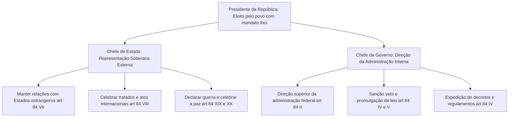
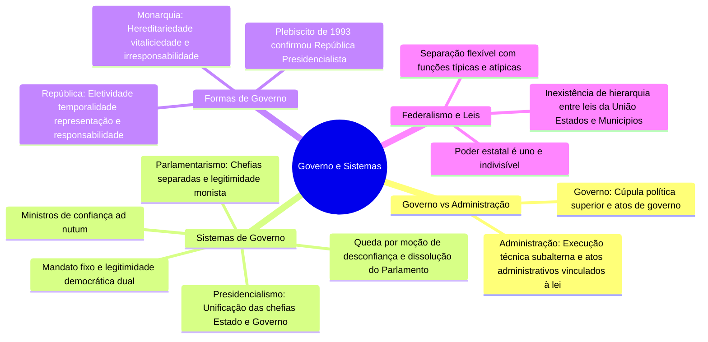

O estudo do Direito Administrativo exige uma demarcação precisa entre a atividade de governar e a atividade de administrar. Embora no senso comum os termos "governo" e "administração" sejam frequentemente utilizados como se fossem sinônimos, a ciência jurídica confere a cada um deles um significado técnico próprio. Enquanto o governo expressa a vontade soberana do Estado e traça as diretrizes políticas de longo prazo, a Administração Pública atua como instrumento executor dessas decisões fundamentais.

Neste capítulo, examinam-se o conceito dogmático de governo, o sistema de governo com o confronto analítico entre presidencialismo e parlamentarismo e a forma de governo com a contraposição entre república e monarquia, revisando ainda pontos de alta incidência sobre o federalismo e a separação dos Poderes.

> [!objetivos]
> - Diferenciar conceitual e funcionalmente o governo da Administração Pública em sentido estrito.
> - Comparar os sistemas de governo presidencialista e parlamentarista, identificando as atribuições do Chefe de Estado e do Chefe de Governo.
> - Contrastar a forma de governo republicana com a monárquica e elencar os atributos do princípio republicano.
> - Analisar a legitimação dual no presidencialismo e a legitimação monista no parlamentarismo.
> - Compreender a inexistência de hierarquia entre as leis dos entes federativos e o critério da preponderância de interesses.

## Governo e Administração Pública: distinção fundamental

Para compreender a exata engrenagem do Estado contemporâneo, é imperioso estabelecer a fronteira entre os órgãos que governam e os órgãos que administram.

O **governo** corporifica a cúpula dirigente do Estado. Trata-se do complexo orgânico e funcional incumbido da condução política superior dos negócios públicos, exercendo atribuições diretamente fundamentadas no texto constitucional. É o governo que define as metas fundamentais da sociedade, planeja as políticas públicas estruturantes, estabelece as diretrizes estratégicas nacionais e exerce o comando supremo das relações institucionais e internacionais. A atividade governamental atua por meio de **atos de governo** (ou atos políticos), marcados por ampla discricionariedade e orientados pelo critério da conveniência e oportunidade política.

Por sua vez, a **Administração Pública** em sentido estrito representa o aparato burocrático, técnico e subalterno responsável por transformar essas diretrizes governamentais em realidade prática para os administrados. A Administração não cria as grandes diretrizes políticas de maneira autônoma; seu papel é executar os planos aprovados pelos governantes, prestando serviços públicos, exercendo a fiscalização de polícia administrativa e promovendo o desenvolvimento social. Enquanto o governo age por comandos políticos superiores, a Administração atua por meio de **atos administrativos** rigorosamente vinculados e subordinados aos limites estabelecidos pela lei formal.

A tabela comparativa a seguir sintetiza as principais divergências funcionais entre a atividade governamental e a atividade administrativa.

| Aspecto de confronto | Governo (Atividade Política) | Administração Pública (Atividade Administrativa) |
| --- | --- | --- |
| Posição institucional | Cúpula soberana e órgãos constitucionais superiores | Estrutura técnica, instrumental e subalterna |
| Natureza da função | Função política, de coordenação, comando e direção | Função técnica de execução concreta e contínua |
| Fundamento normativo | Atuação fundada diretamente na Constituição | Atuação subordinada estritamente à legislação ordinária |
| Espécie de atos | Atos políticos ou de governo (sanção, veto, guerra) | Atos administrativos típicos (multa, licença, certidão) |
| Controle jurisdicional | Controle judicial restrito a aspectos de constitucionalidade | Controle pleno de legalidade e moralidade pelo Judiciário |

## Sistemas de governo: presidencialismo e parlamentarismo

O **sistema de governo** diz respeito ao modo como se estruturam as relações institucionais entre o Poder Executivo e o Poder Legislativo no exercício cotidiano da condução do Estado. O direito comparado consagra duas matrizes principais: o presidencialismo e o parlamentarismo.

### O sistema presidencialista

No **presidencialismo**, modelo adotado no Brasil desde a Proclamação da República e expressamente ratificado pelo plebiscito popular de 1993 (ADCT, art. 2º), vigora o princípio da separação nítida e equilibrada entre os Poderes.

A marca estruturante do presidencialismo reside na **unificação das chefias** na figura do Presidente da República. O Chefe do Executivo desempenha simultaneamente dois papéis distintos:
1. **Chefe de Estado**: personifica a soberania e a unidade da República Federativa do Brasil perante a ordem internacional. Compete-lhe manter relações diplomáticas com países estrangeiros, celebrar tratados e acordos internacionais (CF, art. 84, VIII) e declarar guerra ou celebrar a paz com autorização congressual (CF, art. 84, XIX e XX).
2. **Chefe de Governo**: lidera a gestão interna da máquina pública e participa ativamente do processo legislativo. Incumbe-lhe exercer a direção superior da administração pública federal com o auxílio de seus ministros, iniciar projetos de lei privativos, sancionar e promulgar leis, vetar proposições contrárias ao interesse público e expedir decretos regulamentares (CF, art. 84, II a V).

> [!lei] CF, arts. 76 e 84, II
> Art. 76. O Poder Executivo é exercido pelo Presidente da República, auxiliado pelos Ministros de Estado.
> Art. 84. Compete privativamente ao Presidente da República:
> II - exercer, com o auxílio dos Ministros de Estado, a direção superior da administração federal;

O diagrama mermaid abaixo ilustra o duplo papel exercido pelo Presidente da República no sistema presidencialista brasileiro.

No presidencialismo, o governante é eleito para um **mandato com prazo determinado** (mandato fixo de quatro anos no Brasil, permitida uma única reeleição consecutiva). O Presidente não depende da aprovação permanente da maioria do Congresso Nacional para conservar o seu cargo. Ele somente pode ser destituído de forma excepcional antes do término do mandato mediante condenação formal em processo de impeachment por crime de responsabilidade, julgado pelo Senado Federal com quórum qualificado de dois terços (CF, art. 52, I e parágrafo único).

Os Ministros de Estado são auxiliares diretos do Presidente da República, nomeados e exonerados livremente sob o critério da confiança (*cargos de demissão ad nutum*).

### O sistema parlamentarista

No **parlamentarismo**, predomina a íntima colaboração, interdependência e integração política entre o Poder Executivo e o Poder Legislativo.

Diferentemente do modelo presidencialista, no parlamentarismo ocorre a **separação das chefias**:
- A **Chefia de Estado** é exercida pelo Presidente da República (nas repúblicas parlamentaristas, como a Itália e a Alemanha) ou pelo Monarca (nas monarquias parlamentaristas, como o Reino Unido e a Espanha). Esse governante exerce funções representativas de representação e estabilidade institucional;
- A **Chefia de Governo** é desempenhada pelo **Primeiro-Ministro** (ou Chanceler), acompanhado de seu Gabinete Ministerial. O Primeiro-Ministro é quem efetivamente comanda as políticas governamentais e dirige a administração pública.

O Chefe de Governo é indicado pelo Chefe de Estado, mas depende da prévia aprovação e sustentação da maioria dos membros do Parlamento. No parlamentarismo, o Primeiro-Ministro **não possui mandato com prazo fixo**. O governo pode ser destituído a qualquer instante caso o partido governista perca a maioria congressual ou se o Parlamento aprovar uma **moção de desconfiança** (ou voto de censura).

Como contrapartida desse controle, o Chefe de Estado dispõe da prerrogativa de decretar a **dissolução do Parlamento**, convocando eleições legislativas gerais extraordinárias para que o corpo de eleitores decida o novo equilíbrio de forças políticas.

A tabela a seguir confronta os traços essenciais do presidencialismo e do parlamentarismo.

| Elemento de análise | Sistema Presidencialista | Sistema Parlamentarista |
| --- | --- | --- |
| Distribuição das chefias | Unificadas na figura do Presidente da República | Separadas entre Chefe de Estado e Primeiro-Ministro |
| Vínculo entre os Poderes | Independência orgânica e separação equilibrada | Intensa colaboração política e interdependência |
| Prazo do mandato do Chefe | Mandato com prazo determinado (mandato fixo) | Ausência de prazo fixo; depende da maioria política |
| Hipótese de destituição | Apenas por impeachment em crime de responsabilidade | Voto de desconfiança ou perda da maioria parlamentar |
| Prerrogativa de dissolução | Inexiste dissolução do Parlamento pelo Executivo | O Chefe de Estado pode dissolver o Parlamento |
| Seleção dos ministros | Escolha discricionária e exoneração livre (*ad nutum*) | Ministros compõem o Gabinete e integram o Parlamento |

### Legitimidade democrática dual versus monista

Uma das distinções teóricas mais cobradas pelas bancas examinadoras sobre sistemas de governo reside na origem da soberania popular:

No **presidencialismo**, vigora a chamada **legitimidade democrática dual** (regime dualista). O sistema possui duas fontes independentes e diretas de legitimação outorgadas pelo voto do cidadão: os eleitores escolhem diretamente o Chefe do Poder Executivo e, em votação autônoma, escolhem os representantes do Poder Legislativo. O Presidente não deriva seu mandato do Parlamento, dispondo de autoridade popular própria.

No **parlamentarismo**, opera-se a **legitimidade democrática monista** (regime monista). O povo vota diretamente para eleger apenas os integrantes do Parlamento. O Poder Executivo governante deriva a sua investidura da confiança outorgada pela assembleia representativa, inexistindo eleição popular direta para a escolha do Primeiro-Ministro.

> [!atencao] Origem da legitimidade democrática
> Lembre-se para a prova: o presidencialismo ostenta duas fontes diretas de legitimidade popular (Presidente e Parlamento), configurando regime dual; o parlamentarismo possui uma única fonte direta de legitimação pelo voto (o Parlamento), consubstanciando regime monista.

## Formas de governo: república e monarquia

A **forma de governo** expressa a maneira como o poder político é instituído e transmitido ao longo do tempo em uma sociedade, bem como a natureza do vínculo mantido entre governantes e cidadãos. As duas modalidades clássicas são a república e a monarquia.

### A forma republicana de governo

A palavra **república** origina-se da expressão latina *res publica*, que significa literalmente "coisa pública" ou "assunto do povo". Ela traduz o postulado de que o poder pertence à sociedade e deve ser exercido em proveito do bem comum, sob rígida igualdade formal de todos perante a lei.

O princípio republicano edifica-se sobre quatro características indissociáveis:
1. **Eletividade**: os governantes ascendem ao comando político mediante a escolha voluntária e soberana dos cidadãos por meio de eleições periódicas;
2. **Temporalidade no exercício do poder**: o governante exerce o poder por um mandato com prazo pré-determinado, sendo vedada a perpetuação indefinida ou vitalícia em cargos eletivos;
3. **Representatividade popular**: os detentores dos mandatos atuam em nome do povo, que é o legítimo titular originário do poder soberano;
4. **Responsabilidade do governante**: quem governa tem o dever indeclinável de prestar contas de todos os atos e recursos administrados, sujeitando-se a sanções políticas, civis e criminais por ilícitos praticados na gestão.

O Brasil adota categoricamente a **República** como forma de governo, consagrada desde a Constituição de 1891 e reafirmada solenemente no art. 1º da Carta de 1988.

### A forma monárquica de governo

Em sentido diametralmente oposto, a **monarquia** assenta-se em premissas tradicionais e dinásticas nas quais o poder não emana da vontade popular:
- **Hereditariedade**: a investidura na chefia de Estado ocorre por sucessão consanguínea ou dinástica, transmitida no seio de uma determinada família real;
- **Vitaliciedade**: o monarca assume o trono por prazo indeterminado, conservando o posto até a sua morte ou até eventual abdicação voluntária;
- **Inexistência de representação popular originária**: o poder do soberano decorre de tradição consuetudinária ou prerrogativa hereditária, e não de eleição periódica;
- **Irresponsabilidade política e jurídica do monarca**: historicamente sintetizada no aforismo *"the king can do no wrong"*, significando que o rei não responde perante os súditos pelos atos praticados pela coroa.

A tabela comparativa a seguir evidencia o contraste entre as duas formas históricas de governo.

| Critério de avaliação | Forma Republicana (República) | Forma Monárquica (Monarquia) |
| --- | --- | --- |
| Mecanismo de investidura | Eletividade mediante eleições periódicas | Hereditariedade por sucessão familiar dinástica |
| Duração do mandato | Temporalidade (mandatos com prazo fixado) | Vitaliciedade (permanência até morte ou abdicação) |
| Titularidade do poder | Representatividade popular (*res publica*) | Pertencente à linhagem real hereditária |
| Prestação de contas | Responsabilidade política, civil e criminal | Irresponsabilidade jurídica do monarca |
| Adoção no Brasil | Vigente desde 1891 e confirmada no plebiscito | Vigente no Brasil Império (1822 a 1889) |

> [!bizu] Mnemônico das três dimensões do Estado
> Para nunca mais confundir os institutos em provas de concurso:
> - **Forma de Estado**: **FE**deração (lembre-se: **F**orma de **E**stado = **FE**deração);
> - **Forma de Governo**: **FOGO** na **REPÚBLICA** (**FO**rma de **GO**verno = **República**);
> - **Sistema de Governo**: **SIGO** o **PRESIDENTE** (**SI**stema de **GO**verno = **Presidencialismo**).

## Questões e pontos recorrentes em provas sobre Estado e Governo

Determinadas questões interdisciplinares entre Direito Administrativo e Constitucional retornam ciclicamente nos concursos organizados pelas principais bancas do país. Convém fixar seus alicerces conceituais:

### Unicidade do poder e separação flexível

Embora o poder estatal seja distribuído funcionalmente entre órgãos dos Poderes Legislativo, Executivo e Judiciário, **o poder político do Estado permanece uno e indivisível**. A tripartição constitui apenas uma técnica de organização e especialização de tarefas voltada a assegurar a liberdade e a eficiência administrativa.

Ademais, o modelo brasileiro adota uma separação de Poderes **flexível**, e não rígida. Cada Poder exerce predominantemente a sua função típica, mas desempenha tarefas atípicas expressamente catalogadas no texto constitucional, sem que isso afronte a harmonia mútua garantida no art. 2º da Constituição.

### Inexistência de hierarquia entre as leis dos entes federados

No Estado Federal brasileiro, não existe qualquer hierarquia abstrata entre uma lei federal, uma lei estadual e uma lei municipal. As bancas de concurso tentam frequentemente induzir o candidato ao erro afirmando que a lei federal sempre se sobrepõe à legislação dos demais entes federados.

O convívio normativo regula-se pelo **princípio da preponderância de interesses** e pela repartição constitucional de competências:
- Se uma lei federal invadir a competência privativa de um município para dispor sobre horário de funcionamento do comércio local ou transporte coletivo urbano (CF, art. 30, I e V), a lei federal padecerá de inconstitucionalidade material por usurpação de competência;
- Se uma lei municipal tentar disciplinar matéria reservada à competência privativa da União, como direito penal ou normas de trânsito e transporte (CF, art. 22, I e XI), a lei municipal será nula pelo mesmo fundamento.

A eventual invalidade decorre do desrespeito às regras constitucionais de partilha de matérias, e não de uma suposta superioridade hierárquica entre entes políticos autônomos.

> [!pegadinha]
> A afirmativa de que "a lei federal é hierarquicamente superior à lei estadual ou municipal" é incorreta. No ordenamento brasileiro, todas as leis infraconstitucionais válidas encontram-se no mesmo patamar de eficácia formal, resolvendo-se eventuais conflitos pela repartição de competências fixada na Constituição Federal.

## Mapa do capítulo

O diagrama em formato de mapa mental abaixo condensa de maneira panorâmica todos os tópicos examinados neste capítulo sobre governo, formas e sistemas.

### Para fixar

- O governo define as diretrizes políticas superiores do Estado, enquanto a Administração Pública executa tecnicamente essas diretrizes.
- No modelo presidencialista, os papéis de liderança soberana externa e de direção governamental interna concentram-se na figura do Presidente da República.
- O Chefe do Executivo no presidencialismo possui mandato fixo, só podendo ser destituído em caso de impeachment por crime de responsabilidade.
- O presidencialismo possui legitimidade democrática dual, enquanto o parlamentarismo possui legitimidade monista centrada no Parlamento.
- No parlamentarismo, as chefias de Estado e de Governo são separadas, podendo o gabinete cair por moção de desconfiança.
- A República caracteriza-se pela eletividade, temporalidade dos mandatos, representatividade popular e dever de prestar contas.
- A Monarquia fundamenta-se na hereditariedade, vitaliciedade, ausência de representação popular e irresponsabilidade do soberano.
- O plebiscito de 1993 (ADCT, art. 2º) confirmou a República como forma e o Presidencialismo como sistema de governo no Brasil.
- A separação de Poderes no Brasil é flexível, permitindo o exercício de funções atípicas expressamente autorizadas na Constituição.
- Não há hierarquia entre leis federais, estaduais e municipais; eventuais conflitos resolvem-se pela repartição constitucional de competências.
