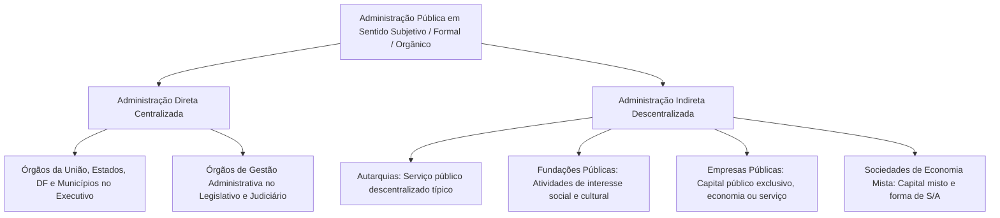
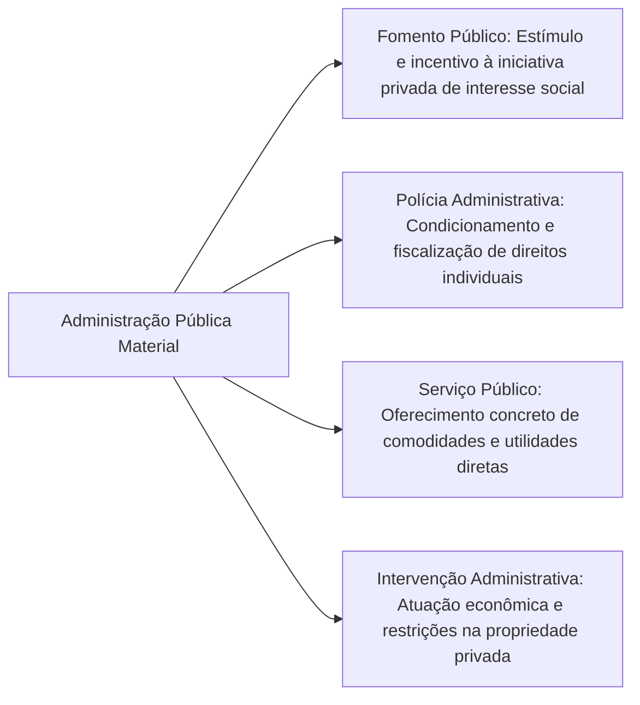
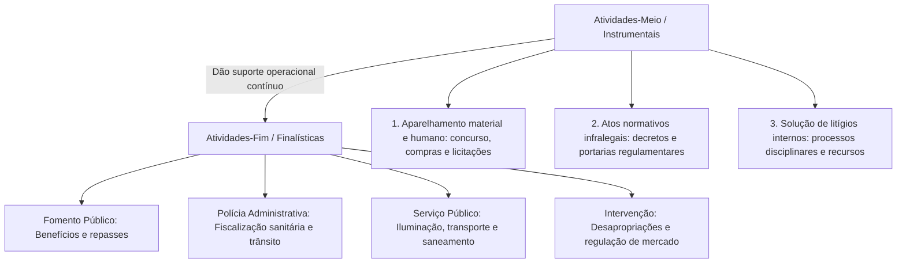
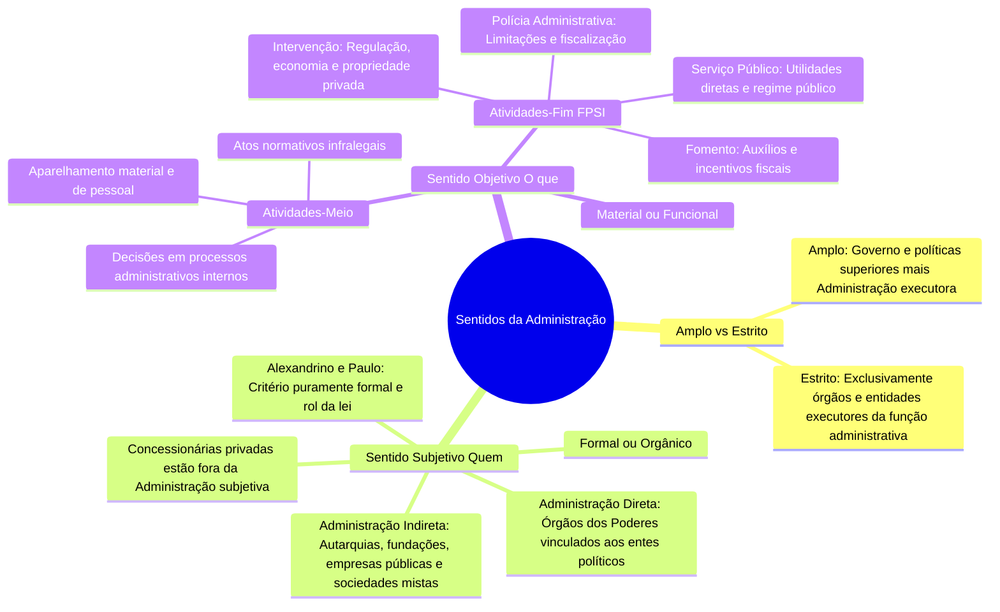

A expressão "Administração Pública" ostenta caráter polissêmico na ciência do Direito Administrativo. Dependendo do ângulo metodológico adotado pelo intérprete, o termo pode designar o conjunto orgânico de pessoas jurídicas e agentes que compõem o aparelho burocrático do Estado ou, de modo diverso, a própria atividade prática desempenhada por essas estruturas. Além dessa dicotomia, faz-se imperioso delimitar o alcance da expressão em seus sentidos amplo e estrito, expurgando as funções puramente governamentais que refogem ao campo administrativo.

Neste capítulo conclusivo do primeiro volume, examinam-se as acepções estrita e ampla da Administração Pública, aprofundam-se os prismas subjetivo (formal ou orgânico) e objetivo (material ou funcional), detalham-se as quatro atividades finalísticas e as atividades-meio estatais e examina-se a divergência doutrinária relativa aos limites da intervenção estatal na economia.

> [!objetivos]
> - Diferenciar a Administração Pública em sentido amplo da Administração Pública em sentido estrito.
> - Compreender o sentido subjetivo, formal ou orgânico, identificando a composição da administração direta e indireta.
> - Analisar o sentido objetivo, material ou funcional e classificar as quatro atividades finalísticas do Estado.
> - Distinguir atividades-fim de atividades-meio e identificar os atos instrumentais de suporte administrativo.
> - Reconhecer as particularidades doutrinárias sobre a intervenção estatal no domínio econômico e na propriedade privada.

## Sentidos amplo e estrito da Administração Pública

Para identificar com precisão o objeto de estudo da disciplina, a doutrina jurídica delimita o alcance da expressão "Administração Pública" em duas dimensões fundamentais: o sentido amplo e o sentido estrito.

### A Administração Pública em sentido amplo

Em **sentido amplo**, a Administração Pública engloba tanto os **órgãos governamentais de cúpula**, encarregados da função política e do comando superior do Estado, quanto os **órgãos e entidades puramente administrativos**, incumbidos da execução técnica das decisões governamentais.

Sob esse ângulo abrangente, a expressão projeta-se em dois planos:
- **Aspecto subjetivo amplo**: compreende os órgãos constitucionais de governo (Presidência da República, Governadorias, Ministérios, Secretarias) e a totalidade das pessoas jurídicas e órgãos administrativos executores;
- **Aspecto objetivo amplo**: engloba a **função política** (fixação de metas, elaboração de diretrizes, atos de soberania) somada à **função administrativa** de execução.

### A Administração Pública em sentido estrito

Em **sentido estrito**, a Administração Pública compreende exclusivamente os órgãos, agentes e entidades que exercem a **função administrativa**. Encontram-se terminantemente excluídos dessa acepção os órgãos de cúpula governamental quando no exercício de funções políticas, bem como os atos de governo.

É exatamente o **sentido estrito que interessa ao Direito Administrativo**. O ramo administrativo não se ocupa de estudar a formulação de diretrizes de governo ou atos de soberania; sua incumbência científica é disciplinar o funcionamento do maquinismo administrativo subordinado que executa a vontade da lei.

A clássica lição de Hely Lopes Meirelles sintetiza essa separação: o governo comanda, traça diretrizes e pratica **atos de governo** com respaldo constitucional direto (como a decretação de estado de defesa, de sítio ou a sanção e o veto de leis); por outro lado, a Administração não pratica atos de governo, mas tão somente **atos administrativos** de execução subordinada à ordem jurídica.

A tabela comparativa a seguir evidencia o contraste entre as duas acepções doutrinárias.

| Critério de demarcação | Sentido Amplo | Sentido Estrito (Objeto da Disciplina) |
| --- | --- | --- |
| Estrutura subjetiva envolvida | Órgãos políticos de governo mais órgãos administrativos executores | Apenas órgãos, entidades e agentes executores da função administrativa |
| Funções exercidas | Função política governamental e função administrativa | Exclusivamente a função administrativa de execução |
| Espécie de atos praticados | Atos políticos e soberanos mais atos de execução | Tão somente atos administrativos vinculados à legislação |
| Pertinência ao Direito Administrativo | Apenas parcial, na parcela que executa as políticas | Integralidade; constitui o núcleo próprio da matéria |

## O sentido subjetivo, formal ou orgânico: "Quem" executa

O **sentido subjetivo**, também denominado **formal** ou **orgânico**, olha para os **sujeitos** da atuação administrativa. Ele responde à indagação elementar: *"quem integra o aparelho da Administração e exerce a função administrativa?"*.

Sob essa perspectiva, a Administração Pública é conceituada como o conjunto de **agentes públicos**, **órgãos estatais** e **pessoas jurídicas** que recebem do ordenamento a incumbência de desempenhar a atividade administrativa do Estado.

> [!atencao] Convenção gráfica: Maiúsculas versus Minúsculas
> Na literatura especializada e nas provas de concurso, adota-se uma convenção gráfica consagrada:
> - **Administração Pública** (com iniciais maiúsculas): designa o sentido subjetivo, formal ou orgânico, identificando o conjunto de sujeitos, órgãos e pessoas jurídicas do aparelho estatal;
> - **administração pública** (com iniciais minúsculas): reporta-se ao sentido objetivo, material ou funcional, indicando a própria atividade administrativa em si.

No ordenamento positivo brasileiro, a Administração Pública em sentido formal divide-se em dois grandes blocos institucionais (Decreto-Lei 200/1967, art. 4º):
1. **Administração Direta (ou centralizada)**: congrega o conjunto de órgãos públicos integrados diretamente na estrutura das pessoas jurídicas políticas que compõem a Federação (União, Estados, Distrito Federal e Municípios). Abrange os ministérios, secretarias de Estado e departamentos vinculados ao Poder Executivo, estendendo-se também aos órgãos administrativos dos Poderes Legislativo e Judiciário (secretarias administrativas, diretorias de recursos humanos e mesas diretoras), nos quais se desempenha função administrativa atípica.
2. **Administração Indireta (ou descentralizada)**: compreende as entidades dotadas de personalidade jurídica própria, criadas ou autorizadas por lei pelos entes políticos para o desempenho especializado de determinadas atividades públicas. Congrega quatro categorias formais: as autarquias e as fundações públicas, ao lado das empresas públicas e das sociedades de economia mista.

> [!lei] CF, art. 37, caput
> A administração pública direta e indireta de qualquer dos Poderes da União, dos Estados, do Distrito Federal e dos Municípios obedecerá aos princípios de legalidade, impessoalidade, moralidade, publicidade e eficiência...

O diagrama mermaid abaixo estrutura a composição subjetiva da Administração Pública brasileira.

### A divergência doutrinária de Alexandrino e Paulo

Os juristas Marcelo Alexandrino e Vicente Paulo apresentam uma importante reflexão sobre os limites conceituais do critério subjetivo.

A doutrina tradicional costuma afirmar que a Administração Pública subjetiva é formada pelos sujeitos que exercem a função administrativa. Todavia, os autores apontam que essa assertiva padece de duas imperfeições técnicas:
- Por um lado, as **empresas concessionárias e permissionárias de serviços públicos** (como uma companhia privada de transporte rodoviário) desempenham materialmente função administrativa por delegação, mas **não integram** a Administração Pública em sentido subjetivo;
- Por outro lado, certas entidades administrativas, como as **empresas públicas e sociedades de economia mista exploradoras de atividade econômica** no mercado (a exemplo de um banco estatal), integram a Administração Pública Indireta, embora não exerçam função administrativa típica de serviço público ou poder de polícia.

Diante disso, Alexandrino e Paulo sustentam que o Brasil adota o **critério estritamente formal**: é Administração Pública no Brasil apenas aquilo que a legislação positiva formalmente reconhece como tal, independentemente da atividade desempenhada no mundo concreto. Por essa ótica, a Administração Pública brasileira é integrada **exclusivamente** pelos órgãos da administração direta e pelas entidades da administração indireta.

> [!pegadinha]
> Concessionárias e permissionárias de serviços públicos executam função administrativa em sentido objetivo (material), prestando serviços essenciais à coletividade sob delegação estatal. Contudo, em hipótese alguma integram a Administração Pública em sentido subjetivo (orgânico). Elas são pessoas jurídicas de direito privado pertencentes ao setor particular.

## O sentido objetivo, material ou funcional: "O que" se realiza

O **sentido objetivo**, denominado indistintamente pela doutrina como **material** ou **funcional**, volta seus olhos para a **atividade administrativa em si**. Ele responde à questão: *"o que o Estado realiza concretamente ao desempenhar a função administrativa?"*.

Nessa acepção, a administração pública é a atividade concreta, direta e imediata que o Estado desenvolve, sob regime de direito público total ou preponderante, com o propósito de atender aos interesses coletivos (Di Pietro).

O sentido material projeta-se sobre quatro grandes atividades finalísticas (*atividades-fim*), que justificam a própria criação e manutenção das estruturas estatais: fomento, polícia administrativa, serviço público e intervenção administrativa.

O esquema mermaid a seguir ilustra a divisão das quatro atividades-fim da administração pública material.

### Fomento público

O **fomento** compreende o conjunto de medidas administrativas de incentivo e estímulo adotadas pelo Poder Público para apoiar a iniciativa privada de utilidade pública ou interesse social relevante. Em vez de executar a atividade por meio de seus próprios órgãos, o Estado auxilia pessoas físicas e entidades não governamentais a desenvolvê-la.

O fomento manifesta-se através de múltiplos instrumentos:
- Concessão de subvenções sociais e auxílios financeiros diretos;
- Linhas de crédito e financiamentos públicos com taxas e condições subsidiadas;
- Desonerações tributárias, incentivos fiscais e isenções condicionadas;
- Repasse de recursos materiais e cessão de uso de bens públicos para entidades beneficentes e educacionais do terceiro setor.

### Polícia administrativa e poder de polícia

A **polícia administrativa** (ou poder de polícia) corporifica a atividade pela qual o Poder Público condiciona, limita, restringe e fiscaliza o exercício de direitos individuais, liberdades civis e o uso da propriedade privada em proveito do interesse coletivo.

Diferentemente da polícia judiciária (que atua repressivamente sobre pessoas na apuração de infrações penais), a polícia administrativa atua de forma eminentemente preventiva e fiscalizatória sobre bens, direitos e atividades econômicas. Exemplificam essa atuação a fiscalização sanitária em restaurantes, a concessão de habite-se em edificações urbanas, a vistoria veicular pelo Detran e a expedição de licenças ambientais.

### Serviço público e prestação de utilidades

O **serviço público** é a atividade material concreta, contínua e imediata prestada pelo Estado, ou por terceiros sob regime de concessão ou permissão, destinada a satisfazer reclamos e necessidades essenciais da coletividade sob regime jurídico predominantemente público (CF, art. 175).

Caracteriza-se pela aplicação de postulados fundamentais, tais como a continuidade do serviço, a modicidade das tarifas cobradas dos usuários, a mutabilidade do regime para modernização técnica e a igualdade de tratamento a todos os consumidores. São exemplos emblemáticos o transporte público de passageiros, a distribuição de energia elétrica, o fornecimento de água tratada e a coleta de esgoto.

### Intervenção administrativa do Estado

A **intervenção administrativa** projeta-se sobre duas searas distintas da vida social: o domínio econômico e a propriedade privada.

A doutrina subdivide a intervenção em três modalidades operacionais:
- **Intervenção indireta no domínio econômico**: consiste na regulamentação, normatização e fiscalização da atividade econômica privada, exercida primordialmente pelas agências reguladoras setoriais;
- **Intervenção direta no domínio econômico**: corporifica a atuação estatal empresarial na exploração de atividade econômica de mercado por intermédio de empresas públicas e sociedades de economia mista, admitida pela Constituição apenas em situações excepcionais de segurança nacional ou relevante interesse coletivo (CF, art. 173, caput);
- **Intervenção na propriedade privada**: manifesta-se por atos estatais concretos que restringem temporária ou definitivamente o uso de bens particulares em favor da comunidade, a exemplo da desapropriação por utilidade pública, servidão administrativa, tombamento de patrimônio histórico, requisição administrativa e ocupação temporária.

> [!atencao] A intervenção direta para Maria Sylvia Di Pietro
> Para a jurista Maria Sylvia Zanella Di Pietro, a função administrativa abrange apenas atividades regidas predominantemente pelo direito público. Como a exploração direta da atividade econômica de mercado por empresas estatais submete-se ao regime de direito privado (CF, art. 173, § 1º, II), a autora entende que essa modalidade direta não constitui função administrativa em sentido estrito; apenas a intervenção indireta (regulação) e a intervenção na propriedade privada ostentariam essa natureza.

A tabela a seguir compara detalhadamente as três modalidades de intervenção administrativa.

| Modalidade interventiva | Objeto central | Regime jurídico predominante | Exemplos concretos |
| --- | --- | --- | --- |
| Intervenção Indireta na Economia | Regulação e fiscalização do mercado | Direito Público (Direito Regulatório) | Normas da Aneel sobre energia, fiscalização da Anvisa |
| Intervenção Direta na Economia | Produção e comercialização de bens | Predominantemente de Direito Privado | Atuação bancária da Caixa, refino e refino de combustíveis |
| Intervenção na Propriedade Privada | Limitação ao direito de propriedade | Direito Público estrito | Desapropriação de terreno, tombamento de casario secular |

> [!bizu] Mnemônico das quatro atividades finalísticas
> Lembre-se da sigla **FPSI**:
> - **F**omento (estímulo e incentivo);
> - **P**olícia administrativa (restrição e fiscalização);
> - **S**erviço público (prestação material de utilidades);
> - **I**ntervenção administrativa (na economia e na propriedade).

## Atividades-fim versus atividades-meio da Administração

O sentido material de administração pública não se esgota nas quatro atividades finalísticas. A máquina pública necessita de um amplo suporte operacional para manter suas repartições em funcionamento regular.

A doutrina distingue, portanto:
- **Atividades-fim (finalísticas)**: são as quatro atividades essenciais (fomento, polícia, serviço público e intervenção) que produzem utilidade direta e imediata para a sociedade, justificando a razão de ser dos órgãos públicos;
- **Atividades-meio (instrumentais)**: são as ações internas e acessórias destinadas a dar sustentação física, funcional e jurídica ao desempenho das atividades-fim. Elas não produzem comodidade direta para o administrado comum, mas viabilizam a existência do próprio aparelho estatal.

O diagrama estrutural abaixo demonstra a subordinação instrumental das atividades-meio em relação às atividades-fim.

As atividades-meio englobam essencialmente três núcleos funcionais:
1. **Composição e aparelhamento material e humano**: processos licitatórios para compras governamentais, obras de manutenção de delegacias, concursos públicos e gestão cadastral de servidores;
2. **Edição de atos normativos secundários**: decretos regulamentares expedidos pelo Chefe do Executivo e portarias ministeriais destinadas a detalhar procedimentos operacionais internos sem inovar na ordem jurídica;
3. **Decisões em controvérsias na esfera administrativa**: processos administrativos fiscais e disciplinares que solucionam impasses internos sem a força da coisa julgada judicial definitiva.

> [!exemplo]
> Para que o Corpo de Bombeiros Militar de Pernambuco possa realizar vistorias preventivas contra incêndio em edifícios comerciais (atividade finalística de polícia administrativa), a corporação precisa realizar concurso público, adquirir viaturas por pregão eletrônico e aprovar instruções técnicas operacionais por portaria normativa (atividades-meio instrumentais).

## Mapa do capítulo

O diagrama em formato de mapa mental abaixo condensa de forma clara toda a sistemática dos sentidos da Administração Pública.

### Para fixar

- Em sentido estrito, a Administração Pública compreende apenas os órgãos e entidades que executam a função administrativa, excluindo os atos de governo.
- O sentido subjetivo (formal ou orgânico) responde a "quem" exerce a função, abrangendo a administração direta e a administração indireta.
- A convenção gráfica reserva "Administração Pública" (com maiúsculas) para o sentido subjetivo e "administração pública" para o objetivo.
- As concessionárias privadas de serviços públicos desempenham função administrativa material, mas não integram a Administração Pública orgânica.
- O sentido objetivo (material ou funcional) responde a "o que" o Estado realiza, traduzindo-se na própria atividade administrativa concreta.
- As quatro atividades-fim da administração material são fomento, polícia administrativa, serviço público e intervenção administrativa (FPSI).
- A polícia administrativa tem caráter restritivo e negativo, enquanto o serviço público possui natureza prestacional e positiva.
- A intervenção administrativa divide-se em intervenção indireta no mercado, intervenção direta na economia e intervenção na propriedade.
- Para Maria Sylvia Di Pietro, a intervenção direta no domínio econômico não constitui função administrativa em virtude do predomínio do direito privado.
- As atividades-meio (gestão de servidores, licitações, atos normativos e decisões administrativas) dão suporte instrumental indispensável às atividades-fim.
