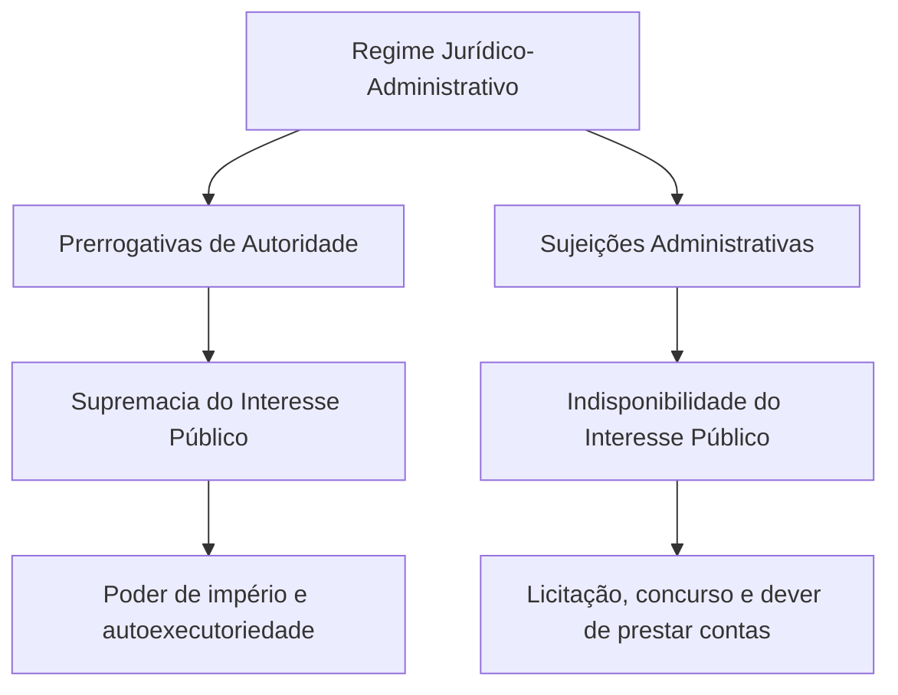
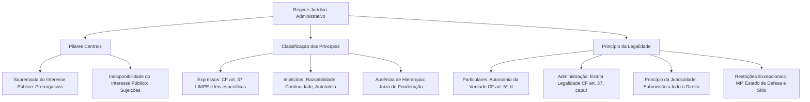

O regime jurídico-administrativo estabelece as regras especiais que regulam a atuação do Estado na busca do bem comum. Ao contrário das relações entre particulares, marcadas pela igualdade jurídica e pela ampla liberdade de escolha, a gestão pública opera sob um modelo singular. O poder público dispõe de prerrogativas de autoridade para impor suas decisões e defender o interesse coletivo, mas se submete a severas restrições para resguardar a sociedade contra o arbítrio.

Compreender essa estrutura é indispensável para as provas de concursos públicos. As bancas exigem o domínio exato das diferenças entre regime de direito público e regime de direito privado, a identificação dos princípios expressos e implícitos e o alcance concreto do princípio da legalidade na Administração Pública.

> [!objetivos]
> - Distinguir o regime jurídico-administrativo do regime jurídico comum aplicável às relações privadas.
> - Identificar os dois pilares fundamentais do Direito Administrativo: a supremacia e a indisponibilidade do interesse público.
> - Diferenciar princípios expressos e implícitos, compreendendo a ausência de hierarquia formal entre eles.
> - Contrastar o princípio da legalidade aplicável aos cidadãos com a estrita legalidade imposta à Administração Pública.
> - Reconhecer as restrições excepcionais à legalidade e a extensão do princípio moderno da juridicidade.

## Regime jurídico da Administração e regime jurídico-administrativo

A expressão **regime jurídico da Administração** possui sentido amplo e abrangente. Ela designa todo o conjunto de normas jurídicas que incidem sobre a Administração Pública no exercício cotidiano de suas atribuições. Sob esse manto amplo, o Estado pode submeter-se tanto a normas de direito público quanto a regras predominantemente de direito privado.

Quando a Administração celebra uma locação imobiliária para instalar uma repartição de apoio, ou quando uma sociedade de economia mista explora atividade econômica mercantil, as relações aproximam-se do direito comum. Nesses cenários, a Administração atua em regime de coordenação ou paridade relativa com o cidadão, sem utilizar todos os privilégios soberanos de autoridade.

Em sentido estrito e técnico, a doutrina reserva o termo **regime jurídico-administrativo** exclusivamente para o conjunto de normas de direito público aplicável aos órgãos e entidades estatais. Esse regime específico é composto pelo binômio indissociável de **prerrogativas** de autoridade e **sujeições** especiais.

As prerrogativas colocam o poder público em posição de supremacia ou verticalidade sobre o administrado. São instrumentos necessários para que o Estado cumpra os seus deveres institucionais. Exemplos típicos incluem a presunção de legitimidade dos atos administrativos, a autoexecutoriedade das medidas de polícia e a prerrogativa de rescisão unilateral dos contratos administrativos.

As sujeições, em contrapartida, representam limites, deveres e freios que restringem a liberdade do administrador público. O gestor estatal não desfruta de vontade autônoma. Ele precisa realizar concurso público para selecionar novos agentes, instaurar processo licitatório para contratar obras e serviços, prestar contas anuais aos órgãos de fiscalização e motivar expressamente suas decisões punitivas.

> [!atencao] Distinção terminológica essencial
> O regime jurídico da Administração compreende normas de direito público e de direito privado. O regime jurídico-administrativo compreende apenas o regime de direito público, fundado em prerrogativas e sujeições.

A tabela seguinte sistematiza as principais diferenças entre esses dois regimes jurídicos nas relações estatais.

| Critério de distinção | Regime de direito público | Regime de direito privado na Administração |
| --- | --- | --- |
| Posição jurídica das partes | Verticalidade (supremacia estatal) | Horizontalidade relativa (coordenação) |
| Instrumentos de atuação | Prerrogativas de império e poderes exorbitantes | Instrumentos do direito civil e comercial comum |
| Margem de liberdade | Estrita subordinação à lei e à finalidade pública | Autonomia contratual mitigada pela tutela estatal |
| Obrigatoriedade de freios | Sujeições integrais (licitação, concurso e motivação) | Sujeições parciais ditadas pelo interesse coletivo |

## Os dois pilares do regime jurídico-administrativo

A doutrina brasileira aponta que todo o Direito Administrativo é construído sobre duas vigas mestras: o princípio da **supremacia do interesse público** sobre o particular e o princípio da **indisponibilidade do interesse público**. Esses mandamentos funcionam como as pedras de toque de toda a disciplina.

O princípio da supremacia do interesse público justifica a existência das prerrogativas estatais. Ele estabelece que, em caso de conflito genuíno entre o benefício de toda a coletividade e o interesse individual isolado, deve prevalecer o bem comum. Não se trata de aniquilar os direitos do cidadão, mas de assegurar que o interesse de uma pessoa não paralise o bem-estar de toda a sociedade.

É com base na supremacia que o Corpo de Bombeiros Militar interdita uma edificação comercial com risco iminente de colapso, ou que a autoridade de trânsito recolhe um veículo que trafega sem freios. O Estado atua com base no poder de império para tutelar a integridade de todos.

O princípio da indisponibilidade do interesse público, por sua vez, constitui o fundamento de todas as sujeições e restrições administrativas. A ideia central é simples e direta: o administrador público não é o dono da coisa pública. Os recursos financeiros, os imóveis, as viaturas e o patrimônio estatal pertencem ao povo. O agente público atua como mero gestor transitório.

Como consequência direta da indisponibilidade, o agente não pode dispor, renunciar, doar ou perdoar direitos e créditos da Administração por simples benevolência pessoal. Ele só pode praticar atos mediante expressa determinação ou autorização legal. Qualquer ato de renúncia indevida configura desvio de poder e ato de improbidade administrativa.

> [!exemplo] Aplicação prática do binômio fundamental
> Em um grande incêndio urbano em Olinda, o comandante da operação de socorro do Corpo de Bombeiros Militar requisita o uso temporário de um caminhão-pipa pertencente a uma empresa particular para abastecer as viaturas de combate ao fogo. Essa requisição decorre diretamente do princípio da supremacia do interesse público. Em seguida, encerrada a ocorrência, o órgão militar devolve o veículo e instaura processo formal para indenizar eventuais danos comprovados pelo proprietário, cumprindo rigorosamente a lei em respeito à indisponibilidade do interesse público.

Existe uma conhecida divergência na doutrina sobre a identificação desses pilares. Celso Antônio Bandeira de Mello sustenta que a supremacia e a indisponibilidade são os dois princípios fundamentais autônomos que sustentam o regime jurídico-administrativo. Já Maria Sylvia Zanella Di Pietro prefere apontar que a bipolaridade do Direito Administrativo decorre do confronto entre a supremacia do interesse público (lado das prerrogativas) e a legalidade (lado das sujeições).

Em questões de prova, ambas as construções são aceitas e convergem para a mesma conclusão prática: o Estado precisa de poderes para agir, mas esses poderes existem exclusivamente em função dos deveres e das limitações estabelecidas pelo ordenamento jurídico.

O esquema a seguir demonstra a dinâmica harmoniosa entre prerrogativas e sujeições no regime público.

## Teoria geral dos princípios administrativos

No Direito moderno, os princípios não são apenas conselhos ou enunciados teóricos de ordem moral. Eles possuem **natureza normativa plena**, integrando o ordenamento jurídico com força vinculante idêntica ou até superior à das regras legais específicas. A violação de um princípio atinge a própria coerência do sistema jurídico, sendo tão ou mais grave do que o desrespeito a uma regra isolada.

A doutrina distingue três funções essenciais desempenhadas pelos princípios jurídicos:

1. **Função informativa ou orientadora**: serve de bússola para o Poder Legislativo no momento de elaborar e aprovar novas leis, evitando normas abusivas ou incompatíveis com a justiça social.
2. **Função interpretativa**: direciona a atuação dos juízes, tribunais e autoridades administrativas na aplicação cotidiana das leis, permitindo escolher a solução que melhor concretize os valores fundamentais da Constituição.
3. **Função integrativa**: preenche as lacunas da legislação quando não houver regra expressa para o caso concreto, assegurando que o administrador decida sempre em harmonia com o Direito.

Quanto à sua forma de previsão no ordenamento, os princípios administrativos dividem-se em expressos e implícitos.

Os **princípios expressos** são aqueles previstos de forma explícita e taxativa no texto de uma norma jurídica. Na Constituição Federal de 1988, o rol central está inserido no art. 37, *caput*, abrangendo a legalidade, a impessoalidade, a moralidade, a publicidade e a eficiência (reunidos no clássico mnemônico LIMPE).

No plano infraconstitucional, diversas leis estruturantes consagram catálogos principiológicos próprios. O exemplo mais marcante no processo administrativo federal está no art. 2º da Lei 9.784/1999, que sintetiza as diretrizes fundamentais da atuação pública.

> [!lei] Lei 9.784/1999, art. 2º
> A Administração Pública obedecerá, dentre outros, aos princípios da legalidade, finalidade, motivação, razoabilidade, proporcionalidade, moralidade, ampla defesa, contraditório, segurança jurídica, interesse público e eficiência.

No mesmo sentido, a Lei 14.133/2021 estabelece no art. 5º o catálogo de princípios que regem os procedimentos licitatórios em todo o território nacional.

Os **princípios implícitos ou reconhecidos** são aqueles que não constam com essa denominação em uma cláusula legal específica, mas são extraídos pela doutrina e pela jurisprudência a partir do espírito geral da Constituição e do regime republicano. São exemplos marcantes, por não constarem do texto da Constituição, a supremacia do interesse público, a autotutela, a continuidade dos serviços públicos, a razoabilidade e a proporcionalidade. Atenção: razoabilidade, proporcionalidade e interesse público são implícitos na Constituição, mas aparecem expressos no art. 2º da Lei 9.784/1999.

> [!lei] CF, art. 37, caput
> A administração pública direta e indireta de qualquer dos Poderes da União, dos Estados, do Distrito Federal e dos Municípios obedecerá aos princípios de legalidade, impessoalidade, moralidade, publicidade e eficiência e, também, ao seguinte:

O comando do art. 37 da Constituição atinge de modo irrestrito a Administração Direta (órgãos dos Poderes Executivo, Legislativo e Judiciário no exercício de funções administrativas) e todas as entidades descentralizadas da Administração Indireta, dotadas de personalidade jurídica pública ou privada. Alcança igualmente o Ministério Público e os Tribunais de Contas, em todas as esferas federativas: União, Estados, Distrito Federal e Municípios.

> [!bizu] O alcance do LIMPE
> Nenhum órgão ou entidade estatal escapa do LIMPE. Ele se aplica às pessoas de direito público e às de direito privado da Administração Indireta, bem como aos três Poderes da República em todos os níveis federativos.

Ponto de constante atenção em provas de concursos é a **ausência de hierarquia formal entre princípios**. Não existe princípio supremo que anule ou ignore os demais em abstrato. Diante de um caso concreto no qual dois princípios pareçam colidir, o intérprete não elimina nenhum deles do sistema. Deve realizar um juízo de **ponderação de valores**, buscando a harmonização prática que preserve o núcleo essencial de cada garantia.

Se a Administração constata que concedeu um benefício ilegal a um servidor há mais de dez anos, o princípio da legalidade exigiria anular o ato. Contudo, em respeito ao princípio da segurança jurídica e da boa-fé, a lei e a jurisprudência estabelecem prazos de decadência para consolidar a situação, impedindo a anulação extemporânea. Essa solução decorre da ponderação harmônica entre princípios, e não da superioridade hierárquica de um sobre o outro.

> [!pegadinha] A armadilha da hierarquia entre princípios
> A banca examinadora costuma afirmar que o princípio da legalidade ou da supremacia do interesse público é absoluto e prevalece automaticamente sobre todos os outros em qualquer circunstância. Isso está errado. Não há hierarquia entre princípios no Direito brasileiro; a aplicação é sempre pautada pela ponderação e pela razoabilidade no caso concreto.

## Princípio da legalidade e seus desdobramentos

O princípio da legalidade representa a principal garantia de liberdade do cidadão em face do poder estatal. Ele surgiu historicamente com as revoluções liberais do século XVIII e a consolidação do Estado Democrático de Direito, superando o absolutismo no qual a vontade do monarca definia o direito. O objetivo basilar da legalidade é substituir o governo dos homens pelo governo das leis.

Ao analisar esse mandamento, a doutrina identifica dois sentidos inteiramente diversos, a depender do sujeito a quem a norma se destina:

1. **Legalidade para os particulares (autonomia da vontade)**: funda-se no art. 5º, inciso II, da Constituição Federal. Ao cidadão comum, é assegurada ampla liberdade de iniciativa. As relações privadas regem-se pela autonomia privada. O indivíduo pode realizar condutas previstas expressamente em lei e pactuar situações não reguladas pelas normas (*praeter legem*), sofrendo impedimento apenas quando houver proibição legislativa expressa (*contra legem*).
2. **Legalidade para a Administração Pública (estrita legalidade)**: decorre do art. 37, *caput*, da Constituição Federal. A Administração não possui vontade própria autônoma nem liberdade de criação espontânea. O agente público só pode agir quando houver expressa autorização ou imposição legal. O silêncio da lei para a Administração significa proibição de agir. Portanto, a autoridade pública vincula-se de modo estrito ao texto legislativo (*secundum legem*), sendo-lhe vedado inovar originariamente ou contrariar os comandos normativos.

> [!lei] CF, art. 5º, II
> ninguém será obrigado a fazer ou deixar de fazer alguma coisa senão em virtude de lei;

Para o particular, se a lei não veda determinado negócio comercial, a atividade é perfeitamente lícita. Já no ambiente administrativo, se a legislação não cria expressamente uma gratificação por encargo extraordinário, a autoridade do Corpo de Bombeiros Militar ou da Polícia Civil não pode concedê-la aos seus agentes por simples decreto ou portaria, sob pena de nulidade absoluta e responsabilidade do ordenador de despesa.

> [!exemplo] Diferença prática entre legalidade privada e administrativa
> Dois empresários do setor logístico de Caruaru decidem firmar um contrato comercial com cláusulas inéditas, sem previsão expressa no Código Civil, disciplinando o compartilhamento de armazéns refrigerados. Como a lei não proíbe a avença, o negócio é plenamente válido (atuação *praeter legem*). Em contrapartida, se o Secretário de Defesa Social de Pernambuco pretender instituir uma nova verba indenizatória para motoristas de viaturas sem prévia autorização em lei estadual específica aprovada pela Assembleia Legislativa, o ato será manifestamente ilegal e inválido, ainda que motivado pelas melhores intenções.

A tabela comparativa a seguir evidencia a contraposição entre as duas vertentes da legalidade no ordenamento brasileiro.

| Dimensão do princípio | Legalidade dos particulares | Legalidade da Administração Pública |
| --- | --- | --- |
| Base constitucional | CF, art. 5º, inciso II | CF, art. 37, *caput* |
| Fundamento orientador | Autonomia da vontade e liberdade individual | Indisponibilidade do interesse público e soberania da lei |
| Regra geral de ação | É permitido tudo o que a lei não proíbe | É permitido apenas o que a lei expressamente autoriza ou impõe |
| Atuação além da lei (*praeter legem*) | Válida e lícita | Inválida e vedada |
| Atuação contra a lei (*contra legem*) | Inválida e ilícita | Inválida e ilícita (nula de pleno direito) |

A subordinação da Administração à lei desdobra-se em duas categorias de atos:

- **Atos vinculados**: a lei estabelece de forma taxativa e prévia todos os requisitos, elementos e consequências da conduta estatal, sem conceder qualquer margem de liberdade ao administrador. Preenchidos os requisitos legais pelo cidadão, o agente é obrigado a praticar o ato (exemplo: concessão de licença para construir ou aposentadoria compulsória por idade).
- **Atos discricionários**: a lei autoriza a atuação administrativa e confere ao agente público uma margem razoável de escolha quanto à oportunidade e à conveniência da medida, devendo a decisão pautar-se nos limites da finalidade pública e da razoabilidade (exemplo: concessão de autorização de uso de bem público ou escolha do momento ideal para deflagrar uma operação policial preventiva).

É fundamental não confundir o princípio da legalidade com o princípio da **reserva legal**. A legalidade possui sentido amplo: exige que toda a atividade administrativa esteja em conformidade com o bloco de normas vigentes, abrangendo desde a Constituição Federal até atos administrativos normativos secundários, como decretos, resoluções e portarias.

A reserva legal, por outro lado, possui sentido estrito e específico. Ela exige que determinadas matérias sensíveis sejam disciplinadas obrigatoriamente por lei em sentido formal, isto é, por diploma legislativo aprovado pelo Poder Legislativo (leis ordinárias ou leis complementares). É o caso da criação de cargos públicos, da fixação de tributos e da tipificação de infrações penais e administrativas, matérias nas quais atos secundários jamais podem inovar primariamente na ordem jurídica.

> [!pegadinha] Atos secundários e inovação na ordem jurídica
> Decretos regulamentares, portarias e instruções normativas são atos normativos secundários. Eles existem para dar fiel execução à lei, explicitando e detalhando o seu conteúdo. Esses atos vinculam os agentes públicos, mas não podem criar direitos novos nem impor deveres originários aos cidadãos. Se uma portaria estadual criar uma obrigação acessória para comerciantes não prevista em lei, essa portaria incorre em ilegalidade manifesta por invasão da reserva legal.

## Restrições excepcionais à legalidade e princípio da juridicidade

Embora a submissão à lei seja a regra indispensável em um Estado de Direito, o próprio texto da Constituição Federal prevê situações críticas e temporárias nas quais a legalidade sofre **restrições excepcionais**. Essas mitigações são instrumentos de defesa do próprio Estado e das instituições democráticas diante de graves emergências ou calamidades.

A doutrina constitucional e administrativa reconhece três hipóteses taxativas de restrição extraordinária ao princípio da legalidade estrita:

1. **Edição de medidas provisórias (CF, art. 62)**: em situações de relevância e urgência, o Presidente da República pode adotar medidas provisórias com força de lei formal, submetendo-as imediatamente ao Congresso Nacional. Embora tenham eficácia imediata de lei, Celso Antônio Bandeira de Mello as classifica como atenuações da legalidade ordinária em virtude de sua precariedade e do caráter monocrático da edição originária pelo Chefe do Executivo.
2. **Decretação do estado de defesa (CF, art. 136)**: mecanismo de salvaguarda decretado pelo Presidente da República, após ouvir os conselhos de Estado competentes, destinado a preservar ou restabelecer a ordem pública e a paz social ameaçadas por grave instabilidade institucional ou calamidades naturais de grandes proporções em locais restritos e delimitados. O decreto de instauração pode determinar restrições a direitos fundamentais de reunião, sigilo de correspondência e comunicação telefônica.
3. **Decretação do estado de sítio (CF, arts. 137 a 139)**: medida de excepcional gravidade decretada pelo Presidente da República após autorização prévia indispensável do Congresso Nacional. Cabível em casos de comoção grave de repercussão nacional, ineficácia de providências no estado de defesa ou declaração de estado de guerra ou agressão armada estrangeira. Permite a suspensão temporária de garantias constitucionais expressas, como a liberdade de locomoção e a inviolabilidade de domicílio.

> [!atencao] Caráter extraordinário das exceções
> As exceções ao princípio da legalidade são de direito estrito. Nenhuma autoridade administrativa pode criar hipóteses novas de restrição ou afastar a lei comum sem expressa fundamentação nos mecanismos constitucionais de emergência.

Nas últimas décadas, a evolução do Direito Público consolidou a transição do modelo tradicional de legalidade estrita para o moderno **princípio da juridicidade**.

No modelo positivista tradicional do século XIX, a legalidade significava apenas o cumprimento formal da lei escrita (*Gesetz*). Se o ato administrativo atendesse à letra fria da lei formal, era considerado válido, mesmo que resultasse em flagrante injustiça ou imoralidade.

Com a consagração do princípio da juridicidade, o parâmetro de validade da atividade administrativa deixou de ser apenas a lei formal aprovada pelo parlamento e passou a abranger **todo o bloco de juridicidade**. Isso inclui a Constituição Federal, os tratados internacionais de direitos humanos vigentes, os princípios gerais de Direito, os costumes consagrados e a jurisprudência vinculante dos tribunais superiores.

Dessa forma, a atuação do administrador público é submetida a um controle substancial e não meramente formal. Um ato administrativo que cumpra a literalidade da lei, mas desrespeite os princípios da razoabilidade, da proporcionalidade ou da moralidade administrativa, é considerado plenamente inválido e passível de anulação, inclusive pelo Poder Judiciário.

A consequência prática da juridicidade é a redução da margem imune de discricionariedade administrativa. O juiz não pode substituir a escolha de conveniência do administrador, mas detém pleno poder para anular decisões abusivas que violem os limites principiológicos do ordenamento constitucional.

## Mapa do capítulo

O fluxograma seguinte resume a estrutura integrada do regime jurídico-administrativo, conectando seus pilares centrais à atuação da legalidade e da juridicidade.

### Para fixar
- O regime jurídico da Administração compreende normas de direito público e de direito privado, enquanto o regime jurídico-administrativo engloba exclusivamente as regras de direito público.
- A bipolaridade do regime jurídico-administrativo apoia-se no equilíbrio entre prerrogativas de autoridade e sujeições administrativas.
- A supremacia do interesse público justifica os poderes especiais e a verticalidade das relações entre o Estado e os administrados.
- A indisponibilidade do interesse público impõe limitações aos agentes estatais, que atuam como meros gestores de bens e interesses pertencentes à coletividade.
- Os princípios da Administração Pública possuem natureza normativa vinculante, desempenhando funções informativas, interpretativas e integrativas.
- Não existe hierarquia abstrata entre princípios jurídicos; eventuais conflitos aparentes são solucionados pela ponderação e pela concordância prática.
- Os princípios expressos na Constituição Federal para a Administração Direta e Indireta de todos os Poderes e esferas federativas são legalidade, impessoalidade, moralidade, publicidade e eficiência (LIMPE).
- Para os cidadãos comuns, a legalidade garante a autonomia da vontade: faculta-se a prática de qualquer conduta não vedada pelo ordenamento jurídico (CF, art. 5º, II).
- Para a Administração Pública, a legalidade opera de forma estrita: o agente só pode agir quando houver expressa determinação ou autorização legal (CF, art. 37, *caput*).
- O princípio da juridicidade expande o controle administrativo para além da lei formal, exigindo a observância irrestrita de todo o bloco de constitucionalidade e dos princípios gerais de Direito.
