Após o estudo do regime jurídico-administrativo e do princípio da legalidade, torna-se necessário aprofundar o exame dos outros quatro mandamentos expressos no art. 37, *caput*, da Constituição Federal de 1988: impessoalidade, moralidade, publicidade e eficiência. Juntos, esses preceitos formam o núcleo central que rege a conduta de todos os gestores públicos no Brasil.

Em concursos, as bancas examinadoras cobram intensamente as vertentes práticas desses princípios. Elas exigem o conhecimento minucioso sobre os desdobramentos da impessoalidade, as regras da Súmula Vinculante 13 do Supremo Tribunal Federal sobre nepotismo, o alcance da Lei de Acesso à Informação e os dois enfoques clássicos da eficiência administrativa.

> [!objetivos]
> - Compreender os quatro sentidos doutrinários do princípio da impessoalidade e a teoria da imputação volitiva.
> - Distinguir interesse público primário de secundário e identificar as vedações à promoção pessoal e ao partidarismo.
> - Aplicar o princípio da moralidade administrativa e as diretrizes vinculantes do STF no combate ao nepotismo.
> - Analisar o princípio da publicidade, suas exceções legítimas e os mecanismos de transparência ativa e passiva.
> - Avaliar os dois aspectos do princípio da eficiência e a busca por resultados na Administração Pública contemporânea.

## Princípio da impessoalidade e seus desdobramentos

O princípio da impessoalidade impõe que a atividade administrativa seja direcionada exclusivamente ao interesse coletivo, sem favorecimentos indevidos nem perseguições a desafetos. O administrador público atua em nome da coletividade e não em proveito próprio. A doutrina clássica desdobra esse mandamento em quatro significados fundamentais.

O primeiro sentido traduz-se no **princípio da finalidade pública**. Todo ato administrativo deve buscar a finalidade pública geral definida pelo ordenamento ou o objetivo específico previsto em lei para aquela competência. Quando o agente utiliza seus poderes para atingir um propósito alheio ao interesse comum, ocorre o chamado desvio de finalidade, modalidade de abuso de poder que acarreta a nulidade do ato.

Nesse contexto, ganha relevo a distinção entre interesse público primário e secundário. O **interesse público primário** representa as reais necessidades e aspirações de toda a sociedade (segurança, saúde, educação e preservação do patrimônio). É ele que desfruta de supremacia e autoriza o Estado a impor restrições aos particulares.

O **interesse público secundário**, em contrapartida, expressa as conveniências patrimoniais, financeiras ou corporativas do Estado enquanto pessoa jurídica de direito público (aumentar a arrecadação tributária ou diminuir despesas com indenizações). O interesse secundário só é legítimo quando coincide plenamente com o interesse primário. O Estado não pode sacrificar garantias individuais unicamente para acumular recursos em seus cofres.

> [!atencao] Primazia do interesse primário
> Somente o interesse público primário, que reflete o bem comum da coletividade, justifica a prerrogativa de supremacia estatal. O interesse puramente patrimonial do aparelho estatal jamais prevalece contra os direitos fundamentais dos cidadãos.

O segundo significado da impessoalidade reside na **isonomia ou igualdade de tratamento**. A Administração deve dispensar tratamento equânime a todos os cidadãos que se encontrem na mesma situação fática e jurídica. É proibido conceder privilégios odiosos ou impor restrições discriminatórias desprovidas de amparo legal.

Essa vertente isonômica manifesta-se concretamente em institutos indispensáveis da Constituição:

- Exigência de concurso público prévio de provas ou de provas e títulos para provimento de cargos e empregos públicos efetivos (CF, art. 37, II).
- Obrigatoriedade de licitação pública para contratação de obras, serviços, compras e alienações (CF, art. 37, XXI, e Lei 14.133/2021).
- Regime constitucional de precatórios judiciais para pagamento de débitos das Fazendas Públicas por ordem cronológica estrita de apresentação (CF, art. 100).
- Prestação universal e não discriminatória dos serviços públicos delegados aos particulares (CF, art. 175).

O terceiro sentido consagra a **teoria do órgão ou da imputação volitiva**. Formulada originalmente pelo jurista alemão Otto Gierke, essa teoria estabelece que os atos praticados pelos servidores no exercício de suas atribuições são imputados diretamente à pessoa jurídica estatal a que pertencem, e não à pessoa física do agente. O órgão público não possui personalidade jurídica própria; ele manifesta a vontade do ente estatal.

Uma decorrência relevante dessa teoria é a preservação dos atos praticados pelo chamado **funcionário de fato**. Trata-se do indivíduo que exerce uma função pública sob a aparência de legalidade, embora sua investidura contenha um vício formal originário (como uma anulação posterior de concurso por fraude ou falta de posse formal). Em homenagem à segurança jurídica e à boa-fé dos administrados, os atos emitidos por esse funcionário de fato em favor de terceiros permanecem válidos perante a sociedade.

> [!exemplo] Validade dos atos de funcionário de fato
> Um soldado do Corpo de Bombeiros Militar realiza vistoria técnica e emite atestado de regularidade para funcionamento de uma escola em Paulista. Meses depois, apura-se que a investidura desse militar decorreu de erro administrativo no cômputo de notas do certame, sendo anulada a sua nomeação. Os alvarás de funcionamento emitidos aos comerciantes e escolas de boa-fé permanecem plenamente válidos e eficazes, pois a atuação foi juridicamente imputada ao Estado de Pernambuco.

O quarto sentido consiste na **vedação de promoção pessoal e partidarismo**. A publicidade governamental deve possuir caráter estritamente institucional, voltando-se a orientar, informar e educar a população. É terminantemente proibido vincular realizações do Estado a nomes, símbolos, fotografias ou marcas partidárias que personalizem a gestão na figura da autoridade.

> [!lei] CF, art. 37, § 1º
> A publicidade dos atos, programas, obras, serviços e campanhas dos órgãos públicos deverá ter caráter educativo, informativo ou de orientação social, dela não podendo constar nomes, símbolos ou imagens que caracterizem promoção pessoal de autoridades ou servidores públicos.

A violação a essa diretriz atenta contra a impessoalidade e a moralidade, ensejando a propositura de ação popular e a responsabilização da autoridade por ato de improbidade administrativa, nos termos do art. 11, inciso XII, da Lei 8.429/1992, com as alterações da Lei 14.230/2021.

> [!pegadinha] Slogans e cores de campanha em obras públicas
> Não é apenas a inserção explícita de nomes que gera nulidade. A aposição de slogans de campanha eleitoral, cores exclusivas de agremiações partidárias ou logomarcas personalizadas em viaturas, fardamentos e prédios públicos configura violação frontal à impessoalidade, gerando o dever de remoção imediata e ressarcimento dos gastos.

Para assegurar a imparcialidade nas decisões administrativas cotidianas, o ordenamento prevê expressamente os institutos do impedimento e da suspeição. Os arts. 18 a 21 da Lei Federal 9.784/1999 obrigam a autoridade a declarar seu impedimento quando tiver interesse direto na matéria, houver atuado como perito ou for cônjuge ou parente de interessado até o terceiro grau.

A tabela seguinte sistematiza as quatro dimensões fundamentais da impessoalidade.

| Sentido doutrinário | Finalidade primordial | Manifestação prática no ordenamento |
| --- | --- | --- |
| Finalidade pública | Garantir o atendimento do interesse primário coletivo | Vedação de desvio de poder e desvio de finalidade do ato |
| Isonomia e igualdade | Assegurar paridade de oportunidades entre administrados | Concurso público (art. 37, II) e licitação (art. 37, XXI) |
| Imputação volitiva | Vincular a atuação funcional à pessoa jurídica estatal | Validade de atos praticados por funcionário de fato de boa-fé |
| Vedação de promoção pessoal | Impedir a personalização de obras e campanhas públicas | Publicidade institucional, educativa e informativa (art. 37, § 1º) |

## Princípio da moralidade administrativa e vedação ao nepotismo

O princípio da moralidade administrativa exige que a gestão pública paute-se em padrões estritos de ética, decoro, probidade, lealdade e boa-fé objetiva. O administrador não pode guiar-se apenas pela fronteira entre o legal e o ilegal; deve distinguir invariavelmente entre o honesto e o desonesto, entre o conveniente e o oportuno para a coletividade.

A moralidade administrativa possui **autonomia jurídica** em relação à mera moral comum ou religiosa. Trata-se de uma moral institucionalizada no Direito. O desrespeito à moralidade torna o ato administrativo viciado e plenamente nulo, mesmo que todos os aspectos literais da lei tenham sido formalmente cumpridos.

O ordenamento confere ao cidadão instrumentos diretos para resguardar esse princípio. O art. 5º, inciso LXXIII, da Constituição Federal estabelece a legitimidade de qualquer cidadão eleitor para ajuizar **ação popular** visando anular ato lesivo à moralidade administrativa, independentemente da demonstração de prejuízo financeiro imediato ao patrimônio público.

A concretização mais expressiva da moralidade nos tribunais brasileiros reside na severa **vedação ao nepotismo**. A prática de nomear parentes para cargos de comissão e funções de confiança foi historicamente enfrentada pelo Supremo Tribunal Federal, que assentou que a proibição decorre diretamente do texto constitucional, prescindindo de lei ordinária formal prévia.

> [!jurisprudencia] STF, Súmula Vinculante 13
> Proíbe a investidura de cônjuges, companheiros ou parentes consanguíneos e por afinidade até o 3º grau em cargos de comissão e funções de confiança em qualquer Poder de todos os entes federativos, rechaçando categoricamente as nomeações cruzadas por ajuste recíproco.

O enunciado sumular abrange o parentesco consanguíneo e por afinidade até o terceiro grau:

- **1º grau**: pais e filhos (linha reta); sogros, genros e noras (afinidade).
- **2º grau**: avós e netos (linha reta); irmãos (colateral); cunhados (afinidade).
- **3º grau**: bisavós e bisnetos (linha reta); tios e sobrinhos (colateral).

A proibição veda igualmente o chamado **nepotismo cruzado**, caracterizado pela realização de designações recíprocas entre autoridades de diferentes órgãos ou poderes para burlar a fiscalização constitucional. Se uma autoridade da Assembleia Legislativa nomeia o filho de um secretário de Estado, e este, em contrapartida, nomeia a esposa daquela autoridade, ambos os atos incorrem em nulidade flagrante por fraude à Constituição.

> [!atencao] O alcance do parentesco até o terceiro grau
> Primos encontram-se em quarto grau na linha colateral. Portanto, a nomeação de primo, isoladamente considerada, não configura violação direta à Súmula Vinculante 13, ressalvada a hipótese de comprovada falta de idoneidade ou desvio de finalidade apurado no caso concreto.

Questão relevante diz respeito à nomeação de familiares para **cargos de natureza política** (como Ministros de Estado, Secretários Estaduais e Secretários Municipais). Em regra, o STF entende que a Súmula Vinculante 13 não alcança de forma automática esses postos eminentemente políticos, tendo em vista a discricionariedade do Chefe do Executivo na composição de sua equipe de governo.

Todavia, essa exceção não confere imunidade absoluta. A nomeação de parente para cargo político será anulada judicialmente caso fique demonstrada a manifesta ausência de qualificação técnica para a função, a existência de desvio de finalidade evidente ou a configuração de troca de favores.

> [!pegadinha] A mitigação nos cargos políticos
> A nomeação de irmão de prefeito para exercer o cargo político de Secretário Municipal de Saúde não viola automaticamente a Súmula Vinculante 13. Contudo, se o nomeado não possuir qualificação mínima na área e o ato resultar de mera condescendência familiar, o Poder Judiciário anulará a nomeação por ofensa direta à moralidade e à impessoalidade.

Com a promulgação da Lei 14.230/2021, o legislador federal consolidou a matéria ao incluir expressamente o nepotismo como ato de improbidade administrativa atentatório aos princípios da Administração Pública, no art. 11, inciso XI, da Lei 8.429/1992.

> [!exemplo] Distinção prática entre cargo administrativo e cargo político
> O Comandante Geral da Polícia Militar de Pernambuco não pode nomear seu cônjuge para a função gratificada de assessoria técnica do comando militar, por tratar-se de cargo administrativo alcançado pela vedação absoluta da Súmula Vinculante 13. Por outro lado, caso o Governador do Estado nomeie seu irmão, profissional renomado com pós-graduação e décadas de experiência em segurança pública, para a Secretaria de Defesa Social (posto político), o ato será inicialmente válido, salvo prova inequívoca de desvio de finalidade.

## Princípio da publicidade e a Lei de Acesso à Informação

O princípio da publicidade determina que a Administração Pública atue com ampla transparência perante a sociedade. Os recursos geridos pertencem aos cidadãos, razão pela qual a gestão dos negócios públicos não pode ser conduzida sob segredo ou sigilo injustificado.

A doutrina moderna aponta um **duplo sentido** para a publicidade:

1. **Requisito de eficácia dos atos administrativos**: os atos de conteúdo normativo geral que produzam efeitos externos e os atos que acarretem despesas ou encargos ao patrimônio estatal dependem de publicação oficial no Diário Oficial para produzirem efeitos jurídicos válidos e regulares. A falta de publicação impede o início da eficácia do ato e o transcurso de prazos recursais contra a Administração.
2. **Exigência de transparência e controle social**: o princípio assegura que o cidadão fiscalize ativamente os atos governamentais, viabilizando o controle popular, o direito de petição e a obtenção de certidões para defesa de direitos individuais e coletivos (CF, art. 5º, XXXIV).

> [!lei] CF, art. 5º, XXXIII
> todos têm direito a receber dos órgãos públicos informações de seu interesse particular, ou de interesse coletivo ou geral, que serão prestadas no prazo da lei, sob pena de responsabilidade, ressalvadas aquelas cujo sigilo seja imprescindível à segurança da sociedade e do Estado;

A disciplina da publicidade foi amplamente fortalecida pela **Lei de Acesso à Informação (Lei 12.527/2011 - LAI)**. Essa norma estabelece como diretriz fundamental que **a publicidade é o preceito geral e o sigilo é a exceção**. A LAI aplica-se a todos os entes federativos e consagra duas modalidades de prestação informativa:

- **Transparência ativa**: divulgação contínua de informações de interesse geral promovida de ofício pelos próprios órgãos estatais, por meio de seus sítios eletrônicos oficiais na internet, independentemente de solicitação prévia (editais de licitação, contratos celebrados, organogramas funcionais e relatórios orçamentários).
- **Transparência passiva**: fornecimento tempestivo de dados e documentos públicos em resposta a pedidos formais apresentados por qualquer cidadão por meio dos Serviços de Informação ao Cidadão (SIC).

> [!bizu] Transparência ativa versus passiva
> Na transparência ativa, a Administração divulga as informações por iniciativa própria na rede mundial de computadores. Na transparência passiva, a Administração atende à provocação formal do cidadão que solicita acesso a documentos.

A publicidade não é um mandamento absoluto. A própria Constituição Federal autoriza exceções legítimas em duas hipóteses estritas:

1. **Segurança da sociedade e do Estado**: assuntos estratégicos de defesa nacional, investigações policiais sigilosas, inteligência de segurança pública e relações diplomáticas sensíveis.
2. **Proteção à intimidade, honra e vida privada das pessoas**: dados pessoais sensíveis resguardados pelo art. 5º, inciso X, da Constituição.

Ponto de intensa repercussão jurisprudencial envolveu a publicação da remuneração de servidores públicos em portais da transparência. O Supremo Tribunal Federal pacificou a controvérsia em sede de repercussão geral, fixando balizas definitivas.

> [!jurisprudencia] STF, Tema 392 da Repercussão Geral
> Declara legítima a veiculação em portais oficiais mantidos pela Administração Pública do nome dos servidores e dos montantes correspondentes à remuneração bruta e parcelas pecuniárias recebidas, preservando em sigilo dados privados como endereço residencial e documentos particulares.

O STF esclareceu que o direito da sociedade em fiscalizar os gastos estatais sobrepõe-se ao interesse individual do agente público em manter o salário em segredo. Contudo, dados meramente privados, como endereço residencial, telefone pessoal e número de CPF, não podem ser disponibilizados ao público externo.

> [!atencao] Publicidade afeta eficácia, não validade
> A publicação em órgão oficial é requisito de eficácia do ato administrativo, e não de sua validade estrutural. O ato que não é publicado nasce perfeito e existente, mas permanece ineficaz, não gerando obrigações perante terceiros enquanto perdurar a omissão.

## Princípio da eficiência e a Administração Gerencial

O princípio da eficiência foi introduzido no art. 37, *caput*, da Constituição Federal pela **Emenda Constitucional 19/1998**, marcando a transição do modelo burocrático tradicional para o paradigma da **Administração Pública Gerencial**. Essa reforma procurou modernizar a gestão estatal, combatendo a morosidade e exigindo excelência na alocação dos recursos públicos.

A doutrina de Maria Sylvia Zanella Di Pietro sistematiza o princípio da eficiência sob dois prismas complementares:

1. **Quanto à conduta funcional do agente público**: exige-se presteza, dedicação, constante aprimoramento técnico e produtividade na execução das atribuições rotineiras. O servidor deve buscar a melhor solução com o melhor rendimento funcional possível.
2. **Quanto à organização e estrutura da Administração Pública**: impõe-se a racionalização de procedimentos, com eliminação de formalismos desnecessários, adoção de tecnologias modernas, redução de despesas de custeio e foco no atendimento tempestivo das necessidades do cidadão.

No plano constitucional, a eficiência repercutiu diretamente sobre o regime estatutário dos servidores públicos. A Emenda 19/1998 condicionou a aquisição da estabilidade funcional à aprovação em **avaliação especial de desempenho** por comissão instituída para essa finalidade (CF, art. 41, § 4º). Previu também a possibilidade de perda do cargo do servidor estável mediante procedimento de **avaliação periódica de desempenho**, na forma de lei complementar (CF, art. 41, § 1º, III).

Recentemente, a Emenda Constitucional 109/2021 fortaleceu essa vertente ao introduzir o § 16 no art. 37 da Constituição, determinando que os órgãos e entidades devem realizar avaliação periódica das políticas públicas e divulgar amplamente os resultados aferidos.

> [!exemplo] Eficiência na gestão de socorro do CBMPE
> O Corpo de Bombeiros Militar de Pernambuco reestrutura suas bases operacionais no Grande Recife com o auxílio de sistemas informatizados de geolocalização e roteirização em tempo real. A readequação logística reduz o tempo médio de resposta no socorro a acidentes rodoviários de vinte para oito minutos, mantendo o mesmo efetivo e reduzindo o consumo de combustíveis. Essa medida corporifica com perfeição a dimensão estrutural da eficiência administrativa.

Apesar de sua relevância indiscutível, o princípio da eficiência encontra **limites intransponíveis** no ordenamento jurídico. A busca por celeridade, economia ou desburocratização jamais pode ser utilizada como justificativa para descumprir as exigências de legalidade, impessoalidade e moralidade.

> [!bizu] A eficiência não atropela a legalidade
> O administrador não pode deixar de realizar licitação obrigatória ou dispensar o concurso público sob o pretexto de economizar tempo ou recursos. Uma contratação direta fraudulenta que resulte em menor custo não é um ato eficiente; é um ato ilícito, nulo e passível de punição disciplinar e penal.

A tabela comparativa abaixo resume as principais características dos quatro princípios expressos analisados neste capítulo.

| Princípio expresso | Previsão central na CF/88 | Finalidade precípua | Ponto crítico em provas |
| --- | --- | --- | --- |
| Impessoalidade | Art. 37, *caput* e § 1º | Isonomia, finalidade pública e vedação à promoção pessoal | Teoria da imputação volitiva e validade dos atos de funcionário de fato |
| Moralidade | Art. 37, *caput*, e art. 5º, LXXIII | Ética, lealdade, probidade e boa-fé objetiva | Vedação vinculante ao nepotismo (SV 13) e controle por ação popular |
| Publicidade | Art. 37, *caput*, e art. 5º, XXXIII | Eficácia dos atos e transparência da gestão | Requisito de eficácia; legalidade da divulgação de remuneração (Tema 392) |
| Eficiência | Art. 37, *caput* (EC 19/1998) | Produtividade funcional e qualidade com economicidade | Avaliação de desempenho; impossibilidade de sobrepor-se à legalidade |

## Mapa do capítulo

O esquema conceitual abaixo sintetiza os quatro princípios constitucionais expressos examinados, evidenciando suas principais regras e vedações práticas.

```mermaid Princípios Expressos IMPE
flowchart TD
  IMPE[Princípios Expressos art. 37 da CF] --> IMP[Impessoalidade]
  IMPE --> MOR[Moralidade]
  IMPE --> PUB[Publicidade]
  IMPE --> EFI[Eficiência]

  IMP --> IMP1[Finalidade Pública: Interesse Primário]
  IMP --> IMP2[Isonomia: Concurso e Licitação]
  IMP --> IMP3[Imputação Volitiva: Funcionário de Fato]
  IMP --> IMP4[Vedação de Promoção Pessoal art. 37 § 1º]

  MOR --> MOR1[Autonomia Jurídica e Ação Popular art. 5º LXXIII]
  MOR --> MOR2[Súmula Vinculante 13: Vedação ao Nepotismo]
  MOR --> MOR3[Exceção Relativa: Cargos de Natureza Política]

  PUB --> PUB1[Requisito de Eficácia dos Atos]
  PUB --> PUB2[LAI 12.527: Transparência Ativa e Passiva]
  PUB --> PUB3[Exceções: Segurança do Estado e Intimidade]

  EFI --> EFI1[Introduzido pela EC 19/1998: Gestão Gerencial]
  EFI --> EFI2[Avaliação de Desempenho e Produtividade]
  EFI --> EFI3[Subordinação Obrigatória aos Demais Princípios]
```

### Para fixar
- A impessoalidade desdobra-se em quatro dimensões: finalidade pública, isonomia de tratamento, imputação volitiva ao Estado e vedação expressa à promoção pessoal.
- O interesse público primário (da coletividade) é o único que justifica a supremacia estatal, não podendo ser preterido pelo interesse secundário do erário.
- Pela teoria do órgão e da imputação volitiva, os atos praticados por funcionário de fato perante terceiros de boa-fé permanecem válidos em respeito à segurança jurídica.
- A publicidade oficial não pode conter nomes, imagens, símbolos ou marcas partidárias que identifiquem a pessoa do administrador (CF, art. 37, § 1º).
- A moralidade administrativa constitui pressuposto autônomo de validade do ato estatal, autorizando anulação judicial por meio de ação popular (CF, art. 5º, LXXIII).
- A Súmula Vinculante 13 do STF proíbe a nomeação de cônjuge, companheiro ou parente até o terceiro grau para cargos em comissão ou funções de confiança, inclusive na modalidade de nepotismo cruzado.
- Os cargos de natureza política não se submetem automaticamente à Súmula Vinculante 13, salvo se comprovada a falta manifesta de qualificação técnica ou evidente fraude à lei.
- A publicidade atua como requisito de eficácia dos atos administrativos gerais e onerosos, sendo o sigilo medida restritiva e excepcional (Lei 12.527/2011).
- É legítima a divulgação nominal da remuneração e vantagens pecuniárias de servidores públicos em portais oficiais de transparência (STF, Tema 392).
- O princípio da eficiência foi incluído pela Emenda Constitucional 19/1998, exigindo atuação célere e econômica, sem jamais autorizar a violação da legalidade ou da moralidade.
