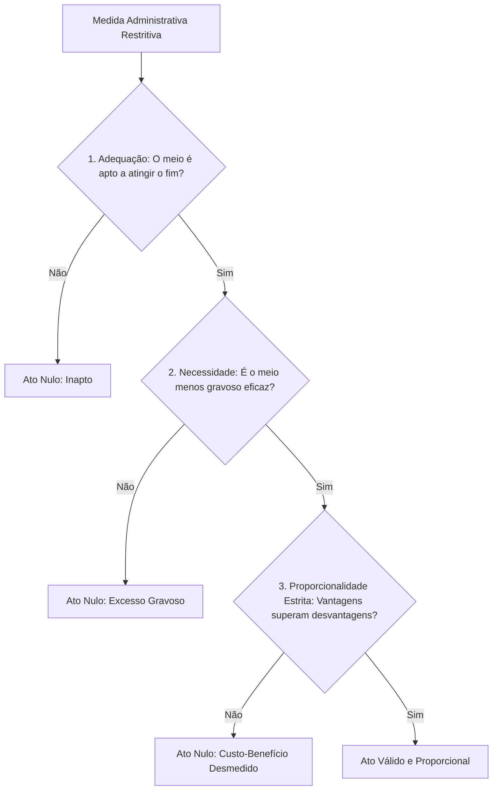
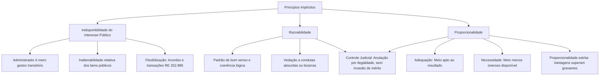

O ordenamento jurídico-administrativo não se esgota nos princípios expressamente enunciados no art. 37 da Constituição Federal. Ao lado da legalidade, impessoalidade, moralidade, publicidade e eficiência, existe um conjunto robusto de **princípios implícitos ou reconhecidos**. Essas normas fundamentais decorrem da própria estrutura republicana, do regime democrático e do catálogo de garantias constitucionais, vinculando de forma obrigatória todos os atos da Administração Pública.

Nas provas de concursos, as bancas cobram com frequência as restrições impostas pela indisponibilidade do interesse público e a disciplina da razoabilidade e da proporcionalidade. O candidato precisa dominar os limites da discricionariedade administrativa, o controle judicial dos excessos e o tríplice teste da proporcionalidade.

> [!objetivos]
> - Compreender a origem, o papel e a força normativa dos princípios implícitos no Direito Administrativo.
> - Analisar os desdobramentos práticos da indisponibilidade do interesse público e as hipóteses excepcionais de transação judicial.
> - Distinguir razoabilidade de proporcionalidade e compreender como esses princípios balizam o poder discricionário.
> - Aplicar os três subelementos da proporcionalidade: adequação, necessidade e proporcionalidade em sentido estrito.
> - Identificar os limites da intervenção do Poder Judiciário no mérito administrativo diante de atos desproporcionais ou desarrazoados.

## Princípios implícitos e o sistema de Direito Público

A classificação dos princípios em expressos e implícitos depende exclusivamente da perspectiva formal da norma de referência. Enquanto os princípios expressos contam com menção textual direta na Constituição Federal (como o LIMPE no art. 37, *caput*), os **princípios implícitos ou reconhecidos** são inferidos pela doutrina e pela jurisprudência a partir do sistema constitucional global.

Isso não significa que os princípios implícitos possuam menor valor hierárquico ou eficácia reduzida. No Direito brasileiro, não existe superioridade formal entre normas principiológicas. Um ato administrativo que afronte a razoabilidade, a autotutela ou a continuidade dos serviços públicos é tão nulo e ilegítimo quanto aquele que viola frontalmente a literalidade da lei expressa.

Muitos desses princípios, embora ausentes do texto originário da Constituição com nomenclatura explícita, foram acolhidos expressamente pelo legislador ordinário. É o que se verifica na Lei Federal 9.784/1999, que regula o processo administrativo na esfera federal e elenca em seu art. 2º preceitos como a motivação, a ampla defesa, a segurança jurídica, a proporcionalidade e a razoabilidade.

A presença dessas diretrizes implícitas cumpre três missões essenciais no Estado de Direito:

1. **Freio ao arbítrio nas competências discricionárias**: impede que a margem de escolha conferida pela lei ao administrador transforme-se em capricho pessoal ou abuso de poder.
2. **Parâmetro de controle da constitucionalidade substancial**: permite que os tribunais examinem se leis e atos normativos atendem ao senso de justiça material da sociedade.
3. **Harmonização do regime jurídico-administrativo**: articula as prerrogativas estatais com o respeito incondicional aos direitos fundamentais dos cidadãos.

## Princípio da indisponibilidade do interesse público e suas atenuações

Conforme estudado na introdução deste volume, a indisponibilidade do interesse público atua como o pilar de sustentação de todas as sujeições administrativas. Esse princípio consagra a premissa de que a coisa pública não pertence aos ocupantes dos cargos governamentais, mas sim ao povo. O administrador exerce uma função de mera guarda, conservação e gestão transitória dos interesses coletivos.

Dessa natureza fiduciária decorrem consequências práticas que limitam severamente a atuação dos gestores estatais:

- **Vedação de renúncia voluntária**: o gestor público não pode renunciar a direitos, abrir mão de competências ou perdoar débitos devidos à Administração sem expressa autorização em lei específica.
- **Inalienabilidade relativa dos bens públicos**: os bens de uso comum do povo e de uso especial encontram-se afetados a finalidades coletivas imediatas. Não podem ser vendidos, doados ou penhorados enquanto mantiverem essa destinação. Sua alienação exige prévia desafetação, demonstração formal de interesse público e cumprimento de rito licitatório.
- **Dever permanente de licitar e realizar concurso público**: a escolha dos futuros servidores e dos fornecedores da Administração deve subordinar-se a critérios objetivos, impessoais e transparentes, evitando preferências subjetivas.

> [!atencao] Caráter relativo da inalienabilidade
> A inalienabilidade dos bens públicos não é absoluta. Uma vez desafetados da finalidade pública e preenchidos os requisitos formais estabelecidos na legislação (como autorização legislativa para imóveis, avaliação prévia e licitação), os bens dominicais podem ser alienados validamente.

Ponto de destacada relevância em provas consiste nas hipóteses de **atenuação do princípio da indisponibilidade**. Historicamente, sustentava-se que a Administração estaria terminantemente impedida de firmar transações, acordos judiciais ou renúncias parciais de valores, sob a alegação de indisponibilidade absoluta.

Essa visão rígida foi superada pela jurisprudência moderna. O Supremo Tribunal Federal fixou o entendimento de que a indisponibilidade deve ser compreendida de modo funcional. Quando a celebração de um acordo judicial ou extrajudicial mostrar-se comprovadamente mais vantajosa para o erário e representar o meio mais eficaz de assegurar o interesse coletivo, a transação é plenamente lícita.

> [!jurisprudencia] STF, RE 252.885/MG
> Reconhece a viabilidade de flexibilização do princípio da indisponibilidade do interesse público pelo administrador quando a realização de acordos e transações constituir a alternativa mais eficiente, econômica e célere para concretizar o benefício da coletividade, evitando litígios judiciais prolongados e onerosos.

> [!exemplo] Acordo administrativo e indisponibilidade mitigada
> O Estado de Pernambuco figura como réu em centenas de ações de desapropriação na Região Metropolitana do Recife para implantação de um complexo de drenagem contra inundações. Diante de perícias técnicas conclusivas, a Procuradoria-Geral do Estado propõe termo de transação e conciliação judicial, oferecendo aos proprietários indenizações à vista com desconto de 15% sobre o valor avaliado. Embora envolva concessões patrimoniais recíprocas, a transação é plenamente válida, pois atende ao interesse público primário, acelera o início das obras preventivas do Corpo de Bombeiros e economiza vultosos recursos com juros judiciais.

A tabela comparativa a seguir sintetiza a regra geral de indisponibilidade e suas mitigações contemporâneas admitidas pelo ordenamento.

| Dimensão da atuação | Regra geral da indisponibilidade | Mitigação ou exceção admitida |
| --- | --- | --- |
| Créditos e cobranças estatais | Vedação de perdão gracioso ou cancelamento sem lei | Parcelamentos fiscais e transações com desconto autorizados em lei |
| Patrimônio e imóveis públicos | Inalienabilidade dos bens afetados à atividade estatal | Alienação de bens dominicais desafetados mediante licitação |
| Solução de litígios jurídicos | Obrigação de recorrer e contestar até as instâncias finais | Celebração de acordos e conciliações judiciais mais vantajosas ao erário |
| Exercício de competências | Indelegabilidade e irrenunciabilidade de poderes essenciais | Delegação temporária e parcial de atos de instrução e decisão |

## Princípios da razoabilidade e da proporcionalidade na atividade estatal

Os princípios da razoabilidade e da proporcionalidade operam como os principais instrumentos de controle sobre o **poder discricionário** da Administração Pública. A discricionariedade não representa poder absoluto nem carta branca para o arbítrio. Ela existe unicamente para permitir que o administrador, no caso concreto, escolha a medida mais adequada entre as opções previamente admitidas pela lei.

Embora frequentemente utilizados como conceitos sinônimos pelas bancas de concursos, a doutrina estabelece distinções sutis e relevantes entre ambos:

- **Razoabilidade**: apoia-se em critérios de lógica, bom senso, coerência e prudência. Impõe que o agente decida segundo o padrão de aceitabilidade esperado de uma pessoa ponderada em circunstâncias normais. Atos bizarros, incoerentes ou manifestamente desarrazoados constituem aberrações jurídicas.
- **Proporcionalidade**: guarda relação com a justa medida, a dosimetria equilibrada e a vedação ao excesso de poder. Exige que a intensidade do meio empregado pela autoridade guarde perfeita correspondência com a gravidade da situação fática e com a finalidade de interesse público buscada.

> [!lei] Lei 9.784/1999, art. 2º, parágrafo único, VI
> adequação entre meios e fins, vedada a imposição de obrigações, restrições e sanções em medida superior àquelas estritamente necessárias ao atendimento do interesse público;

A tabela a seguir evidencia os elementos distintivos entre os dois princípios no exame das condutas estatais.

| Critério comparativo | Princípio da razoabilidade | Princípio da proporcionalidade |
| --- | --- | --- |
| Foco de avaliação | Senso comum, lógica racional, congruência e prudência | Relação de equilíbrio quantitativo e qualitativo entre meios e fins |
| Origem doutrinária | Direito anglo-saxão (*due process of law* substantivo) | Direito constitucional germânico (*Verhältnismässigkeit*) |
| Objeto primordial | Evitar decisões incoerentes, absurdas ou disparatadas | Conter o excesso de poder e a imposição de restrições desmedidas |
| Método de controle | Juízo qualitativo de plausibilidade e bom senso | Tríplice teste estruturado (adequação, necessidade e proporção) |

A aplicação desses mandamentos é fundamental na dosimetria das sanções administrativas e disciplinares aplicadas a servidores e particulares. Uma autoridade não pode aplicar a punição mais grave prevista na lei quando a falta cometida for de natureza leve e não tiver acarretado prejuízo algum ao serviço público.

> [!exemplo] Sanção disciplinar desproporcional
> Um servidor da Polícia Civil de Pernambuco chega trinta minutos atrasado ao plantão policial por motivo de pane mecânica em seu automóvel particular, sem provocar prejuízo ao andamento dos registros de flagrante na delegacia. A autoridade instauradora, embora a legislação estadual admita ampla gradação de penalidades, impõe de imediato a pena máxima de suspensão por noventa dias. Tal ato é manifestamente desarrazoado e desproporcional, revelando excesso de poder suscetível de anulação pelo Poder Judiciário.

Essa diretriz é pacífica na jurisprudência dos tribunais superiores, que consolidaram o entendimento de que a dosimetria das penas disciplinares submete-se ao controle jurisdicional de legalidade e proporcionalidade.

> [!jurisprudencia] STF, RMS 28.208/DF
> Considera nula a aplicação de penalidade expulsória de demissão a servidor público quando a conduta imputada carecer de gravidade proporcional ao ato punitivo extremo, sobretudo diante da ausência de prejuízo ao erário e da comprovação de histórico funcional exemplar.

A intervenção judicial em tais cenários **não configura invasão do mérito administrativo**. O mérito abrange a conveniência e a oportunidade puras deixadas pela lei à escolha do gestor. Quando o ato extrapola os limites da proporcionalidade, ele deixa de ser apenas inconveniente e passa a ser **ilegal e ilegítimo**. O Poder Judiciário, provocado pela ação própria, atua para declarar a anulação do ato inválido, e não a sua revogação.

> [!pegadinha] Anulação judicial versus mérito administrativo
> A banca examinadora costuma sugerir que o juiz não pode anular um ato sancionador desarrazoado porque isso violaria a separação dos Poderes e o mérito administrativo. Essa afirmação é incorreta. A razoabilidade e a proporcionalidade integram a legalidade do ato; o controle judicial que extirpa o excesso de poder analisa estritamente a validade jurídica, preservando o ordenamento.

## Os três elementos da proporcionalidade e o controle jurisdicional

A doutrina constitucional moderna, influenciada pela jurisprudência do Tribunal Constitucional Federal alemão e consagrada pelo STF, divide a verificação da proporcionalidade em um exame estruturado em três etapas cumulativas: o chamado **tríplice teste da proporcionalidade**.

Para que uma restrição a direitos ou sanção imposta pela Administração seja considerada válida, ela deve ser aprovada sucessivamente em três crivos:

1. **Adequação (aptidão ou pertinência)**: averigua se o meio escolhido pelo poder público é empiricamente apto e compatível para alcançar a finalidade pública pretendida. Se o instrumento adotado for inútil ou ineficaz para o objetivo, a medida reprova no teste logo na primeira etapa.
2. **Necessidade (exigibilidade ou menor gravame)**: examina se, entre os diversos meios igualmente eficazes para atingir o fim almejado, a Administração escolheu aquele que acarreta a menor restrição possível à liberdade e aos direitos dos cidadãos. Se houver alternativa menos onerosa que atinja o mesmo resultado com igual eficácia, o meio mais drástico revela-se abusivo e desnecessário.
3. **Proporcionalidade em sentido estrito (sopesamento ou ponderação)**: consiste em um juízo de custo-benefício substancial. As vantagens coletivas trazidas pela medida governamental devem superar com folga as perdas e ônus impostos aos particulares atingidos. O benefício público alcançado não pode ser desmedidamente inferior ao dano individual causado.

A tabela seguinte detalha cada um desses três elementos fundamentais.

| Subprincípio | Pergunta central de controle | Consequência jurídica em caso de falha |
| --- | --- | --- |
| Adequação | O instrumento escolhido é idôneo e apto a alcançar o fim? | Invalidação do ato por inaptidão ou inutilidade técnica |
| Necessidade | Existe outro meio menos oneroso com a mesma eficácia? | Invalidação do ato por excesso gravoso desnecessário |
| Proporcionalidade estrita | As vantagens públicas superam os ônus impostos? | Invalidação do ato por desequilíbrio e injustiça manifesta |

O fluxograma abaixo detalha as etapas de verificação desse teste vinculante.

Na Lei Federal 9.784/1999, o princípio da menor onerosidade é corporificado em diversos comandos práticos. O art. 29, § 2º, estabelece com clareza que os atos de instrução probatória que exijam a participação ativa dos cidadãos devem realizar-se sempre pelo modo menos oneroso para estes, proibindo formalismos estéreis que encareçam a defesa do administrado.

A força da proporcionalidade estende-se igualmente ao controle das leis editadas pelo Poder Legislativo. O Supremo Tribunal Federal consolidou a tese de que leis que imponham restrições desarrazoadas ou desproporcionais ao livre exercício da atividade econômica e profissional padecem de inconstitucionalidade material.

> [!jurisprudencia] STF, ADI 855/PR
> Declara a inconstitucionalidade de lei estadual que exigia dos comerciantes a pesagem imediata de botijões de gás à vista do consumidor no ato de entrega domiciliar, por violação ao princípio da proporcionalidade. O Tribunal assentou que a obrigação impunha custos operacionais exorbitantes e dificuldades técnicas incompatíveis com a finalidade protetiva visada, inviabilizando o serviço sem benefício proporcional à sociedade.

> [!bizu] Memorização do teste da proporcionalidade
> Lembre-se do mnemônico **ANP**: **A**dequação (o meio serve?), **N**ecessidade (é o mais suave que serve?) e **P**roporcionalidade em sentido estrito (a conta fecha em favor do bem comum?). Se faltar um deles, a medida é ilegítima.

## Mapa do capítulo

O diagrama integrador a seguir apresenta a síntese dos princípios implícitos examinados neste capítulo, demonstrando seus impactos práticos sobre a contenção do poder público.

### Para fixar
- Os princípios implícitos possuem força normativa plena e idêntica à dos princípios expressos, integrando o bloco de legalidade e juridicidade.
- A indisponibilidade do interesse público impõe sujeições severas ao administrador, impedindo a renúncia graciosa de direitos ou a alienação arbitrária de bens públicos afetados.
- O STF admite a celebração de transações e acordos pela Administração quando tal medida for economicamente vantajosa e acelerar o atendimento do interesse público (RE 252.885/MG).
- A razoabilidade exige congruência lógica, prudência e bom senso na interpretação e aplicação das normas discricionárias.
- A proporcionalidade veda o excesso de poder e a imposição de sacrifícios superiores aos estritamente necessários para satisfazer o interesse público (Lei 9.784/1999, art. 2º, parágrafo único, VI).
- O exame da proporcionalidade compõe-se de três subelementos cumulativos: adequação (aptidão do meio), necessidade (menor gravame possível) e proporcionalidade em sentido estrito (equilíbrio custo-benefício).
- Nos atos de instrução processual, a atuação exigida dos administrados deve realizar-se sempre pelo modo menos oneroso (Lei 9.784/1999, art. 29, § 2º).
- O controle judicial sobre atos desarrazoados ou desproporcionais analisa a legalidade e a legitimidade da conduta, ensejando a anulação do ato sem usurpação do mérito administrativo.
