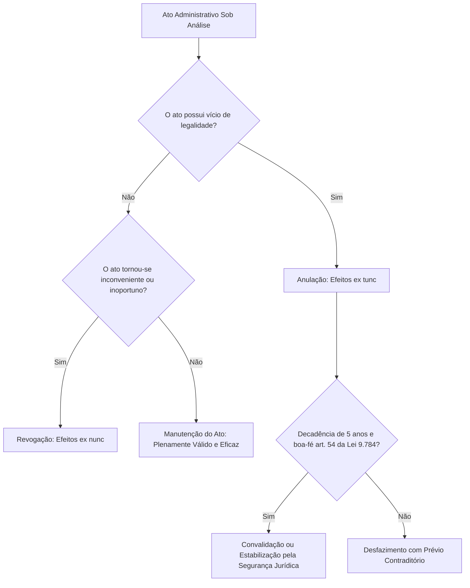
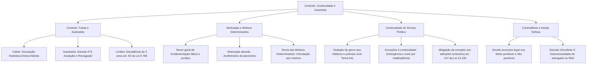

A fiscalização dos atos estatais e a proteção dos direitos dos cidadãos dependem de um conjunto articulado de garantias principiológicas. Os princípios da tutela administrativa, da autotutela, da motivação, da continuidade dos serviços públicos e do contraditório e ampla defesa formam as balizas que impedem o desvio de poder e preservam a regularidade da gestão pública no dia a dia.

Este capítulo reúne tópicos com altíssimo índice de cobrança em concursos. As bancas exigem a distinção técnica entre tutela e autotutela, os efeitos da anulação e da revogação de atos administrativos, a aplicação da teoria dos motivos determinantes, os limites do direito de greve nas carreiras de segurança pública e o alcance da Súmula Vinculante 5 do STF.

> [!objetivos]
> - Distinguir o controle finalístico (tutela) do poder de controle interno sobre os próprios atos (autotutela).
> - Diferenciar os regimes jurídicos da anulação e da revogação, identificando seus efeitos temporais e limites legais.
> - Compreender a obrigatoriedade da motivação e a aplicação prática da teoria dos motivos determinantes e da motivação *aliunde*.
> - Analisar o princípio da continuidade dos serviços públicos, o regime de greve nas forças de segurança e as hipóteses legais de suspensão do fornecimento.
> - Examinar as garantias do contraditório e da ampla defesa nos processos administrativos punitivos e não punitivos.

## Princípios do controle (tutela) e da autotutela

O controle da atividade administrativa manifesta-se sob duas modalidades estruturais que não podem ser confundidas: a tutela administrativa e a autotutela.

A **tutela administrativa**, também denominada controle finalístico ou supervisão ministerial, é o controle externo exercido pela Administração Direta sobre as entidades descentralizadas integrantes da Administração Indireta, abrangendo autarquias, fundações estatais, empresas públicas e sociedades mistas. Esse mecanismo tem como objetivo exclusivo verificar se a entidade descentralizada está cumprindo as finalidades institucionais fixadas na lei que autorizou ou criou a sua estrutura.

É fundamental destacar que **não existe hierarquia ou subordinação** entre a Administração Direta e a Indireta. A relação jurídica entre elas é de mera vinculação administrativa. A tutela não autoriza o ente central a interferir na gestão interna ou no mérito das decisões da entidade supervisionada, salvo nas hipóteses estritas expressamente previstas em lei.

Em contrapartida, a **autotutela** representa o poder-dever conferido à Administração Pública de exercer o controle sobre os seus próprios atos. Por meio da autotutela, o poder público revisa internamente sua conduta, sem depender de prévia autorização judicial.

A autotutela desdobra-se em duas vertentes capitais:

1. **Anulação**: incide sobre atos administrativos ilegais ou ilegítimos, ou seja, atos praticados com vício em seus elementos constitutivos. A anulação opera efeitos retroativos (*ex tunc*), desfazendo a relação desde a sua origem. Pode ser declarada pela própria Administração, de ofício ou mediante provocação, bem como pelo Poder Judiciário, sempre mediante provocação do interessado.
2. **Revogação**: incide sobre atos administrativos legítimos e válidos, mas que se tornaram inoportunos ou inconvenientes ao interesse público superveniente. A revogação opera efeitos prospectivos (*ex nunc*), respeitando os efeitos já produzidos no passado e os direitos adquiridos. A revogação é privativa da Administração Pública que editou o ato; o Poder Judiciário jamais pode revogar atos do Poder Executivo ou Legislativo.

> [!jurisprudencia] STF, Súmula 473
> O Supremo Tribunal Federal consolidou que o poder público deve anular os atos ilegais, dos quais não decorrem direitos, e pode revogar aqueles inoportunos ou inconvenientes, preservando os direitos adquiridos e mantendo sempre a possibilidade de revisão judicial.

> [!lei] Lei 9.784/1999, art. 53
> A Administração deve anular seus próprios atos, quando eivados de vício de legalidade, e pode revogá-los por motivo de conveniência ou oportunidade, respeitados os direitos adquiridos.

A tabela seguinte sistematiza as distinções técnicas entre a tutela e a autotutela.

| Aspecto diferenciador | Tutela administrativa (supervisão) | Autotutela administrativa |
| --- | --- | --- |
| Sujeitos envolvidos | Administração Direta sobre a Administração Indireta | A própria Administração sobre seus próprios atos |
| Vínculo jurídico | Vinculação finalística (inexiste hierarquia) | Relação de hierarquia e subordinação interna |
| Finalidade precípua | Fiscalizar o cumprimento das finalidades legais da entidade | Anular atos ilegais ou revogar atos inoportunos |
| Fundamento de atuação | Limites estritamente estabelecidos em lei formal | Poder-dever de autocorreção (Súmulas 346 e 473 do STF) |

A autotutela encontra limites indispensáveis na segurança jurídica e na proteção à boa-fé dos cidadãos. O art. 54 da Lei 9.784/1999 estabelece que o direito da Administração de anular atos que gerem efeitos favoráveis aos administrados **decai em cinco anos**, contados da data de sua prática, salvo comprovada má-fé do beneficiário.

Além disso, caso o desfazimento do ato atinja diretamente direitos individuais de determinada pessoa, a Administração é obrigada a instaurar procedimento prévio assegurando o contraditório e a ampla defesa.

> [!atencao] Prazo decadencial para autotutela
> Transcorridos cinco anos da prática de um ato que gerou benefícios a particular de boa-fé, opera-se a decadência administrativa. O ato ilegal convalida-se pelo tempo em homenagem à estabilidade das relações jurídicas.

> [!pegadinha] Revogação pelo Poder Judiciário
> O Poder Judiciário pode anular qualquer ato administrativo ilegal quando devidamente provocado. Todavia, o juiz não pode revogar ato administrativo praticado pelo Poder Executivo sob a alegação de que a medida é inconveniente. O controle judicial restringe-se à legalidade; a revogação de mérito é matéria privativa da autoridade administrativa competente.

A tabela seguinte sintetiza as diferenças operacionais entre anulação e revogação.

| Elemento do desfazimento | Anulação de ato administrativo | Revogação de ato administrativo |
| --- | --- | --- |
| Natureza do vício | Ilegalidade ou ilegitimidade originária | Inconveniência ou inoportunidade superveniente |
| Competência para decretar | Própria Administração (de ofício/provocação) e Judiciário | Exclusiva da Administração que praticou o ato |
| Efeitos temporais | Retroativos (*ex tunc*), desfazendo desde a origem | Prospectivos (*ex nunc*), respeitando efeitos passados |
| Limite temporal | Prazo decadencial de 5 anos para atos favoráveis (salvo má-fé) | A qualquer tempo, desde que respeitados direitos adquiridos |

O fluxograma abaixo esquematiza a dinâmica decisória da autotutela no controle dos atos públicos.

## Princípio da motivação e a teoria dos motivos determinantes

O princípio da motivação determina que o agente público aponte de forma clara, expressa e congruente os **fundamentos de fato** e os **fundamentos de direito** que sustentam a sua decisão. A motivação permite verificar se o ato atendeu à finalidade pública, se respeitou a moralidade e se observou a legalidade.

É indispensável não confundir dois conceitos:

- **Motivo**: é a situação de fato e de direito que autoriza ou exige a prática do ato administrativo. É elemento intrínseco de existência do ato.
- **Motivação**: é a exteriorização formal e escrita das razões fáticas e jurídicas que levaram a autoridade a decidir. É a demonstração do motivo.

> [!bizu] Motivo versus motivação
> O motivo é o acontecimento real e a norma legal aplicável (por que o ato foi feito). A motivação é o texto escrito no processo justificando a decisão (onde o motivo foi registrado).

A regra geral do Direito Administrativo brasileiro impõe a obrigatoriedade da motivação dos atos administrativos. O art. 50 da Lei Federal 9.784/1999 traz um rol detalhado de situações nas quais a motivação é expressamente exigida:

1. Atos que neguem, limitem ou afetem direitos ou interesses individuais.
2. Atos que imponham ou agravem deveres, encargos ou penalidades administrativas.
3. Decisões em processos seletivos e concursos públicos.
4. Atos de dispensa ou declaração de inexigibilidade de licitação pública.
5. Julgamento de recursos administrativos.
6. Decisões que decorram de reexame de ofício.
7. Decisões que divirjam de pareceres, laudos ou relatórios técnicos oficiais.
8. Atos que importem anulação, revogação, suspensão ou convalidação de atos anteriores.

O ordenamento admite a chamada **motivação *aliunde*** (ou motivação por remissão). O § 1º do art. 50 da Lei 9.784/1999 autoriza que a autoridade decida declarando sua concordância expressa com os fundamentos de pareceres técnicos, informações, propostas ou relatórios anteriores, passando estes a integrar o ato administrativo como fundamentação própria.

> [!exemplo] Aplicação de motivação aliunde
> Em um processo administrativo para aquisição de viaturas de resgate no Corpo de Bombeiros Militar, o setor de engenharia e a assessoria jurídica emitem pareceres detalhados demonstrando a necessidade de padronização técnica. O ordenador de despesas homologa o procedimento exarando despacho no qual declara acolher integralmente os fundamentos do parecer técnico nº 45/2026. Essa manifestação é plenamente válida sob a modalidade de motivação *aliunde*.

Vinculada a esse tema surge a **teoria dos motivos determinantes**. Essa teoria postula que a validade do ato administrativo fica indissoluvelmente atrelada à veracidade e à conformidade jurídica dos motivos invocados pela autoridade para justificá-lo. Se a Administração apresentar fundamentos fáticos inexistentes ou juridicamente falsos, o ato padece de nulidade absoluta, ainda que a legislação dispensasse originariamente a motivação expressa para aquela espécie de ato.

O exemplo clássico cobrado em concursos envolve a exoneração de ocupante de cargo em comissão (livre nomeação e livre exoneração). O gestor público não tem a obrigação jurídica de justificar a demissão imotivada de um assessor comissionado. Contudo, se resolver motivar o ato, declarando formalmente que a exoneração ocorreu por motivo de corte orçamentário na folha salarial, e ficar comprovado que no dia seguinte foi nomeada outra pessoa para a mesma vaga com aumento de despesa, o ato de exoneração será anulado judicialmente com base na teoria dos motivos determinantes.

## Princípio da continuidade dos serviços públicos

O princípio da continuidade estabelece que a prestação dos serviços públicos essenciais à sociedade não pode sofrer interrupções abruptas ou arbitrárias. É por meio dos serviços públicos que o Estado viabiliza o acesso à saúde, segurança pública, abastecimento de água, saneamento, energia elétrica, transporte e comunicações. A paralisação desses serviços acarreta danos graves à ordem pública e à integridade dos cidadãos.

Maria Sylvia Zanella Di Pietro aponta desdobramentos diretos desse princípio nas relações estatais:

- **Regulação restritiva do direito de greve**: os servidores e agentes públicos submetem-se a limites severos em suas manifestações coletivas, assegurando que as atividades essenciais não sejam descontinuadas.
- **Atenuação da *exceptio non adimpleti contractus***: no regime dos contratos administrativos, o particular contratado não dispõe da faculdade de paralisar prontamente a execução em caso de mora do Estado. O art. 137, § 2º, inciso IV, da Lei 14.133/2021 estabelece que o contratado só pode suspender o cumprimento de suas obrigações ou pleitear a rescisão contratual após atraso superior a dois meses nos pagamentos devidos pela Administração.
- **Reversão de bens nas concessões**: ao término dos contratos de concessão ou permissão de serviços públicos, os bens materiais afetados à execução da atividade transferem-se automaticamente para o patrimônio estatal, assegurando que o serviço continue sendo prestado à população sem interrupção.
- **Institutos de suplência, delegação e substituição**: a legislação estatutária prevê mecanismos automáticos para que cargos e funções de chefia e fiscalização não permaneçam acéfalos durante afastamentos regulamentares dos titulares.

O tema do **direito de greve no serviço público** assume contornos singulares na jurisprudência do STF. A Constituição Federal estabelece no art. 37, inciso VII, que o direito de greve será exercido nos termos de lei específica. Diante da prolongada omissão legislativa, o Supremo Tribunal Federal supriu a lacuna ao estender aos servidores públicos civis as regras da Lei Federal 7.783/1989 (lei de greve do setor privado), ressalvando as atividades inadiáveis.

No entanto, para as forças armadas e de segurança pública, a jurisprudência fixou vedações taxativas:

1. **Militares estaduais e federais**: a Constituição Federal proíbe expressamente a greve e a sindicalização aos militares em qualquer hipótese (CF, art. 142, § 3º, IV, extensível aos militares dos Estados e do Distrito Federal pelo art. 42, § 1º).
2. **Policiais civis e carreiras de segurança pública armada**: o Supremo Tribunal Federal, ao apreciar o Tema 541 da Repercussão Geral (ARE 654.432/GO), assentou a diretriz de que a deflagração de greve, em quaisquer de suas modalidades, é terminantemente proibida aos policiais civis e a todos os servidores que desempenham funções diretas na preservação da segurança pública. A segurança é atividade estatal indelegável que não comporta descontinuidade.

> [!atencao] Vedação absoluta de greve na segurança pública
> Tanto os policiais e bombeiros militares quanto os policiais civis e guardas municipais estão terminantemente proibidos de exercer o direito de greve. A restrição visa resguardar a ordem pública e a incolumidade das pessoas, bens fundamentais protegidos pelo princípio da continuidade.

Além disso, o STF firmou o entendimento de que a Administração Pública tem o poder-dever de promover o **desconto remuneratório dos dias parados** decorrentes de greve dos servidores públicos civis (Tema 531 / RE 693.456), salvo acordo de compensação aprovado pelas partes.

A continuidade dos serviços públicos, todavia, **não tem caráter absoluto**. A legislação brasileira admite hipóteses expressas de interrupção temporária e legítima da prestação.

O art. 6º, § 3º, da Lei Federal 8.987/1995 prescreve que não caracteriza descontinuidade do serviço público a sua paralisação temporária nas seguintes situações:

- **Em situações de emergência**: independe de prévio aviso aos usuários (exemplo: rompimento inesperado de adutora de água potável ou colapso estrutural na rede de distribuição elétrica em decorrência de tempestade).
- **Após prévio aviso formal**: em duas hipóteses:
  1. Por razões de ordem técnica ou para garantir a segurança das instalações (obras de manutenção preventiva programada).
  2. Por inadimplemento comprovado do usuário, considerado o interesse geral da coletividade (corte no fornecimento de energia elétrica ou água após notificação expressa por falta de pagamento da tarifa).

> [!exemplo] Corte de serviço por falta de pagamento
> Uma empresa comercial do polo têxtil de Caruaru deixa de pagar reiteradamente as faturas de fornecimento de energia elétrica. A concessionária de serviço público notifica formalmente a empresa, concedendo prazo razoável para regularização do débito. Persistindo a inadimplência, a concessionária interrompe o fornecimento em dia útil. Essa conduta é plenamente legítima e não vulnera o princípio da continuidade, pois a sustentabilidade financeira da concessão depende da adimplência dos beneficiários.

A tabela comparativa a seguir sistematiza as hipóteses legais de suspensão do serviço público.

| Hipótese de interrupção | Exigência de prévio aviso | Fundamento legal (Lei 8.987/1995, art. 6º, § 3º) |
| --- | --- | --- |
| Situação de emergência iminente | Desnecessário (fato imprevisível e urgente) | Preservação da segurança física e patrimonial coletiva |
| Razões de ordem técnica ou segurança | Obrigatório (notificação com antecedência) | Manutenção preventiva e reformas programadas na rede |
| Inadimplemento da tarifa pelo usuário | Obrigatório (notificação com prazo para quitação) | Sustentabilidade econômico-financeira do sistema público |

## Princípios do contraditório e da ampla defesa

Os princípios do contraditório e da ampla defesa encontram base constitucional solene no art. 5º, inciso LV, da Constituição Federal, integrando o núcleo duro do **devido processo legal** substantivo e processual (CF, art. 5º, LIV).

> [!lei] CF, art. 5º, LV
> aos litigantes, em processo judicial ou administrativo, e aos acusados em geral são assegurados o contraditório e ampla defesa, com os meios e recursos a ela inerentes;

Essas garantias fundamentais incidem sobre **todos os processos administrativos**, possuam eles natureza punitiva ou não punitiva:

- **Processos administrativos punitivos**: alcançam os acusados em geral, aplicando-se aos processos administrativos disciplinares (PADs), aos conselhos de disciplina e de justificação militar, bem como a autos de infração ambiental, sanitária e de trânsito. Nesses procedimentos, o rigor defensivo é máximo.
- **Processos administrativos não punitivos**: alcançam os litigantes e interessados em matérias concorrenciais, desapropriações, pedidos de aposentadoria e certames licitatórios. Qualquer decisão que possa restringir ou extinguir direitos exige oportunidade prévia de manifestação.

A doutrina constitucional decompõe esses princípios em dimensões complementares:

- **Contraditório**: traduz-se no binômio *informação e reação*. O administrado tem o direito de ser formalmente notificado acerca de todos os atos e provas carreadas aos autos (ciência), dispondo da faculdade concreta de contrapor argumentos e teses jurídicas para influenciar o convencimento da autoridade julgadora.
- **Ampla defesa**: confere ao cidadão a prerrogativa de valer-se de todos os meios de prova admitidos em Direito para demonstrar suas razões (documental, testemunhal e pericial), bem como a garantia de interpor recursos administrativos perante instâncias superiores.

Ponto de intensa incidência em provas da banca examinadora diz respeito à necessidade de atuação de advogado nos processos administrativos. Durante anos, debateu-se se a ausência de defesa técnica por profissional do Direito configuraria nulidade insanável no processo disciplinar.

O Supremo Tribunal Federal pacificou a matéria de forma definitiva ao editar súmula com força vinculante.

> [!jurisprudencia] STF, Súmula Vinculante 5
> A ausência de defesa técnica exercida por advogado no âmbito do processo administrativo disciplinar não afronta os ditames da Constituição Federal.

O STF esclareceu que a ampla defesa em sede administrativa é assegurada quando a Administração garante ao servidor o direito de defender-se pessoalmente (autodefesa) ou de constituir defensor habilitado, caso assim deseje. A presença de advogado é facultativa, cabendo ao próprio interessado optar pelo patrocínio técnico. A ausência de causídico nos autos não gera nulidade do processo disciplinar, desde que respeitadas as demais garantias processuais.

> [!pegadinha] Defesa técnica no processo disciplinar
> As bancas examinadoras costumam afirmar que a ausência de advogado no interrogatório ou na apresentação de defesa escrita em processo administrativo disciplinar anula o processo de demissão. Cuidado. Conforme a Súmula Vinculante 5 do STF, a defesa por advogado em PAD é facultativa; a sua ausência não enseja nulidade, salvo se comprovado cerceamento efetivo à manifestação do servidor.

## Mapa do capítulo

O diagrama integrador seguinte reúne os princípios de controle, motivação, continuidade e ampla defesa, conectando seus desdobramentos às súmulas vinculantes e à legislação de regência.

### Para fixar
- A tutela administrativa compreende o controle finalístico exercido pela Administração Direta sobre a Indireta, sem relação de subordinação ou hierarquia.
- Pela autotutela, a Administração anula atos ilegais com efeitos retroativos (*ex tunc*) e revoga atos inoportunos com efeitos prospectivos (*ex nunc*), respeitados os direitos adquiridos (Súmula 473 do STF).
- O Poder Judiciário jamais pode revogar atos administrativos de outro Poder; o controle jurisdicional limita-se à anulação por vício de legalidade e legitimidade.
- O direito da Administração de anular atos que gerem efeitos favoráveis decai em cinco anos para administrados de boa-fé (Lei 9.784/1999, art. 54).
- A motivação exige indicação expressa dos fatos e das normas jurídicas que embasaram o ato (Lei 9.784/1999, art. 50).
- Pela teoria dos motivos determinantes, a validade do ato fica vinculada à existência real e à juridicidade dos motivos expressos, tornando nulo o ato justificado por fundamentos falsos.
- É legítima a motivação *aliunde*, consistente na concordância expressa com relatórios, laudos ou pareceres prévios constantes dos autos.
- A continuidade do serviço público proíbe a paralisação arbitrária das atividades essenciais, vedando terminantemente a greve de militares e policiais civis (Tema 541 do STF).
- A interrupção do serviço público é lícita em situações de emergência ou, mediante aviso prévio, por razões técnicas ou inadimplemento comprovado da tarifa (Lei 8.987/1995, art. 6º, § 3º).
- A ausência de defesa técnica por advogado em processo administrativo disciplinar não viola a Constituição Federal (STF, Súmula Vinculante 5).
