A consolidação do regime jurídico-administrativo requer garantias que preservem a estabilidade das relações sociais e impeçam desvios na gestão estatal. Ao lado das regras do art. 37 da Constituição e das balizas de controle, existem princípios essenciais para tutelar a confiança dos administrados. Eles delimitam a atuação das entidades descentralizadas e resolvem atritos práticos do cotidiano.

Este capítulo encerra o volume com temas de alta incidência nas provas. Vamos estudar a especialidade na descentralização, as faces objetiva e subjetiva da segurança jurídica e a diferença entre boa-fé e proteção à confiança. Também analisaremos os princípios setoriais e os precedentes vinculantes dos tribunais superiores.

> [!objetivos]
> - Compreender a aplicação da especialidade nas entidades da Administração Indireta.
> - Diferenciar a segurança jurídica objetiva da proteção à confiança legítima subjetiva.
> - Identificar a regra que proíbe aplicar retroativamente nova interpretação jurídica.
> - Distinguir o princípio da boa-fé da tutela da confiança na doutrina administrativista.
> - Dominar os princípios setoriais e as súmulas vinculantes dos tribunais superiores.

## Princípio da especialidade na descentralização administrativa

O princípio da especialidade exige que as entidades da Administração Indireta atuem apenas nos limites dos objetivos fixados na lei que as criou ou autorizou. Esse postulado é a base da descentralização administrativa por serviços ou funcional. Nesse modelo, o ente político transfere a titularidade e a execução de dada atividade para uma pessoa jurídica autônoma.

O fundamento central está no art. 37, XIX, da Constituição Federal. O texto exige lei específica para criar autarquia e para autorizar a instituição de fundação pública, empresa pública e sociedade de economia mista.

A lei instituidora define o objeto social e as competências materiais da entidade. A pessoa administrativa descentralizada não pode desviar-se dessas diretrizes. Se uma entidade atua fora de sua finalidade legal, o ato padece de nulidade por vício de competência em razão da matéria. Além disso, os dirigentes respondem nas esferas civil, administrativa e por improbidade.

Criada inicialmente para as autarquias, a especialidade hoje alcança todas as entidades da Administração Indireta:

- **Autarquias**: executam serviços públicos típicos e atividades exclusivas de Estado, como fiscalização e regulação.
- **Fundações públicas**: desempenham atividades sociais, culturais, de saúde, ensino ou pesquisa, sem objetivo de lucro.
- **Empresas públicas e sociedades de economia mista**: prestam serviços públicos delegados ou exploram atividade econômica em caráter supletivo (CF, art. 173).

Não há hierarquia entre a Administração Direta instituidora e a entidade descentralizada. A relação jurídica entre elas é de vinculação administrativa. A pessoa central exerce apenas a tutela administrativa ou supervisão ministerial. Esse controle finalístico verifica se a entidade cumpre as finalidades previstas em sua lei de criação.

> [!exemplo] Desvio da finalidade legal
> Uma autarquia estadual de trânsito foi instituída para fiscalizar vias e licenciar veículos. Se seus diretores decidirem prestar serviços pagos de pavimentação urbana para particulares, esses contratos serão nulos. O ato viola diretamente o princípio da especialidade.

A tabela abaixo compara o regime e a finalidade das entidades da Administração Indireta segundo a especialidade.

| Entidade descentralizada | Regime jurídico | Modo de criação (CF, art. 37, XIX) | Finalidade institucional específica |
| --- | --- | --- | --- |
| Autarquia | Direito Público | Criada por lei ordinária específica | Serviços públicos típicos e atividades estatais exclusivas |
| Fundação Pública de Direito Público | Direito Público (autárquica) | Criada por lei ordinária específica | Atividades sociais, hospitalares, culturais e de ensino |
| Fundação Pública de Direito Privado | Direito Privado | Autorizada por lei específica | Serviços de utilidade pública sem fim lucrativo |
| Empresa Pública | Direito Privado | Autorizada por lei específica | Serviços públicos ou exploração de atividade econômica |
| Sociedade de Economia Mista | Direito Privado (sociedade anônima) | Autorizada por lei específica | Serviços públicos ou atividade econômica estatal |

## Segurança jurídica e proteção à confiança legítima

O princípio da segurança jurídica é elemento indispensável do Estado Democrático de Direito. Sua função primordial é conferir previsibilidade, estabilidade e certeza às relações travadas entre o cidadão e a Administração Pública. Ele impede que alterações abruptas de regras ou entendimentos desfaçam situações pretéritas consolidadas de boa-fé.

No Direito Administrativo, a segurança jurídica contrabalança a estrita legalidade. Pela legalidade pura, qualquer ato viciado deveria ser sumariamente anulado a qualquer tempo. Contudo, desconstituir situações consolidadas após anos pode gerar injustiça e desordem social. O ordenamento jurídico pondera esses valores e autoriza a manutenção de atos viciados para resguardar a estabilidade social.

A doutrina divide a segurança jurídica em duas vertentes:

1. **Vertente objetiva (segurança jurídica em sentido estrito)**: cuida da estabilidade das normas e das relações sociais no plano geral. Manifesta-se na salvaguarda de direitos consolidados, situações consumadas e coisa julgada (CF, art. 5º, XXXVI). Fundamenta ainda a prescrição, a decadência e a edição de súmulas vinculantes pelo STF (CF, art. 103-A, § 1º).
2. **Vertente subjetiva (proteção à confiança legítima)**: protege a crença do cidadão comum na legitimidade dos atos praticados pelo poder público. O particular presume que as manifestações, licenças e pagamentos estatais são regulares e duradouros.

O art. 2º, caput, da Lei 9.784/1999 prevê expressamente a segurança jurídica. O parágrafo único, inciso XIII, desse artigo estabelece uma regra basilar: a proibição de aplicação retroativa de nova interpretação jurídica.

> [!lei] Lei 9.784/1999, art. 2º, parágrafo único, XIII
> interpretação da norma administrativa da forma que melhor garanta o atendimento do fim público a que se dirige, vedada aplicação retroativa de nova interpretação.

A Administração Pública tem o poder de aperfeiçoar suas teses e mudar sua jurisprudência administrativa. O Direito evolui e as exigências coletivas se transformam. Porém, o novo entendimento opera apenas para o futuro (*ex nunc*). Ele não pode alcançar atos aperfeiçoados sob a interpretação anterior.

Nem mesmo a alegação de interesse público autoriza o efeito retroativo prejudicial. O Superior Tribunal de Justiça firmou a tese de que valores alimentares recebidos de boa-fé por servidor público não precisam ser devolvidos quando o pagamento decorreu de erro de interpretação da lei pela Administração (STJ, REsp 1.244.182/PB). O Tribunal de Contas da União adota entendimento idêntico na Súmula 249, assim como a Advocacia-Geral da União na Súmula Administrativa 34. A Administração cessa o pagamento futuro, mas não exige a devolução do passado.

Outra decorrência prática é a preservação dos atos do **agente de fato**. Imagine que um servidor público tenha sido empossado após procedimento depois anulado. Enquanto esteve em exercício aparente, esse agente expediu certidões e autorizações a cidadãos de boa-fé. Seus atos continuam válidos perante os administrados, resguardando a confiança na atuação estatal.

A LINDB (Decreto-Lei 4.657/1942), no art. 30, reforça a segurança jurídica ao determinar que as autoridades editem regulamentos, súmulas administrativas e respostas a consultas vinculantes para uniformizar a aplicação da legislação.

> [!atencao] Decadência de cinco anos na autotutela
> O art. 54 da Lei 9.784/1999 prevê que a Administração decai do direito de anular atos favoráveis ao administrado no prazo de cinco anos da sua prática, ressalvada a má-fé comprovada. Transcorrido esse período sem manifestação estatal, o ato convalida-se pela segurança jurídica.

A tabela seguinte confronta as duas vertentes do princípio da segurança jurídica.

| Critério distintivo | Vertente objetiva (segurança estrita) | Vertente subjetiva (confiança legítima) |
| --- | --- | --- |
| Foco protetivo | Estabilidade institucional do ordenamento | Boa-fé do cidadão nas decisões estatais |
| Instrumentos típicos | Coisa julgada, ato perfeito, direito adquirido e súmulas | Preservação de atos favoráveis e do agente de fato |
| Marco temporal | Prazos de prescrição e decadência legal | Decadência quinquenal do art. 54 da Lei 9.784/1999 |
| Efeito prático central | Proibição de retroatividade de nova exegese legal | Dispensa de devolução de valores recebidos de boa-fé |

## Boa-fé administrativa e a visão doutrinária de Di Pietro

O princípio da boa-fé orienta todo o Direito moderno e assume contornos decisivos nas relações administrativas. A doutrina analisa esse princípio sob dois ângulos:

- **Boa-fé objetiva**: impõe um padrão ético de conduta leal, proba, sincera e cooperativa entre as partes.
- **Boa-fé subjetiva**: traduz o estado de convicção interior do sujeito que acredita agir em plena harmonia com a lei. Quem conhece a ilicitude atua de má-fé.

A Lei 9.784/1999 consagra o princípio em dois dispositivos. O art. 2º, parágrafo único, IV, impõe à Administração conduta ética pautada por probidade, decoro e boa-fé. De modo recíproco, o art. 4º, II, estabelece que o administrado deve agir com lealdade, urbanidade e boa-fé.

Na doutrina de Maria Sylvia Zanella Di Pietro, é preciso distinguir boa-fé e proteção à confiança:

1. **A boa-fé é bilateral**: incide sobre os dois polos da relação jurídica. O Estado e o cidadão devem atuar com probidade. Se licitantes particulares combinam preços e fraudam certame público, o procedimento pode ser anulado por violação à boa-fé, mesmo sem participação de agentes públicos.
2. **A proteção à confiança é unilateral**: tutela a posição do administrado de boa-fé perante a Administração. Fundamenta a manutenção de atos estatais viciados quando o particular confiou na aparência de regularidade e não concorreu para a ilegalidade.

> [!pegadinha] Bilateralidade da boa-fé
> As bancas costumam questionar qual princípio vincula igualmente o poder público e os particulares. A resposta é a boa-fé. Princípios como publicidade oficial, supremacia do interesse público e legalidade estrita recaem primordialmente como deveres ou poderes da Administração Pública.

Sem boa-fé subjetiva do administrado, não existe direito à confiança legítima. Se o particular usou fraude ou participou do conluio, a Administração pode anular o ato viciado a qualquer tempo, sem incidência do prazo decadencial de cinco anos.

## Princípios implícitos setoriais da atividade administrativa

A doutrina administrativista consagra princípios setoriais implícitos que disciplinam situações específicas da gestão e do controle estatal.

### Intranscendência das sanções administrativas

O princípio da intranscendência estabelece que as penalidades e restrições administrativas não podem passar da pessoa ou órgão que praticou o ilícito. É vedado punir quem não concorreu para a falta.

No plano federativo, esse princípio impede punir o Poder Executivo estadual ou municipal por falhas exclusivas de órgãos autônomos. No julgamento da ACO 3072/PR, o Supremo Tribunal Federal assentou que o Executivo estadual não pode sofrer bloqueio de transferências nem proibição de crédito se o excesso de gastos de servidores decorreu do Ministério Público local. O governador não possui poderes de gestão sobre órgãos de autonomia constitucional.

Na esfera municipal, o Superior Tribunal de Justiça consagrou a mesma regra:

> [!jurisprudencia] STJ, Súmula 615
> O Superior Tribunal de Justiça firmou que é ilegítima a inscrição de município em cadastros de inadimplentes por dívidas de gestão anterior quando o novo prefeito comprova a tomada de providências cabíveis para a reparação dos danos ao erário.

Comprovada a diligência do novo gestor contra o antecessor faltoso, o município não pode ter seus repasses federais suspensos.

### Princípio da hierarquia

A hierarquia estrutura as relações de comando e subordinação dentro da máquina pública. Trata-se de princípio exclusivo da **função administrativa**, não existindo nas funções jurisdicional e legislativa, nas quais vigora a independência funcional dos seus membros.

A hierarquia abrange prerrogativas essenciais da Administração:
- Poder de expedir ordens e exigir cumprimento pelo subordinado.
- Poder de fiscalizar e anular atos viciados de instâncias inferiores.
- Poder de punir faltas funcionais após o devido processo.
- Faculdade de **delegar** atribuições a terceiros ou de **avocar** competências originárias de órgãos subordinados por motivos relevantes justificados.

### Princípio da precaução

O princípio da precaução orienta que o poder público adote medidas preventivas perante atividades que tragam risco de danos graves ou irreversíveis à sociedade ou ao meio ambiente. A conduta preventiva impõe-se mesmo na ausência de certeza científica absoluta.

Esse postulado determina a **inversão do ônus da prova**. O particular interessado em atividade potencialmente danosa deve comprovar tecnicamente que o projeto é seguro. Havendo dúvida fundamentada, a Administração deve negar a autorização em benefício da coletividade.

### Presunção de legitimidade e veracidade

Os atos administrativos nascem protegidos pela presunção de legitimidade e veracidade:
- **Legitimidade**: presume-se que o ato respeitou as normas legais vigentes.
- **Veracidade**: presume-se que os fatos relatados pela autoridade condizem com a realidade.

Em virtude desse atributo, o ato administrativo é dotado de executoriedade imediata, produzindo seus efeitos desde logo.

A presunção é **relativa (*juris tantum*)**, admitindo prova em contrário. O administrado que impugna o ato estatal assume o ônus de provar a sua ilegalidade perante a autoridade ou em juízo.

### Princípio da sindicabilidade

A sindicabilidade afirma que **todo ato administrativo pode ser submetido a controle**. Não existem condutas do poder público imunes a exame e correção.

A sindicabilidade opera por duas vias:
1. **Autotutela interna**: a própria Administração fiscaliza seus atos, anulando os ilegais e revogando os inoportunos.
2. **Controle jurisdicional externo**: qualquer cidadão pode acionar o Poder Judiciário contra lesão ou ameaça a direito, conforme o princípio da inafastabilidade da jurisdição (CF, art. 5º, XXXV).

### Responsabilização e prestação de contas

O gestor público administra bens e interesses do povo, regendo-se pela indisponibilidade do interesse público. O agente tem o dever constitucional de prestar contas de todo recurso recebido ou gerido. Se praticar irregularidades, sofrerá sanções administrativas, civis e penais, além da obrigação de ressarcir o dano ao erário.

### Subsidiariedade e consensualidade

Pelo princípio da **subsidiariedade**, a atuação direta do Estado deve priorizar as funções estatais indelegáveis, como segurança pública, justiça e defesa nacional. A intervenção nas atividades econômicas e sociais opera em caráter suplementar.

O princípio da **consensualidade** busca substituir decisões impositivas unilaterais pelo diálogo e pelo consenso com a sociedade. O modelo estimula a administração pública participativa e negociada por meio de:
- Termos de ajustamento de conduta com órgãos de fiscalização.
- Parcerias público-privadas e contratos de metas de desempenho.
- Consultas e audiências públicas prévias com a população.
- Mediação, conciliação e arbitragem para dirimir litígios.

A tabela abaixo sintetiza os princípios setoriais examinados e seus efeitos práticos.

| Princípio setorial | Conceito nuclear | Efeito prático ou processual | Fundamento de regência |
| --- | --- | --- | --- |
| Intranscendência | Sanção pessoal ao infrator | Novo gestor diligente afasta restrição da gestão anterior | STJ, Súmula 615; STF, ACO 3072 |
| Hierarquia | Subordinação interna na função administrativa | Comando, fiscalização, delegação e avocação de atos | Organização administrativa clássica |
| Precaução | Ação preventiva diante de risco grave | Inversão do ônus da prova contra riscos incertos | Proteção à saúde e ao meio ambiente |
| Presunção de Legitimidade | Presunção relativa de legalidade e veracidade | Execução imediata do ato; ônus probatório ao administrado | Atributo próprio do ato administrativo |
| Sindicabilidade | Controle amplo sobre todo ato estatal | Autotutela interna e controle judicial externo | CF, art. 5º, XXXV (jurisdição una) |
| Consensualidade | Gestão negociada e participativa | Audiências públicas, termos de ajuste e mediação | Administração dialogal contemporânea |

## Jurisprudência consolidada dos tribunais superiores

As bancas examinadoras cobram intensamente as súmulas e teses fixadas pelo Supremo Tribunal Federal e pelo Superior Tribunal de Justiça acerca dos princípios administrativos.

Vejamos os principais precedentes jurisprudenciais:

1. **Súmula Vinculante 5 do STF**: a ausência de defesa técnica por advogado em processo administrativo disciplinar não viola a Constituição Federal. A ampla defesa é garantida pela autodefesa e pela oportunidade de contratar defensor, sendo facultativa a presença de causídico.
2. **Súmula Vinculante 13 do STF**: veda o nepotismo na Administração Direta e Indireta de todos os entes federados e Poderes. A proibição impede nomear para cargos comissionados ou funções de confiança o cônjuge, companheiro ou parente até terceiro grau da autoridade nomeante ou de chefia, alcançando designações recíprocas (nepotismo cruzado). Nos **cargos de natureza política** (ministro e secretário), a proibição não incide de forma automática, exigindo checagem de qualificação técnica e ausência de fraude.
3. **Súmula 473 do STF**: o desfazimento obrigatório de atos viciados por ilegalidade opera efeitos retroativos (*ex tunc*), enquanto a revogação de atos inconvenientes opera efeitos prospectivos (*ex nunc*), respeitados os direitos adquiridos e mantida a apreciação judicial.
4. **Motivação *per relationem* (aliunde)**: o STF e o STJ consideram legítimo fundamentar decisões disciplinares ou concursais mediante concordância expressa com pareceres técnicos anteriores anexados aos autos.
5. **Diferença de classes no SUS (STF, RE 581.488/RS)**: é constitucional a proibição de pagamento complementar para obter leitos superiores ou médicos diferenciados no SUS, em respeito aos princípios da isonomia e da universalidade do sistema de saúde.
6. **Cadastros de inadimplência federativa (STF, Tema 327 / RE 1.067.086/BA)**: inscrever entes federados em cadastros restritivos para bloquear transferências voluntárias exige contraditório prévio e julgamento de tomada de contas especial no Tribunal de Contas, ou prévia notificação com prazo de resposta nos casos sem tomada de contas.
7. **Pensão vitalícia a viúvas de ex-prefeitos (STF, ADI 975/CE)**: é inconstitucional lei municipal que concede pensão a viúvas de ex-prefeitos, violando o princípio republicano, a igualdade, a moralidade e a impessoalidade.

> [!bizu] Precedentes que resolvem questões
> - **PAD sem advogado**: Permitido pela Súmula Vinculante 5 do STF.
> - **Nepotismo até 3º grau**: Vedado pela Súmula Vinculante 13 do STF; para secretários, avalia-se a capacidade técnica.
> - **Autotutela**: Súmula 473 do STF (anula o ilegal e revoga o inoportuno).
> - **Nova interpretação**: Não retroage contra o administrado (Lei 9.784/1999, art. 2º, p. único, XIII).
> - **Valores de boa-fé por erro de interpretação**: O servidor não devolve (STJ, REsp 1.244.182/PB).
> - **Bloqueio de repasses ao município**: Não atinge o novo gestor diligente (STJ, Súmula 615).

A tabela abaixo organiza esses julgados de alta incidência nos concursos.

| Decisão judicial | Tribunal prolator | Conteúdo essencial | Princípio aplicado |
| --- | --- | --- | --- |
| Súmula Vinculante 5 | STF | Advogado em processo disciplinar é facultativo | Ampla defesa e contraditório |
| Súmula Vinculante 13 | STF | Nepotismo direto e cruzado é vedado pelo art. 37 | Moralidade, impessoalidade e isonomia |
| Súmula 473 | STF | Anula o ato ilegal (*ex tunc*) e revoga o inoportuno (*ex nunc*) | Legalidade, autotutela e segurança jurídica |
| Súmula 615 | STJ | Gestor sucessor diligente afasta cadastro restritivo | Intranscendência das sanções |
| RE 581.488/RS | STF | Proibição de pagar quarto superior no SUS | Isonomia e impessoalidade |
| ADI 975/CE | STF | Pensão vitalícia a viúvas de governantes é nula | Princípio republicano e moralidade |

## Mapa do capítulo

O diagrama integrador seguinte reúne os princípios de especialidade, segurança jurídica, postulados setoriais e os precedentes jurisprudenciais do capítulo.

```mermaid Síntese de Especialidade, Segurança e Jurisprudência
flowchart TD
  MAP[Salvaguarda Administrativa e Jurisprudência] --> ESP[Especialidade da Indireta]
  MAP --> SEG[Segurança Jurídica e Confiança]
  MAP --> SET[Princípios Setoriais]
  MAP --> JUR[Jurisprudência dos Tribunais]

  ESP --> ESP1[Descentralização: finalidade estrita fixada em lei art. 37 XIX]
  ESP --> ESP2[Supervisão ministerial: controle finalístico sem subordinação]

  SEG --> SEG1[Vertente objetiva: estabilidade temporal das relações]
  SEG --> SEG2[Vertente subjetiva: proteção à confiança e boa-fé]
  SEG --> SEG3[Lei 9.784 art. 2 p. único XIII: vedada retroatividade interpretativa]
  SEG --> SEG4[Lei 9.784 art. 54: decadência de cinco anos para atos favoráveis]

  SET --> SET1[Intranscendência: sanção pessoal sem atingir sucessor Sumula 615 STJ]
  SET --> SET2[Hierarquia: típica da função administrativa com delegação e avocação]
  SET --> SET3[Presunção de Legitimidade: ato válido e inversão do ônus da prova]
  SET --> SET4[Sindicabilidade e Consensualidade: controle irrestrito e diálogo]

  JUR --> JUR1[SV 5 STF: advogado dispensável no processo disciplinar]
  JUR --> JUR2[SV 13 STF: nepotismo proibido até 3 grau e ressalva política]
  JUR --> JUR3[RE 581488: vedação de diferença de classes no SUS]
  JUR --> JUR4[ADI 975 CE: inconstitucionalidade de pensões a viúvas de prefeitos]
```

### Para fixar
- Pelo princípio da especialidade, a entidade da Administração Indireta vincula-se estritamente aos fins definidos em sua lei instituidora (CF, art. 37, XIX).
- A relação entre a Administração Direta e a Indireta é de tutela finalística, sem qualquer vínculo de subordinação hierárquica.
- A segurança jurídica possui dimensão objetiva (estabilidade do ordenamento) e dimensão subjetiva (proteção à legítima confiança do cidadão).
- É vedado aplicar retroativamente nova interpretação jurídica na Administração Pública (Lei 9.784/1999, art. 2º, parágrafo único, XIII).
- O servidor não restitui verbas alimentares recebidas de boa-fé em razão de erro de interpretação da lei pela Administração (STJ, REsp 1.244.182/PB).
- O direito estatal de anular atos favoráveis ao administrado decai em cinco anos, ressalvada a má-fé comprovada (Lei 9.784/1999, art. 54).
- A boa-fé é princípio bilateral que vincula poder público e particulares, enquanto a proteção à confiança tutela o cidadão que confiou na aparência estatal.
- As penalidades sujeitam-se à intranscendência, não podendo o novo mandatário sofrer bloqueios por desmandos da gestão anterior se agir para reparar o dano (STJ, Súmula 615).
- A ausência de defesa técnica por advogado em processo disciplinar não vulnera a Constituição Federal (STF, Súmula Vinculante 5).
- A vedação ao nepotismo atinge parentes até o terceiro grau nos Três Poderes (STF, Súmula Vinculante 13), cabendo análise de qualificação nos cargos políticos.
