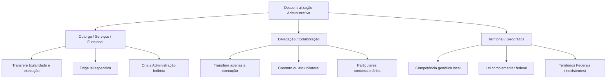
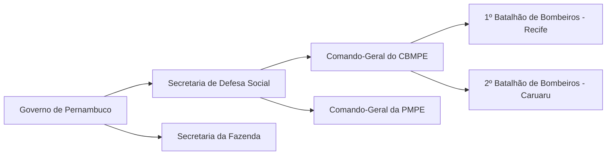
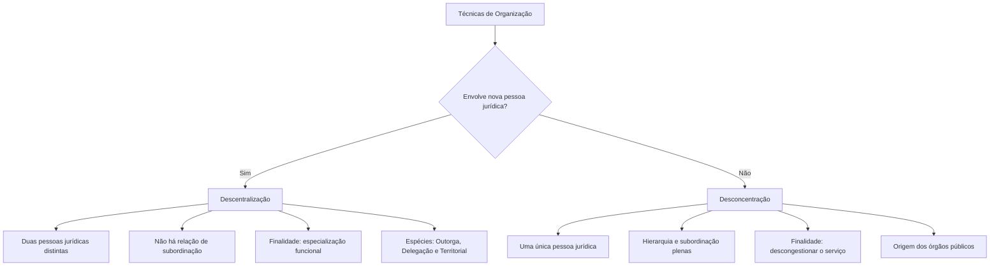

A organização administrativa disciplina como o Estado reparte atribuições e estrutura seus aparelhos funcionais. Para viabilizar os serviços públicos e as ações de polícia, o Poder Público recorre a técnicas consagradas pela doutrina e cobradas de forma recorrente em concursos.

Neste capítulo inicial, examinaremos a distinção conceitual entre Governo e Administração Pública, os traços que diferenciam entidades políticas de administrativas e as quatro modalidades clássicas de distribuição de competências: centralização, descentralização, concentração e desconcentração.

> [!objetivos]
> - Distinguir organização do Estado de organização administrativa e as funções de Governo e Administração.
> - Diferenciar entidades políticas e administrativas quanto à natureza jurídica e ao grau de autonomia.
> - Contrastar centralização e descentralização, compreendendo outorga, delegação e descentralização territorial.
> - Identificar as características da desconcentração e da concentração em uma mesma pessoa jurídica.
> - Analisar as combinações práticas entre centralização, descentralização e desconcentração.

## Organização do Estado e organização administrativa

O estudo da máquina pública reparte-se em duas vertentes complementares. A **organização do Estado** integra o Direito Constitucional. Ela abrange a forma federativa, a tripartição de Poderes, o sistema de governo e a partilha originária de competências entre os entes federados.

Por sua vez, a **organização administrativa** pertence ao Direito Administrativo. Esse ramo analisa a estrutura interna da Administração, as entidades estatais descentralizadas, a criação de órgãos e a atuação de seus agentes.

Nesse cenário, cabe separar as figuras de Governo e Administração:

- **Governo**: órgão de cúpula com atribuição política e diretiva superior. Formula políticas públicas essenciais, define prioridades orçamentárias e traça as diretrizes estratégicas do Estado. Atua com ampla discricionariedade e responde primordialmente no campo político perante o corpo eleitoral. Seus atos ostentam natureza política e soberana.
- **Administração Pública**: aparelho eminentemente técnico encarregado de operacionalizar as decisões tomadas pelo Governo. Presta serviços aos cidadãos, aplica sanções regulamentares de polícia e administra os bens coletivos sob o império da legalidade estrita. Sua atividade é neutra, técnica, contínua e subordinada às balizas do ordenamento jurídico.

Essa engrenagem estatal opera mediante a articulação coordenada de entidades, órgãos e agentes públicos, nos moldes delimitados pela Lei 9.784/1999.

> [!lei] Lei 9.784/1999, art. 1º, § 2º
> Para os fins desta Lei, consideram-se:
> I - órgão - a unidade de atuação integrante da estrutura da Administração direta e da estrutura da Administração indireta;
> II - entidade - a unidade de atuação dotada de personalidade jurídica;
> III - autoridade - o servidor ou agente público dotado de poder de decisão.

Entidades são os sujeitos de direito que assumem obrigações em nome próprio; órgãos atuam como suas unidades internas sem personalidade; e agentes são as pessoas físicas que manifestam a vontade estatal e dão cumprimento material às atribuições públicas.

## Entidades políticas e entidades administrativas

No direito administrativo, a palavra **entidade** designa a pessoa dotada de personalidade jurídica própria. Isso confere aptidão legal para contrair obrigações, titularizar direitos subjetivos e figurar no polo ativo ou passivo de demandas judiciais. Há duas categorias primordiais de entidades no direito brasileiro:

As **entidades políticas** (União, estados-membros, Distrito Federal e municípios) formam a estrutura federativa da República (CF, art. 18). Recebem suas competências diretamente do texto constitucional e desfrutam de **autonomia plena**, que conjuga três capacidades consagradas:

1. **Auto-organização e autolegislação**: poder de editar normas fundamentais próprias e inovar originariamente na ordem jurídica. Os estados elaboram suas próprias Constituições estaduais (CF, art. 25); municípios e Distrito Federal editam suas Leis Orgânicas (CF, arts. 29 e 32). Todos editam suas próprias leis ordinárias e complementares.
2. **Autogoverno**: capacidade de eleger governantes próprios pelo voto popular e estruturar seus Poderes funcionais. Os estados possuem Executivo, Legislativo e Judiciário (CF, art. 125). Os municípios estruturam os Poderes Executivo e Legislativo, sendo desprovidos de Judiciário próprio.
3. **Autoadministração**: prerrogativa de gerir tributos, arrecadar rendas, organizar quadros funcionais de servidores e prestar serviços públicos locais conforme a partilha constitucional (CF, arts. 21 a 24 e 30).

Em posição diversa, as **entidades administrativas** integram a Administração Indireta: compreendem autarquias, fundações públicas de direito público ou privado, empresas públicas e sociedades de economia mista. Suas atribuições decorrem de lei ordinária específica, não possuindo autonomia política ou capacidade legislativa primária.

Essas entidades gozam unicamente de **autoadministração restrita**, orientada pelo **princípio da especialidade**. Por esse vetor, as atividades da entidade ficam rigorosamente adstritas aos fins estipulados pelo legislador criador. A atuação fora do objeto legal configura desvio de finalidade e nulidade do ato praticado. O escopo primário da criação de entidades é conferir especialização técnica e gerencial à prestação pública.

| Aspecto | Entidades políticas | Entidades administrativas |
| --- | --- | --- |
| Exemplos | União, estados, DF e municípios | Entidades autárquicas, fundacionais e empresas estatais |
| Natureza jurídica | Pessoas jurídicas de direito público interno | Pessoas jurídicas de direito público ou privado |
| Origem da competência | Diretamente da Constituição Federal | De lei específica ordinária |
| Autonomia política | Sim (capacidade legislativa e autogoverno) | Não (ausência de capacidade legislativa) |
| Capacidade | Autonomia plena e genérica | Autoadministração restrita à finalidade legal |

## Centralização e descentralização administrativa

Para desincumbir-se de suas tarefas, o Estado adota dois modelos estruturais antagônicos de gestão:

A **centralização** ocorre quando o serviço é executado diretamente pelos órgãos e agentes integrantes da pessoa política titular. A atuação parte da Administração Direta, sem intermediação de outra pessoa jurídica. Como exemplo, cita-se o policiamento ostensivo do Corpo de Bombeiros Militar de Pernambuco e da Polícia Militar de Pernambuco, ambos vinculados à Secretaria de Defesa Social do Estado.

Em contrapartida, a **descentralização** pressupõe necessariamente **duas pessoas jurídicas distintas**: o ente federado transfere a prestação do serviço a outra entidade.

A doutrina distingue duas espécies de descentralização:

- **Descentralização política**: decorre do pacto federativo constitucional, no qual a Carta Magna reparte competências originárias entre União, estados, DF e municípios.
- **Descentralização administrativa**: opera no plano infraconstitucional. O ente transfere serviços para a Administração Indireta ou para particulares prestadores.

> [!pegadinha] Descentralização política versus administrativa
> Questões de concurso costumam classificar a criação de uma autarquia ou empresa estatal como descentralização política. Trata-se de erro grosseiro. A criação de entidade administrativa descentralizada é sempre administrativa. A descentralização política existe unicamente no texto constitucional.

Na descentralização **não há hierarquia**. Inexiste subordinação funcional entre o ente político instituidor e a entidade descentralizada, restando apenas o controle finalístico (tutela administrativa ou supervisão ministerial).

> [!atencao] Controle finalístico
> O controle finalístico é externo e limitado. A autoridade supervisora só pratica atos de controle previstos expressamente em lei, conferindo o cumprimento dos fins institucionais da entidade.

## Modalidades de descentralização: outorga, delegação e territorial

A descentralização administrativa manifesta-se em três modalidades teóricas consagradas:

### Descentralização por outorga (por serviços, funcional ou técnica)

Ocorre quando o Estado cria, por lei específica, uma pessoa jurídica da Administração Indireta e lhe confere a **titularidade** e a **execução** do serviço. O instituto possui presunção de definitividade: apenas nova lei formal pode alterar ou revogar as competências transferidas.

> [!exemplo] Outorga em Pernambuco
> O Estado de Pernambuco instituiu por lei a Fundação de Aposentadorias e Pensões dos Servidores do Estado de Pernambuco (Funape), atribuindo-lhe a titularidade da gestão previdenciária dos servidores estaduais. Trata-se de outorga típica de serviços.

### Descentralização por delegação (ou por colaboração)

Na delegação, o Estado transfere a um particular apenas a **execução** do serviço, mantendo para si a **titularidade**. O particular presta a atividade por sua conta e risco perante os cidadãos, sob permanente controle estatal. Formaliza-se por:

- **Contrato administrativo**: nas concessões e permissões de serviço público, com prazo determinado e equilíbrio econômico-financeiro.
- **Ato unilateral**: na autorização de serviço público, de natureza precária e discricionária, revogável sem dever indenizatório.

O controle estatal na delegação é mais rigoroso que na outorga, admitindo alteração unilateral de cláusulas e sanções diretas.

### Descentralização territorial ou geográfica

Verifica-se quando o Estado cria uma entidade de direito público com limites territoriais delimitados e **capacidade administrativa genérica**. Aplica-se unicamente aos **Territórios Federais** (CF, art. 18, § 2º).

> [!lei] CF, art. 18, § 2º
> Os Territórios Federais integram a União, e sua criação, transformação em Estado ou reintegração ao Estado de origem serão reguladas em lei complementar.

Os territórios integram a União e constituem verdadeiras autarquias territoriais. Ao contrário das autarquias de serviço, que têm objeto específico, o território atua em múltiplos setores sociais na sua área geográfica. Os territórios não integram a federação nem dispõem de capacidade política. Atualmente inexistem territórios federais no Brasil.

| Parâmetro | Por outorga (serviços) | Por delegação (colaboração) | Territorial (geográfica) |
| --- | --- | --- | --- |
| Objeto transferido | Titularidade e execução | Apenas a execução do serviço | Competência genérica local |
| Instrumento jurídico | Lei formal específica | Contrato ou ato unilateral | Lei complementar federal |
| Beneficiário | Entidade da Administração Indireta | Empresa privada delegatária | Território Federal instituído |
| Regime temporal | Tendência à definitividade | Prazo fixo ou precário | Vigência por tempo indeterminado |
| Relação jurídica | Tutela finalística por lei | Fiscalização contratual ampla | Vinculação direta com a União |

## Desconcentração e concentração: a criação de órgãos

A **desconcentração** é a distribuição interna de competências no âmbito de **uma única pessoa jurídica**. Dela derivam os **órgãos públicos**. Conforme Hely Lopes Meirelles, trata-se de técnica de simplificação e aceleração do serviço destinada a agilizar o atendimento estatal.

Na desconcentração vigora o **princípio da hierarquia**. Entre os órgãos desconcentrados há subordinação, comando, fiscalização, imposição de sanções, delegação e avocação de atribuições.

A desconcentração opera sob três critérios:

- **Por matéria**: especialização de temas (Ministério da Saúde, Secretaria de Educação).
- **Por grau ou hierarquia**: escalonamento vertical (Secretário de Estado, Diretor-Geral, Chefe de Seção).
- **Territorial**: demarcação geográfica de atuação (Superintendências Regionais, Batalhões de Bombeiros).

A **concentração** representa o caminho inverso: consiste na extinção ou fusão de órgãos, reagrupando competências em menor número de unidades funcionais para racionalizar despesas.

> [!bizu] Dica prática de memorização
> Guarde a distinção com facilidade:
> - Desconcen**tração** tem a letra **O**: cria **Ó**rgãos internos (mesma pessoa jurídica, há hierarquia).
> - Descen**trali**zação tem a letra **E**: cria **E**ntidades administrativas ou delega a **E**mpresas (outra pessoa jurídica, sem hierarquia).

## Confronto entre descentralização e desconcentração

Descentralização e desconcentração não são institutos excludentes, mas ferramentas combináveis pelo gestor público.

Um serviço estatal pode ser prestado:

1. **Centralizado e desconcentrado**: realizado por órgão interno da Administração Direta, como a emissão de RG por delegacia da Polícia Civil de Pernambuco.
2. **Centralizado e concentrado**: executado diretamente pela autoridade central do ente, sem escalonamento em órgãos subordinados.
3. **Descentralizado e desconcentrado**: executado por departamento regional de autarquia, como uma agência do INSS.
4. **Descentralizado e concentrado**: realizado de forma exclusiva pela sede central de uma entidade descentralizada.

| Critério | Descentralização | Desconcentração |
| --- | --- | --- |
| Pessoas jurídicas | Duas pessoas jurídicas distintas | Uma única pessoa jurídica |
| Estrutura resultante | Pessoas jurídicas autônomas | Órgãos despersonalizados |
| Vínculo relacional | Sem hierarquia (tutela finalística) | Com hierarquia e subordinação |
| Finalidade precípua | Especialização de atividades | Descompressão e agilidade interna |
| Meio de criação | Lei específica ou contrato/ato | Lei ou decreto organizativo |

## Mapa do capítulo

| Instituto | Ideia central | Exemplo prático | Relação funcional |
| --- | --- | --- | --- |
| Centralização | Serviço prestado pela própria pessoa política | Atuação direta das secretarias estaduais | Vínculo orgânico direto |
| Descentralização | Repasse da atividade para outra pessoa jurídica | Criação de autarquia ou concessão rodoviária | Vinculação e tutela (sem subordinação) |
| Desconcentração | Repartição interna de tarefas na mesma entidade | Batalhões, grupamentos e delegacias | Subordinação e comando hierárquico |
| Concentração | Reunião de competências por corte de órgãos | Fusão de secretarias para economia pública | Retorno à chefia imediata |

### Para fixar

- O Governo planeja diretrizes políticas; a Administração Pública as executa com amparo técnico e submissão estrita à lei.
- Entidades políticas (União, estados, DF e municípios) possuem autonomia plena, competência constitucional e poder legislativo.
- Entidades administrativas possuem autoadministração restrita, competência fixada em lei e ausência de poder legislativo.
- A centralização decorre da execução dos serviços pela própria Administração Direta da pessoa federada titular.
- A descentralização exige duas pessoas jurídicas distintas e caracteriza-se pela inexistência de subordinação hierárquica.
- A outorga transfere a titularidade e a execução do serviço por lei, originando as entidades da Administração Indireta.
- A delegação transfere apenas a execução do serviço a particulares, mediante contrato ou ato unilateral.
- A desconcentração opera internamente em uma mesma pessoa jurídica, cria órgãos públicos e mantém o poder hierárquico.
- A desconcentração desenvolve-se pelos critérios de matéria, escalonamento hierárquico e demarcação territorial.
- Um serviço público pode ser simultaneamente centralizado e desconcentrado, ou descentralizado e desconcentrado.
