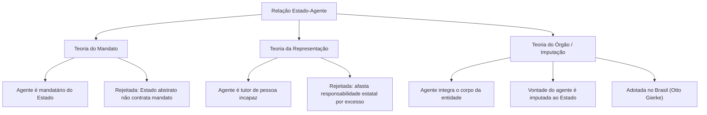
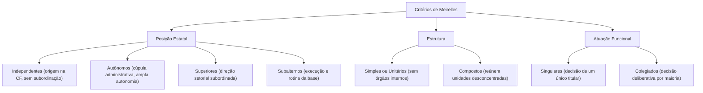
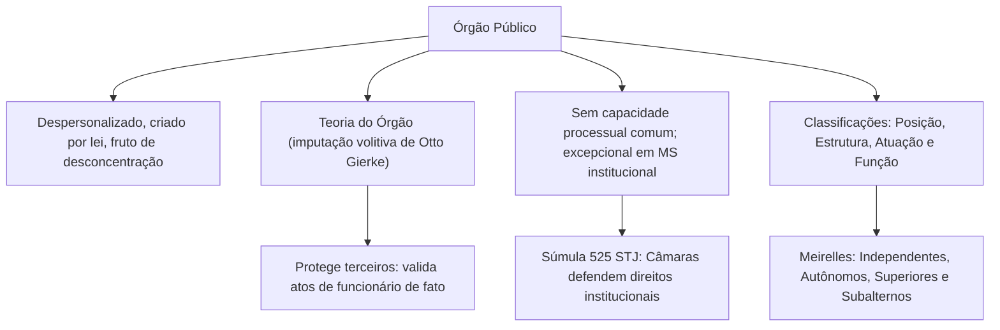

Os órgãos públicos constituem as unidades estruturais pelas quais as entidades estatais manifestam sua vontade e executam serviços essenciais. Enquanto a descentralização cria novas entidades com personalidade jurídica própria, a desconcentração distribui competências internamente em uma mesma pessoa jurídica, originando os órgãos públicos. Por sua vez, a concentração reúne atribuições antes dispersas, ao passo que a centralização mantém a execução das atividades no seio da Administração Direta.

Neste capítulo, estudaremos a definição de órgão público e sua despersonalização jurídica. Analisaremos as teorias formuladas sobre a atuação estatal, com foco na teoria do órgão e no princípio da imputação volitiva de Otto Gierke. Abordaremos também as normas constitucionais de criação e extinção de órgãos, a capacidade processual extraordinária perante os tribunais e as classificações doutrinárias exigidas nas provas de concurso.

> [!objetivos]
> - Definir órgão público e identificar suas características estruturais essenciais.
> - Compreender a teoria do órgão, o princípio da imputação volitiva e o funcionário de fato.
> - Relacionar a criação de órgãos à desconcentração e diferenciá-la da descentralização.
> - Dominar as normas constitucionais sobre criação, extinção e capacidade processual dos órgãos.
> - Classificar os órgãos segundo Hely Lopes Meirelles, Bandeira de Mello e Maria Sylvia Di Pietro.

## Conceito e natureza dos órgãos públicos

O **órgão público** é uma unidade integrante da estrutura de uma pessoa jurídica, que reúne um feixe de competências exercido por seus agentes. Segundo a doutrina clássica de Hely Lopes Meirelles, órgãos são "centros de competências" criados para exprimir a atuação do Estado e concretizar as funções administrativas.

A doutrina administrativista destaca os seguintes traços essenciais dos órgãos:

- **Despersonalização jurídica**: os órgãos não possuem personalidade jurídica própria. Integram uma entidade política da Administração Direta (União, estado, DF ou município) ou uma entidade da Administração Indireta (como uma autarquia).
- **Feixe de competências legais**: recebem da legislação uma esfera própria de atribuições decisórias e operacionais fixadas formalmente.
- **Fruto da desconcentração**: resultam da divisão interna de tarefas dentro de uma mesma pessoa jurídica, operando sob subordinação hierárquica. Distinguem-se da descentralização, que envolve entidades autônomas distintas sem hierarquia.
- **Atuação instrumental**: não assumem direitos ou obrigações em nome próprio. Os atos praticados vinculam a pessoa jurídica a que o órgão pertence.

Quando a Secretaria de Defesa Social de Pernambuco adquire viaturas para o Corpo de Bombeiros Militar, quem contrata formalmente e responde por eventuais inadimplementos é o **Estado de Pernambuco**, titular exclusivo da personalidade jurídica.

## Teorias sobre a atuação do Estado e imputação volitiva

Por ser pessoa jurídica abstrata, o Estado atua no mundo real por meio de pessoas físicas. Ao longo do tempo, três teorias principais buscaram explicar o vínculo existente entre o agente público e a entidade estatal:

### Teoria do mandato

Sustentava que o agente atuaria como mandatário do Estado, mediante contrato formal de mandato. Foi recusada porque o mandato pressupõe duas vontades autônomas preexistentes. O Estado, antes de dispor de agentes em atividade, não tem como outorgar procuração voluntária para que alguém o represente.

### Teoria da representação

Equiparava o agente a um tutor ou curador que representa civilmente um incapaz. Também foi rejeitada pela doutrina:

- Reduz o Estado soberano à condição de pessoa civilmente incapaz.
- No direito civil, atos praticados pelo representante com excesso de poder não vinculam o representado. Se essa diretriz fosse aplicada ao Estado, deixaria a vítima sem reparação indenizatória quando o agente atuasse com desvio de poder ou abuso de autoridade.

### Teoria do órgão (imputação volitiva)

Concebida pelo jurista alemão Otto Gierke e amplamente adotada no Brasil, funda-se no princípio da **imputação volitiva**. O órgão é concebido como parte integrante do próprio organismo da entidade estatal, à semelhança dos membros que formam o corpo humano. Quando o agente atua no uso de sua função, sua vontade é imputada diretamente à pessoa jurídica.

A manifestação funcional do servidor é considerada ato da própria entidade. Se um bombeiro militar atua em socorro público ou um policial civil efetua uma prisão em flagrante, é o próprio Estado que está operando o salvamento ou exercendo o poder de polícia.

| Teoria | Fundamento nuclear | Crítica teórica | Adoção no Brasil |
| --- | --- | --- | --- |
| Mandato | Agente é mandatário com poderes contratuais | O Estado abstrato não pode celebrar mandato prévio | Não |
| Representação | Agente é tutor de entidade civilmente incapaz | Reduz o Estado a incapaz e afasta reparação por excesso | Não |
| Órgão (Gierke) | Vontade funcional é imputada diretamente à entidade | Nenhuma objeção relevante na doutrina moderna | **Sim (regra geral)** |

### O funcionário de fato

Da teoria da imputação volitiva decorre a validade jurídica dos atos praticados pelo **funcionário de fato**: aquele cuja investidura no cargo ou função foi irregular, nula ou com vício formal, mas que atua ostentando inequívoca aparência de legalidade perante a sociedade.

> [!exemplo] Aplicação prática do funcionário de fato
> Suponha que um candidato aprovado em concurso para perito da Polícia Civil seja empossado e elabore laudos periciais durante meses. Posteriormente, o Poder Judiciário anula o concurso por vício formal no edital. Com base na boa-fé, na segurança jurídica e na teoria do órgão, seus laudos periciais continuam plenamente válidos e eficazes perante terceiros.

Os atos do funcionário de fato preservam seus efeitos em homenagem aos princípios da segurança jurídica e da confiança legítima dos cidadãos. Situação inteiramente diversa é a do **usurpador de função pública**, indivíduo desprovido de qualquer título formal que invade o serviço público praticando conduta ilícita; seus atos são considerados juridicamente inexistentes.

## Capacidade processual e prerrogativas dos órgãos

No ordenamento pátrio, a ausência de personalidade jurídica acarreta a incapacidade judiciária dos órgãos para ingressar em juízo por iniciativa própria ou responder isoladamente a demandas forenses. Conforme dispõe o art. 70 do Código de Processo Civil, a capacidade processual comum cabe à pessoa que se encontra no exercício regular de direitos. Se houver lesão a ser reparada, a ação judicial deve ser proposta contra a pessoa jurídica federada titular (União, estado, DF ou município).

### Capacidade processual extraordinária (personalidade judiciária)

Excepcionalmente, a jurisprudência pacífica dos tribunais superiores confere **personalidade judiciária aos órgãos independentes** de estatura constitucional. Reconhece-se que esses órgãos do topo estatal possuem legitimação para impetrar **mandado de segurança** com o propósito estrito de resguardar suas **prerrogativas funcionais e competências institucionais** contra atos abusivos de outros órgãos.

> [!jurisprudencia] STJ, Súmula 525
> O Superior Tribunal de Justiça consolidou a tese de que a Câmara Municipal é desprovida de personalidade jurídica patrimonial, detendo apenas legitimação processual para agir em juízo na defesa estrita de prerrogativas institucionais ligadas à sua autonomia e ao seu funcionamento regular.

Essa legitimação processual extraordinária exige a presença concomitante de requisitos restritos:

1. Tratar-se de órgão independente de escalão constitucional (como mesas diretoras de Câmaras Municipais, Assembleias Legislativas e Tribunais de Contas).
2. A lide versar estritamente sobre a tutela de competências e prerrogativas de sua autonomia orgânica (como o repasse tempestivo do duodécimo orçamentário).
3. A via processual adotada ser o mandado de segurança.

Demandas que versem sobre interesses patrimoniais comuns, como cobrança de aluguéis ou execução de obras de engenharia, devem ser ajuizadas pela pessoa federada titular do patrimônio.

> [!atencao] Defesa coletiva do consumidor
> O Código de Defesa do Consumidor (Lei 8.078/1990, art. 82, III) autoriza expressamente que entidades e órgãos públicos despersonalizados destinados à defesa do consumidor (como os Procons) ajuízem ações coletivas e promovam liquidação e execução indenizatória em prol da coletividade.

## Criação e extinção de órgãos públicos

A instituição e o encerramento de órgãos públicos submetem-se a limites constitucionais estritos conforme o Poder no qual se situam.

### No âmbito do Poder Executivo

No Poder Executivo, vigora o princípio da reserva legal estrita. A criação e a extinção de ministérios e órgãos públicos da Administração Direta exigem edição de **lei formal**, de iniciativa privativa do Chefe do Executivo (CF, art. 61, § 1º, II, "e").

> [!lei] CF, art. 61, § 1º, II, "e"
> São de iniciativa privativa do Presidente da República as leis que disponham sobre:
> II - criação e extinção de Ministérios e órgãos da administração pública, observado o disposto no art. 84, VI;

Em complemento, o art. 84, VI, "a", da Carta Magna autoriza o Chefe do Executivo a expedir **decretos autônomos** para dispor sobre a organização e funcionamento da administração federal, sob a condição estrita de **não gerar aumento de despesa nem criar ou extinguir órgãos públicos**.

> [!pegadinha] Extinção de órgãos por decreto autônomo
> As bancas costumam afirmar que o Governador ou Presidente pode extinguir órgãos vagos por decreto para economizar recursos. É assertiva falsa. Cargos públicos vagos podem ser extintos por decreto autônomo (CF, art. 84, VI, "b"), mas a extinção de órgãos exige sempre lei em sentido formal.

### Nos Poderes Legislativo e Judiciário

Nos demais Poderes estatais, o processo institucional obedece a preceitos específicos:

- **Poder Legislativo**: Câmara dos Deputados e Senado Federal dispõem sobre sua organização interna e criação de órgãos mediante **atos regimentais próprios de cada Casa** legislativa (CF, art. 51, IV, e art. 52, XIII), sem necessidade de sanção presidencial.
- **Poder Judiciário**: a criação e extinção de varas judiciais, juizados e câmaras processam-se por **lei formal ordinária**, com iniciativa privativa conferida aos tribunais competentes (CF, art. 96, II, "c" e "d").
- **Ministério Público e Tribunais de Contas**: a iniciativa de lei para dispor sobre sua organização e subdivisão interna pertence, privativamente, ao Procurador-Geral (CF, art. 127, § 2º) e à Presidência da respectiva corte de contas (CF, art. 73 c/c art. 96).

A tabela a seguir consolida o regime constitucional de criação e extinção de órgãos:

| Estrutura de Poder | Instrumento formal | Iniciativa privativa | Dispositivo constitucional |
| --- | --- | --- | --- |
| Executivo (órgãos) | Lei formal ordinária | Chefe do Poder Executivo | CF, art. 61, § 1º, II, "e" |
| Executivo (organização) | Decreto autônomo (sem novo órgão) | Chefe do Poder Executivo | CF, art. 84, VI, "a" |
| Câmara dos Deputados | Ato da Mesa / Resolução própria | Mesa da Câmara dos Deputados | CF, art. 51, IV |
| Senado Federal | Ato da Mesa / Resolução própria | Mesa do Senado Federal | CF, art. 52, XIII |
| Poder Judiciário | Lei formal ordinária | Tribunais competentes | CF, art. 96, II, "c" e "d" |
| Ministério Público | Lei formal | Procurador-Geral | CF, art. 127, § 2º |

## Classificação dos órgãos segundo Hely Lopes Meirelles

Hely Lopes Meirelles sistematiza os órgãos públicos sob três pontos de vista fundamentais:

### Quanto à posição estatal

Segundo Meirelles, as unidades agrupam-se hierarquicamente nas categorias de:

1. **Independentes**: posicionados no topo da estrutura republicana, com assento direto no texto constitucional e sem qualquer subordinação hierárquica. Suas atribuições políticas e judiciais são exercidas por agentes políticos (Presidência da República, Congresso Nacional, STF, STJ, TCU, MPU).
2. **Autônomos**: situados na cúpula da Administração Pública, logo abaixo dos órgãos independentes. Desfrutam de ampla autonomia técnica, administrativa e financeira para coordenar planos setoriais e supervisionar atividades (Ministérios, Secretarias de Estado, Advocacia-Geral da União).
3. **Superiores**: órgãos de direção e comando setorial com poder decisório em matérias delimitadas, mas submetidos ao controle hierárquico de uma chefia autônoma. Não possuem autonomia financeira (diretorias gerais, departamentos, coordenadorias).
4. **Subalternos**: encontram-se na base da hierarquia organizacional, desempenhando tarefas operacionais rotineiras, expediente material e atendimento básico ao público, com reduzido poder de decisão (portarias, seções de protocolo).

### Quanto à estrutura interna

- **Simples (unitários)**: constituídos por um único centro de competências, inexistindo desconcentração interna em órgãos menores. Podem abrigar vários servidores e agentes, desde que a unidade permaneça indivisa (exemplo: seção de protocolo de uma repartição).
- **Compostos**: congregam múltiplos órgãos menores subordinados resultantes de sucessivas etapas de desconcentração (um Ministério que se ramifica em secretarias, diretorias e divisões).

### Quanto à situação funcional

- **Singulares (unipessoais)**: atuam e decidem mediante a manifestação de vontade monocrática de uma única autoridade titular que chefia o órgão (Presidência da República, Governadorias de Estado, Prefeituras).
- **Colegiados (pluripessoais)**: deliberam pela vontade conjunta da maioria de seus membros votantes reunidos em sessão plenária (tribunais do Poder Judiciário, cortes de contas, conselhos de disciplina militar).

| Classificação de Meirelles | Espécies | Traço definidor |
| --- | --- | --- |
| Posição estatal | Independentes, Autônomos, Superiores e Subalternos | Escalonamento funcional que vai do ápice constitucional à base executora |
| Estrutura interna | Simples (unitários) e Compostos | Ausência ou presença de subdivisão desconcentrada interna |
| Situação funcional | Singulares e Colegiados | Decisão monocrática de chefia versus voto deliberativo da maioria |

## Outras classificações doutrinárias relevantes

A doutrina brasileira contempla ainda as classificações elaboradas por Celso Antônio Bandeira de Mello e Maria Sylvia Zanella Di Pietro.

### Classificação de Celso Antônio Bandeira de Mello

O autor classifica os órgãos de acordo com as funções precípuas que desempenham no aparelho público:

- **Órgãos ativos**: exteriorizam decisões estatais e prestam serviços práticos para atingir as finalidades da entidade (ministérios e secretarias de estado operacionais).
- **Órgãos de controle**: fiscalizam a regularidade contábil, financeira, orçamentária e a legalidade de condutas e atos administrativos de outros órgãos (tribunais de contas e controladorias internas).
- **Órgãos consultivos**: prestam assessoramento jurídico e técnico, emitindo pareceres fundamentados para subsidiar a tomada de decisão dos órgãos ativos (procuradorias estaduais e consultorias jurídicas).

### Classificação de Maria Sylvia Di Pietro

A administrativista formula duas distinções de relevo:

- **Quanto à estrutura orgânica**:
  - *Burocráticos*: estruturados segundo ordenamento vertical, com agentes distribuídos em cadeia hierárquica sob a autoridade disciplinar de um superior hierárquico único (equivalem aos órgãos unipessoais).
  - *Colegiados*: formados por agentes organizados horizontalmente, que deliberam em igualdade de condições por meio de coordenação e votação coletiva.
- **Quanto à composição de agentes**:
  - *Singulares*: integrados fisicamente por um único agente público no exercício da função (a chefia de um destacamento de bombeiros).
  - *Coletivos*: compostos materialmente por múltiplos agentes titulares estáveis (plenários judiciais e tribunais administrativos tributários).

> [!bizu] Esquema mnemônico das classificações
> - Meirelles: Posição (Independentes, Autônomos, Superiores e Subalternos), Estrutura (Simples e Compostos) e Atuação (Singulares e Colegiados).
> - Bandeira de Mello: Função (Ativos, Controle e Consultivos).
> - Di Pietro: Estrutura (Burocráticos e Colegiados) e Composição (Singulares e Coletivos).

## Mapa do capítulo

| Categoria | Divisões | Exemplos característicos |
| --- | --- | --- |
| Posição estatal | Independentes, Autônomos, Superiores, Subalternos | STF, Secretarias Estaduais, Departamentos, Protocolos |
| Estrutura | Simples (unitários) e Compostos | Seção indivisa versus Ministério com secretarias |
| Situação funcional | Singulares e Colegiados | Governador de Estado versus Plenário do Tribunal |
| Função (Bandeira) | Ativos, De controle, Consultivos | Secretarias, Tribunais de Contas, Procuradorias |
| Formação (Di Pietro) | Burocráticos e Colegiados | Diretoria vertical versus Conselho deliberativo horizontal |

### Para fixar

- Os órgãos públicos são centros de competências despersonalizados resultantes da desconcentração administrativa.
- O Brasil adota a teoria do órgão (imputação volitiva), imputando a manifestação funcional do agente à pessoa jurídica estatal.
- As teorias do mandato e da representação foram superadas por incompatibilidade com a soberania e a responsabilidade civil do Estado.
- Atos praticados por funcionário de fato são válidos perante cidadãos de boa-fé, com base na segurança jurídica e na confiança legítima.
- Em regra, órgãos públicos não possuem capacidade para figurar em juízo como autor ou réu.
- Órgãos independentes possuem personalidade judiciária extraordinária para impetrar mandado de segurança na defesa de suas prerrogativas.
- No Poder Executivo, a criação e a extinção de órgãos exigem lei formal de iniciativa privativa do chefe do Executivo.
- O decreto autônomo pode dispor sobre organização e funcionamento da administração federal, vedada a criação ou extinção de órgãos.
- Na classificação de Meirelles pela posição estatal, os órgãos são independentes, autônomos, superiores ou subalternos.
- Quanto à situação funcional, órgãos singulares decidem por autoridade individual e colegiados deliberam por votação majoritária.
