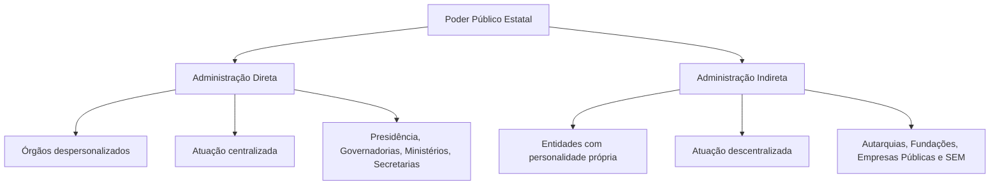
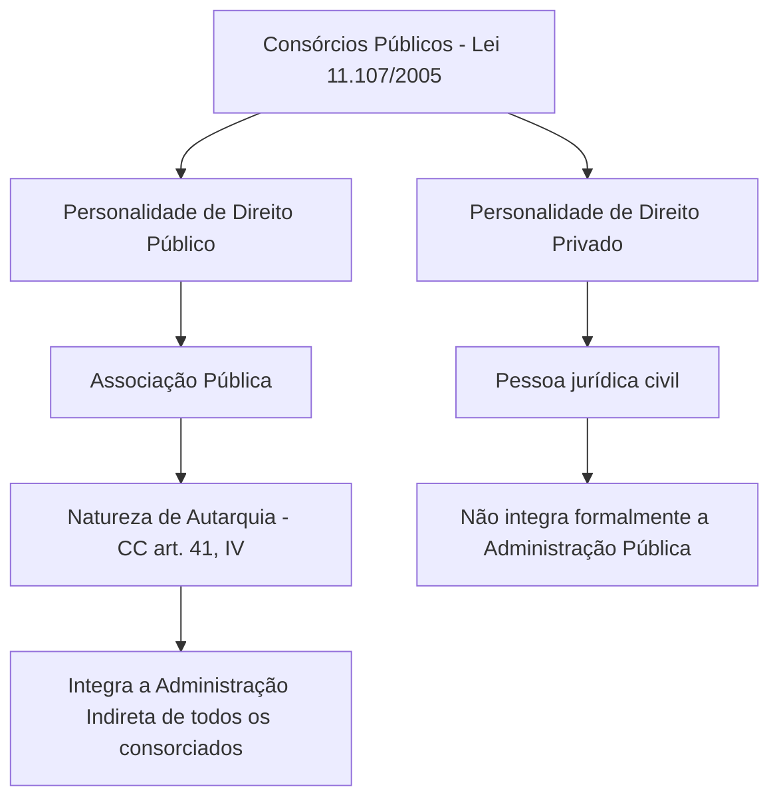
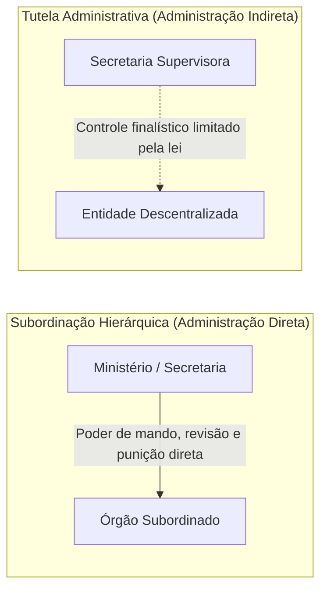
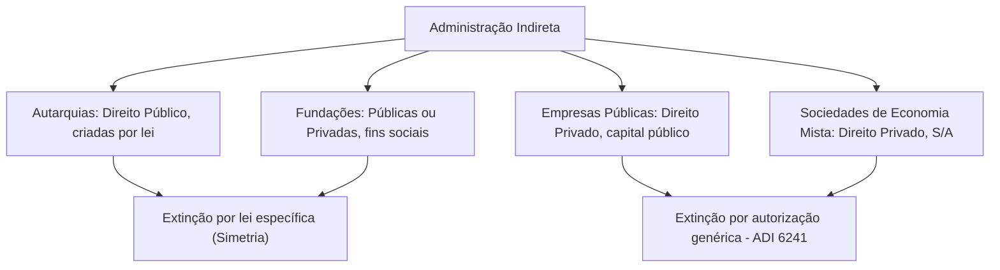

A organização do Estado moderno reparte a gestão das atividades coletivas entre órgãos centrais e entidades especializadas. Essa divisão conforma os blocos da Administração Pública Direta e da Administração Pública Indireta. Compreender as regras comuns que balizam essas estruturas é indispensável para enfrentar questões de prova com precisão técnica.

Neste capítulo, estudaremos os conceitos da Administração Direta e Indireta com base no modelo do Decreto-Lei 200/1967 e da Constituição Federal de 1988. Analisaremos as quatro categorias clássicas de entidades descentralizadas (autarquias, fundações instituídas pelo poder público, empresas públicas e sociedades de economia mista), o regime dos consórcios públicos, os requisitos para criação e aquisição de personalidade jurídica e a sistemática de extinção fixada pelo Supremo Tribunal Federal na ADI 6241.

> [!objetivos]
> - Diferenciar a estrutura da Administração Direta da Administração Indireta em todas as esferas federativas.
> - Identificar as quatro categorias de entidades administrativas e o tratamento conferido aos consórcios públicos.
> - Compreender os traços comuns às entidades da Administração Indireta, especialmente a reserva legal e a tutela finalística.
> - Distinguir o momento e a forma de aquisição da personalidade jurídica nas entidades públicas e privadas.
> - Dominar as regras de extinção das entidades administrativas e o entendimento do STF firmado na ADI 6241.

## A estrutura da Administração Pública Direta

A **Administração Pública Direta** é o conjunto de órgãos públicos despersonalizados que integram a estrutura das pessoas jurídicas políticas da federação: União, estados-membros, Distrito Federal e municípios. Esses órgãos desempenham a atividade administrativa do Estado de forma **centralizada**, atuando em nome do respectivo ente federado.

No plano federal, o Decreto-Lei 200/1967 estabelece no art. 4º, I, que a Administração Direta compreende o conjunto funcional de serviços vinculados à estrutura orgânica da Presidência da República (incluindo órgãos essenciais como a Casa Civil e os Ministérios). Embora o diploma seja federal, esse modelo de repartição foi reproduzido compulsoriamente por estados, pelo Distrito Federal e pelos municípios, em observância ao princípio da simetria constitucional.



Embora a imensa maioria dos órgãos da Administração Direta localize-se no âmbito do Poder Executivo, é fundamental assinalar que se encontram repartições da Administração Direta no âmbito de todos os Poderes republicanos (Executivo, Legislativo e Judiciário). Essa constatação decorre da redação expressa do art. 37, caput, da Constituição Federal, que impõe os princípios administrativos à administração pública direta de qualquer dos Poderes.

Quando a Mesa Diretora da Câmara dos Deputados organiza um concurso público ou o Tribunal de Justiça do Estado de Pernambuco licencia servidores e adquire equipamentos de informática, ambos estão desempenhando função administrativa atípica por meio de seus órgãos internos da Administração Direta.

| Parâmetro | Administração Direta | Administração Indireta |
| --- | --- | --- |
| Natureza das unidades | Órgãos despersonalizados | Entidades dotadas de personalidade jurídica |
| Modo de atuação | Centralizado (com ou sem desconcentração) | Descentralizado por outorga legal |
| Pessoas jurídicas | As pessoas políticas (União, estados, DF, municípios) | Pessoas jurídicas públicas ou privadas criadas por lei |
| Vínculo interno | Subordinação hierárquica entre seus órgãos | Vinculação e controle finalístico (sem hierarquia) |
| Presença nos Poderes | Presente nos Poderes Executivo, Legislativo e Judiciário | Predominante no Executivo (possível nos demais) |

## A Administração Pública Indireta e suas entidades

A **Administração Pública Indireta** é constituída pelo conjunto de pessoas jurídicas (entidades administrativas) criadas pelo Poder Público para desempenhar atividades de interesse coletivo de forma **descentralizada**.

Nos termos do art. 4º, II, do Decreto-Lei 200/1967 e do art. 37, XIX, da Constituição Federal de 1988, a Administração Indireta é integrada por quatro categorias clássicas de entidades:

1. **Autarquias**: pessoas jurídicas de direito público criadas por lei para executar atividades típicas e exclusivas de Estado.
2. **Fundações públicas**: patrimônios personificados instituídos para o desenvolvimento de atividades sociais, culturais, assistenciais e de pesquisa sem fins lucrativos.
3. **Empresas públicas**: pessoas jurídicas de direito privado cujo capital é integralmente público, instituídas sob qualquer forma empresarial admitida em direito.
4. **Sociedades de economia mista**: pessoas jurídicas de direito privado com capital misto (majoritariamente público votante), estruturadas obrigatoriamente como sociedade anônima.

> [!exemplo] Entidades da Administração Indireta em Pernambuco
> No âmbito do Estado de Pernambuco, encontramos exemplos marcantes de cada espécie de entidade descentralizada:
> - Autarquia: o Instituto Agronômico de Pernambuco (IPA), voltado ao fomento rural e pesquisa agropecuária.
> - Fundação pública: a Fundação de Hematologia e Hemoterapia de Pernambuco (Hemope).
> - Empresa pública: o Complexo Industrial Portuário de Suape.
> - Sociedade de economia mista: a Companhia Pernambucana de Saneamento (Compesa).

Convém destacar que nem todas as entidades da Administração Indireta desempenham serviços públicos em sentido técnico. As pessoas estatais (tanto sob a roupagem de empresa pública quanto sob o modelo de sociedade de economia mista) podem ser instituídas com duas finalidades distintas: prestar serviços públicos ou **explorar atividade econômica em sentido estrito**, nos termos autorizados pelo art. 173 da Constituição Federal (como é o caso do Banco do Brasil e da Petrobras no plano federal). Mesmo quando exploram atividade econômica concorrencial de mercado, essas estatais continuam integrando formalmente a Administração Pública Indireta.

### O regime dos consórcios públicos

Tema frequente em certames públicos diz respeito ao enquadramento jurídico dos **consórcios públicos**, regulamentados pela Lei 11.107/2005. Trata-se de instrumentos de cooperação interfederativa celebrados entre União, estados, Distrito Federal e municípios para a realização de objetivos comuns.

A doutrina brasileira debate se os consórcios públicos representariam uma "quinta espécie" de entidade da Administração Indireta. Doutrinadores de renome, como Maria Sylvia Zanella Di Pietro, defendem que os consórcios formam uma espécie autônoma de pessoa jurídica descentralizada.

Prevalece, contudo, a lição de autores como Celso Antônio Bandeira de Mello, Marcelo Alexandrino e Vicente Paulo: os consórcios públicos **não constituem uma nova espécie autônoma**, devendo ser examinados conforme a sua personalidade jurídica:

- **Consórcios de direito público**: recebem a denominação legal de **associações públicas**. O Código Civil, em seu art. 41, IV, estabelece expressamente que as associações públicas ostentam a natureza de **autarquias**. Integram formalmente a Administração Indireta de todos os entes federados consorciados de forma simultânea.
- **Consórcios de direito privado**: assumem feição civil ou empresarial e, na linha estrita da Lei 11.107/2005, não integram a Administração Pública formal, regendo-se predominantemente pelas normas do direito privado.



## Características comuns das entidades da Administração Indireta

Embora guardem regimes jurídicos próprios e naturezas contrárias (direito público versus direito privado), as entidades que compõem a Administração Indireta compartilham traços estruturais comuns:

### Personalidade jurídica própria e patrimônio destacado

Todas as entidades da Administração Indireta possuem personalidade jurídica própria. São sujeitos autônomos de direitos e obrigações, dotados de capacidade para celebrar contratos, contrair empréstimos, admitir pessoal e responder juridicamente por suas ações e omissões.

Para assegurar sua viabilidade material, recebem patrimônio próprio inicial destacado da pessoa política instituidora. Esse patrimônio fica permanentemente afetado à consecução de seus objetivos institucionais. Além disso, contam com receita própria, proveniente de dotações orçamentárias regulares ou de taxas e tarifas decorrentes de suas atividades operacionais.

### Reserva legal e criação condicionada à lei

Nenhuma entidade da Administração Indireta pode ser instituída por ato administrativo infralegal, como decreto executivo ou portaria ministerial. Conforme determina o art. 37, XIX, da Constituição Federal, sua instituição subordina-se à atuação do Poder Legislativo por meio de **lei específica**.

> [!lei] CF, art. 37, XIX
> somente por lei específica poderá ser criada autarquia e autorizada a instituição de empresa pública, de sociedade de economia mista e de fundação, cabendo à lei complementar, neste último caso, definir as áreas de sua atuação;

A exigência de lei específica significa que o diploma normativo deve tratar pontualmente da entidade cuja instituição se pretende. São inconstitucionais as autorizações genéricas em leis orçamentárias ou diretrizes orçamentárias para "criar empresas quando conveniente".

> [!atencao] A lei complementar das fundações públicas
> A parte final do art. 37, XIX, da Carta da República exige lei complementar para definir as áreas de atuação das fundações públicas. Até os dias atuais, o Congresso Nacional não editou essa lei complementar nacional. Não obstante essa mora legislativa, a jurisprudência autoriza o funcionamento das fundações existentes, desde que vinculadas a atividades de relevante interesse social sem finalidade lucrativa.

Em harmonia com essa exigência, o art. 37, XX, da Constituição prescreve que a criação de **subsidiárias** das entidades administrativas, assim como a sua participação em empresas privadas, depende igualmente de autorização legislativa em cada caso. Essa autorização legislativa para subsidiárias, segundo pacificado pelo STF, pode constar genericamente na própria lei instituidora da empresa estatal matriz.

### O princípio da especialidade

Toda entidade administrativa surge vinculada a uma **finalidade pública específica**, fixada expressamente no texto da lei que a instituiu ou autorizou. É a consagração do princípio da especialidade.

A entidade descentralizada não dispõe de competência aberta ou genérica. É nulo, por desvio de finalidade, qualquer ato praticado pelos dirigentes da entidade que extrapole os estritos objetivos materiais definidos pelo legislador. Se uma autarquia de trânsito passar a custear obras de saneamento básico, o ato é fulminado por vício de competência e desvio de poder.

### Tutela administrativa e ausência de subordinação hierárquica

Entre a Administração Direta e as entidades da Administração Indireta **não existe relação hierárquica**. O órgão ministerial ou a secretaria supervisora não possui poder disciplinar direto sobre a entidade descentralizada, não podendo intervir livremente em sua gestão diária nem avocar rotineiramente seus processos internos.

O que vigora é a **tutela administrativa**, também denominada **controle finalístico** ou **supervisão ministerial** (Decreto-Lei 200/1967, art. 26).

Trata-se de controle externo, teleológico e limitado. A finalidade da supervisão consiste em assegurar que a entidade cumpra os objetivos fixados na lei de criação e harmonize suas atividades com as diretrizes do programa governamental. Os atos de controle só podem ser exercidos nos estritos limites autorizados pelo legislador. Além da tutela, as entidades submetem-se ao controle externo exercido pelo Tribunal de Contas e pelo Poder Judiciário.



## Aquisição da personalidade jurídica

O modo pelo qual a pessoa jurídica nasce no mundo jurídico varia de forma substancial conforme a sua natureza de direito público ou de direito privado. Essa distinção decorre da redação do art. 37, XIX, da Carta Política e do Código Civil.

### Entidades de direito público (autarquias e fundações de direito público)

As entidades com personalidade jurídica de direito público interno são **criadas diretamente por lei específica**.

Para essas pessoas jurídicas, o nascimento opera-se de imediato com a **entrada em vigor da lei formal**. Não se exige a elaboração de estatutos sociais em cartório nem qualquer registro em Junta Comercial ou Registro Civil das Pessoas Jurídicas. A publicação e vigência da norma instituidora conferem personalidade jurídica automática à entidade.

Esse regime aplica-se a todas as autarquias e também às fundações públicas de direito público (que ostentam a natureza material de autarquias fundacionais).

### Entidades de direito privado (empresas públicas, SEM e fundações privadas)

Diferentemente das pessoas públicas, as entidades administrativas de direito privado **não são criadas diretamente pela lei**. A lei específica limita-se a **autorizar a sua criação**.

A aquisição da personalidade jurídica dessas entidades depende do cumprimento de um procedimento em etapas sucessivas:

1. **Autorização legislativa**: edição e publicação da lei específica autorizadora.
2. **Elaboração dos atos constitutivos**: o Chefe do Poder Executivo edita, por decreto regulamentar, os atos constitutivos e estatutos sociais da entidade.
3. **Registro formal no órgão competente**: os atos constitutivos são inscritos na **Junta Comercial** (no caso de sociedades empresárias, como empresas públicas mercantis e sociedades de economia mista) ou no **Registro Civil de Pessoas Jurídicas** (para fundações de direito privado e empresas prestadoras de serviço civil).

A personalidade jurídica nasce apenas e tão somente no instante em que o **registro formal é deferido e inscrito**. Antes do registro cartorário ou mercantil, a entidade é mera expectativa de fato, desprovida de capacidade jurídica própria.

```mermaid Etapas de criação de entidade da Administração Indireta de direito privado
flowchart LR
  Lei[1. Lei específica autorizadora] --> Dec[2. Decreto com estatuto social]
  Dec --> Reg[3. Registro na Junta Comercial ou RCPJ]
  Reg --> Nasc[4. Nascimento da personalidade jurídica]
```

A tabela a seguir consolida a forma de nascimento de cada figura da Administração Indireta:

| Entidade administrativa | Natureza jurídica | Momento da personalidade | Exigência de registro |
| --- | --- | --- | --- |
| Autarquias | Direito Público | Vigência da lei específica de criação | Dispensado |
| Fundações públicas de direito público | Direito Público | Vigência da lei específica de criação | Dispensado |
| Fundações públicas de direito privado | Direito Privado | Inscrição do ato no Registro Civil | Obrigatório no RCPJ |
| Empresas públicas | Direito Privado | Inscrição do ato na Junta ou RCPJ | Obrigatório (Junta/RCPJ) |
| Sociedades de economia mista | Direito Privado | Inscrição dos atos constitutivos na Junta | Obrigatório na Junta Comercial |

> [!pegadinha] Criação versus autorização de empresas públicas
> Assertivas que afirmam que "as empresas públicas e sociedades de economia mista adquirem personalidade jurídica a partir da promulgação da lei que as instituiu" estão erradas. A lei apenas autoriza a sua instituição; a personalidade jurídica nasce unicamente com o subsequente registro dos estatutos no órgão registral competente.

> [!bizu] Dica de memorização da personalidade
> Lembre-se:
> - É de Direito **Público**? A própria **Lei cria** (nasce com a vigência da norma).
> - É de Direito **Privado**? A Lei **autoriza** e o **Registro formaliza** (nasce com o registro público).

## Extinção das entidades da Administração Indireta e a ADI 6241

Para o desfazimento das entidades administrativas, a doutrina tradicional sustenta o **princípio da simetria das formas jurídicas** (paralelismo das formas). Sob essa ótica clássica, se a entidade necessitou de lei específica para ser criada ou autorizada, sua extinção deveria depender obrigatoriamente de outra lei específica.

No entanto, a jurisprudência do Supremo Tribunal Federal estabeleceu uma distinção relevante sobre a matéria, flexibilizando o rigor para as empresas estatais.

### Autarquias e fundações públicas

Em relação às autarquias e às fundações públicas, o princípio da simetria permanece aplicável de forma integral. A extinção dessas pessoas jurídicas depende de **lei formal específica** que expressamente determine a extinção da autarquia ou autorize a liquidação da fundação instituída. É inadmissível extinguir autarquia ou fundação por simples decreto executivo ou autorização legal genérica.

### Empresas estatais e a jurisprudência na ADI 6241

No julgamento histórico da **ADI 6241**, o Supremo Tribunal Federal fixou diretriz menos rigorosa para a extinção de empresas públicas e sociedades de economia mista inseridas em processos de desestatização.

O STF consolidou a tese de que **não é necessária lei específica para autorizar a extinção ou privatização de empresa estatal**, sendo suficiente uma **autorização legislativa genérica** veiculada em lei que institua programa setorial de desestatização. São exemplos federais a Lei 9.491/1997 (Programa Nacional de Desestatização - PND) e a Lei 13.334/2016 (Programa de Parcerias de Investimentos - PPI).

> [!jurisprudencia] STF, ADI 6241
> O Supremo Tribunal Federal pacificou que a extinção e a desestatização de empresas públicas e sociedades de economia mista podem ser respaldadas por autorização genérica prevista em lei instituidora de programa de desestatização, desde que a norma fixe diretrizes, objetivos e critérios claros de política pública, dispensando-se lei individualizada para cada empresa estatal.

Todavia, o STF estabeleceu duas balizas imperativas que condicionam a validade dessa autorização genérica:

1. **Vedação da carta em branco**: a lei instituidora do programa de desestatização não pode conferir delegação irrestrita ou em branco ao Poder Executivo. O texto legal deve estipular balizas, finalidades e critérios objetivos da política pública a ser executada.
2. **Ressalva da exigência da lei instituidora**: a autorização legislativa genérica é inaplicável se a própria lei que autorizou a criação da empresa estatal previu, expressamente em seu texto, a exigência de lei específica para autorizar a sua posterior extinção ou alienação acionária. Havendo essa cláusula especial, a simetria restabelece-se de modo cogente.

A tabela comparativa a seguir sintetiza as hipóteses de extinção no direito público brasileiro:

| Entidade | Requisito para extinção | Fundamento normativo |
| --- | --- | --- |
| Autarquias | Lei específica formal | Princípio da simetria das formas |
| Fundações públicas | Lei específica (ou autorização em lei específica) | Princípio da simetria das formas |
| Empresas públicas (regra) | Autorização em lei de desestatização (genérica) | STF, tese firmada na ADI 6241 |
| Sociedades de economia mista | Autorização em lei de desestatização (genérica) | STF, tese firmada na ADI 6241 |
| Empresas estatais (exceção) | Lei específica, se exigida na sua lei de criação | STF, modulação na ADI 6241 |

## Mapa do capítulo



| Instituto | Natureza | Criação | Extinção | Regime pessoal |
| --- | --- | --- | --- | --- |
| Administração Direta | Despersonalizada | Lei formal (Executivo) ou ato próprio | Lei formal | Estatutário predominante |
| Autarquias | Direito Público | Criada por lei específica | Lei específica | Estatutário predominante |
| Fundações Públicas | Direito Público ou Privado | Lei cria (Púb.) ou autoriza (Priv.) | Lei específica | Estatutário ou Celetista |
| Empresas Públicas | Direito Privado | Autorizada por lei + Registro | Autorização genérica (ADI 6241) | Celetista concursado |
| Sociedades de Economia Mista | Direito Privado | Autorizada por lei + Registro na Junta | Autorização genérica (ADI 6241) | Celetista concursado |

### Para fixar

- A Administração Direta é integrada por órgãos despersonalizados das pessoas federadas e atua de forma centralizada.
- Existem órgãos da Administração Direta nos Poderes Executivo, Legislativo e Judiciário em todos os entes políticos.
- A Administração Indireta é composta por autarquias, fundações governamentais, sociedades de economia mista e empresas públicas.
- As empresas estatais que exploram atividade econômica em regime de mercado integram formalmente a Administração Indireta.
- Os consórcios públicos de direito público constituem associações públicas com natureza jurídica de autarquias.
- As entidades descentralizadas gozam de patrimônio próprio, personalidade jurídica autônoma e receita própria.
- Entre a Administração Direta e as entidades da Indireta inexiste hierarquia, vigorando apenas a tutela administrativa ou supervisão ministerial.
- Autarquias e fundações públicas de direito público nascem com a publicação e vigência da lei específica instituidora.
- Entidades administrativas de direito privado adquirem personalidade jurídica a partir do registro de seus atos constitutivos no órgão competente.
- Pela tese da ADI 6241 do STF, empresas estatais podem ser extintas mediante autorização genérica em lei de desestatização.
