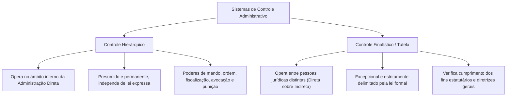
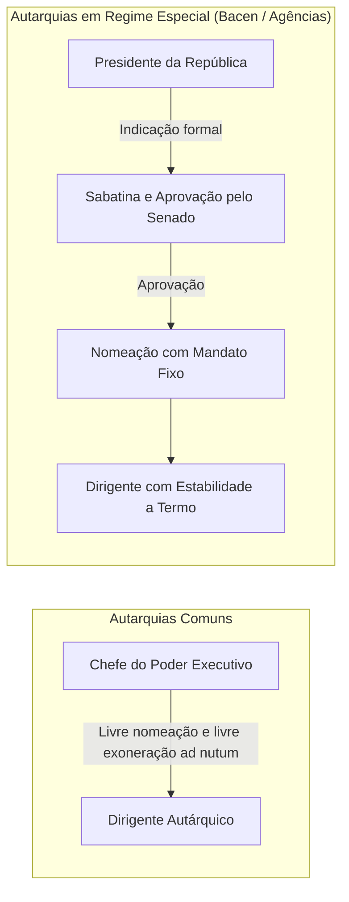
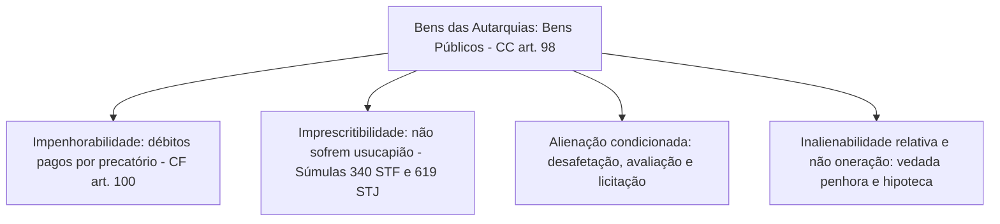
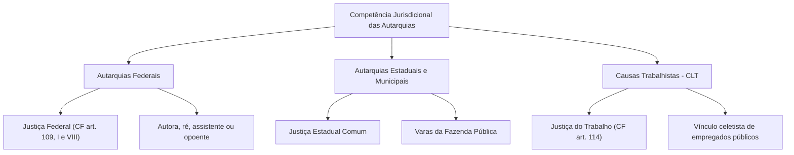
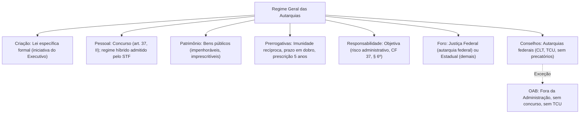

Dentre todas as figuras que integram a Administração Pública Indireta, a autarquia ostenta posição de absoluto destaque dogmático e prático. Criada diretamente por lei para desempenhar atividades típicas de Estado com feição pública, a entidade autárquica atua como um verdadeiro prolongamento personalizado do Poder Público, munida das prerrogativas e restrições próprias do regime jurídico-administrativo.

> [!objetivos]
> - Definir autarquia e identificar seus elementos caracterizadores essenciais no ordenamento pátrio.
> - Compreender a sistemática de criação e extinção autárquica e os limites do controle finalístico (tutela).
> - Analisar o regime funcional autárquico à luz da jurisprudência do STF sobre o art. 39 da Constituição.
> - Dominar as prerrogativas públicas das autarquias: imunidade tributária recíproca, regime de precatórios, prazos processuais e prescrição quinquenal.
> - Diferenciar o regime dos conselhos de fiscalização profissional e o da Ordem dos Advogados do Brasil.

## Conceito e elementos caracterizadores da autarquia

A autarquia é a pessoa jurídica de direito público interno, integrante da Administração Pública Indireta, criada por lei específica para executar atividades típicas e exclusivas de Estado de forma descentralizada. Na síntese de Celso Antônio Bandeira de Mello, as autarquias configuram pessoas de direito público com capacidade exclusivamente administrativa. Já Maria Sylvia Zanella Di Pietro acentua que se trata de entidade dotada de personalidade de direito público interno, instituída por diploma legal com autonomia de gestão para a realização de serviços públicos descentralizados.

No direito positivo federal, o marco de referência encontra-se insculpido no art. 5º, I, do Decreto-Lei 200/1967.

> [!lei] Decreto-Lei 200/1967, art. 5º, I
> Autarquia - o serviço autônomo, criado por lei, com personalidade jurídica, patrimônio e receita próprios, para executar atividades típicas da Administração Pública, que requeiram, para seu melhor funcionamento, gestão administrativa e financeira descentralizada.

A autarquia traduz a ideia de um serviço público personificado. O Estado destaca determinado serviço ou função pública de sua Administração Direta e confere a ele personalidade jurídica própria, patrimônio autônomo e receita individualizada.

A doutrina identifica cinco características basilares das autarquias:

- **Criação direta por lei específica**: adquire personalidade jurídica com a vigência da lei instituidora, sem necessidade de registro em cartório.
- **Personalidade jurídica de direito público**: submete-se ao regime de direito público, desfrutando dos privilégios da Fazenda Pública e curvando-se a restrições estritas de legalidade.
- **Capacidade de autoadministração**: possui autonomia técnica, administrativa e orçamentária para gerir seus próprios serviços e quadro funcional, sem ingerência política direta em suas decisões internas.
- **Especialização de finalidades**: rege-se pelo princípio da especialidade, atuando unicamente nos limites fixados em sua lei instituidora.
- **Sujeição a controle finalístico**: vincula-se ao órgão da Administração Direta instituidora para fins de tutela e supervisão, inexistindo qualquer subordinação hierárquica.

As autarquias desempenham atividades típicas de Estado: serviços públicos propriamente ditos, ações de fomento social, previdência pública e exercício de poder de polícia administrativa. É expressamente vedado atribuir à autarquia a exploração de atividade econômica de mercado em sentido estrito (CF, art. 173), tarefa privativa das empresas estatais.

Como exemplos notórios de autarquias federais, citam-se o Instituto Nacional do Seguro Social (INSS), o Departamento Nacional de Infraestrutura de Transportes (DNIT) e o Instituto Brasileiro do Meio Ambiente e dos Recursos Naturais Renováveis (IBAMA). No Estado de Pernambuco, destaca-se o Departamento de Estradas de Rodagem de Pernambuco (DER-PE).

| Elemento estrutural | Regime jurídico autárquico |
| --- | --- |
| Personalidade jurídica | Direito público interno |
| Modo de instituição | Criada diretamente por lei formal específica |
| Objeto e missão | Atividades típicas de Estado (serviço público, previdência, polícia administrativa) |
| Exploração econômica | Proibida (incompatível com o regime de direito público) |
| Relação com o ente central | Vinculação com controle finalístico (ausência de subordinação hierárquica) |

## Criação e extinção de autarquias

A criação de autarquias depende compulsoriamente de **lei ordinária específica**, conforme prescreve o art. 37, XIX, da Constituição Federal. Trata-se de criação imediata: a autarquia nasce no plano jurídico na exata data em que a lei entra em vigor.

No plano federal, a iniciativa do processo legislativo para a criação de autarquias é **privativa do Presidente da República**, por força do art. 61, § 1º, II, "e", da Carta Magna. Em atenção ao princípio da simetria constitucional, a iniciativa pertence com exclusividade ao Governador no âmbito estadual e distrital, e ao Prefeito no plano municipal. Qualquer projeto de lei de iniciativa parlamentar que pretenda criar autarquia padece de inconstitucionalidade formal insanável por usurpação de competência do Chefe do Executivo.

Excepcionalmente, se a autarquia for instituída no âmbito dos serviços auxiliares do Poder Legislativo ou do Poder Judiciário, a iniciativa legislativa caberá à Mesa da respectiva Casa Parlamentar ou ao Tribunal competente.

A extinção da autarquia submete-se estritamente ao **princípio da simetria das formas jurídicas**: se a entidade depende de lei específica para nascer, sua extinção exige compulsoriamente a edição de **outra lei formal específica**. É juridicamente impossível extinguir autarquia mediante decreto regulamentar do Chefe do Poder Executivo ou portaria ministerial. Extinta a autarquia por lei, seu patrimônio residual, seus créditos e suas dívidas reincorporam-se automaticamente ao patrimônio da pessoa jurídica política instituidora.


## Tutela ou controle do ente político (supervisão ministerial)

A descentralização autárquica pressupõe que a entidade criada desfrute de autonomia para gerir seus próprios serviços. Em consequência direta dessa premissa, **não existe hierarquia nem subordinação** entre a Administração Direta e as autarquias a ela vinculadas.

A pessoa política instituidora exerce sobre a autarquia tão somente o **controle finalístico legal**, tradicionalmente denominado pela doutrina como tutela administrativa ou supervisão ministerial setorial (Decreto-Lei 200/1967, art. 26).



A autoridade supervisora (Ministro de Estado ou Secretário Estadual) não possui poder disciplinar genérico sobre os agentes da autarquia, nem tem competência para rever de ofício as decisões técnicas emanadas de seus órgãos colegiados. As formas de intervenção governamental limitam-se àquelas taxativamente previstas na legislação, destinadas a assegurar a harmonia com o plano geral de governo e coibir desvios de finalidade.

A tabela a seguir evidencia os contrastes marcantes entre essas duas ordens de controle:

| Critério de comparação | Controle hierárquico | Controle finalístico (tutela) |
| --- | --- | --- |
| Âmbito de incidência | Interno a uma mesma pessoa jurídica | Externo, entre duas pessoas jurídicas distintas |
| Relação jurídica | Subordinação plena e permanente | Vinculação restrita à finalidade legal |
| Necessidade de lei | Desnecessária previsão expressa (poder implícito) | Exige previsão taxativa em lei formal |
| Poderes do controlador | Dar ordens, anular, revogar, avocar e punir | Verificar cumprimento dos fins e programas de governo |
| Recursos administrativos | Recursos hierárquicos próprios ordinários | Recursos hierárquicos impróprios admitidos por lei |

## Regime de pessoal das autarquias

A disciplina dos agentes que compõem o quadro das autarquias sofreu expressivas oscilações normativas ao longo da vigência da Constituição de 1988, culminando em relevante decisão do STF:

### A evolução constitucional e o julgamento definitivo da ADI 2135

Na redação original de 1988, o art. 39 da Constituição impunha a instituição de um **regime jurídico único** para os agentes da administração direta, das autarquias e das fundações públicas em cada esfera federativa. Embora o constituinte não tivesse determinado expressamente o regime estatutário, esse modelo foi adotado como regra pela União (Lei 8.112/1990) e pela imensa maioria dos estados e municípios.

A Emenda Constitucional 19/1998 suprimiu a obrigatoriedade do regime jurídico único, admitindo a coexistência de servidores estatutários e empregados públicos regidos pela Consolidação das Leis do Trabalho (CLT) no âmbito de uma mesma entidade autárquica.

Em 2007, o Supremo Tribunal Federal, ao apreciar a medida cautelar na **ADI 2135**, suspendeu a vigência da redação dada pela EC 19/1998 por vício formal de tramitação no Congresso Nacional, restabelecendo a vigência do texto original que exigia o regime jurídico único.

Contudo, no julgamento definitivo de mérito concluído em **2024**, o Plenário do Supremo Tribunal Federal superou a cautelar anterior e julgou improcedente a ação direta, declarando a **constitucionalidade formal e material da Emenda Constitucional 19/1998**.

| Marco temporal | Regime jurídico aplicável | Efeito prático |
| --- | --- | --- |
| 1988 a 1998 (texto original) | Regime jurídico único obrigatório | Predomínio absoluto do regime estatutário nas autarquias |
| 1998 a 2007 (vigência da EC 19) | Regime jurídico flexível | Admissão de contratações pelo regime da CLT |
| 2007 a 2024 (cautelar na ADI 2135) | Regime jurídico único restabelecido | Obrigatoriedade de regime único (estatutário em regra) |
| A partir de 2024 (julgamento de mérito) | Regime múltiplo admitido constitucionalmente | Cada ente pode adotar estatutários ou celetistas por lei |

A decisão de 2024 não converteu automaticamente os regimes funcionais existentes. Como as leis estatutárias de regência (como a Lei 8.112/1990 na União e a Lei 6.123/1968 em Pernambuco) continuam em pleno vigor, os quadros autárquicos permanecem preponderantemente sob o regime estatutário até que nova legislação local disponha de forma diversa.

### Regras constitucionais imperativas aplicáveis ao quadro autárquico

Independentemente do regime funcional eleito pelo legislador (estatutário ou celetista), os agentes públicos das autarquias submetem-se imperativamente aos preceitos do art. 37 da Constituição:

- **Concurso público prévio**: indispensável para a investidura em cargo ou emprego público efetivo (CF, art. 37, II).
- **Vedação de acumulação remunerada**: proibição de acumular cargos, empregos e funções autárquicas, ressalvadas as hipóteses constitucionais expressas de compatibilidade de horários: dois cargos de magistério; um cargo de magistério com outro de qualquer natureza (EC 138/2025); dois privativos de profissionais de saúde regulamentados (CF, art. 37, XVI e XVII).
- **Teto remuneratório constitucional**: submissão estrita aos limites remuneratórios fixados no art. 37, XI, da Carta Política.
- **Regime previdenciário próprio**: caso sejam titulares de cargos efetivos estatutários, filiam-se compulsoriamente ao Regime Próprio de Previdência Social (CF, art. 40); se contratados pelo regime da CLT, vinculam-se ao Regime Geral de Previdência Social gerido pelo INSS.
- **Estabilidade no serviço público**: adquirida após três anos de efetivo exercício pelos servidores concursados em cargo efetivo, após avaliação especial de desempenho (CF, art. 41).

## Nomeação e exoneração de dirigentes autárquicos

A gestão das autarquias é confiada a diretores e presidentes investidos em cargos de direção superior. A sistemática de escolha e destituição desses dirigentes obedece a preceitos constitucionais que buscam equilibrar a chefia executiva com a autonomia técnica das entidades.



### Regra geral nas autarquias comuns

Nas autarquias de regime comum, os cargos de direção configuram cargos em comissão de livre nomeação e livre exoneração (*ad nutum*). A competência para a escolha e nomeação pertence privativamente ao Chefe do Poder Executivo (no plano federal, ao Presidente da República, por força do art. 84, XXV, da CF; por simetria, aos Governadores e Prefeitos). A exoneração pode ocorrer a qualquer momento por decisão discricionária da chefia executiva, sem necessidade de motivação funcional ou processo disciplinar prévio.

### Exceções constitucionais e as agências reguladoras

A Carta Política consagra hipóteses expressas em que a nomeação dos dirigentes autárquicos submete-se à aprovação prévia do Poder Legislativo:

- **Banco Central do Brasil**: autarquia federal cujos presidente e diretores são nomeados pelo Presidente da República após sabatina e aprovação prévia por voto secreto do Senado Federal (CF, art. 52, III, "d", c/c art. 84, XIV).
- **Cargos que a lei determinar**: o art. 52, III, "f", da CF autoriza o legislador a exigir aprovação prévia do Senado para outros cargos públicos expressos. É o modelo adotado para as diretorias colegiadas das **agências reguladoras federais** (Lei 13.848/2019).

> [!pegadinha] Aprovação legislativa para dirigentes de autarquias estaduais
> O Supremo Tribunal Federal fixou tese firme (ADI 2167) de que as Constituições estaduais e leis orgânicas municipais **não podem condicionar a nomeação de dirigentes de autarquias comuns à prévia aprovação da Assembleia Legislativa ou Câmara de Vereadores**, por ofensa ao princípio da separação de Poderes e à reserva de iniciativa do Executivo. A exigência de sabatina parlamentar estadual só é admitida para **agências reguladoras**, por simetria com a previsão constitucional federal.

No que tange à exoneração, o STF assentou que o Poder Legislativo **jamais pode participar do ato de demissão ou exoneração de dirigentes autárquicos** (ADI 1949). A perda de mandato dos dirigentes de autarquias especiais submete-se estritamente aos casos taxativos previstos em lei: renúncia voluntária, condenação judicial transitada em julgado ou condenação em processo administrativo disciplinar dotado de contraditório e ampla defesa.

## Patrimônio e regime dos bens autárquicos

O patrimônio das autarquias é formado por bens móveis e imóveis recebidos originariamente da pessoa política instituidora, acrescidos daqueles adquiridos no exercício de suas atividades ou doados por terceiros.

Por força do art. 98 do Código Civil, os bens pertencentes às autarquias qualificam-se formalmente como **bens públicos de direito público interno**. Em razão dessa natureza jurídica pública, o patrimônio autárquico goza de prerrogativas protetivas fundamentais:



1. **Impenhorabilidade**: os bens e as rendas das autarquias não podem ser objeto de penhora, arresto, sequestro judicial ou gravames reais (como hipoteca e penhor). Os credores titulares de créditos judiciais decorrentes de sentenças transitadas em julgado devem promover a execução por meio do **regime constitucional de precatórios** (CF, art. 100) ou requisições de pequeno valor (RPV).
2. **Imprescritibilidade**: os bens autárquicos são insuscetíveis de aquisição por terceiros mediante usucapião, qualquer que seja o tempo de posse ou ocupação particular (CF, art. 183, § 3º, e art. 191, parágrafo único; Súmula 340 do STF).
3. **Restrições severas à alienação**: os bens autárquicos ostentam inalienabilidade relativa. Para serem legitimamente alienados, exigem a caracterização de interesse público, prévia desafetação, avaliação técnica formal e autorização legislativa para imóveis, além de procedimento licitatório prévio (Lei 14.133/2021).

Extinta a entidade autárquica por lei formal, cessa a personificação do patrimônio e todo o acervo remanescente reincorpora-se de pleno direito ao ente federativo instituidor, que assume igualmente os débitos e encargos nos limites das forças patrimoniais transferidas.

## Prerrogativas públicas das autarquias

Com o objetivo de assegurar a defesa do interesse coletivo e a estabilidade das funções estatais, o ordenamento jurídico confere às autarquias um robusto conjunto de prerrogativas processuais e fazendárias de direito público.

### Imunidade tributária recíproca

O art. 150, VI, "a", c/c o § 2º, da Constituição Federal, estende a imunidade tributária recíproca às autarquias e às fundações instituídas e mantidas pelo Poder Público. Essa prerrogativa veda a União, estados, DF e municípios de instituir **impostos** sobre o patrimônio, a renda e os serviços uns dos outros.

> [!atencao] Abrangência da imunidade autárquica
> A imunidade tributária recíproca alcança exclusivamente **impostos**, não se aplicando a taxas de prestação de serviços ou de polícia, nem a contribuições de melhoria. Ademais, o texto constitucional restringe a proteção aos impostos incidentes sobre o patrimônio, a renda e os serviços **vinculados às suas finalidades essenciais ou às que delas decorram**.

O Supremo Tribunal Federal firmou jurisprudência ampla sobre o tema: se a autarquia desenvolve atividade não lucrativa estranha aos seus objetivos imediatos (por exemplo, a locação de um imóvel público ocioso para um particular comercial), o patrimônio e a receita auferida **continuam imunes à tributação por IPTU**, desde que os valores arrecadados sejam **integralmente vertidos e aplicados na consecução dos fins institucionais da entidade** (STF, RE 237.718 e RE 589.185).

> [!exemplo] Aplicação concreta da imunidade tributária
> A Universidade Federal de Pernambuco (UFPE), autarquia federal de ensino, é proprietária de um edifício no centro do Recife que não vem sendo utilizado para salas de aula. A universidade aluga o imóvel para uma rede bancária e destina o valor integral dos aluguéis para a concessão de bolsas de pesquisa científica a alunos de graduação. O Município do Recife não poderá cobrar IPTU sobre esse prédio, haja vista que os aluguéis financiam integralmente a finalidade essencial da autarquia educacional.

### Privilégios processuais da Fazenda Pública

Nas demandas judiciais em que figurem como parte ou intervenientes, as autarquias desfrutam do tratamento processual diferenciado assegurado à Fazenda Pública:

- **Prazos processuais em dobro**: prazo em dobro para todas as manifestações processuais (contestações, contrarrazões, petições e recursos), consoante dispõe o art. 183 do Código de Processo Civil.
- **Duplo grau de jurisdição obrigatório (remessa necessária)**: a sentença proferida contra a autarquia só produz eficácia após ser confirmada pelo Tribunal de Justiça ou Tribunal Regional Federal (CPC, art. 496). Não se aplica a remessa se a condenação for inferior aos limites monetários legais (1.000 salários-mínimos para a União e suas autarquias; 500 para estados e capitais; 100 para demais municípios), ou se a decisão estiver em conformidade com súmula vinculante ou tese de recurso repetitivo.
- **Execução fiscal de créditos**: seus créditos não pagos são inscritos em dívida ativa e cobrados judicialmente mediante o rito privilegiado da execução fiscal (Lei 6.830/1980), munidos de presunção de liquidez e certeza da Certidão de Dívida Ativa (CDA).
- **Isenção de custas judiciais**: dispensadas do adiantamento de preparo e custas forenses nos termos das leis processuais federais e estaduais, ressalvada a obrigação de reembolsar as despesas adiantadas pela parte vencedora ao final da lide.
- **Dispensa de juntada de procuração**: seus procuradores e advogados públicos do quadro próprio não precisam exibir instrumento de mandato judicial para representá-las em juízo (Lei 9.469/1997, art. 9º, e Súmula 644 do STF).

### Prescrição quinquenal em favor da autarquia

As ações indenizatórias e as dívidas passivas exigíveis contra as autarquias submetem-se ao lapso prescricional de cinco anos, cujo termo inicial coincide com a data do evento ou da conduta lesiva que gerou a pretensão (Decreto 20.910/1932, art. 1º, c/c Decreto-Lei 4.597/1942, art. 2º). Trata-se de prerrogativa que prevalece sobre os prazos prescricionais mais dilatados do Código Civil comum.

A tabela a seguir consolida o regime de prerrogativas autárquicas:

| Prerrogativa | Conteúdo do benefício | Base normativa |
| --- | --- | --- |
| Imunidade tributária | Vedação de impostos sobre bens, renda e serviços essenciais | CF, art. 150, § 2º |
| Impenhorabilidade | Débitos judiciais quitados via precatórios ou RPV | CF, art. 100 |
| Imprescritibilidade | Bens insuscetíveis de aquisição por usucapião | CF, art. 183, § 3º; Súmula 340 STF |
| Prescrição quinquenal | Dívidas da autarquia prescrevem em 5 anos | Decreto 20.910/1932, art. 1º |
| Prazo em dobro | Prazos processuais dobrados para qualquer manifestação | CPC, art. 183 |
| Remessa necessária | Eficácia da sentença contra autarquia condicionada a reexame | CPC, art. 496 |
| Execução fiscal | Cobrança de dívida ativa com presunção de certeza e liquidez | Lei 6.830/1980 |

> [!bizu] Mnemônico das prerrogativas autárquicas
> Guarde as letras de **P-I-P-E**:
> - **P**: Prazos em dobro e Prescrição quinquenal.
> - **I**: Imunidade tributária, Impenhorabilidade e Imprescritibilidade.
> - **P**: Precatórios para pagamentos de sentenças.
> - **E**: Execução fiscal para recebimento de seus créditos.

## Responsabilidade civil das autarquias

Por deterem personalidade jurídica de direito público interno, as autarquias submetem-se ao regime de **responsabilidade civil extracontratual objetiva** disciplinado no art. 37, § 6º, da Constituição Federal.

> [!lei] CF, art. 37, § 6º
> As pessoas jurídicas de direito público e as de direito privado prestadoras de serviços públicos responderão pelos danos que seus agentes, nessa qualidade, causarem a terceiros, assegurado o direito de regresso contra o responsável nos casos de dolo ou culpa.

A responsabilidade das autarquias alicerça-se na **teoria do risco administrativo**. Para que se configure o dever de indenizar da entidade perante o particular lesado, basta a comprovação de três elementos materiais:

1. A conduta administrativa estatal praticada por seu agente público no exercício da função.
2. O dano patrimonial ou moral sofrido pela vítima.
3. O nexo de causalidade direto entre a ação administrativa e o resultado lesivo suportado.

A vítima fica expressamente desobrigada de demonstrar a existência de dolo ou culpa do servidor causador do evento danoso. Todavia, como se adota a teoria do risco administrativo (e não do risco integral), a autarquia pode atenuar ou afastar o dever indenizatório caso comprove a ocorrência de excludentes de nexo causal: **culpa exclusiva da vítima**, **caso fortuito ou força maior**, ou **fato exclusivo de terceiro**. Demonstrada a culpa concorrente da vítima, a indenização devida pela autarquia é proporcionalmente reduzida.

Caso a autarquia seja condenada judicialmente a indenizar a vítima, assiste-lhe o **direito de regresso** contra o servidor responsável pelo dano. Contudo, na ação regressiva interna, a responsabilidade do agente público é **subjetiva**, exigindo que a entidade prove cabalmente que o servidor agiu com **dolo ou culpa**.

## Juízo competente e foro processual

A determinação do juízo competente para processar e julgar as demandas nas quais figurem autarquias varia estritamente conforme a esfera federativa instituidora da entidade:



### Autarquias federais

As causas em que uma **autarquia federal** intervier na condição de autora, ré, assistente ou opoente tramitam compulsoriamente perante a **Justiça Federal**, nos termos do art. 109, I, da Constituição Federal. No mesmo diapasão, os mandados de segurança impetrados contra atos de dirigentes de autarquias federais são da competência exclusiva dos juízes federais (CF, art. 109, VIII).

Uma importante controvérsia jurisprudencial diz respeito às demandas que envolvem usuários de serviços públicos e empresas concessionárias privadas. Quando uma agência reguladora federal (como a Anatel) não ingressa na lide como litisconsorte passiva necessária, assistente ou opoente, a competência permanece com a Justiça Comum Estadual.

> [!jurisprudencia] STF, Súmula Vinculante 27
> O Supremo Tribunal Federal fixou na Súmula Vinculante 27 que a competência para processar e julgar controvérsias entre usuários e empresas de telefonia concessionárias pertence à Justiça Estadual, quando a agência reguladora federal não integrar a relação como litisconsorte passiva, assistente ou opoente.

### Autarquias estaduais e municipais

As causas cíveis e fazendárias envolvendo autarquias estaduais (como o DER-PE) e municipais (como autarquias municipais de trânsito) são processadas e julgadas na **Justiça Estadual**, comumente perante as Varas da Fazenda Pública da comarca respectiva.

### Causas funcionais e a Justiça do Trabalho

A competência para ações entre os servidores e as autarquias depende da natureza do liame funcional:

- **Servidores estatutários de autarquia federal**: Justiça Federal (CF, art. 109, I).
- **Servidores estatutários de autarquias estaduais e municipais**: Justiça Estadual.
- **Empregados públicos celetistas de qualquer autarquia**: **Justiça do Trabalho** (CF, art. 114, I).

| Autarquia litigante | Relação jurídica debatida | Juízo competente |
| --- | --- | --- |
| Autarquia Federal | Matéria cível em geral (autora ou ré) | Justiça Federal (CF, art. 109, I) |
| Autarquia Federal | Mandado de segurança contra ato de autoridade | Justiça Federal (CF, art. 109, VIII) |
| Autarquia Estadual ou Municipal | Litígios cíveis e mandados de segurança | Justiça Estadual |
| Concessionária de serviço público | Demanda do consumidor sem agência na lide | Justiça Estadual (Súmula Vinculante 27) |
| Empregados públicos celetistas | Conflito decorrente de contrato de trabalho | Justiça do Trabalho (CF, art. 114) |

## Atos administrativos, contratos e licitações

Por sua natureza jurídica de direito público, a atuação externa das autarquias corporifica-se preponderantemente por meio de **atos administrativos típicos**. Seus atos desfrutam dos atributos da presunção de legitimidade e veracidade, imperatividade, exigibilidade e autoexecutoriedade, exigindo a presença cumulativa dos cinco elementos essenciais de validade: competência, finalidade, forma, motivo e objeto.

No campo negocial, celebram **contratos administrativos**, munidos de cláusulas exorbitantes que asseguram prerrogativas especiais ao Poder Público, tais como a alteração unilateral de objeto, a rescisão unilateral por interesse público justificado e a aplicação direta de penalidades com base na Lei 14.133/2021.

A contratação de obras, serviços, alienações e locações submete-se à obrigatoriedade de **licitação pública prévia**, regida pelos princípios da isonomia, publicidade e vantajomiosidade (Lei 14.133/2021), ressalvadas as hipóteses legalmente autorizadas de dispensa e inexigibilidade licitatória.

Excepcionalmente, as autarquias podem celebrar atos e contratos regidos predominantemente pelo direito privado, a exemplo da aquisição direta de imóveis particulares ou de contratos bancários comuns, atuando em situação de relativa paridade com os administrados.

## Conselhos de fiscalização profissional e a situação singular da OAB

Um dos temas mais cobrados pelas bancas em Direito Administrativo diz respeito à natureza jurídica dos órgãos encarregados de fiscalizar o exercício das profissões regulamentadas (Conselhos de Medicina, Engenharia, Enfermagem, Contabilidade, Odontologia e correlatos).

```mermaid Conselhos de fiscalização profissional versus Ordem dos Advogados do Brasil
flowchart TD
  Fiscal[Fiscalização Profissional]
  Fiscal --> CFM[Conselhos Profissionais em Geral]
  Fiscal --> OAB[Ordem dos Advogados do Brasil]

  CFM --> C1["Autarquias corporativas federais sui generis"]
  CFM --> C2["Poder de polícia administrativa delegado"]
  CFM --> C3["Exigem concurso público e licitação"]
  CFM --> C4["Prestação de contas obrigatória ao TCU"]
  CFM --> C5["Não pagam por precatório - RE 938.837 STF"]

  OAB --> O1["Entidade sui generis independente (fora da Administração)"]
  OAB --> O2["Serviço público independente ligado à cidadania"]
  OAB --> O3["Dispensada de concurso e de licitação - ADI 3026"]
  OAB --> O4["Não presta contas ao TCU - Tema 1024 STF"]
  OAB --> O5["Execução judicial sem precatórios"]
```

### Conselhos profissionais em geral

Segundo assentada jurisprudência do Supremo Tribunal Federal e do Superior Tribunal de Justiça (MS 22.643 e RE 539.224), os conselhos de fiscalização profissional federais e regionais (CFM, CRM, CREA, COFEN) ostentam **natureza jurídica de autarquias corporativas federais**.

Ainda que possuam âmbito de atuação geográfica delimitado aos estados (como o Conselho Regional de Medicina de Pernambuco - CRM-PE), **todos os conselhos regionais são entidades federais**. Exercem poder de polícia administrativa indelegável a particulares, arrecadam tributos corporativos (contribuições de interesse de categorias profissionais, previstas no art. 149 da CF) e compõem a Administração Pública Indireta da União.

Por serem autarquias federais:

- Seus litígios cíveis tramitam perante a **Justiça Federal** (CF, art. 109, I).
- Submetem-se ao dever de **licitar** suas contratações (Lei 14.133/2021).
- Devem contratar seus colaboradores permanentes mediante prévio **concurso público** (CF, art. 37, II), admitindo-se a contratação sob o regime celetista sem estabilidade estatutária (concursados sob a CLT).
- Submetem-se à **prestação de contas obrigatória perante o Tribunal de Contas da União (TCU)**.

> [!pegadinha] Conselhos de classe e a execução sem precatórios
> Embora sejam autarquias federais, o Supremo Tribunal Federal firmou tese no julgamento do **RE 938.837** de que os conselhos de fiscalização profissional **não se sujeitam ao regime de precatórios** do art. 100 da Constituição Federal. Suas execuções judiciais passivas processam-se pelo rito comum de penhora de bens e constrição bancária, dado que são mantidos integralmente por anuidades pagas pelos profissionais inscritos, sem aporte de recursos do Orçamento Geral da União.

### A situação sui generis e autônoma da OAB

A Ordem dos Advogados do Brasil (Conselho Federal e seccionais estaduais, como a OAB/PE) constitui notável exceção no ordenamento jurídico pátrio. No julgamento paradigmático da **ADI 3026** e, mais recentemente, no **Tema 1024 da Repercussão Geral (RE 1.182.189)**, o Supremo Tribunal Federal assentou que a OAB possui perfil ímpar e diferenciado.

> [!jurisprudencia] STF, ADI 3026 e Tema 1024
> A Ordem dos Advogados do Brasil não é uma entidade da Administração Indireta, não possui natureza autárquica e constitui serviço público independente dotado de proteção constitucional direta, não estando sujeita a prestação de contas à corte de contas federal nem a órgãos externos de auditoria estatal, nem ao dever de realizar concurso público ou licitação.

A OAB não integra a Administração Pública Indireta, nem ostenta natureza autárquica. Trata-se de uma instituição que desempenha múnus público constitucional de defesa da ordem jurídica democrática, dos direitos humanos e das garantias fundamentais da cidadania (CF, art. 133).

Em decorrência desse estatuto diferenciado:

- A OAB **não realiza concurso público** para a contratação de seus empregados, que são admitidos sob o regime da CLT comum.
- Não se submete à obrigatoriedade de licitação pública da Lei 14.133/2021 para compras e contratações.
- Suas contribuições anuais não possuem natureza jurídica de tributo, constituindo verbas de classe.
- Não se submete à prestação de contas perante o TCU nem a qualquer entidade externa de controle.
- Suas dívidas judiciais não são pagas por precatório, operando-se por penhora ordinária civil.

A tabela analítica a seguir consolida as diferenças cobradas com extrema frequência nos concursos:

| Parâmetro de confronto | Conselhos de classe em geral (CRM, CREA) | Ordem dos Advogados do Brasil (OAB) |
| --- | --- | --- |
| Natureza jurídica | Autarquia federal corporativa especial | Instituição autônoma sui generis (fora da Administração) |
| Integra a Administração Indireta? | Sim, integra a Administração Indireta da União | Não, entidade independente sem vínculo estatal |
| Foro processual | Justiça Federal (CF, art. 109, I) | Justiça Federal (CF, art. 109, I - para Conselho Federal e Seccionais) |
| Exigência de concurso público | Sim, concurso público obrigatório (regime CLT) | Não, contratação livre pelo regime trabalhista privado |
| Dever de licitar contratos | Sim, subordinados à Lei 14.133/2021 | Não, aplicam regulamentos internos próprios |
| Prestação de contas ao TCU | Sim, submissão compulsória ao controle do TCU | Não, isenta de controle do TCU (ADI 3026 e Tema 1024) |
| Regime de pagamento judicial | Sem precatórios (penhora e constrição direta) | Sem precatórios (execução civil comum privada) |
| Natureza das anuidades | Tributo (contribuição corporativa, CF 149) | Verba institucional corporativa de direito privado |

## Mapa do capítulo



| Tópico essencial | Síntese da regra aplicável | Exceção ou ponto de atenção |
| --- | --- | --- |
| Criação e Extinção | Depende de lei formal específica de iniciativa privativa do Executivo | Extinção exige sempre lei em sentido formal (simetria) |
| Vínculo com a Direta | Controle finalístico e tutela ministerial | Inexistência de poder de mando ou subordinação hierárquica |
| Regime de Bens | Bens públicos impenhoráveis, imprescritíveis e alienação condicionada | Extinta a autarquia, o patrimônio reverte ao ente instituidor |
| Regime Tributário | Imunidade tributária recíproca sobre patrimônio, renda e serviços | Alcança imóveis alugados se a renda financiar o fim essencial |
| Prerrogativas Processuais | Prazos em dobro (CPC 183) e remessa necessária (CPC 496) | Dívidas executadas por precatórios judiciais (CF 100) |
| Responsabilidade Civil | Objetiva fundada na teoria do risco administrativo (CF 37, § 6º) | Ação regressiva subjetiva contra o agente causador |
| Foro Judicial | Justiça Federal para autarquias federais; Estadual para as demais | SV 27: concessão de telefonia sem a Anatel fica na Justiça Estadual |
| Conselhos de Classe | Autarquias federais corporativas sujeitas ao TCU e a concurso | RE 938.837 STF: não pagam débitos pelo regime de precatórios |
| Regime da OAB | Serviço público independente que não integra a Administração | Isenta de concurso, licitação e fiscalização do TCU (Tema 1024) |

### Para fixar

- A autarquia é pessoa jurídica de direito público criada diretamente por lei para executar atividades típicas de Estado.
- A criação e a extinção de autarquias dependem de lei específica, cuja iniciativa no Executivo é privativa do chefe do Poder Executivo.
- Inexiste subordinação hierárquica entre o ente político e a autarquia, operando apenas o controle finalístico previsto em lei.
- O STF validou em 2024 a redação da EC 19/1998, permitindo que a lei de carreira institua regime estatutário ou celetista na autarquia.
- Os dirigentes das autarquias comuns são nomeados e exonerados livremente pelo Executivo, vedada ingerência prévia do Legislativo.
- Os bens das autarquias são bens públicos: impenhoráveis, imprescritíveis e protegidos pelo rito de precatórios judiciais.
- A imunidade tributária recíproca impede a cobrança de impostos sobre bens e rendas vinculados às finalidades essenciais da autarquia.
- Em favor da autarquia operam prazo em dobro para manifestações judiciais, remessa necessária e prescrição quinquenal de débitos.
- A responsabilidade civil das autarquias é objetiva, amparada na teoria do risco administrativo por danos causados por seus agentes.
- Causas com autarquias federais tramitam na Justiça Federal; causas de consumo sem a Anatel na lide são da Justiça Estadual (SV 27).
