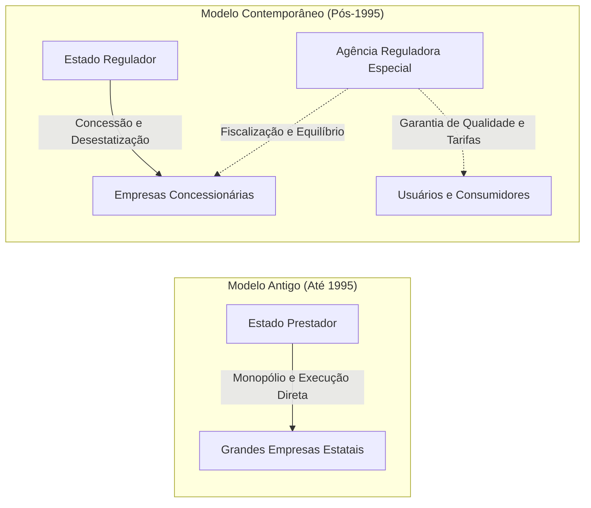
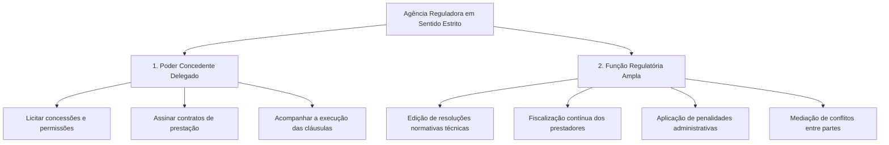
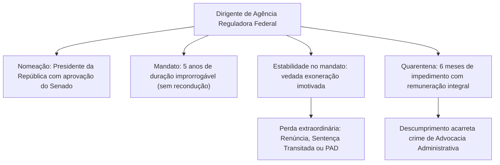
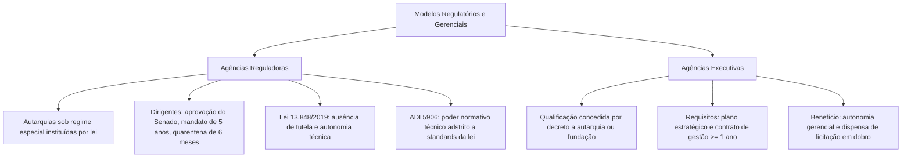

A evolução das funções do Estado exigiu novos arranjos administrativos. O modelo de prestação direta de serviços cedeu espaço ao Estado regulador. Nesse cenário, surgiram estruturas dotadas de forte capacitação técnica e maior blindagem política. Dentre essas inovações, destacam-se as autarquias sob regime especial, representadas sobretudo pelas agências reguladoras, e a qualificação de agências executivas.

Neste capítulo conclusivo, examinaremos o regime jurídico diferenciado das autarquias especiais. Estudaremos a trajetória histórica que conduziu à implantação das agências reguladoras a partir da Reforma Gerencial de 1995. Analisaremos a Lei Geral das Agências Reguladoras (Lei 13.848/2019), os poderes normativos dessas entidades, a estabilidade de seus dirigentes e as balizas fixadas pelo Supremo Tribunal Federal. Por fim, abordaremos a qualificação das agências executivas mediante contrato de gestão.

> [!objetivos]
> - Diferenciar autarquias comuns de autarquias sob regime especial.
> - Conhecer o histórico, as funções e o rol das onze agências reguladoras federais.
> - Dominar o estatuto dos dirigentes reguladores: indicação, sabatina no Senado, mandato fixo e quarentena.
> - Compreender a natureza jurídica e os requisitos de qualificação das agências executivas na Lei 9.649/1998.
> - Analisar a jurisprudência consolidada do STF sobre os limites normativos das agências e a publicidade dos processos sancionadores.

## Autarquias sob regime especial

A doutrina divide as autarquias em duas categorias. Temos as **autarquias comuns** e as **autarquias sob regime especial**.

Segundo José dos Santos Carvalho Filho, as autarquias comuns submetem-se ao regime geral do direito público sem traços extravagantes. Já as **autarquias sob regime especial** recebem da própria lei de criação privilégios e garantias reforçadas. O objetivo é assegurar maior autonomia decisória, funcional e financeira. Essa blindagem protege a atuação técnica da entidade contra pressões políticas conjunturais.

No direito brasileiro, encontramos diversos exemplos de autarquias em regime especial:

- As **agências reguladoras**, encarregadas de disciplinar e fiscalizar setores econômicos e serviços públicos delegados.
- O **Banco Central do Brasil**, autarquia federal dotada de autonomia técnica e diretoria com mandato fixo, nos termos da Lei Complementar 179/2021.
- As **universidades públicas**, que desfrutam de autonomia didático-científica, administrativa e financeira outorgada pelo art. 207 da Constituição Federal.
- Os conselhos de fiscalização profissional, em razão de sua singular estrutura corporativa e regime híbrido.

Marcelo Alexandrino e Vicente Paulo alertam que a expressão "regime especial" deve ser compreendida com exatidão. Toda autarquia comum já possui personalidade jurídica de direito público. Toda autarquia tem patrimônio próprio e atua sem subordinação hierárquica à Administração Direta. Portanto, o elemento verdadeiramente distintivo do regime especial repousa no **mandato a termo dos dirigentes com estabilidade temporária** e no **poder normativo técnico especializado**.

## Agências reguladoras: origem, evolução e marco legal

As agências reguladoras surgiram nos Estados Unidos no fim do século XIX. O marco inicial foi a *Interstate Commerce Commission* (ICC), criada em 1887 para fiscalizar o transporte ferroviário interestadual. No modelo norte-americano, essas entidades nasceram como comissões independentes para equilibrar mercados de infraestrutura.

No Brasil, a implantação do modelo regulatório moderno deu-se a partir de 1995. O movimento integrou a **Reforma do Aparelho do Estado**, estruturada pelo Plano Diretor da Reforma do Aparelho do Estado (PDRAE).

Durante décadas, o Estado brasileiro atuou como produtor direto de bens e prestador monopolista de serviços. Administrava setores inteiros por meio de empresas estatais nas áreas de telecomunicações, eletricidade, transportes e petróleo. Com a reforma dos anos 1990, o Poder Público transferiu a prestação dessas atividades para a iniciativa privada. A transferência deu-se mediante contratos de concessão e permissão de serviços públicos.

Contudo, a desestatização exigia salvaguardas. Era imperativo evitar abusos econômicos, resguardar os usuários, assegurar tarifas módicas e manter a expansão dos serviços com qualidade. Para alcançar esse equilíbrio, o Estado instituiu entidades técnicas especializadas. Surgiram assim as agências reguladoras federais.

### O rol das agências reguladoras federais

No âmbito da União, a Lei 13.848/2019 (Lei Geral das Agências Reguladoras) relacionou formalmente em seu art. 2º as **onze agências reguladoras federais**.

A primeira agência reguladora federal instituída no país foi a **Agência Nacional de Energia Elétrica (Aneel)**. Sua criação deu-se por meio da Lei 9.427, de 26 de dezembro de 1996.

> [!atencao] Agências com previsão na Constituição Federal
> Apenas duas agências reguladoras federais possuem matriz explícita no texto da Constituição de 1988:
> - A **Anatel** (telecomunicações), prevista no art. 21, XI, da Carta Política, dispositivo incluído pela Emenda Constitucional 8/1995.
> - A **ANP** (petróleo, gás natural e biocombustíveis), expressamente contemplada no art. 177, § 2º, III, da Constituição, incluído pela Emenda Constitucional 9/1995.
> As demais agências federais possuem criação e disciplina puramente infraconstitucional.

A tabela a seguir apresenta as onze agências federais, seus setores de atuação e respectivos diplomas de criação:

| Agência reguladora | Setor de atuação | Norma de criação | Previsão constitucional |
| --- | --- | --- | --- |
| **Aneel** | Energia elétrica | Lei 9.427/1996 | Infraconstitucional |
| **Anatel** | Serviços de telecomunicações | Lei 9.472/1997 | CF, art. 21, XI |
| **ANP** | Petróleo, gás natural e biocombustíveis | Lei 9.478/1997 | CF, art. 177, § 2º, III |
| **Anvisa** | Vigilância sanitária e medicamentos | Lei 9.782/1999 | Infraconstitucional |
| **ANS** | Saúde suplementar e planos privados | Lei 9.961/2000 | Infraconstitucional |
| **ANA** | Gestão de recursos hídricos e saneamento | Lei 9.984/2000 | Infraconstitucional |
| **ANTT** | Transportes terrestres (rodovias e ferrovias) | Lei 10.233/2001 | Infraconstitucional |
| **Antaq** | Transportes aquaviários e navegação | Lei 10.233/2001 | Infraconstitucional |
| **Ancine** | Cinema e mercado audiovisual | Medida Provisória 2.228-1/2001 | Infraconstitucional |
| **Anac** | Aviação civil e infraestrutura aeroportuária | Lei 11.182/2005 | Infraconstitucional |
| **ANM** | Exploração mineral e recursos minerais | Lei 13.575/2017 | Infraconstitucional |

Estados e municípios também podem instituir suas próprias agências reguladoras para fiscalizar concessões locais. No Estado de Pernambuco, a **Agência de Regulação dos Serviços Públicos Delegados do Estado de Pernambuco (ARPE)** atua no saneamento, no gás canalizado e no transporte intermunicipal de passageiros.

## Funções e o conceito estrito de agência reguladora

Para delimitar as competências dessas entidades, Maria Sylvia Zanella Di Pietro estabelece uma clássica distinção doutrinária:

- **Conceito amplo**: engloba qualquer órgão ou entidade estatal que exerça regulação e fiscalização sobre determinada matéria setorial. Sob essa ótica ampla, incluem-se o Banco Central do Brasil, a Comissão de Valores Mobiliários (CVM) e o Conselho Administrativo de Defesa Econômica (Cade).
- **Conceito estrito**: restringe-se às **autarquias sob regime especial**, criadas por lei formal com atribuição técnica regulatória, dirigidas por colegiado com **mandato fixo**, vedada exoneração imotivada, e **expressamente nominadas em lei como agências reguladoras**.

Nas provas de concurso público, utiliza-se sempre o **conceito estrito**. Por isso, Banco Central e CVM não são qualificados como agências reguladoras em sentido técnico, embora desempenhem funções de regulação monetária e mobiliária.

Na prática administrativa, as agências exercem dois tipos fundamentais de missão:

1. **Agências de serviços públicos delegados**: fiscalizam contratos de concessão e asseguram o equilíbrio econômico-financeiro dos ajustes (Anatel, Aneel, ANTT, Antaq).
2. **Agências de poder de polícia administrativa**: exercem fiscalização e controle sobre condutas privadas em áreas de interesse social, sem delegação contratual de serviços públicos (Anvisa e ANS).

### O combate à teoria da captura e os instrumentos de controle social

Um dos riscos mais graves enfrentados pelos órgãos de regulação é a denominada **teoria da captura**. Formulada pela economia política e estudada pelo direito administrativo, a captura ocorre quando a agência reguladora, em vez de defender o interesse público e os direitos dos usuários, passa a atuar subordinada aos interesses econômicos das grandes empresas concessionárias por ela fiscalizadas.

Para neutralizar esse risco e preservar a imparcialidade estatal, a Lei 13.848/2019 instituiu mecanismos cogentes de governança e transparência:

- **Análise de Impacto Regulatório (AIR)**: as agências federais são obrigadas a elaborar estudo prévio de AIR antes da edição de resoluções e normas de caráter geral. O estudo avalia os custos, os impactos econômicos e a viabilidade da medida regulatória sobre o mercado e a sociedade.
- **Consultas e audiências públicas**: a edição e a alteração de normas regulatórias devem ser antecedidas de consulta pública aberta a todos os cidadãos, assegurando manifestação de usuários, especialistas e associações de defesa do consumidor.
- **Sessões deliberativas públicas**: as reuniões colegiadas da diretoria da agência para deliberação de normas e processos contenciosos devem ser obrigatoriamente gravadas e abertas ao público, com atas disponibilizadas na internet.

## Características das agências na Lei 13.848/2019

A Lei 13.848/2019 uniformizou os padrões de governança, transparência e autonomia das agências reguladoras federais.

O art. 3º do diploma fixa os pilares que compõem o seu regime jurídico especial:

> [!lei] Lei 13.848/2019, art. 3º
> A natureza especial conferida à agência reguladora é caracterizada pela ausência de tutela ou de subordinação hierárquica, pela autonomia funcional, decisória, administrativa e financeira e pela investidura a termo de seus dirigentes e estabilidade durante os mandatos, bem como pelas demais disposições constantes desta Lei ou de leis específicas voltadas à sua implementação.

> [!pegadinha] A literalidade da ausência de tutela na lei
> A doutrina tradicional afirma que as autarquias submetem-se à tutela administrativa ou controle finalístico da Administração Direta. Entretanto, o art. 3º da Lei 13.848/2019 consigna expressamente que a agência caracteriza-se pela **"ausência de tutela ou de subordinação hierárquica"**. Se a banca examinadora exigir a redação legal estrita, essa ausência de tutela prevista na lei deve ser apontada como correta.

A autonomia administrativa das agências federais manifesta-se em prerrogativas expressas:

- Encaminhar diretamente ao ministério supervisor pedidos de autorização para realizar concursos públicos.
- Prover cargos autorizados por lei para seu quadro permanente, segundo as dotações orçamentárias existentes.
- Conceder passagens e diárias para servidores em deslocamento a serviço, inclusive para viagens ao exterior.
- Firmar e prorrogar contratos de custeio voltados à manutenção de suas instalações, qualquer que seja o valor do ajuste.

A autonomia econômico-financeira decorre do poder de arrecadar receitas próprias. As agências instituem taxas de fiscalização cobradas periodicamente dos agentes econômicos e concessionárias dos setores regulados.

## Estatuto dos dirigentes: nomeação, mandato e quarentena

Para garantir que as decisões regulatórias sejam técnicas e imunes a oscilações eleitorais, a legislação criou um regime de proteção especial para os membros dos conselhos diretores e diretorias colegiadas.

### Procedimento de nomeação e sabatina

Os dirigentes são nomeados pelo **Presidente da República**, após sabatina e **aprovação pelo voto secreto do Senado Federal** (CF, art. 52, III, "f", c/c Lei 13.848/2019). A indicação exige reputação ilibada, formação universitária compatível e notória capacidade técnica comprovada.

A Lei 9.986/2000 estipula critérios objetivos para a indicação. O candidato deve possuir experiência profissional mínima de dez anos no setor público ou privado na área de atuação da agência, ou quatro anos em cargo de direção superior.

A legislação estabelece também vedações rigorosas para coibir interferências político-partidárias e conflitos de interesse:

- É proibida a indicação de pessoa que exerça mandato parlamentar ou cargo em partido político.
- É vedada a nomeação de dirigente partidário ou sindical que tenha atuado nessa condição nos trinta e seis meses anteriores.
- Não pode ser indicado cônjuge, companheiro ou parente até o terceiro grau de membros da diretoria ou de sócios de empresas reguladas pela agência.

### Duração do mandato e vedação de recondução

A Lei 13.848/2019 unificou o mandato dos conselheiros e diretores das agências reguladoras federais em **cinco anos**. A lei estabeleceu também que é terminantemente **vedada a recondução** para mandato sucessivo na mesma entidade. A vedação impede manobras populistas voltadas a agradar governantes para obter novo mandato.

Os mandatos da diretoria colegiada não são coincidentes. A lei adota a substituição escalonada dos membros ao longo dos anos. Esse formato evita rupturas bruscas nas políticas regulatórias da agência decorrentes da troca simultânea de toda a diretoria.

### Estabilidade a termo e perda do mandato

Ao contrário das autarquias comuns, cujos dirigentes são exonerados *ad nutum*, os diretores de agências gozam de **estabilidade a termo** durante o mandato.

A Lei 9.986/2000 elenca em seu art. 9º as únicas hipóteses em que o dirigente **perderá o mandato**:

1. Renúncia expressa apresentada por escrito.
2. Condenação judicial com trânsito em julgado.
3. Condenação em processo administrativo disciplinar (PAD), com garantia de contraditório e ampla defesa.
4. Descumprimento das vedações fixadas na Lei 9.986/2000, tais como exercer militância político-partidária ou incorrer em conflito de interesses (art. 8º-B).

A destituição arbitrária por divergência ideológica é nula de pleno direito, autorizando a anulação da exoneração na via judicial.

### Regime de quarentena pós-mandato

Findo o exercício do cargo ou formalizada a renúncia, o ex-dirigente submete-se ao instituto da **quarentena impeditiva** pelo período de **seis meses** (Lei 9.986/2000, art. 8º).

Nesse intervalo de seis meses, o ex-dirigente fica impedido de trabalhar ou prestar qualquer serviço para pessoas e empresas do setor regulado pela agência. A regra resguarda informações privilegiadas e coíbe o favorecimento indevido de grupos privados.

Para viabilizar o sustento do ex-gestor durante o impedimento, ele **continua vinculado à agência e recebe remuneração compensatória integral**, em valor equivalente ao cargo de direção ocupado. A inobservância da quarentena configura o crime de **advocacia administrativa**.

> [!bizu] Regra dos dirigentes reguladores
> Fixe para as provas:
> - **5 anos** de mandato fixo sem direito a recondução.
> - **6 meses** de quarentena impeditiva com remuneração compensatória integral.

A tabela comparativa a seguir sintetiza o regime entre autarquias comuns e agências:

| Critério funcional | Autarquias comuns (regra geral) | Agências reguladoras federais |
| --- | --- | --- |
| Escolha e investidura | Nomeação discricionária do Chefe do Executivo | Nomeação presidencial após aprovação do Senado |
| Período de investidura | Prazo indeterminado em cargo de confiança | Mandato fixo de 5 anos improrrogável |
| Regime de exoneração | Livre exoneração a qualquer tempo (*ad nutum*) | Exoneração vedada; perda apenas por PAD, sentença ou renúncia |
| Quarentena posterior | Não exigida no regime geral | Seis meses com remuneração compensatória |
| Efeito do descumprimento | Não aplicável | Tipificação penal de advocacia administrativa |

## Revisão das decisões das agências: o Parecer AGU 51/2006

As agências reguladoras detêm competência técnica especializada. Por isso, a regra geral assenta que **suas deliberações são finais na esfera administrativa**. Não cabe recurso hierárquico ordinário contra decisões técnicas da agência para o Ministério supervisor.

Contudo, a Advocacia-Geral da União delimitou exceções no **Parecer AGU 51/2006**:

1. **Avocação presidencial**: o Chefe do Poder Executivo federal, diante de fundada e relevante razão de interesse público e como autoridade máxima da administração federal (CF, art. 84, II), pode **avocar** e decidir qualquer questão administrativa, inclusive afeta a agências reguladoras.
2. **Recurso hierárquico impróprio**: admite-se extraordinariamente a interposição de **recurso hierárquico impróprio** perante o Ministro supervisor. Essa via só é admitida quando a decisão da agência **extrapolar seus fins estatutários ou violar expressamente as diretrizes da política pública governamental** definida para o setor. Se a decisão técnica da agência for harmônica com as diretrizes da política do setor, o recurso não pode ser acolhido.

## Agências executivas

O termo **agência executiva** foi criado na Reforma Administrativa de 1995 para denominar um modelo voltado à superação da burocracia e ao alcance de resultados.

É indispensável compreender que **a agência executiva não constitui uma nova espécie de entidade da Administração Indireta**. Não se trata de pessoa jurídica criada com essa denominação. Cuida-se de uma **qualificação jurídica especial** atribuída discricionariamente pelo Poder Executivo a uma autarquia ou fundação pública pré-existente.

> [!lei] Lei 9.649/1998, art. 51
> O Poder Executivo poderá qualificar como Agência Executiva a autarquia ou fundação que tenha cumprido os seguintes requisitos:
> I - ter um plano estratégico de reestruturação e de desenvolvimento institucional em andamento;
> II - ter celebrado Contrato de Gestão com o respectivo Ministério supervisor.
> § 1º A qualificação como Agência Executiva será feita em ato do Presidente da República.

### Requisitos para a qualificação

Para que uma autarquia ou fundação pública receba o título de agência executiva, exige-se a demonstração de dois requisitos materiais cumulativos:

1. **Plano estratégico em andamento**: a entidade deve estar implantando um plano estratégico de reestruturação institucional. O plano busca aperfeiçoar processos, enxugar despesas e qualificar os recursos humanos (Lei 9.649/1998, art. 52).
2. **Contrato de Gestão firmado**: deve celebrar com o respectivo ministério supervisor o **contrato de gestão** (ou contrato de desempenho, respaldado no art. 37, § 8º, da CF). O ajuste tem **periodicidade mínima de um ano**, estipulando metas concretas, indicadores de produtividade e critérios de controle.

### Concessão por decreto e discricionariedade

Atendidos os dois requisitos legais, a concessão da qualificação formaliza-se por **decreto do Presidente da República**.

A concessão ostenta natureza **discricionária**: a lei assenta que o Poder Executivo "poderá qualificar". Logo, o Chefe do Executivo examina a oportunidade da medida. Trata-se de qualificação essencialmente transitória. Se a entidade descumprir as metas pactuadas no contrato de gestão, o Presidente pode revogar a qualificação por decreto, retornando a entidade ao regime comum.

> [!pegadinha] Agência executiva não nasce de lei
> Enunciados de prova costumam asseverar que as agências executivas são criadas diretamente por lei específica. A assertiva é falsa. A entidade é criada como autarquia ou fundação por lei formal. Já a sua qualificação como agência executiva é ato discricionário outorgado por **decreto do Chefe do Executivo**.

### Vantagens e regime licitatório diferenciado

Ao assumir o compromisso de atingir metas elevadas de produtividade, a entidade qualificada recebe maior margem de autonomia gerencial e orçamentária.

O reflexo prático mais destacado opera-se nas compras governamentais: o art. 75, § 2º, da Lei 14.133/2021 estabelece que os valores limites para a **dispensa de licitação em razão do valor são duplicados** em favor das agências executivas. A duplicação confere celeridade à gestão das contratações da entidade.

> [!exemplo] O Inmetro como agência executiva federal
> O Instituto Nacional de Metrologia, Qualidade e Tecnologia (Inmetro) constitui autarquia federal de regime comum criada por lei. Para dinamizar a modernização de seus laboratórios e o controle metrológico no território nacional, o Inmetro elaborou plano estratégico institucional e firmou contrato de gestão com o ministério supervisor, sendo subsequentemente qualificado como agência executiva por decreto presidencial. Com a qualificação, a autarquia passou a operar com autonomia de gestão reforçada e limites ampliados para dispensa licitatória.

| Aspecto estrutural | Agências Reguladoras | Agências Executivas |
| --- | --- | --- |
| Natureza jurídica | Autarquias em regime especial instituídas por lei | Qualificação jurídica outorgada a autarquias ou fundações |
| Veículo instituidor | Criadas diretamente por lei formal específica | Qualificadas por decreto discricionário do Chefe do Executivo |
| Missão primordial | Regular, normatizar e fiscalizar setores econômicos | Executar serviços públicos com foco em metas contratuais |
| Base de atuação | Lei instituidora e plano de gestão regulatório | Plano estratégico institucional e Contrato de Gestão anual |
| Regime da diretoria | Mandato de 5 anos aprovado pelo Senado Federal | Dirigentes comuns submetidos a exoneração discricionária |
| Benefício licitatório | Poder regulatório e poder de polícia técnica | Limites legais de dispensa de licitação em dobro |

## Jurisprudência consolidada em organização administrativa

O Supremo Tribunal Federal firmou teses decisivas sobre as balizas constitucionais das agências reguladoras:

### Limites do poder normativo técnico e standards legais (ADI 5906)

No julgamento da **ADI 5906**, o Supremo Tribunal Federal delimitou o alcance das resoluções normativas editadas pelas agências:

> [!jurisprudencia] STF, ADI 5906
> As agências reguladoras recebem do legislador delegação para exercer regulação técnica em setor específico, mas não podem inovar originariamente na ordem jurídica sem expressa base legal, tampouco regulamentar matérias para as quais inexista conceito ou parâmetro prévio genérico na lei instituidora (standards), sendo vedada a criação ou aplicação de sanções administrativas desprovidas de amparo legal.

O STF consolidou a teoria da **deslegalização**. A lei formal transfere a matéria para a esfera técnica da agência, fixando os parâmetros gerais (*standards* regulatórios). A agência edita os detalhes técnicos mediante atos infralegais. Contudo, é vedado à agência criar obrigações primárias, proibições inéditas ou penalidades novas sem respaldo em lei formal, sob pena de vulneração da legalidade estrita (CF, art. 37, caput).

### Publicidade dos processos sancionadores regulatórios (ADI 5371)

Na **ADI 5371**, a Suprema Corte reafirmou a obrigatoriedade da transparência republicana na atuação regulatória:

> [!jurisprudencia] STF, ADI 5371
> O Plenário da Suprema Corte fixou a tese de que os procedimentos punitivos movidos pelas agências em face de delegatárias de serviços devem submeter-se à transparência plena em todas as etapas, preservando-se apenas hipóteses constitucionais ou legais de sigilo devidamente motivadas.

Os processos sancionadores instaurados contra concessionárias interessam a toda a sociedade. Por conseguinte, a publicidade é a regra imperativa, constituindo o sigilo medida excepcional e justificada.

## Mapa do capítulo

| Categoria | Definição | Instrumento | Dirigentes | Efeito Principal |
| --- | --- | --- | --- | --- |
| Autarquia Especial | Autarquia com privilégios concedidos em sua lei | Lei ordinária específica | Dirigentes com mandato fixo na lei | Ampla autonomia e blindagem funcional |
| Agência Reguladora | Autarquia especial que disciplina setores econômicos | Lei formal (onze na União) | Sabatina no Senado e mandato de 5 anos | Poder normativo adstrito a standards da lei |
| Agência Executiva | Qualificação especial para autarquia ou fundação | Decreto do Poder Executivo | Dirigentes comuns da entidade de origem | Limites de dispensa licitatória duplicados |

### Para fixar

- Autarquias sob regime especial dispõem de maior autonomia funcional e dirigentes investidos com mandato fixo.
- Agências reguladoras são autarquias em regime especial com missão de regular e fiscalizar setores econômicos e serviços públicos.
- A União conta com onze agências reguladoras listadas na Lei 13.848/2019, figurando a Aneel como a primeira criada em 1996.
- Apenas a Anatel (CF, art. 21, XI) e a ANP (CF, art. 177, § 2º, III) possuem expressa previsão no texto da Constituição de 1988.
- Dirigentes de agências federais são nomeados pelo Presidente após sabatina do Senado, com mandato improrrogável de cinco anos.
- Na quarentena de seis meses após o mandato, o ex-dirigente não atua no setor e recebe remuneração compensatória integral.
- O art. 3º da Lei 13.848/2019 consagra formalmente a ausência de tutela e a autonomia decisória das agências federais.
- A agência executiva não é nova entidade, mas qualificação por decreto a autarquia ou fundação que tenha plano e contrato de gestão.
- O contrato de gestão de agência executiva tem prazo mínimo de um ano e duplica limites de dispensa de licitação por valor.
- Pela tese da ADI 5906 do STF, o poder normativo das agências depende de prévios standards fixados em lei, vedada sanção sem base legal.
